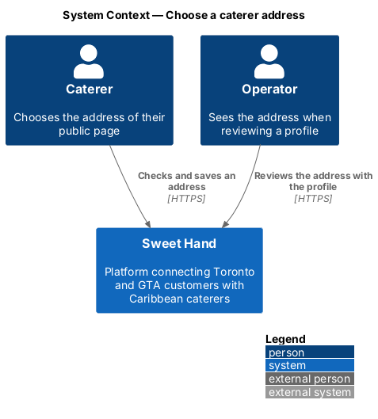
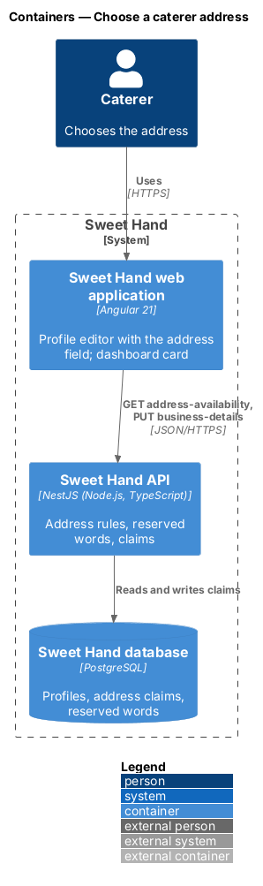
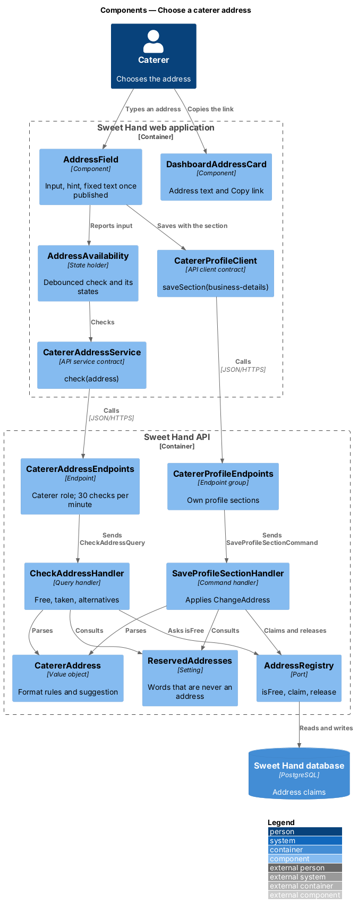
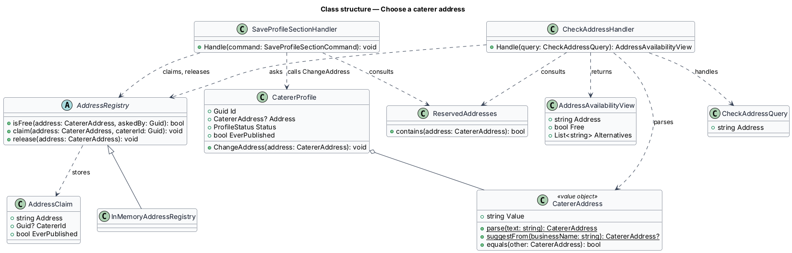
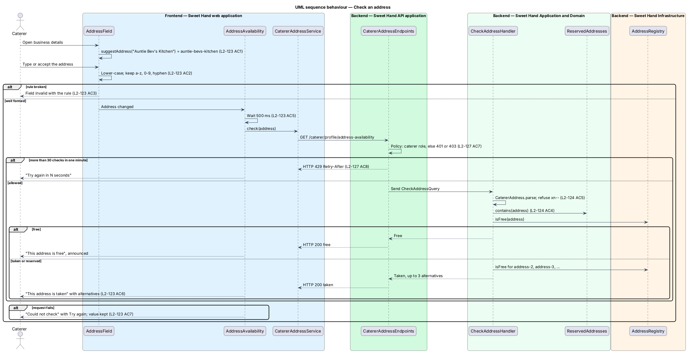
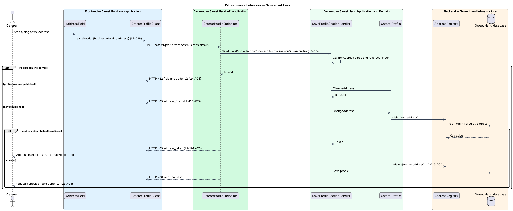

# Choose a caterer address

## Overview

Each caterer on Sweet Hand has one public web address of their own,
`https://{address}.sweethand.ca`. A caterer prints it on a card, a sticker or a
flyer, and it opens their public page once an operator has approved the profile
(`open-caterer-page-by-address`). This feature covers how the address is chosen,
how it stays unique, and when it stops changing.

> **address** — the one label a caterer holds under `sweethand.ca`, such as `auntie-bevs-kitchen`; 3 to 40 characters of `a` to `z`, `0` to `9` and the hyphen
>
> **suggestion** — address derived from the business name, shown before the caterer types anything
>
> **reserved word** — label that is never an address, such as `www`, `app` or `admin`
>
> **address claim** — record that an address is held by one caterer; it outlives the profile when the profile was ever published
>
> **ever published** — true once a profile has reached status `Published` at any time, whatever its status now

The caterer settles the address in the business details section of the profile
editor (`set-up-profile`). The editor suggests an address from the business
name, checks whether it is free while the caterer types, and offers numbered
alternatives when it is taken (`L2-123`). An address is required before a
profile can be submitted for review (`L2-039`), and the operator sees it beside
the business name in the review queue (`L2-124 AC9`).

The caterer may change the address while the profile has never been published.
From first publication the address is fixed: a business name change no longer
changes it, and no endpoint changes it for a caterer or an operator
(`L2-126`). An address that was ever live is never given to another caterer
(`L2-124 AC7`).

This design replaces the earlier slug rules. The address is the slug of
`/caterers/{slug}` (`L2-018`). The approval flow no longer derives a slug, and
an approved name change no longer creates a redirect.

## Description

Technology choices follow ADR 0001 (Angular 21) and ADR 0006 (NestJS on
Node.js, PostgreSQL); the code in `backend/` persists JSON document
collections (ADR 0008). The components below are described by role. No mock
draws the address field or the dashboard card yet; both need a mock before
implementation.

**Frontend — Sweet Hand web application**

- **`AddressField`** — field labelled "Your web address" in the business
  details section of `ProfileEditorPage`, followed by the fixed text
  `.sweethand.ca`. It lower-cases input and drops every character outside
  `a`–`z`, `0`–`9` and the hyphen (`L2-123 AC2`). A hint states that the address
  is public and cannot be changed once the profile is published
  (`L2-123 AC9`). When the profile was ever published, the field is replaced by
  plain text and a sentence that the address stays the same (`L2-126 AC2`).
- **`suggestAddress(businessName)`** — plain TypeScript function beside the
  page. It produces the suggestion of `L2-123 AC1`: lower case, accents and
  apostrophes removed, each run of other characters replaced by one hyphen,
  hyphens trimmed, cut to 40 characters. A result shorter than 3 characters
  yields an empty field and a hint to choose an address (`L2-123 AC4`). The
  server applies the same rule; the client copy exists only to fill the field.
- **`addressRuleMessage(address)`** — plain TypeScript function that returns
  the message for a broken rule: length, leading or trailing hyphen, double
  hyphen (`L2-123 AC3`).
- **`AddressAvailability`** — state holder for the check. It waits 500 ms after
  the last keystroke, calls `CatererAddressService.check`, and exposes one of
  `checking`, `free`, `taken`, `failed` or `limited`. Each state renders words
  and an icon in a live region (`L2-123 AC5`). `taken` lists up to 3 free
  alternatives as buttons that fill the field (`L2-123 AC6`). `failed` offers
  "Try again" and keeps the typed value (`L2-123 AC7`). `limited` shows when
  the next check is allowed (`L2-127 AC8`).
- **`SetupChecklist`** — gains the item "Choose your web address"
  (`L2-123 AC8`).
- **`DashboardAddressCard`** — shows the address as text on the caterer
  dashboard with a "Copy link" action that reads "Copied" for 3 seconds. Before
  publication it states that the address opens once the profile is approved
  (`L2-123 AC10`). The text wraps at viewport XS (`L2-123 AC11`).
- **`CatererAddressService`** — abstract service in `@sweet-hand/api` with
  `check(address)`; `HttpCatererAddressService` implements it. Saving uses the
  existing `saveSection('business-details', values)` of `CatererProfileClient`,
  whose values gain `address`.

**Backend — Sweet Hand API application**

- **`CatererAddressEndpoints`** —
  `GET /caterer/profile/address-availability?address={address}` returns
  `AddressAvailabilityView`. The endpoint policy allows the caterer role only,
  so a visitor receives HTTP 401 and a customer HTTP 403 (`L2-127 AC7`). A rate
  limit of 30 checks per caterer per minute answers HTTP 429 with
  `Retry-After` (`L2-127 AC8`).
- **`CatererProfileEndpoints`** —
  `PUT /caterer/profile/sections/business-details` accepts `address`. A broken
  rule answers HTTP 422 with the field name and a `code` (`L2-124 AC6`). A lost
  race answers HTTP 409 with `code` `address_taken` (`L2-124 AC3`). A change
  after first publication is refused with HTTP 409 and `code`
  `address_fixed` (`L2-126 AC3`).

**Backend — Sweet Hand Application and Domain**

- **`CatererAddress`** — value object. `parse(text)` lower-cases the text and
  applies the rules of `L2-123 AC3` and the `xn--` rule of `L2-124 AC5`.
  `suggestFrom(businessName)` applies `L2-123 AC1`. Two addresses that differ
  only in capitals are equal (`L2-124 AC1`).
- **`ReservedAddresses`** — the reserved words of `L2-124 AC4`, read from a
  settings document so the list grows without a release. A reserved word
  answers as taken.
- **`AddressRegistry`** — port with `isFree(address)`, `claim(address,
  catererId)` and `release(address)`. `claim` succeeds for exactly one of two
  concurrent requests (`L2-124 AC3`).
- **`CheckAddressQuery`** / **`CheckAddressHandler`** — parses the address,
  consults `ReservedAddresses` and `AddressRegistry`, and for a taken address
  returns up to 3 free alternatives of the form `{address}-2`, `{address}-3`
  (`L2-123 AC6`). An address already held by the asking caterer is free.
- **`CatererProfile.ChangeAddress`** — applied by `SaveProfileSectionHandler`.
  It refuses when the profile was ever published (`L2-126 AC3`). Otherwise it
  claims the new address, releases the former one (`L2-126 AC1`) and marks the
  checklist item done.
- **`ProfileSubmissionRules`** — gains the rule "address set and free"
  (`L2-039`).
- **`ApproveProfileHandler`** — no longer calls `SlugGenerator`; the profile
  already holds its address. `ApproveNameChangeHandler` leaves the address
  unchanged and creates no redirect (`L2-126 AC4`).
- **`DeleteAccountHandler`** (privacy subsystem) — releases the address of a
  profile that was never published and keeps the claim of one that was
  (`L2-124 AC7`, `AC8`).
- **`ReviewQueueItemView`** (moderation subsystem) — gains `address`, shown
  beside the business name (`L2-124 AC9`).

**Backend — Sweet Hand Infrastructure**

- **`AddressClaim`** — document keyed by the lower-case address: `address`,
  `catererId`, `everPublished`. The key gives the uniqueness that `claim`
  relies on. A retained claim holds no personal information after account
  deletion; `catererId` is cleared.
- **`InMemoryAddressRegistry`** and the PostgreSQL implementation — the two
  adapters of `AddressRegistry`.

**Existing data.** The `slug` of each existing caterer becomes its address and
its claim. `previousSlugs` and `SlugRedirect` are removed; no production
caterer exists before launch, so no live URL is lost.

**Open points**

- Transliteration of non-Latin business names is not attempted; the caterer
  types an address (`L2-123 AC4`).
- Where an operator edits the reserved word list is `<TO SUPPLY>`.

## Requirements

The feature realizes the following level-2 (L2) requirements from
`docs/specs/L2.md`. Each refines the level-1 (L1) requirement cited beside it.
Requirement text is quoted from the specification, with *must* rendered as
*shall*.

| L2 ID | Refines (L1) | Requirement |
|-------|--------------|-------------|
| `L2-039` | `L1-011` | A profile can be submitted for approval only when all of the following are true: email verified; business name set; address set and free (L2-123, L2-124); description 50–2,000 characters; 1–5 cuisines with one primary; at least 1 service area with one primary; guest range set; at least 1 occasion; 3 to 30 photos, each with a caption, one marked as cover; 3 to 50 menu items; a valid food handler certificate. |
| `L2-123` | `L1-028` | Profile setup settles the caterer's address, `https://{address}.sweethand.ca`. The address is suggested from the business name, so most caterers never type it. |
| `L2-124` | `L1-028` | No two caterers share an address, and some words are never an address. |
| `L2-126` | `L1-028` | A printed card, a sticker and a saved link shall keep working for as long as the caterer is on Sweet Hand. |
| `L2-127` | `L1-021` | An address per caterer shall not weaken a person's session or the security of the application. |

This feature realizes the address rule of `L2-039` and criteria 7 and 8 of
`L2-127`. The remaining criteria of `L2-127` belong to
`open-caterer-page-by-address`.

## Diagrams

### System context

A caterer chooses the address. An operator sees it during review.

### Containers

The web application checks and saves the address through the Sweet Hand API,
which keeps address claims in the Sweet Hand database.

### Components

`AddressField` drives `AddressAvailability`, which calls the availability
endpoint. `CheckAddressHandler` and `SaveProfileSectionHandler` share
`CatererAddress`, `ReservedAddresses` and `AddressRegistry`.

### Class structure

`CatererAddress` holds the format rules. `AddressRegistry` holds uniqueness.
`CatererProfile` holds the rule that the address is fixed once the profile was
ever published.

### Behaviour — check an address

The field waits 500 ms, then asks whether the address is free. The answer is
free, taken with alternatives, a rule error or a rate limit.

### Behaviour — save an address

The section save claims the address. A concurrent claim loses with HTTP 409,
and a profile that was ever published refuses the change.

