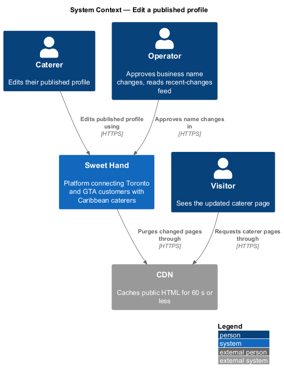
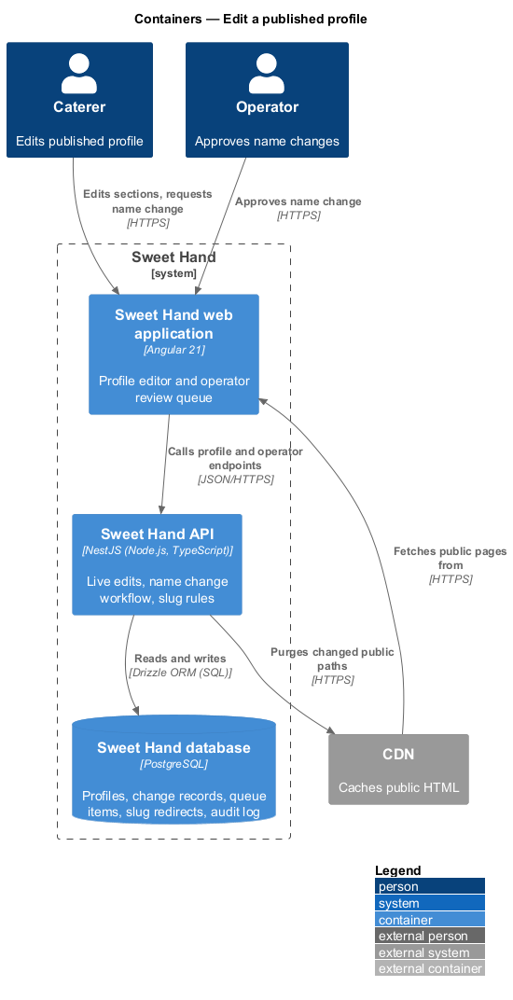
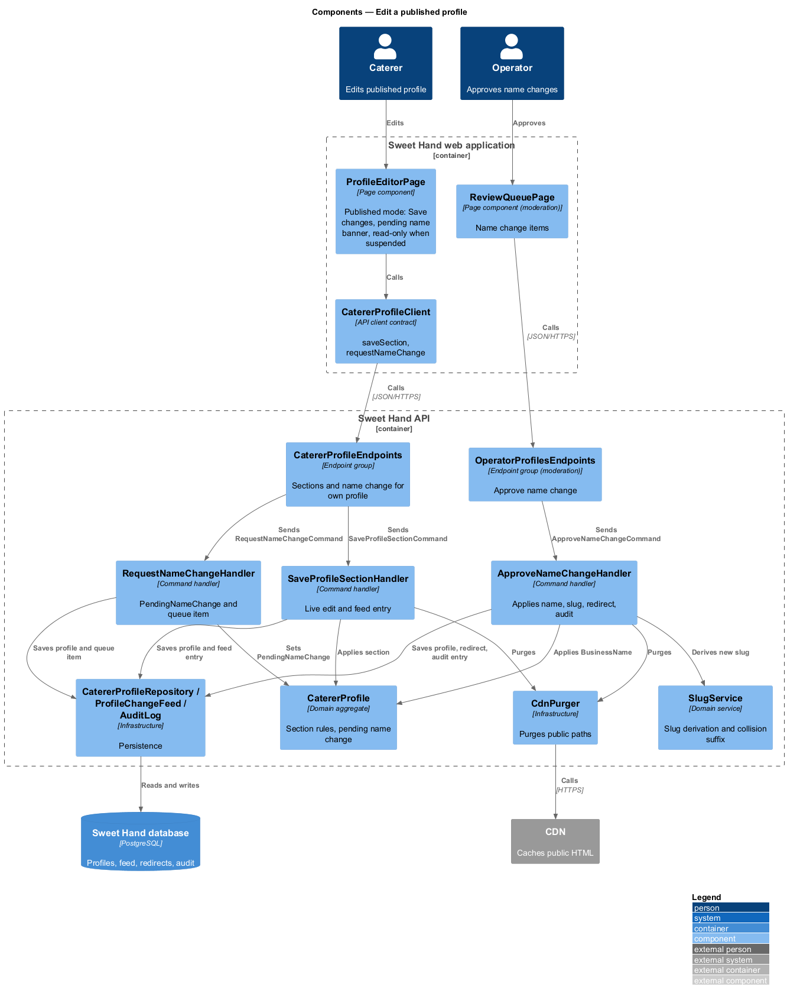
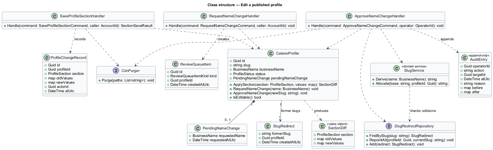
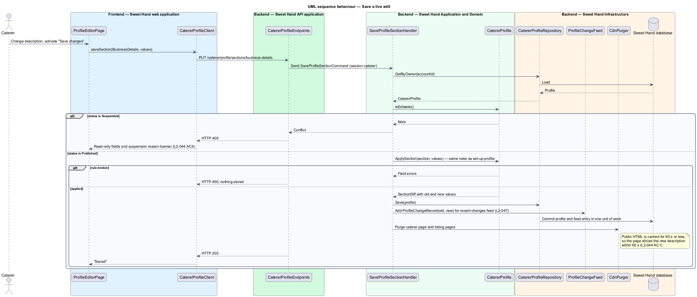
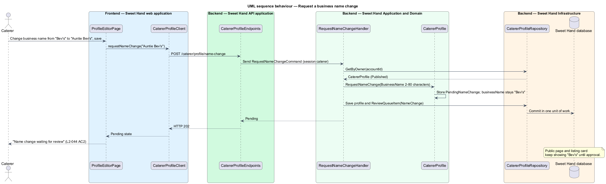
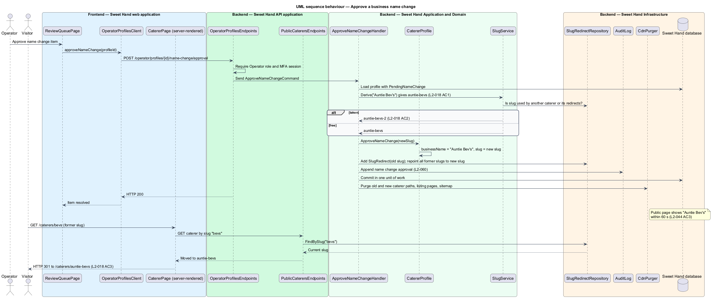

# Edit a published profile

## Overview

Once an operator approves a caterer profile, it is `Published` and visible to
everyone. Caterers keep their pages current — a new dish, a new area, a
different cover photo — without going back through the full review. This
feature covers those edits and the one exception: a change of business name,
which needs operator approval again because the name identifies the business
and forms the page's address.

**published edit** — change to a `Published` profile's description, cuisines, service areas, guest range, occasions, photos or menu, which goes live straight away

**recent-changes feed** — operator list of edits to published profiles from the last 30 days, each with old and new values and a "Revert" action (L2-047 AC4)

**pending name change** — requested new business name that waits for operator approval while the old name stays live

**slug** — readable, URL-safe form of the business name used in the caterer page address `/caterers/{slug}`

**slug redirect** — record that sends requests for a former slug to the current one with HTTP 301

A published edit reaches the public page within 60 seconds and is recorded in
the recent-changes feed so operators can check it after the fact. A business
name change shows "Name change waiting for review" to the caterer and enters
the operator review queue. When an operator approves it, the new name goes
live, the slug changes, and the old address redirects to the new one. A
`Suspended` profile cannot be edited.

## Description

Technology choices follow ADR 0001 (Angular 21) and ADR 0006 (NestJS on
Node.js, PostgreSQL through Drizzle ORM, S3-compatible object storage);
providers not named there remain `<TO SUPPLY>`.

Frontend (Sweet Hand web application):

- **`ProfileEditorPage`** (published mode) — the same editor as
  `set-up-profile`. For a `Published` profile each section has an explicit
  "Save changes" action instead of draft autosave, because every save goes
  live. It shows "Name change waiting for review" while a name change is
  pending (L2-044 AC2). For a `Suspended` profile every field is read-only and
  a banner shows the suspension reason (L2-044 AC4).
- **`CatererProfileClient`** — API client contract shared with
  `set-up-profile`: `saveSection(section, values)`, `requestNameChange(name)`.

Backend (Sweet Hand API):

- **`CatererProfileEndpoints`** — the section endpoint
  `PUT /caterer/profile/sections/{section}` and
  `POST /caterer/profile/name-change`, both resolving the profile from the
  session's caterer account.
- **`SaveProfileSectionHandler`** — for a `Published` profile it applies the
  section through `CatererProfile` (the same rules as `set-up-profile`),
  records a `ProfileChangeRecord` with old and new values for the
  recent-changes feed, and asks `CdnPurger` to purge the caterer page and
  listing pages (L2-044 AC1). A `Suspended` profile is rejected with HTTP 409.
  Photo and menu changes follow `manage-photos` and `manage-menu` and record
  feed entries the same way.
- **`RequestNameChangeHandler`** — stores a `PendingNameChange` on the profile
  and adds a `ReviewQueueItem` of kind `NameChange`. The public business name
  does not change (L2-044 AC2).
- **`ApproveNameChangeHandler`** — invoked from the operator review queue
  (`moderation` subsystem). It applies the new `BusinessName`, asks
  `SlugService` for a new slug, adds a `SlugRedirect` from every former slug to
  the new one, records the decision in the audit log (L2-060), and purges the
  CDN so the page shows the new name within 60 seconds (L2-044 AC3).
- **`SlugService`** — derives a slug from a business name: lower case,
  apostrophes removed, every other run of non-alphanumeric characters replaced
  by one hyphen, leading and trailing hyphens removed. "Auntie Bev's Kitchen"
  becomes `auntie-bevs-kitchen` (L2-018 AC1). When the slug is taken by another
  caterer or held as another caterer's redirect, it appends `-2`, `-3` and so
  on (L2-018 AC2). The same service assigns the first slug when a profile is
  first published.
- **`SlugRedirect`** — maps a former slug to a caterer. Requests for a former
  slug receive HTTP 301 to `/caterers/{current slug}` (L2-018 AC3). Every
  redirect points at the current slug, so a chain of renames never produces
  more than one hop.
- **`ProfileChangeRecord`** — feed entry: profile id, section, old values, new
  values, time, actor.
- **`CdnPurger`** — purges affected public paths. Public HTML is cacheable for
  60 seconds or less (L2-087 AC4), so the 60-second visibility rules hold even
  when a purge fails.

Open points:

- Handling of a second name change while one is still pending is
  `<TO SUPPLY>`.
- Transliteration of accented letters in slugs is `<TO SUPPLY>`.
- Whether a former slug stays reserved for its caterer indefinitely is
  `<TO SUPPLY>`; the design keeps it reserved so redirects stay stable.

## Requirements

The feature realizes the following level-2 (L2) requirements from
`docs/specs/L2.md`. Each refines the level-1 (L1) requirement cited beside it.
Requirement text is quoted from the specification, with *must* rendered as
*shall*.

| L2 ID | Refines (L1) | Requirement |
|-------|--------------|-------------|
| `L2-044` | `L1-012` | A published caterer shall be able to edit their description, cuisines, service areas, guest range, occasions, photos and menu. These edits go live straight away and are added to the operator's recent-changes feed (L2-047). A change to the business name needs operator approval again: the old name stays live until the new one is approved. |
| `L2-018` | `L1-006` | Each caterer page shall have a stable, readable URL of the form `/caterers/{slug}`, where the slug comes from the business name. Pages shall be rendered on the server and include metadata for search engines and link previews. |

This feature realizes the slug rules of `L2-018` (AC1 to AC3). Server
rendering, metadata, status responses and the sitemap (AC4 to AC6) belong to
the `discovery` subsystem.

## Diagrams

### System context

The caterer edits the published profile and an operator approves name changes.
Sweet Hand purges the CDN so visitors see changes within 60 seconds.

### Containers

The web application sends edits to the Sweet Hand API, which writes the
profile, feed entries, queue items and redirects to the Sweet Hand database and
purges the CDN.

### Components

`SaveProfileSectionHandler` applies live edits and records feed entries.
`RequestNameChangeHandler` queues a name change, and `ApproveNameChangeHandler`
applies it with `SlugService`.

### Class structure

`CatererProfile` holds a `PendingNameChange` and its `SlugRedirect` records.
`ProfileChangeRecord` captures each live edit for the recent-changes feed.

### Behaviour — save a live edit

An edit to a published profile is applied, recorded in the recent-changes feed
and pushed to the public page within 60 seconds. A suspended profile is
refused.

### Behaviour — request a business name change

The new name waits for review. The public page keeps the old name, and the
caterer sees that the change is pending.

### Behaviour — approve a business name change

An operator approves the change. The new name and slug go live, and the old
address redirects with HTTP 301.

