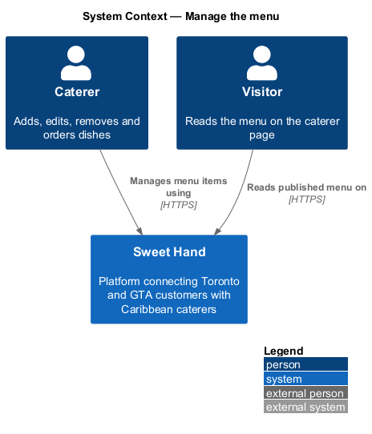
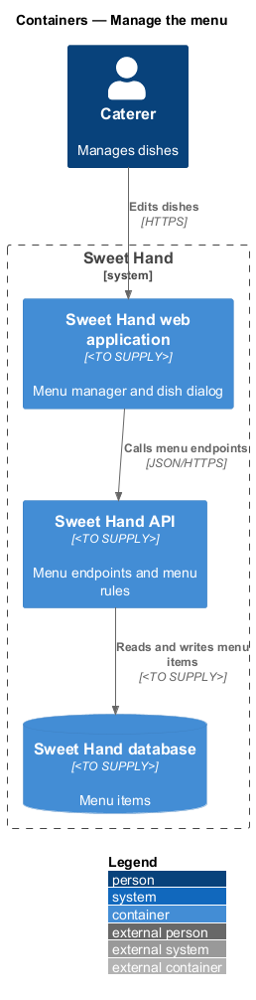
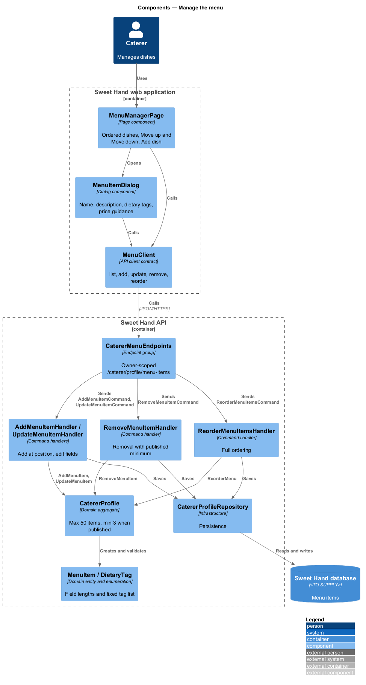
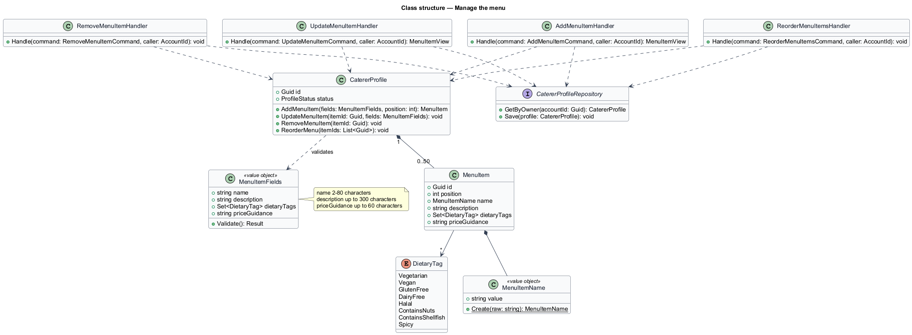
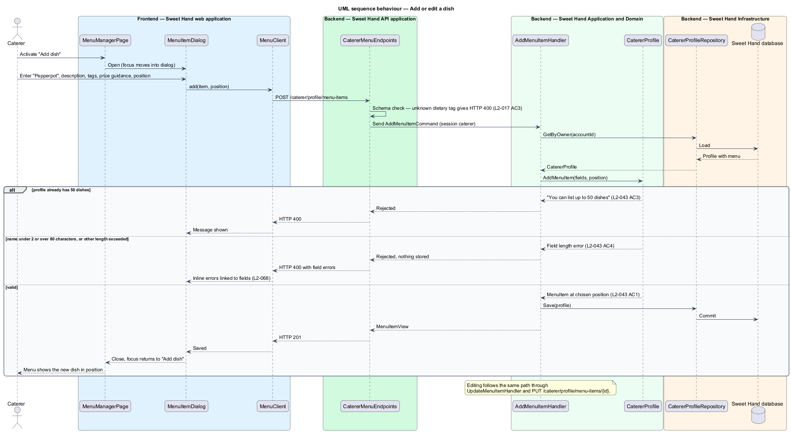
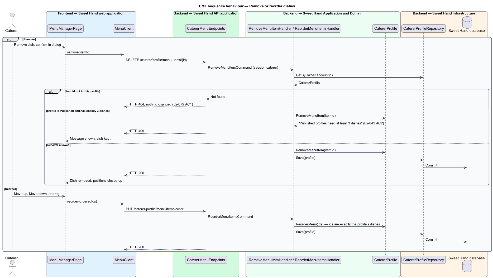

# Manage the menu

## Overview

Customers choose a caterer partly by what they cook. This feature lets a
caterer keep a menu of dishes — or sample dishes — on their profile: add, edit,
remove and reorder items, and describe each with structured dietary tags and
optional price guidance.

**menu item** — one dish on a caterer's menu, with a name and optional description, dietary tags and price guidance

**dietary tag** — value from a fixed list that marks a dish's dietary properties or allergens

**price guidance** — short free-text indication of price written by the caterer, such as "From $18 per person"

Dietary tags are structured data, not free text, so that the caterer page and
later features can rely on them. The fixed list is Vegetarian, Vegan,
Gluten-free, Dairy-free, Halal, Contains nuts, Contains shellfish and Spicy
(L2-017). A profile holds 3 to 50 menu items for submission (L2-039), and a
`Published` profile keeps at least 3. For a `Published` profile, menu changes
go live straight away and appear in the operator's recent-changes feed, as
`edit-published-profile` describes. Display of the menu on the caterer page
belongs to the `discovery` subsystem.

## Description

Technology choices for every component below are `<TO SUPPLY>` pending
architecture decision records in `docs/adr/`.

Frontend (Sweet Hand web application):

- **`MenuManagerPage`** — screen listing the caterer's dishes in order, with
  "Move up" and "Move down" controls on every viewport and drag-and-drop on
  wider viewports. It works at viewport XS without horizontal scrolling
  (L2-045). At 50 dishes the "Add dish" control is disabled with "You can list
  up to 50 dishes" (L2-043 AC3).
- **`MenuItemDialog`** — accessible dialog for adding or editing a dish: name,
  description, a checkbox group of dietary tags, price guidance, and the
  position for a new dish. Editing never happens inline on the page.
- **`MenuClient`** — API client contract: `list()`, `add(item, position)`,
  `update(itemId, item)`, `remove(itemId)`, `reorder(itemIds)`.

Backend (Sweet Hand API):

- **`CatererMenuEndpoints`** — owner-scoped endpoints under
  `/caterer/profile/menu-items`. A menu item id that does not belong to the
  session's profile returns not found (HTTP 404) and changes nothing
  (L2-079 AC1).
- **`AddMenuItemHandler`** — adds a dish at the chosen position (L2-043 AC1).
- **`UpdateMenuItemHandler`** — replaces a dish's fields.
- **`RemoveMenuItemHandler`** — removes a dish. A `Published` profile with
  exactly 3 dishes blocks removal with "Published profiles need at least 3
  dishes" (L2-043 AC2).
- **`ReorderMenuItemsHandler`** — saves a full ordering of the profile's dish
  ids.
- **`CatererProfile`** (menu methods) — `AddMenuItem`, `UpdateMenuItem`,
  `RemoveMenuItem`, `ReorderMenu`. The aggregate enforces the 50-item maximum
  and the published minimum of 3.
- **`MenuItem`** — entity with `MenuItemName` (2 to 80 characters; length
  errors shown inline, L2-043 AC4), optional `description` (up to 300
  characters), a set of `DietaryTag`, optional `priceGuidance` (up to 60
  characters) and `position`.
- **`DietaryTag`** — fixed enumeration. A value outside the list fails request
  validation with HTTP 400 (L2-017 AC3, L2-080).
- All text is stored as given and rendered as literal text (L2-080 AC1).

Open points:

- Whether price guidance stays free text or becomes a structured amount in CAD
  with a unit is `<TO SUPPLY>`.

## Requirements

The feature realizes the following level-2 (L2) requirements from
`docs/specs/L2.md`. Each refines the level-1 (L1) requirement cited beside it.
Requirement text is quoted from the specification, with *must* rendered as
*shall*.

| L2 ID | Refines (L1) | Requirement |
|-------|--------------|-------------|
| `L2-043` | `L1-012` | A caterer shall be able to add, edit, remove and reorder menu items. Each item has a name (2–80 characters), an optional description (up to 300 characters), optional dietary tags (L2-017) and optional price guidance (up to 60 characters). A profile can have 3 to 50 items. |
| `L2-017` | `L1-006` | The caterer page shall list the caterer's menu items. Each item shows a name, an optional description, optional dietary tags and optional price guidance. |

This feature realizes the menu item model and the fixed dietary tag list of
`L2-017`. The caterer page display of `L2-017` belongs to the `discovery`
subsystem.

## Diagrams

### System context

The caterer manages menu items in Sweet Hand. Visitors later read the menu on
the caterer page.

### Containers

The web application calls owner-scoped menu endpoints on the Sweet Hand API,
which stores menu items in the Sweet Hand database.

### Components

`MenuManagerPage` and `MenuItemDialog` depend on the `MenuClient` contract.
`CatererMenuEndpoints` dispatches to one handler per action, and each handler
applies the change through `CatererProfile`.

### Class structure

`CatererProfile` owns an ordered list of up to 50 `MenuItem` entities. Each
item holds a `MenuItemName` and a set of `DietaryTag` values.

### Behaviour — add or edit a dish

The dialog sends the dish to the API. The aggregate checks lengths, tags and
the 50-item maximum before saving.

### Behaviour — remove or reorder dishes

Removal is blocked when a published profile would drop below 3 dishes.
Reordering saves the full order in one request.

