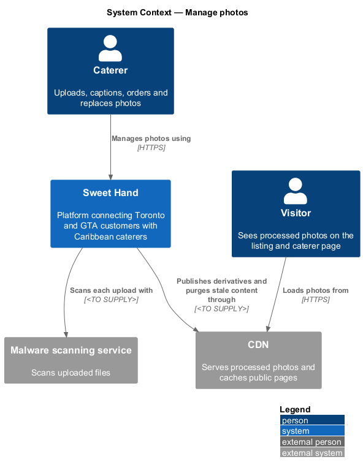
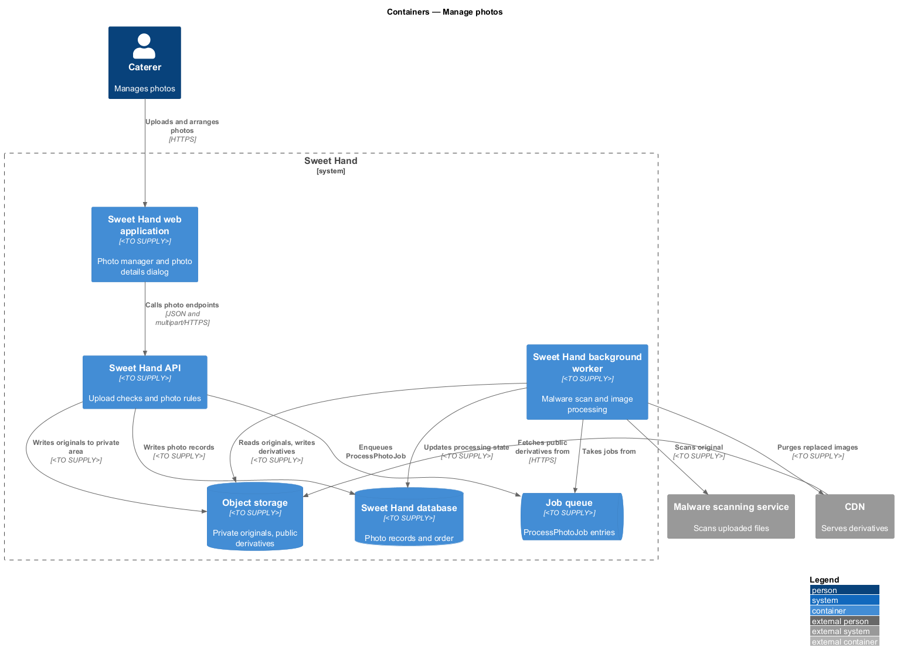
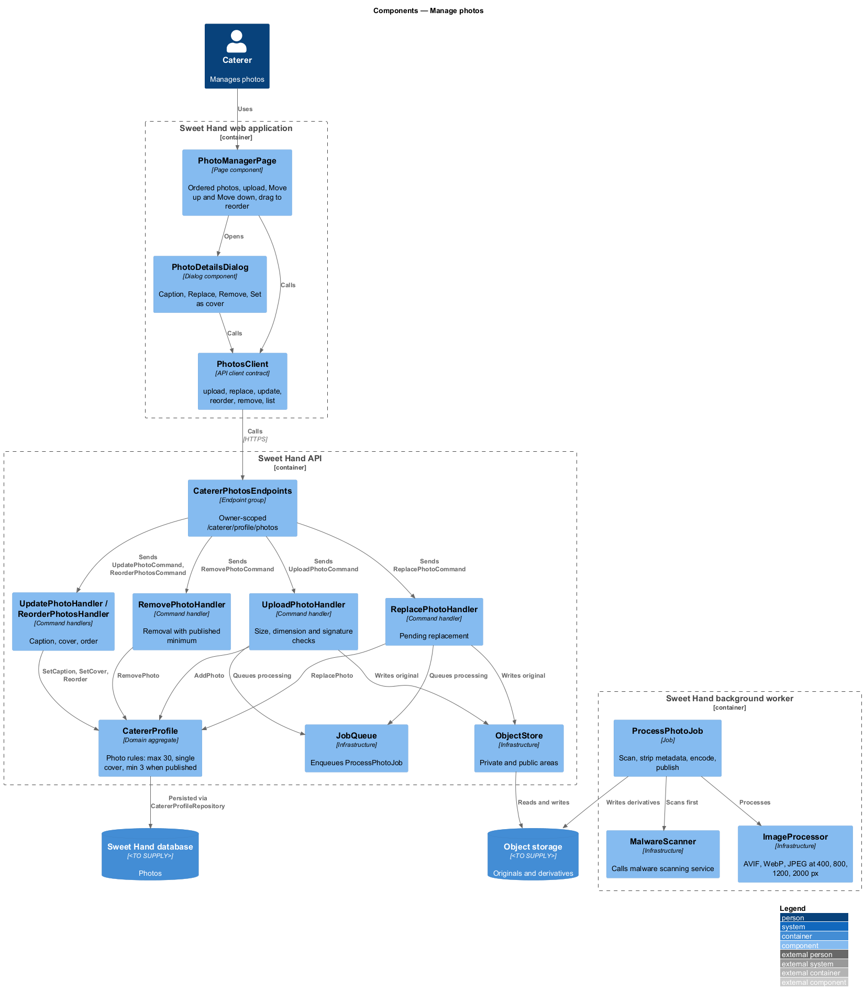
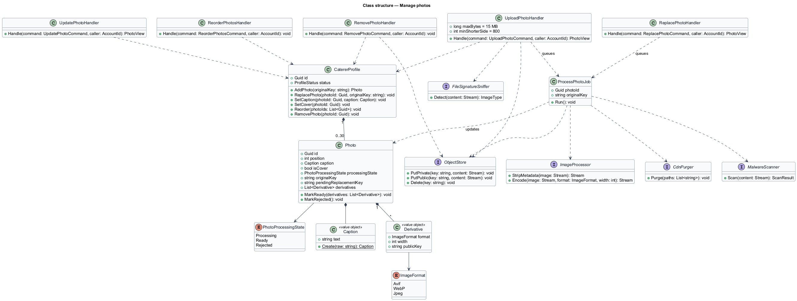
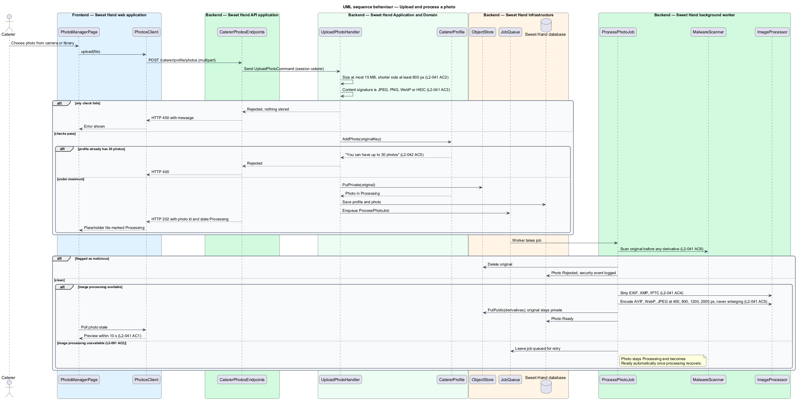
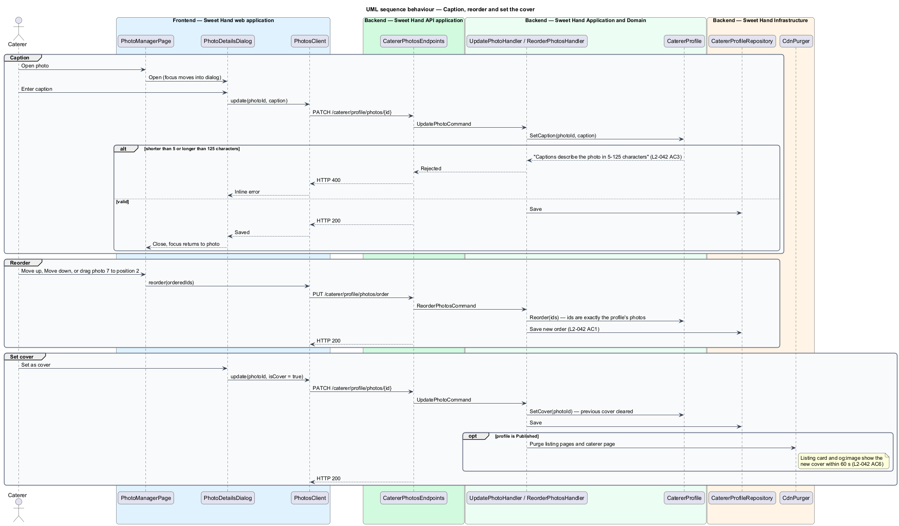
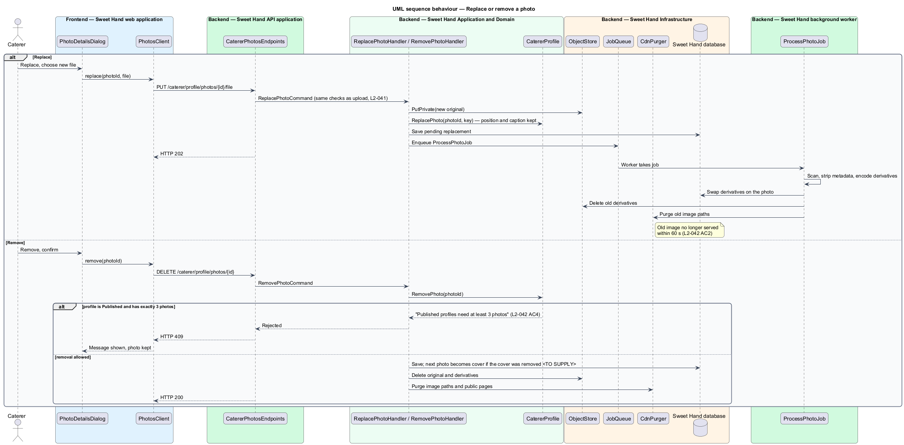

# Manage photos

## Overview

Sweet Hand's listing leads with food photography (L1-002), so a caterer's
photos are the first thing a customer sees. This feature lets a caterer add,
replace, remove and reorder photos, caption each one, and choose the cover
photo, from a phone as easily as from a desktop.

**photo manager** — screen in which a caterer manages their photos

**cover photo** — the one photo shown on the listing card and used as the `og:image` link preview

**caption** — caterer-written description of a photo, 5 to 125 characters, used as the image's text alternative

**original** — the file as uploaded, kept private and never served publicly

**derivative** — processed copy of a photo in AVIF, WebP or JPEG at one of the widths 400, 800, 1200 or 2000 pixels, stripped of metadata

**processing state** — `Processing`, `Ready` or `Rejected`; only `Ready` photos appear to anyone other than the caterer

Every upload is checked and processed on the server before anyone else can see
it: size, dimensions and real file type are checked, the file is scanned for
malware, and metadata such as GPS coordinates is removed. Processing runs in
the background worker. When the image processing service is down, uploads are
still accepted and wait in `Processing` until it recovers (L2-091 AC2).

A profile holds 3 to 30 photos for submission (L2-039). For a `Published`
profile, photo changes go live straight away and appear in the operator's
recent-changes feed, as `edit-published-profile` describes.

## Description

Technology choices for every component below are `<TO SUPPLY>` pending
architecture decision records in `docs/adr/`.

Frontend (Sweet Hand web application):

- **`PhotoManagerPage`** — screen listing the caterer's photos in order with
  their captions and processing state. On viewport XS it offers upload from the
  device camera or photo library, "Move up" and "Move down" controls and a
  "Set as cover" control, with no horizontal scrolling (L2-045 AC1). Wider
  viewports add drag-and-drop reordering alongside the same controls
  (L2-042 AC1). At 30 photos the upload control is disabled with "You can have
  up to 30 photos" (L2-042 AC5).
- **`PhotoDetailsDialog`** — accessible dialog opened from a photo, with the
  caption field and the "Replace", "Remove" and "Set as cover" actions.
  Editing never happens inline on the page.
- **`PhotosClient`** — API client contract: `upload(file)`,
  `replace(photoId, file)`, `update(photoId, caption, isCover)`,
  `reorder(photoIds)`, `remove(photoId)`, `list()`.

Backend (Sweet Hand API):

- **`CatererPhotosEndpoints`** — owner-scoped endpoints under
  `/caterer/profile/photos`. A photo id that does not belong to the session's
  profile returns not found (HTTP 404) and changes nothing (L2-079 AC1).
- **`UploadPhotoHandler`** — accepts JPEG, PNG, WebP or HEIC files of up to
  15 MB whose shorter side is at least 800 pixels. Size and dimension failures
  return "Photos must be under 15 MB and at least 800 pixels on the shorter
  side" (L2-041 AC2). The type is checked from the content signature, not the
  extension; a mismatch is rejected and nothing is stored (L2-041 AC3). The
  original goes to a private area of `ObjectStore`, a `Photo` is added in
  `Processing`, and a `ProcessPhotoJob` is queued.
- **`ReplacePhotoHandler`** — stores a new original against the existing
  `Photo` as a pending replacement and queues processing. The photo keeps its
  position and caption (L2-042 AC2).
- **`UpdatePhotoHandler`** — sets the caption ("Captions describe the photo in
  5–125 characters", L2-042 AC3) or the cover flag. Exactly one photo is the
  cover.
- **`ReorderPhotosHandler`** — saves a full ordering of the profile's photo ids
  (L2-042 AC1).
- **`RemovePhotoHandler`** — removes a photo and deletes its files. A
  `Published` profile with exactly 3 photos blocks removal with "Published
  profiles need at least 3 photos" (L2-042 AC4).
- **`CatererProfile`** (photo methods) — `AddPhoto`, `ReplacePhoto`,
  `SetCaption`, `SetCover`, `Reorder`, `RemovePhoto`. The aggregate enforces the
  30-photo maximum, the single cover and the published minimum.
- **`Photo`** — entity: `id`, `position`, `caption`, `isCover`,
  `processingState`, `originalKey`, `derivativeKeys`, `pendingReplacementKey`.

Background worker:

- **`ProcessPhotoJob`** — for each original, in this order:
  1. `MalwareScanner` scans the file before any derivative exists. A flagged
     file is deleted, the photo becomes `Rejected`, and the event is written
     to `SecurityLog` (L2-041 AC6).
  2. `ImageProcessor` decodes the image, removes EXIF, XMP and IPTC metadata
     (L2-041 AC4), and encodes AVIF, WebP and JPEG at widths 400, 800, 1200
     and 2000 pixels, never enlarging (L2-041 AC5).
  3. Derivatives go to the public area of `ObjectStore`, served through the
     CDN. The original stays private and remains available for the caterer's
     data export (L2-071 AC2).
  4. The photo becomes `Ready`. For a replacement, the old derivatives are
     deleted and purged from the CDN so the old image stops being served within
     60 seconds (L2-042 AC2).
  A preview is available to the caterer within 10 seconds of upload
  (L2-041 AC1).
- When `ImageProcessor` is unavailable, the job stays in `JobQueue` and is
  retried. The photo stays `Processing` and becomes `Ready` automatically once
  processing recovers (L2-091 AC2). The image processing queue depth is a
  monitored metric (L2-089 AC2).
- A cover change, replacement or removal on a `Published` profile purges the
  affected public pages from the CDN. The listing card and `og:image` show the
  new cover within 60 seconds (L2-042 AC6).

Open points:

- Whether a photo in `Processing` counts toward the 3-photo minimum for
  submission (L2-039) and for the published minimum (L2-042 AC4) is
  `<TO SUPPLY>`.
- The retry schedule for `ProcessPhotoJob` while image processing is down is
  `<TO SUPPLY>`.
- Which photo becomes the cover when the caterer removes the current cover is
  `<TO SUPPLY>`.
- Whether the image processor runs inside the background worker or as a
  separate service is `<TO SUPPLY>` pending an ADR.

## Requirements

The feature realizes the following level-2 (L2) requirements from
`docs/specs/L2.md`. Each refines the level-1 (L1) requirement cited beside it.
Requirement text is quoted from the specification, with *must* rendered as
*shall*.

| L2 ID | Refines (L1) | Requirement |
|-------|--------------|-------------|
| `L2-041` | `L1-012` | Uploaded photos shall be checked and processed on the server before anyone else can see them. |
| `L2-042` | `L1-012` | A caterer shall be able to add, replace, remove and reorder photos, give each one a caption, and choose a cover photo. |
| `L2-091` | `L1-023` | If a dependency fails, the platform shall keep its core functions working, with limited features where needed, rather than failing completely. |

This feature realizes `L2-091` AC2 (uploads accepted while image processing is
down). The other `L2-091` criteria belong to the `platform` subsystem.

## Diagrams

### System context

The caterer uploads and arranges photos in Sweet Hand. Sweet Hand scans each
upload with the Malware scanning service and serves processed photos through
the CDN.

### Containers

The API checks uploads, stores originals privately in Object storage and queues
processing. The background worker scans, processes and publishes derivatives,
which the CDN serves.

### Components

`PhotoManagerPage` and `PhotoDetailsDialog` depend on the `PhotosClient`
contract. `CatererPhotosEndpoints` dispatches to one handler per action, and
the worker's `ProcessPhotoJob` runs the scan and image processing.

### Class structure

`CatererProfile` owns an ordered list of `Photo` entities. `ProcessPhotoJob`
depends on `MalwareScanner`, `ImageProcessor` and `ObjectStore`.

### Behaviour — upload and process a photo

The API rejects oversized, undersized or mislabelled files at once. Accepted
files are stored privately and processed in the background. When processing is
down, the photo waits in `Processing` and is published once it recovers.

### Behaviour — caption, reorder and set the cover

Caption, order and cover changes are small owner-scoped updates. A cover change
on a published profile reaches the listing card and `og:image` within 60
seconds.

### Behaviour — replace or remove a photo

A replacement keeps the photo's position and caption and swaps the image once
processing finishes. Removal is blocked when a published profile would drop
below 3 photos.

