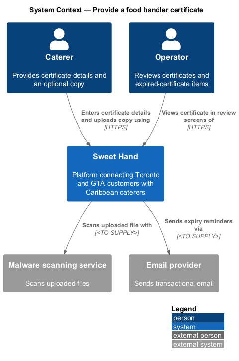
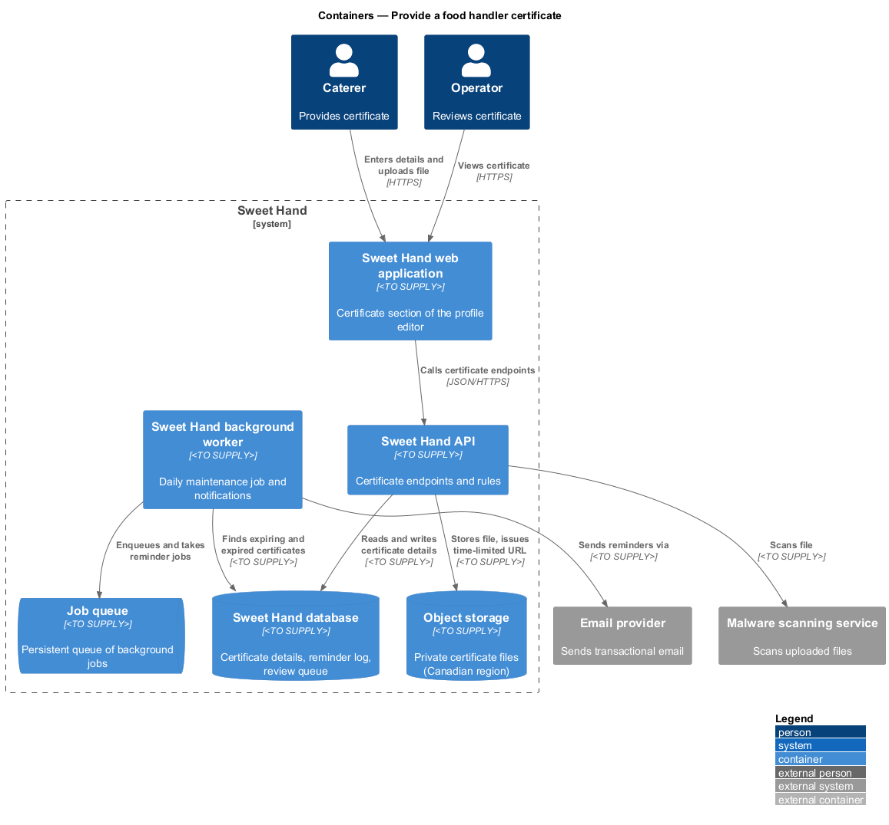
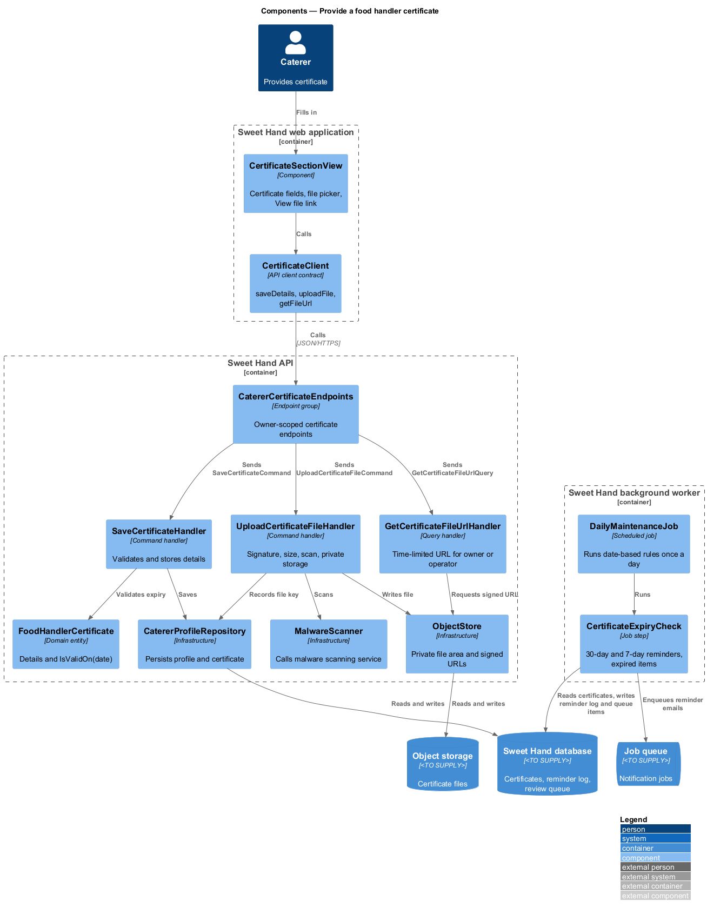
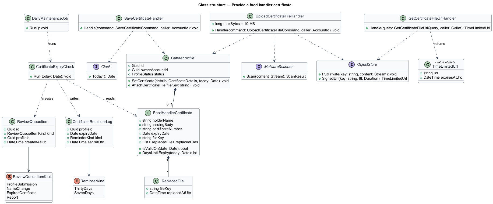
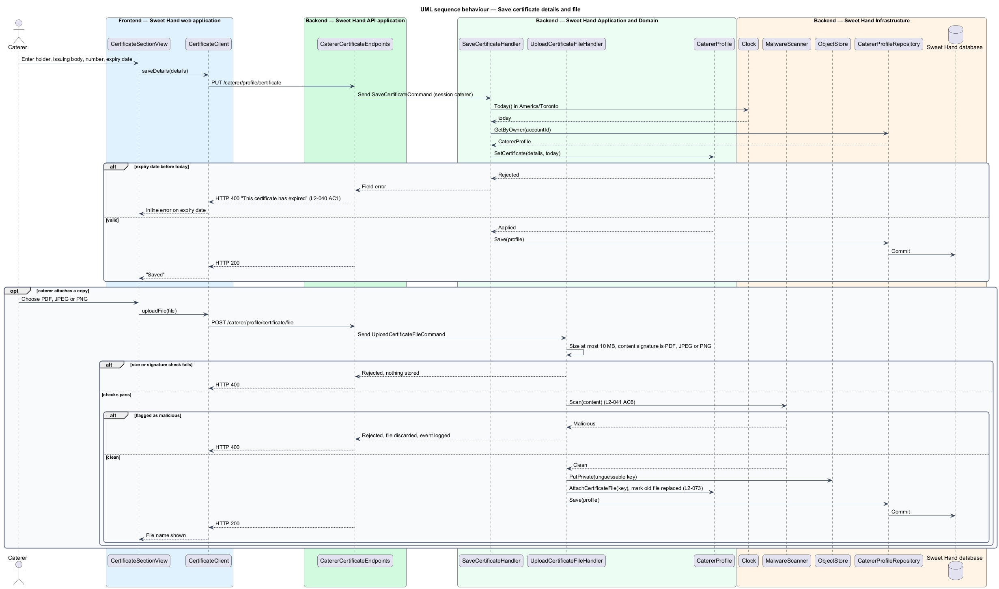
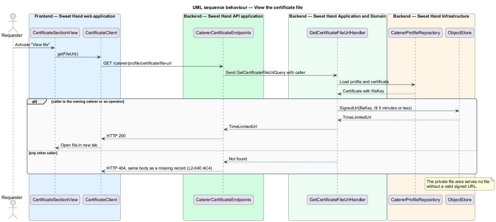
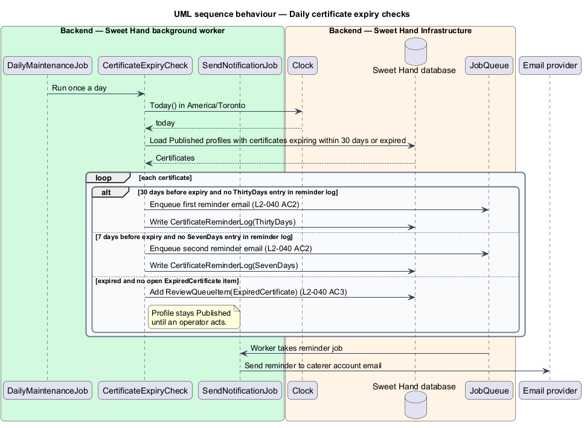

# Provide a food handler certificate

## Overview

Sweet Hand requires every caterer to hold a food handler certificate before an
operator reviews their profile (assumption A-4 in `docs/specs/L1.md`). The
platform records the certificate as the caterer's own statement. It does not
certify the caterer's kitchen.

**food handler certificate** — credential showing that a named person completed food handler training, with an issuing body, a certificate number and an expiry date

**certificate file** — optional copy of the certificate uploaded by the caterer as a PDF, JPEG or PNG of up to 10 MB

**time-limited URL** — authorised link to a private file that stops working after 5 minutes or less

**daily maintenance job** — scheduled background job that runs once a day and applies date-based rules

The certificate is a section of the profile editor (`set-up-profile`). A valid,
unexpired certificate is one of the submission rules in L2-039. Only the owning
caterer and operators can see the certificate details and file; public pages
and public API responses never include them (L2-014). After publication, the
daily maintenance job reminds the caterer before the certificate expires and
puts an expired certificate in front of an operator, without unpublishing the
profile on its own.

## Description

Technology choices for every component below are `<TO SUPPLY>` pending
architecture decision records in `docs/adr/`.

Frontend (Sweet Hand web application):

- **`CertificateSectionView`** — certificate section of `ProfileEditorPage`.
  Fields: holder name, issuing body, certificate number, expiry date
  (`type="date"`), and an optional file picker limited to PDF, JPEG and PNG. It
  shows the current file name and a "View file" link that requests a
  time-limited URL.
- **`CertificateClient`** — API client contract: `saveDetails(details)`,
  `uploadFile(file)`, `getFileUrl()`.

Backend (Sweet Hand API):

- **`CatererCertificateEndpoints`** — owner-scoped endpoints:
  `PUT /caterer/profile/certificate`, `POST /caterer/profile/certificate/file`
  and `GET /caterer/profile/certificate/file-url`. The profile comes from the
  session's caterer account. Operators reach the same data through operator
  review endpoints in the `moderation` subsystem.
- **`SaveCertificateCommand`** / **`SaveCertificateHandler`** — validates and
  stores the details through `CatererProfile.SetCertificate`. An expiry date
  before today in `America/Toronto` (read from `Clock`) is rejected with "This
  certificate has expired" (L2-040 AC1).
- **`UploadCertificateFileHandler`** — accepts files up to 10 MB whose content
  signature is PDF, JPEG or PNG. The file passes through `MalwareScanner`
  before storage, in line with the rule that every uploaded file is scanned
  (L2-041 AC6). It stores the file in a private area of `ObjectStore` under an
  unguessable key. A replaced file is marked replaced, and the retention job
  deletes it 90 days later (L2-073).
- **`GetCertificateFileUrlHandler`** — returns a time-limited URL of 5 minutes
  or less for the owner or an operator. Any other caller receives not found
  (HTTP 404) (L2-040 AC4).
- **`FoodHandlerCertificate`** — entity: `holderName`, `issuingBody`,
  `certificateNumber`, `expiryDate`, `fileKey`, `replacedFileKeys`. Method
  `IsValidOn(date)` returns true when the expiry date is today or later.
- **`DailyMaintenanceJob`** (background worker) — runs
  `CertificateExpiryCheck` for `Published` profiles:
  - 30 days before expiry, queue a reminder email (L2-040 AC2);
  - 7 days before expiry, queue a second reminder (L2-040 AC2);
  - after expiry, add a `ReviewQueueItem` of kind `ExpiredCertificate` for
    operators; the profile stays `Published` until an operator acts
    (L2-040 AC3).
  `CertificateReminderLog` records each reminder sent so a rerun of the job
  sends none twice.
- **`SecurityLog`** / application logs — never record the certificate number
  (L2-084 AC2).

Open points:

- Whether the certificate holder name has to match the caterer's contact name
  is `<TO SUPPLY>`.
- Whether the issuing body is free text or chosen from a list is
  `<TO SUPPLY>`.
- L2-040 AC2 and AC3 apply to published caterers. Handling of a certificate
  that expires while a profile is `Pending review` is `<TO SUPPLY>`.

## Requirements

The feature realizes the following level-2 (L2) requirements from
`docs/specs/L2.md`. Each refines the level-1 (L1) requirement cited beside it.
Requirement text is quoted from the specification, with *must* rendered as
*shall*.

| L2 ID | Refines (L1) | Requirement |
|-------|--------------|-------------|
| `L2-040` | `L1-011` | Assumption A-4. Before submitting, a caterer shall provide a food handler certificate: the certificate holder's name, the issuing body, the certificate number and the expiry date. They can also upload a copy as a PDF, JPEG or PNG of up to 10 MB. Only the caterer and operators can see this information. |

## Diagrams

### System context

The caterer provides the certificate to Sweet Hand, and operators review it.
Sweet Hand scans uploaded files with the Malware scanning service and sends
expiry reminders through the Email provider.

### Containers

The API stores details in the Sweet Hand database and the file in a private
area of Object storage. The background worker runs the daily expiry checks and
sends reminders.

### Components

`CatererCertificateEndpoints` dispatches to three handlers for details, file
upload and file access. In the worker, `DailyMaintenanceJob` runs
`CertificateExpiryCheck`.

### Class structure

`CatererProfile` holds one `FoodHandlerCertificate`. `CertificateExpiryCheck`
reads certificates, writes `CertificateReminderLog` entries and creates
`ReviewQueueItem` records.

### Behaviour — save certificate details and file

The handler rejects an expired certificate. An optional file is checked by
content signature and size, scanned, and stored privately.

### Behaviour — view the certificate file

Only the owner or an operator receives a time-limited URL; any other caller
receives HTTP 404.

### Behaviour — daily expiry checks

The daily maintenance job sends the 30-day and 7-day reminders once each and
queues expired certificates for operator review without unpublishing the
profile.

