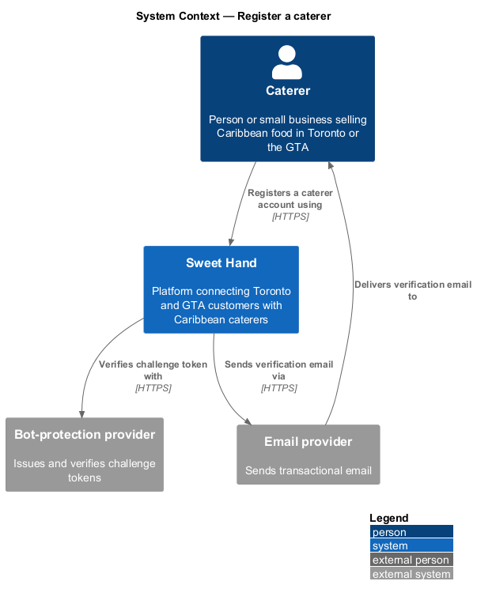
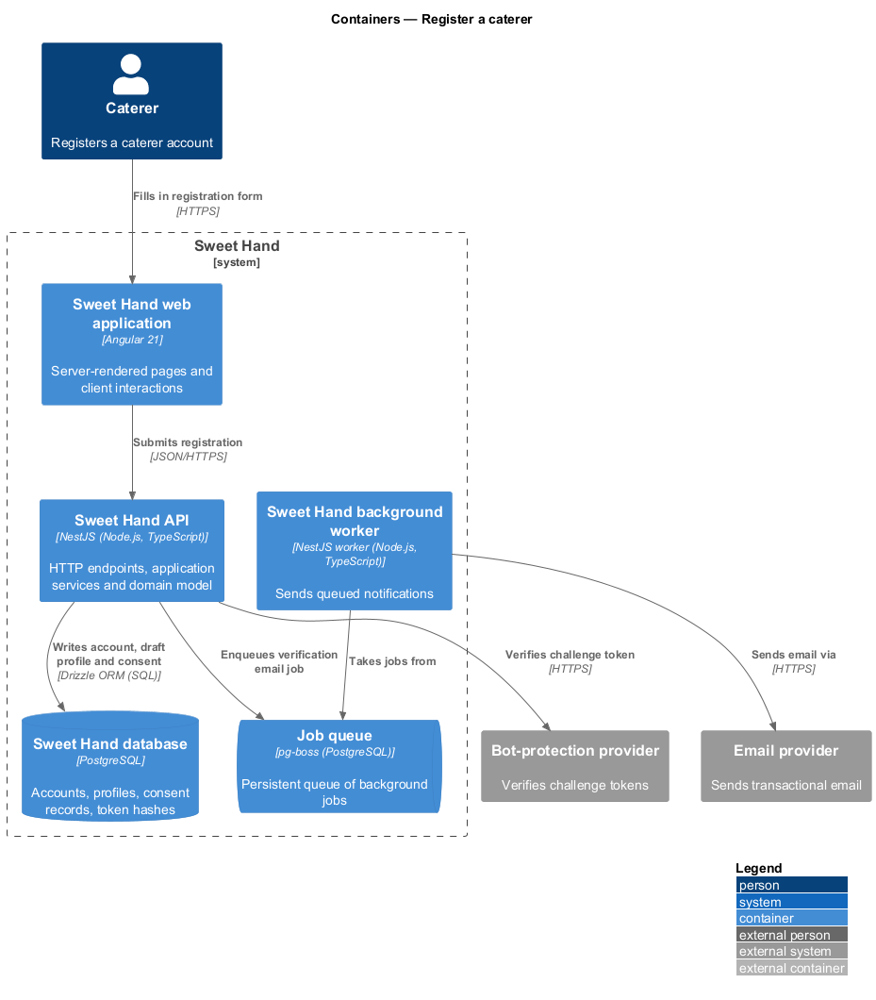
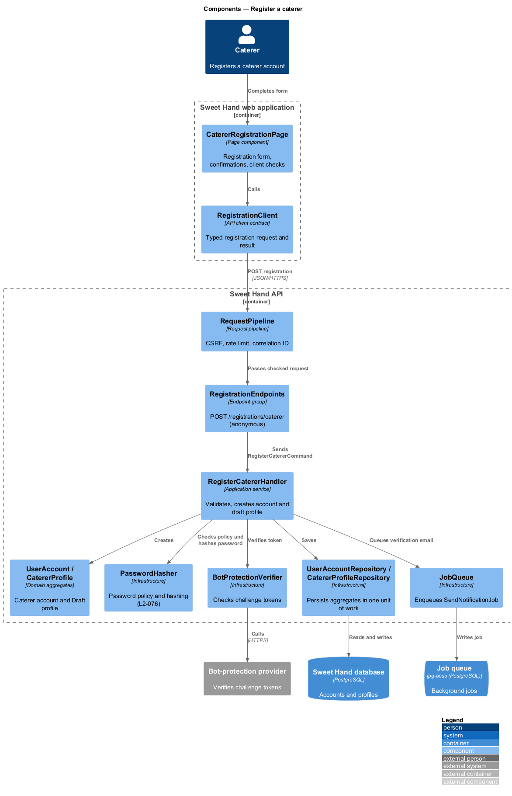
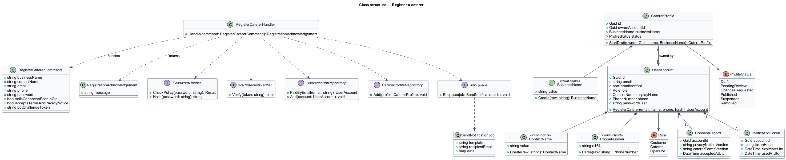
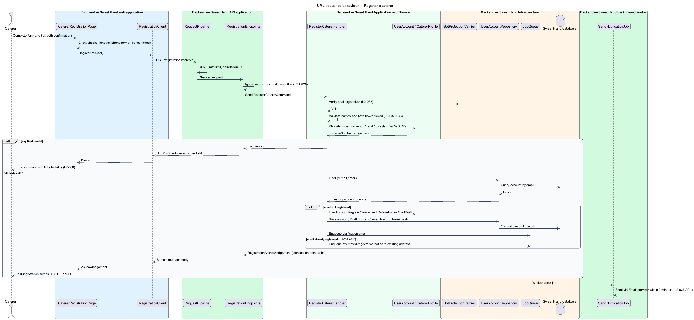

# Register a caterer

## Overview

Sweet Hand connects people in Toronto and the Greater Toronto Area (GTA) with
people selling Caribbean food. The first release lists caterers only
(assumption A-1 in `docs/specs/L1.md`).

**caterer** — person or small business selling Caribbean food that lists on Sweet Hand

**caterer account** — user account with the `Caterer` role that owns exactly one caterer profile

**caterer profile** — public-facing record of a caterer's business, built by the caterer and published only after operator approval

This feature is the entry point of the `caterer-profiles` subsystem. A person
who sells Caribbean food fills in a registration form, confirms that they sell
Caribbean food in Toronto or the GTA, and accepts the caterer terms and the
privacy notice. The platform creates a caterer account and an empty caterer
profile in status `Draft`, sends a verification email, and takes the person to
profile setup (see `set-up-profile`).

Registration publishes nothing. The email address is verified before the
profile can be submitted for review (`submit-profile-for-review`). Registration
also does not reveal whether an email address already belongs to an account: a
repeat registration looks like a successful one, and the owner of the existing
address receives a notice instead.

## Description

Technology choices follow ADR 0001 (Angular 21) and ADR 0006 (NestJS on
Node.js, PostgreSQL through Drizzle ORM, S3-compatible object storage);
providers not named there remain `<TO SUPPLY>`.

- **`CatererRegistrationPage`** — screen in the Sweet Hand web application. It
  renders the registration form with visible labels, the two unticked
  confirmation boxes, the bot-protection challenge (L2-082), and field-level
  client checks for immediate feedback. Field types follow L2-065
  (`type="email"`, `type="tel"`).
- **`RegistrationClient`** — API client contract the page depends on. It sends
  the registration request and returns a typed acknowledgement or a list of
  field errors.
- **`RegistrationEndpoints`** — endpoint group in the Sweet Hand API
  (`POST /registrations/caterer`). Anonymous access is a deliberate choice for
  this endpoint. The shared `RequestPipeline` applies CSRF and rate-limit
  checks. The endpoint ignores any `role`, `status` or owner field in the body
  (mass-assignment protection, L2-079) and dispatches the command.
- **`RegisterCatererCommand`** — request object: `businessName`,
  `contactName`, `email`, `phone`, `password`, `sellsCaribbeanFoodInGta`,
  `acceptsTermsAndPrivacyNotice`, `botChallengeToken`.
- **`RegisterCatererHandler`** — application service. It verifies the
  bot-protection token, validates every field, normalises the phone number and
  checks the password policy (L2-076). It then either creates the account or
  queues an "attempted registration" notice to the existing address. Both paths
  return the same `RegistrationAcknowledgement`.
- **`BusinessName`** — value object holding 2 to 80 characters after trimming.
- **`ContactName`** — value object holding 2 to 50 characters after trimming.
- **`PhoneNumber`** — value object that accepts 10-digit North American numbers
  with or without `+1`, spaces, dashes or brackets. It stores them in the form
  `+14165550199` and rejects any other input with the message "Enter a 10-digit
  Canadian phone number" (L2-037 AC2).
- **`UserAccount`** — account aggregate with `Role.Caterer`, an unverified
  email, a password hash from `PasswordHasher`, the contact name and the phone.
- **`CatererProfile`** — profile aggregate created in `ProfileStatus.Draft`
  with the `BusinessName` and the owning account id.
- **`ConsentRecord`** — stores the accepted privacy notice version, caterer
  terms version and UTC timestamp (L2-070 AC3).
- **`VerificationToken`** — single-use, expiring token. Only its hash is stored
  (L2-077).
- **`UserAccountRepository`**, **`CatererProfileRepository`** — persist the
  two aggregates in the Sweet Hand database in one unit of work.
- **`JobQueue`** and **`SendNotificationJob`** — the handler queues the
  verification email or the attempted-registration notice. The background
  worker sends it through the Email provider within 2 minutes (L2-037 AC1).

Rules by acceptance criterion:

- L2-037 AC1 — on success the account and draft profile are created, the
  verification email is queued, and the web application navigates to profile
  setup.
- L2-037 AC2 — phone normalisation and rejection live in `PhoneNumber`.
- L2-037 AC3 — an unticked confirmation box fails validation. The page marks
  the box as required and links the error to it (L2-068).
- L2-037 AC4 — an email already registered to any account yields the same
  status code and body as a success.

Open points:

- L2-037 AC1 sends a new caterer to the profile setup page, while L2-037 AC4
  requires a duplicate registration to look exactly like a success. A duplicate
  creates no session, so a redirect to setup would differ observably. The
  post-registration screen for both paths is `<TO SUPPLY>`.
- L2-035 AC4 refers to a caterer "business email", while L2-037 collects one
  email address. Whether the account email doubles as the business email is
  `<TO SUPPLY>`.

## Requirements

The feature realizes the following level-2 (L2) requirements from
`docs/specs/L2.md`. Each refines the level-1 (L1) requirement cited beside it.
Requirement text is quoted from the specification, with *must* rendered as
*shall*.

| L2 ID | Refines (L1) | Requirement |
|-------|--------------|-------------|
| `L2-037` | `L1-011` | A caterer shall be able to register with a business name (2–80 characters), contact name (2–50 characters), email address, phone number (North American format), password (L2-076), confirmation that they sell Caribbean food in Toronto or the GTA, and acceptance of the caterer terms and privacy notice. The email address shall be verified before the caterer can submit a profile for approval. |

## Diagrams

### System context

A prospective caterer registers with Sweet Hand. Sweet Hand checks the
bot-protection token with the Bot-protection provider and sends the
verification email through the Email provider.

### Containers

The web application posts the form to the Sweet Hand API. The API writes the
account, profile and consent record to the Sweet Hand database and queues the
email, which the background worker sends.

### Components

`CatererRegistrationPage` calls the `RegistrationClient` contract.
`RegistrationEndpoints` dispatches `RegisterCatererCommand` to
`RegisterCatererHandler`, which builds the aggregates and queues the email.

### Class structure

`RegisterCatererHandler` uses the value objects `BusinessName`, `ContactName`
and `PhoneNumber`. It creates a `UserAccount` and a `Draft` `CatererProfile`,
and records a `ConsentRecord` and a `VerificationToken`.

### Behaviour — register a caterer

The handler validates the request, then branches. A new email creates the
account and draft profile and queues the verification email. An email already
in use queues a notice to that address. Both branches return the same
acknowledgement (L2-037 AC4).

