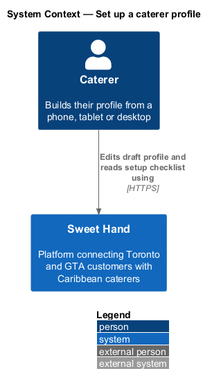
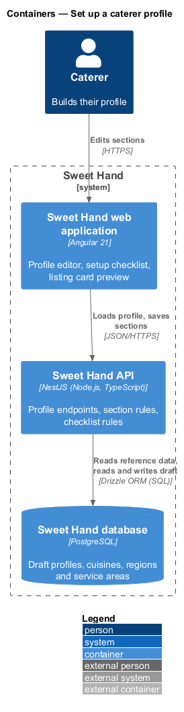
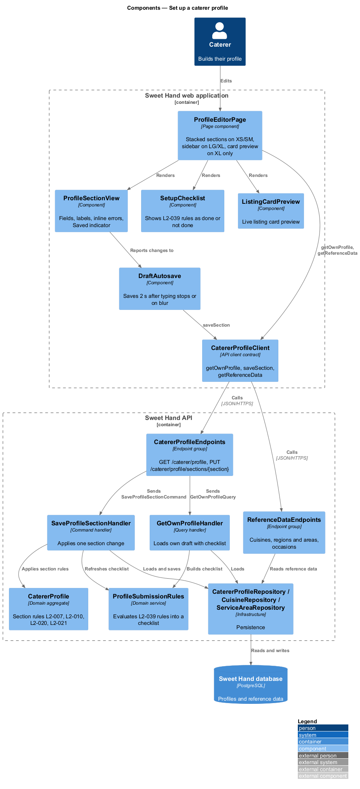
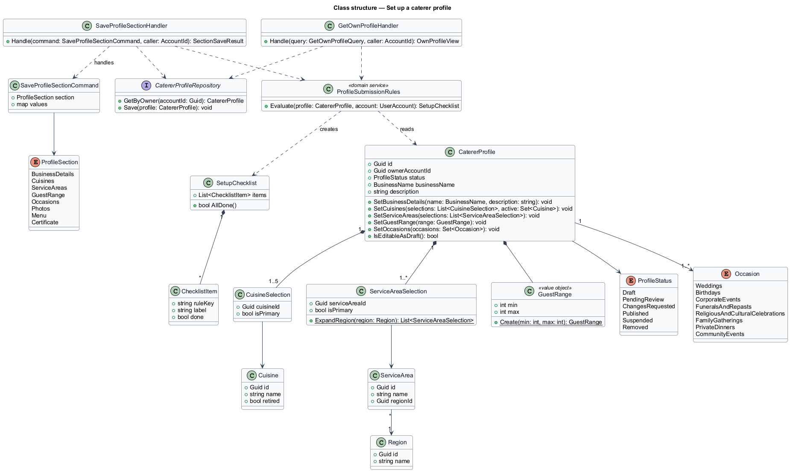
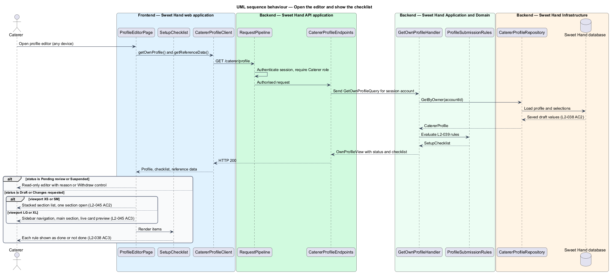
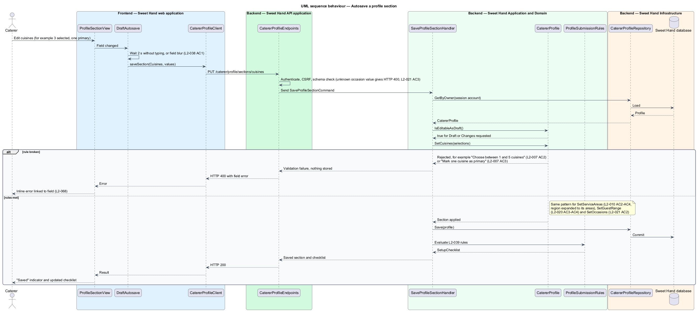

# Set up a caterer profile

## Overview

After registration (`register-caterer`), a caterer owns one caterer profile in
status `Draft`. This feature lets the caterer build that profile over as many
sessions and devices as needed, from a phone or a desktop, before submitting it
for review (`submit-profile-for-review`).

**profile editor** — dedicated screen in which a caterer edits their own profile, one section at a time

**profile section** — group of related profile fields edited and saved together, such as cuisines or service areas

**draft autosave** — automatic saving of a section's changes 2 seconds after typing stops or when a field loses focus

**setup checklist** — list of the submission rules (L2-039) showing each as done or not done for the current draft

**primary cuisine** / **primary area** — the one cuisine and the one service area a caterer marks to appear on the listing card

The editor covers the business details and the structured selections that
describe what a caterer offers: cuisines by island or country of origin,
service areas in Toronto and the GTA, the guest range, and occasions. Photos,
the menu and the food handler certificate are sections of the same editor, with
their own rules described in `manage-photos`, `manage-menu` and
`provide-food-handler-certificate`.

This feature applies while the profile is `Draft` or `Changes requested`. A
profile in `Pending review` or `Suspended` opens read-only. Edits to a
`Published` profile follow `edit-published-profile`.

## Description

Technology choices follow ADR 0001 (Angular 21) and ADR 0006 (NestJS on
Node.js, PostgreSQL through Drizzle ORM, S3-compatible object storage);
providers not named there remain `<TO SUPPLY>`.

Frontend (Sweet Hand web application):

- **`ProfileEditorPage`** — the profile editor screen. On viewport XS and SM it
  shows sections as a stacked list that opens one section at a time (L2-045
  AC2). On LG and XL it shows section navigation in a sidebar and the selected
  section in the main area (L2-045 AC3). Only on XL does it add a live
  `ListingCardPreview` beside the selected section (L2-045 AC4); at LG there
  is no room for a third column. It has no horizontal scrolling at any
  viewport class.
- **`ProfileSectionView`** — renders one section's fields with visible labels,
  inline errors and the shared "Saved" indicator. Sections: business details
  (business name, description), cuisines, service areas, guest range,
  occasions, photos, menu and certificate.
- **`DraftAutosave`** — watches field input and saves the section 2 seconds
  after the last keystroke or on blur, then shows "Saved" (L2-038 AC1).
- **`SetupChecklist`** — shows each L2-039 rule as done or not done, using the
  checklist the API returns (L2-038 AC3).
- **`ListingCardPreview`** — renders the listing card as it would appear with
  the current draft values (cover photo, business name, primary cuisine,
  primary area).
- **`CatererProfileClient`** — API client contract the editor depends on:
  `getOwnProfile()`, `saveSection(section, values)`, `getReferenceData()`.

Backend (Sweet Hand API):

- **`CatererProfileEndpoints`** — endpoints for the signed-in caterer's own
  profile: `GET /caterer/profile` and `PUT /caterer/profile/sections/{section}`.
  The profile is resolved from the session's account, never from an id in the
  request, so a caterer reaches only their own profile (L2-079). A request for
  another profile's draft returns not found (L2-038 AC4).
- **`ReferenceDataEndpoints`** — read-only lists of active cuisines (alphabetical,
  retired cuisines excluded), regions with their service areas, occasions and
  dietary tags.
- **`GetOwnProfileQuery`** / **`GetOwnProfileHandler`** — loads the draft and
  computes the checklist with `ProfileSubmissionRules`.
- **`SaveProfileSectionCommand`** / **`SaveProfileSectionHandler`** — loads the
  profile, checks that its status allows editing, applies the section change
  through the aggregate and saves it. Each save is all-or-nothing for the
  section.
- **`CatererProfile`** — aggregate that owns the section rules:
  - `SetCuisines(selections)` — 1 to 5 cuisines, exactly one primary, each
    cuisine active or already held (L2-007). Messages: "Choose between 1 and 5
    cuisines", "Mark one cuisine as primary".
  - `SetServiceAreas(selections)` — at least 1 area, exactly one primary
    (L2-010). A whole-region selection expands to every area in that region
    before storage (L2-010 AC3). Messages: "Choose at least one area you
    serve", "Choose your primary area".
  - `SetGuestRange(min, max)` — through `GuestRange` (L2-020).
  - `SetOccasions(occasions)` — at least 1 value from `Occasion`
    (L2-021). Message: "Choose at least one occasion".
  - `SetBusinessDetails(name, description)` — `BusinessName` of 2 to 80
    characters and a description of up to 2,000 characters. While the profile
    is unpublished, a business name change needs no approval.
- **`GuestRange`** — value object. Both bounds are whole numbers from 1 to
  5,000 ("Enter a whole number from 1 to 5,000"), and the minimum is not larger
  than the maximum ("Minimum guests can't be more than maximum guests").
- **`Occasion`** — fixed enumeration: Weddings, Birthdays, Corporate events,
  Funerals and repasts, Religious and cultural celebrations, Family gatherings,
  Private dinners, Community events. A value outside the list fails request
  validation with HTTP 400 and nothing is stored (L2-021 AC3).
- **`Cuisine`**, **`CuisineSelection`** — operator-managed cuisine with a
  `retired` flag, and the caterer's selection with a primary flag. The initial
  18 cuisines are seeded idempotently (L2-007 AC1).
- **`Region`**, **`ServiceArea`**, **`ServiceAreaSelection`** — fixed list of
  30 areas in 5 regions, seeded idempotently (L2-010 AC1): City of Toronto
  (Downtown Toronto, East York, Etobicoke, North York, Scarborough, York); Peel
  (Brampton, Caledon, Mississauga); York Region (Aurora, East Gwillimbury,
  Georgina, King, Markham, Newmarket, Richmond Hill, Vaughan,
  Whitchurch-Stouffville); Durham (Ajax, Brock, Clarington, Oshawa, Pickering,
  Scugog, Uxbridge, Whitby); Halton (Burlington, Halton Hills, Milton,
  Oakville).
- **`ProfileSubmissionRules`** — domain service that evaluates every L2-039
  rule against a profile and returns a `SetupChecklist` of items marked done or
  not done. `submit-profile-for-review` uses the same service.
- **`CatererProfileRepository`**, **`CuisineRepository`**,
  **`ServiceAreaRepository`** — persistence in the Sweet Hand database.

Status rules for editing:

| Profile status | Editor behaviour |
|----------------|------------------|
| `Draft`, `Changes requested` | Editable through this feature |
| `Pending review` | Read-only, with "Withdraw submission" (L2-039 AC4) |
| `Published` | Edits follow `edit-published-profile` |
| `Suspended` | Read-only with the suspension reason (L2-044 AC4) |

Open points:

- Saving the same section from 2 devices at once needs a conflict rule
  (last write wins, or a version check). The rule is `<TO SUPPLY>`.
- L2-039 sets the description range at 50–2,000 characters for submission. The
  design rejects more than 2,000 at save time and treats fewer than 50 as an
  unmet checklist item. Confirmation of that split is `<TO SUPPLY>`.

## Requirements

The feature realizes the following level-2 (L2) requirements from
`docs/specs/L2.md`. Each refines the level-1 (L1) requirement cited beside it.
Requirement text is quoted from the specification, with *must* rendered as
*shall*.

| L2 ID | Refines (L1) | Requirement |
|-------|--------------|-------------|
| `L2-038` | `L1-011` | A caterer shall be able to build their profile across several sessions. Changes are saved automatically as a draft, and a checklist shows what is still needed before the profile can be submitted. |
| `L2-045` | `L1-012` | The caterer's profile editor, photo manager and menu manager shall be fully usable at every viewport class, so a caterer can manage everything from a phone. |
| `L2-007` | `L1-003` | The platform shall keep a list of Caribbean cuisines (by island or country of origin) that operators manage. Each caterer shall pick 1 to 5 cuisines and mark exactly one as primary. The initial list is: Antiguan & Barbudan, Bahamian, Barbadian (Bajan), Belizean, Cuban, Dominican (Dominica), Dominican (Dominican Republic), Grenadian, Guyanese, Haitian, Jamaican, Kittitian & Nevisian, Puerto Rican, St. Lucian, Surinamese, Trinidadian & Tobagonian, Vincentian, Pan-Caribbean. |
| `L2-010` | `L1-004` | The platform shall keep a fixed list of service areas within Toronto and the GTA, grouped by region. Each caterer shall pick at least 1 service area and mark exactly one as primary. The initial list is: … (30 areas in 5 regions, listed in the Description). |
| `L2-020` | `L1-007` | Each caterer shall state the minimum and maximum number of guests they cater for. Both are whole numbers from 1 to 5,000, and the minimum cannot be larger than the maximum. The caterer page shall display the range. |
| `L2-021` | `L1-007` | Each caterer shall pick at least 1 occasion from a fixed list: Weddings, Birthdays, Corporate events, Funerals and repasts, Religious and cultural celebrations, Family gatherings, Private dinners, Community events. The caterer page shall display the chosen occasions. |

This feature realizes the selection and validation parts of `L2-007`,
`L2-010`, `L2-020` and `L2-021`. Operator management of cuisines, listing
filters and display on the caterer page belong to the `discovery` and
`moderation` subsystems.

## Diagrams

### System context

A caterer builds their profile in Sweet Hand. No external system takes part in
saving a draft.

### Containers

The web application loads the draft and saves each section through the Sweet
Hand API, which reads reference data and writes the draft in the Sweet Hand
database.

### Components

`ProfileEditorPage` uses `DraftAutosave`, `SetupChecklist` and
`ListingCardPreview`, and depends on the `CatererProfileClient` contract. On the
API side, `SaveProfileSectionHandler` applies section rules through
`CatererProfile`, and `ProfileSubmissionRules` builds the checklist.

### Class structure

`CatererProfile` composes the cuisine and area selections, the `GuestRange` and
the set of `Occasion` values. `ProfileSubmissionRules` reads the aggregate to
produce a `SetupChecklist`.

### Behaviour — open the editor and show the checklist

The editor loads the caterer's own profile and the reference data, then lays
itself out by viewport class. The API returns the checklist with the draft so
the caterer sees what remains before submission.

### Behaviour — autosave a section

After 2 seconds without typing, or on blur, the editor saves the section. The
aggregate enforces the section rules; a rejection returns the specification's
message for that rule and nothing is stored.

