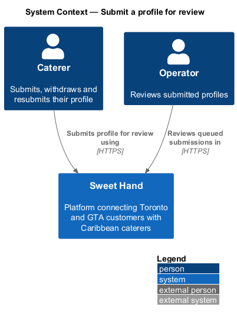
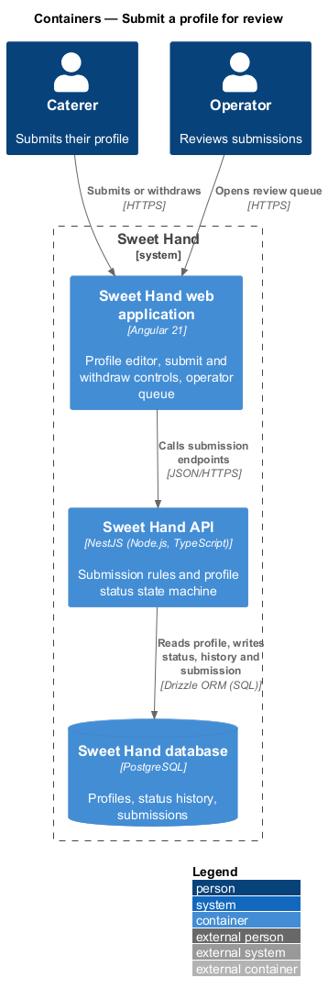
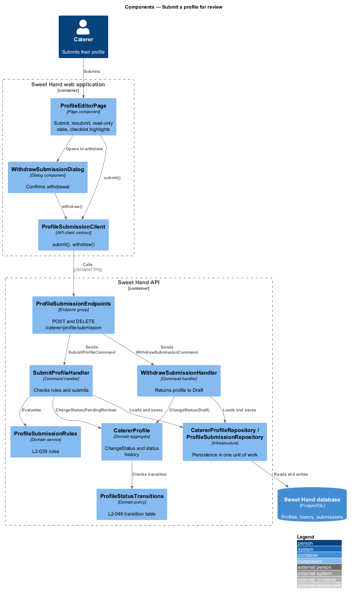
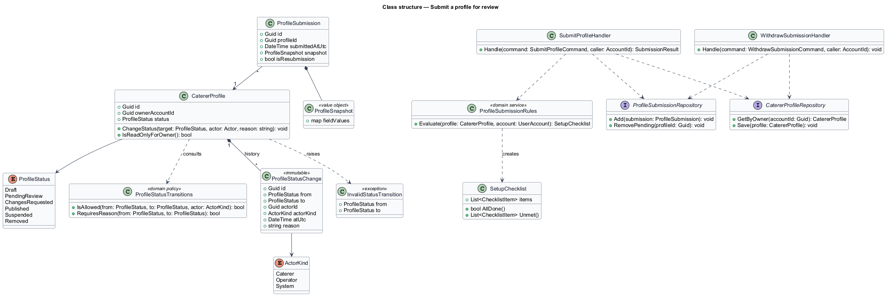
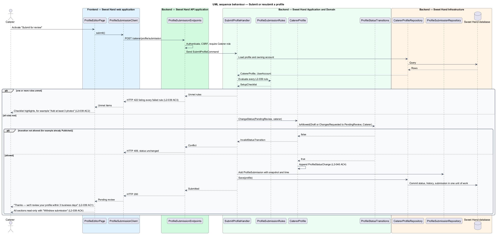
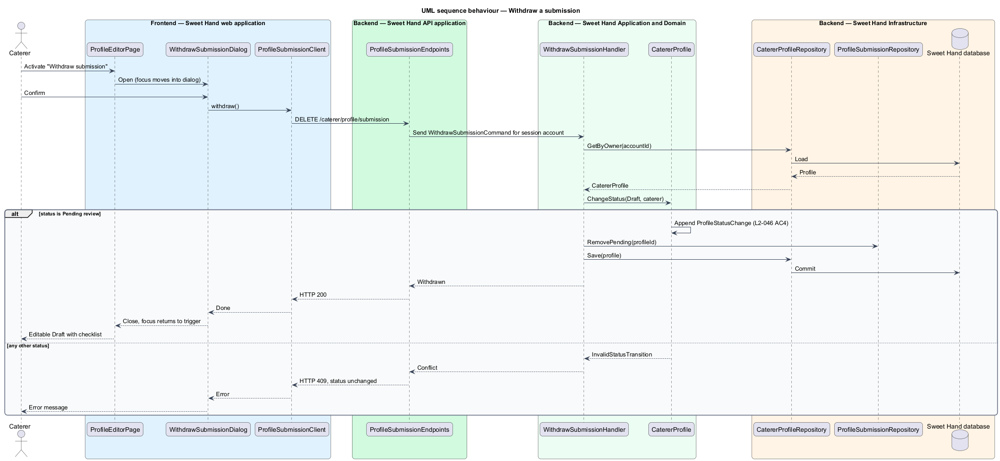

# Submit a profile for review

## Overview

A caterer profile becomes public only after an operator approves it (L1-013).
This feature covers the caterer's side of that gate: submitting a finished
draft for review, withdrawing a submission, and resubmitting after an operator
asks for changes. The operator's side — the review queue and the approval
decision — belongs to the `moderation` subsystem.

**operator** — member of the Sweet Hand team who approves caterers and keeps listings accurate

**submission** — caterer's request that an operator review the profile, which moves it to `Pending review`

**profile status** — one of `Draft`, `Pending review`, `Changes requested`, `Published`, `Suspended` or `Removed`; only `Published` profiles are public

**status history** — append-only list of status changes, each recording the old and new status, the actor, the time and any reason

Submission is allowed only when the draft meets every rule in L2-039. The setup
checklist from `set-up-profile` shows the same rules while the caterer works,
so a failed submission points at the items still open. While a profile waits
for review, every field is read-only. The caterer can withdraw the submission
to return to `Draft` and continue editing.

## Description

Technology choices follow ADR 0001 (Angular 21) and ADR 0006 (NestJS on
Node.js, PostgreSQL through Drizzle ORM, S3-compatible object storage);
providers not named there remain `<TO SUPPLY>`.

Frontend (Sweet Hand web application):

- **`ProfileEditorPage`** — shows the "Submit for review" button (or
  "Resubmit for review" in `Changes requested`) beside the `SetupChecklist`.
  After a successful submission it shows "Thanks — we'll review your profile
  within 3 business days" (L2-039 AC1) and switches every section to read-only
  with a "Withdraw submission" control (L2-039 AC4). A failed submission
  highlights each unmet checklist item, for example "Add at least 3 photos"
  (L2-039 AC2).
- **`WithdrawSubmissionDialog`** — confirmation dialog for withdrawing, built on
  the UI framework's accessible dialog primitive.
- **`ProfileSubmissionClient`** — API client contract: `submit()`,
  `withdraw()`.

Backend (Sweet Hand API):

- **`ProfileSubmissionEndpoints`** — `POST /caterer/profile/submission`
  (submit or resubmit) and `DELETE /caterer/profile/submission` (withdraw).
  Both resolve the profile from the session's caterer account. Operator-only
  transitions (approve, request changes, suspend, reinstate, remove) live on
  operator endpoints, which return HTTP 403 to a caterer session (L2-046 AC1).
- **`SubmitProfileCommand`** / **`SubmitProfileHandler`** — loads the profile
  and the owning account, runs `ProfileSubmissionRules`, and on success applies
  the transition. When any rule fails it returns HTTP 422 listing every failed
  rule (L2-039 AC3).
- **`WithdrawSubmissionCommand`** / **`WithdrawSubmissionHandler`** — applies
  the `Pending review` → `Draft` transition and removes the pending queue item.
- **`ProfileSubmissionRules`** — domain service shared with `set-up-profile`.
  It checks: email verified; business name set; description of 50–2,000
  characters; 1–5 cuisines with one primary; at least 1 service area with one
  primary; guest range set; at least 1 occasion; 3–30 photos, each captioned,
  one marked as cover; 3–50 menu items; a valid (unexpired) food handler
  certificate.
- **`CatererProfile.ChangeStatus(target, actor, reason)`** — the only way a
  status changes. It consults `ProfileStatusTransitions` and appends a
  `ProfileStatusChange` to the status history (L2-046 AC4). A transition not in
  the table raises `InvalidStatusTransition`, which the endpoint maps to HTTP
  409 (L2-046 AC2, AC3).
- **`ProfileStatusTransitions`** — the L2-046 transition table:

  | From | To | By |
  |------|----|----|
  | `Draft` | `Pending review` | Caterer (submit) |
  | `Pending review` | `Draft` | Caterer (withdraw) |
  | `Pending review` | `Published` | Operator (approve) |
  | `Pending review` | `Changes requested` | Operator, with a reason |
  | `Changes requested` | `Pending review` | Caterer (resubmit) |
  | `Published` | `Suspended` | Operator, with a reason |
  | `Suspended` | `Published` | Operator (reinstate) |
  | Any except `Removed` | `Removed` | Operator, with a reason |

- **`ProfileStatusChange`** — immutable history entry. The repository exposes
  no update or delete for it.
- **`ProfileSubmission`** — records the submission time and a snapshot of the
  submitted field values. The operator review queue orders by submission time
  and compares a resubmission with the snapshot taken at the last "Changes
  requested" decision (L2-047 AC1, AC3).
- **`CatererProfileRepository`**, **`ProfileSubmissionRepository`** — persist
  the profile, history and submission in one unit of work.

Open points:

- Whether operators receive a notification when a profile is submitted is
  `<TO SUPPLY>`; L2-047 specifies only the queue.
- The message "within 3 business days" is copy. Whether the platform tracks or
  alerts on that target is `<TO SUPPLY>`.

## Requirements

The feature realizes the following level-2 (L2) requirements from
`docs/specs/L2.md`. Each refines the level-1 (L1) requirement cited beside it.
Requirement text is quoted from the specification, with *must* rendered as
*shall*.

| L2 ID | Refines (L1) | Requirement |
|-------|--------------|-------------|
| `L2-039` | `L1-011` | A profile can be submitted for approval only when all of the following are true: email verified; business name set; description 50–2,000 characters; 1–5 cuisines with one primary (L2-007); at least 1 service area with one primary (L2-010); guest range set (L2-020); at least 1 occasion (L2-021); 3 to 30 photos, each with a caption, one marked as cover (L2-042); 3 to 50 menu items (L2-043); a valid food handler certificate (L2-040). |
| `L2-046` | `L1-013` | A caterer profile shall always have one of these statuses: `Draft`, `Pending review`, `Changes requested`, `Published`, `Suspended` or `Removed`. Only the transitions below are allowed, and only `Published` profiles are publicly visible. (The transition table appears in the Description.) |

This feature realizes the caterer transitions of `L2-046` (submit, withdraw,
resubmit) and the shared state machine with its history. The operator
transitions are designed in the `moderation` subsystem.

## Diagrams

### System context

The caterer submits the profile to Sweet Hand, and an operator later reviews it
there. No external system takes part.

### Containers

The web application calls the Sweet Hand API, which checks the rules and writes
the status change, history entry and submission record to the Sweet Hand
database.

### Components

`ProfileSubmissionEndpoints` dispatches to `SubmitProfileHandler` and
`WithdrawSubmissionHandler`. Both change status only through
`CatererProfile.ChangeStatus`, guarded by `ProfileStatusTransitions`.

### Class structure

`CatererProfile` owns its status history. `ProfileStatusTransitions` defines
the allowed moves, and `ProfileSubmission` holds the snapshot the review queue
reads.

### Behaviour — submit or resubmit

The handler evaluates every L2-039 rule. Failures return HTTP 422 with the full
list. Success applies the transition, appends history and records the
submission in one unit of work.

### Behaviour — withdraw a submission

Withdrawal moves a `Pending review` profile back to `Draft` and removes it from
the review queue. Any other status returns HTTP 409.

