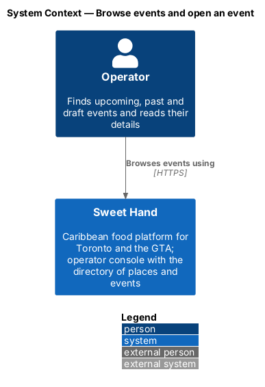
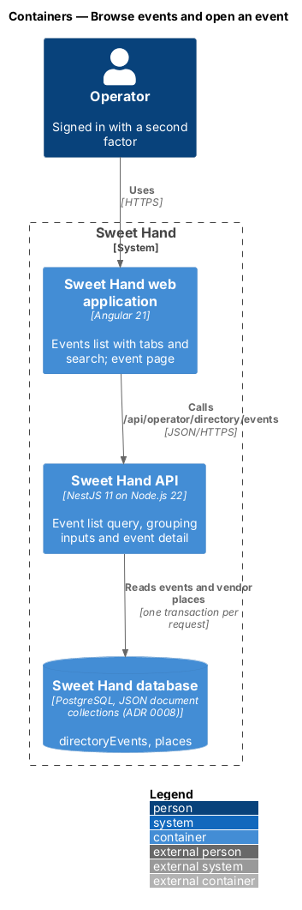
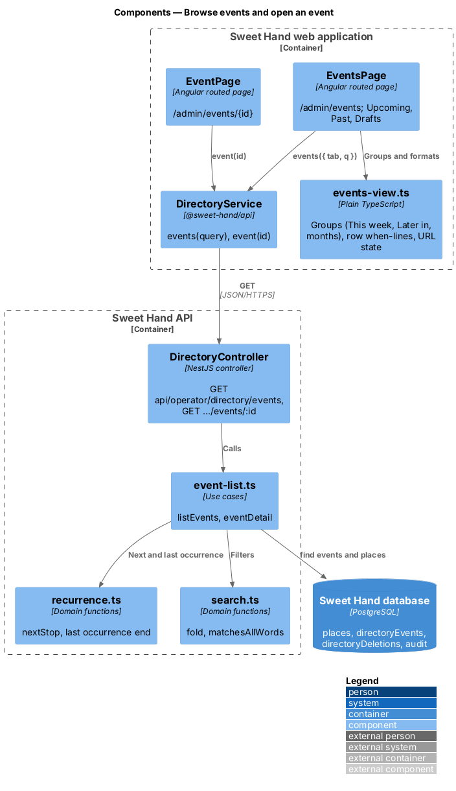
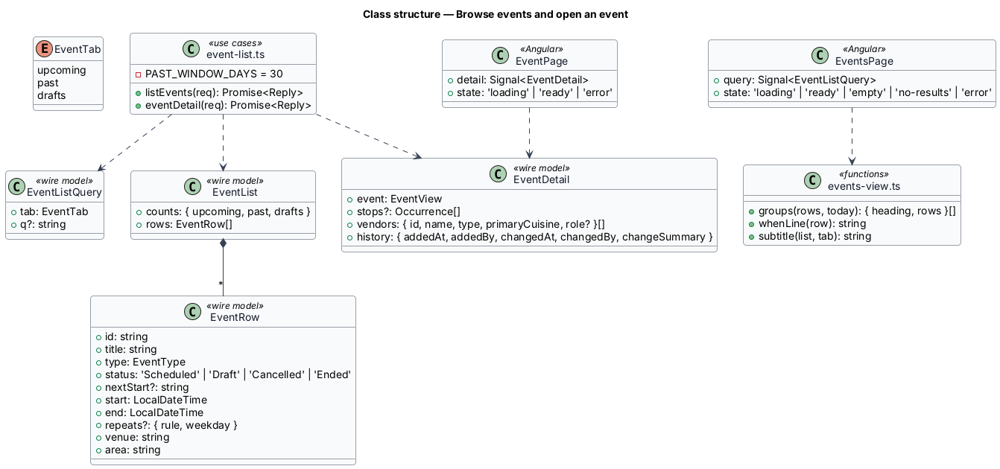
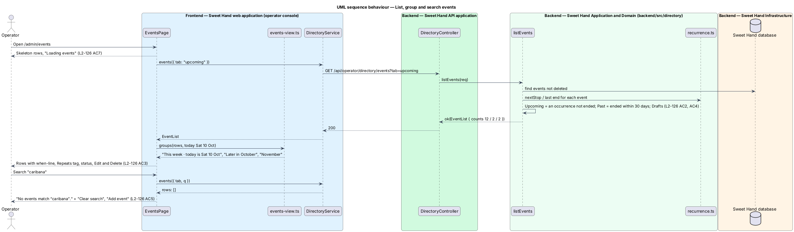
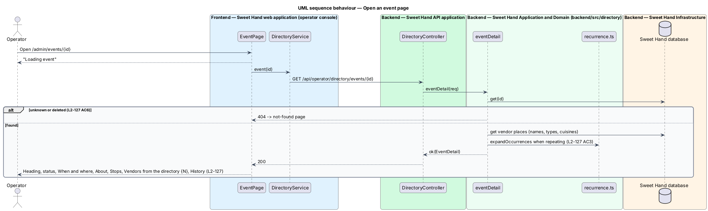

# Browse events and open an event

## Overview

The events list at `/admin/events` and each event page at `/admin/events/{id}` let an operator find and read events (`L1-028`). The list has three tabs — Upcoming, Past and Drafts — and a search; the page shows when and where an event happens, its stops, its vendors and its history.

> **upcoming event** — draft or scheduled event with an occurrence that has not ended
>
> **past event** — event whose last occurrence has ended; the Past tab shows those that ended in the last 30 days, and past events are kept for 2 years
>
> **ended** — status shown for a scheduled event whose last occurrence has ended

Upcoming events are grouped under "This week · today is {date}" for occurrences starting in the next 7 days, "Later in {month}" for the rest of the month, then one heading per month. A repeating event appears once, with "Every {weekday}" and a "Repeats" tag. Search and the tab live in the URL.

## Description

**Shared directory design.** The directory features share these building blocks and name them the same way:

- **Backend area `backend/src/directory/`** — `directory.controller.ts` (`DirectoryController`) maps routes under `api/operator/directory/` to use cases. Every route declares `@UsePolicy(roles('Operator'))`, so a customer or caterer session receives HTTP 403 and an operator who has not completed the second factor reaches nothing (`L2-133 AC1`). Use cases take the framework-free request context (`Request` in `http/endpoint.ts`) and return a `Reply` built with `http/problems.ts`, as `operator-settings/cuisines.ts` does.
- **Documents** — through the persistence port of ADR 0008: collection `places` (`Place`), collection `directoryEvents` (`DirectoryEvent`) and collection `directoryDeletions` (`Deletion`). Each place and event carries a `version` number for optimistic concurrency; a save with an older `version` returns `conflict(...)` (HTTP 409). The port filters only on top-level scalars, so search and range queries load the non-deleted documents and filter in process; `L2-134` sets the scale this holds for (2,000 places, 5,000 events).
- **Audit and history** — every change calls `recordAudit` (`platform/audit.ts`) with `targetType` `place` or `event` (`L2-133 AC3`). The document keeps `addedAt`, `addedBy`, `changedAt`, `changedBy` and `changeSummary` for the History sections.
- **Frontend** — pages and dialogs live in `frontend/projects/sweet-hand/src/app/features/operator/directory/`, routed from `features/operator/routes.ts` and lazy-loaded (`L2-134 AC5`). Paths come from `core/routing/paths.ts` (`paths.admin.places`, `place(id)`, `placesMap`, `events`, `event(id)`, `calendar`). Pages depend on the abstract `DirectoryService` in `@sweet-hand/api` (`services/directory.service.ts`), implemented by `HttpDirectoryService` and registered in `features/operator/providers.ts`. Wire models sit one type per file in `projects/api/src/lib/models/`, and the backend imports them with `import type`. Rules and view models are plain TypeScript beside each page; dates and times go through `core/format/format.ts` in `America/Toronto`.
- **Tests** — `backend/test/directory/` drives the API over HTTP against the in-memory database (ADR 0007, ADR 0008). `frontend/e2e/specs/directory/` covers each mock state through one page object per screen, with the directory cast seeded in test mode (ADR 0009). The seed cast in `backend/src/seed/` holds the fictional places and events of `docs/mocks/README.md`.

**Frontend — operator console**

- **`EventsPage`** (`features/operator/directory/events/events.page.ts`) — routed at `paths.admin.events`. It renders the heading "Events", the subtitle "{N} upcoming · festivals, markets, trade shows, food truck stops, pop-ups and workshops" (or "{N} past events in the last 30 days" on Past), "Add event", the "View" tabs "List" and "Calendar", the search ("Name, venue or area"), and the tab links "Upcoming {N}", "Past {N}" and "Drafts {N}" with `aria-current="page"` (`L2-126 AC1`, `L2-126 AC8`).
  - Rows show the title as a link, the when-line, "{type} · {venue}, {area}", the `sh-status` ("Scheduled", "Draft", "Cancelled", "Ended") and "Edit {title}" and "Delete {title}" (`L2-126 AC3`).
  - The Past tab ends with the caption "Past events stay for 2 years so vendors’ histories stay complete." (`L2-126 AC4`).
  - Loading, empty, no-results and error states follow `L2-126 AC5` to `L2-126 AC7`.
- **`events-view.ts`** — `groups(rows, today)` builds the headings of `L2-126 AC2` (the year added outside the current year); `whenLine(row)` gives "Sun 11 Oct · 12–8 p.m.", "Fri 16 – Sun 18 Oct · 10 a.m.–6 p.m." or "Every Saturday · 10 a.m.–4 p.m."; `fromUrl` and `toUrl` keep `tab` and `q`.
- **`EventPage`** (`features/operator/directory/event/event.page.ts`) — routed at `paths.admin.event(id)`. It renders the title, the status and type, and "Edit", "Cancel event" (scheduled only) and "Delete" (`L2-127 AC1`); "When and where" from an `sh-description-list` (`L2-127 AC2`, `L2-127 AC3`); "About"; "Stops" for a repeating event (`schedule-repeating-events`); "Vendors from the directory {N}" as links with "{type} · {primary cuisine}" and the other-exhibitors caption (`L2-127 AC4`); and "History" (`L2-127 AC5`). Loading, error ("Try again", "Open the calendar") and not-found follow `L2-127 AC6`. A cancelled event adds the alert of `cancel-or-delete-event`.

**Frontend — `@sweet-hand/api`**

- **`DirectoryService`** — `events(query)` and `event(id)`. Wire models `EventTab`, `EventListQuery`, `EventList`, `EventRow`, `EventDetail`.

**Backend — `backend/src/directory/`**

- **`directory.controller.ts`** — `GET api/operator/directory/events?tab=&q=` and `GET api/operator/directory/events/:id`.
- **`event-list.ts`** — `listEvents(req)` loads events that are not deleted and works out, with `nextStop` and the last occurrence's end, which are upcoming (drafts included), past within 30 days, or drafts; it counts all three, filters the requested tab with `matchesAllWords` over title, venue and area, and orders upcoming by next occurrence and past newest first (`L2-126 AC2`, `L2-126 AC4`, `L2-126 AC5`). A search on Past covers every retained past event. `eventDetail(req)` returns `notFound()` for an unknown or deleted id, and otherwise the event with its stops, the vendors' current names, types and cuisines, and history.
- **Retention** — the daily retention rule (`privacy/retention.ts`) deletes events 2 years after their last occurrence, as the `L2-073` table records.

## Requirements

The feature realizes the following level-2 (L2) requirements from `docs/specs/L2.md`. Each refines the level-1 (L1) requirement cited beside it. Requirement text is quoted from the specification, with *must* rendered as *shall*; the acceptance criteria cited in the Description are in the specification.

| L2 ID | Refines (L1) | Requirement |
|-------|--------------|-------------|
| `L2-126` | `L1-028` | The events list at `/admin/events` shall show upcoming, past and draft events with search. |
| `L2-127` | `L1-028` | Each event shall have an operator page at `/admin/events/{id}`. |

## Diagrams

### System context

The operator browses events in Sweet Hand. No external system takes part.

### Containers

The list and event pages call the event endpoints, which read events and the places they link.

### Components

`listEvents` uses `recurrence.ts` for next and last occurrences and `search.ts` for matching. `events-view.ts` builds the groups.

### Class structure

`EventList` carries the three tab counts and the rows; `EventDetail` adds stops, vendors and history.

### Behaviour — list, group and search events

The API decides which tab each event belongs to; the page groups the upcoming rows by week and month. A search with no match shows the no-results state.

### Behaviour — open an event page

The page loads the event, its vendors and its expanded stops in one request; an unknown or deleted id shows the not-found page.

