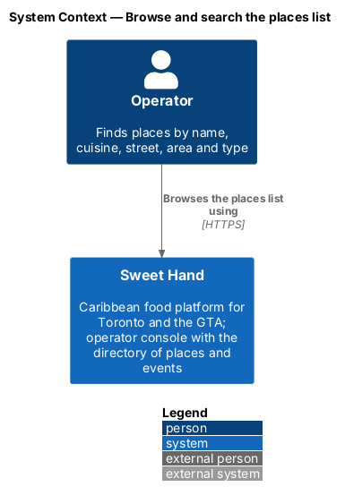
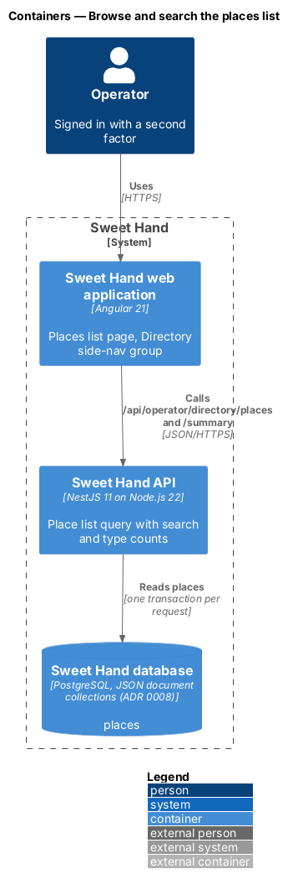
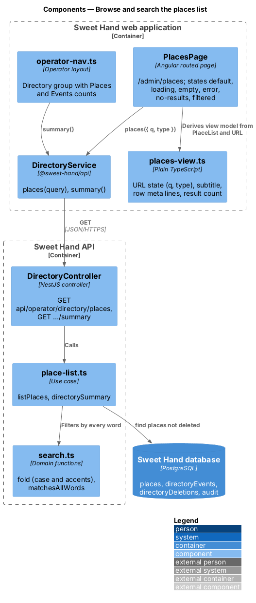
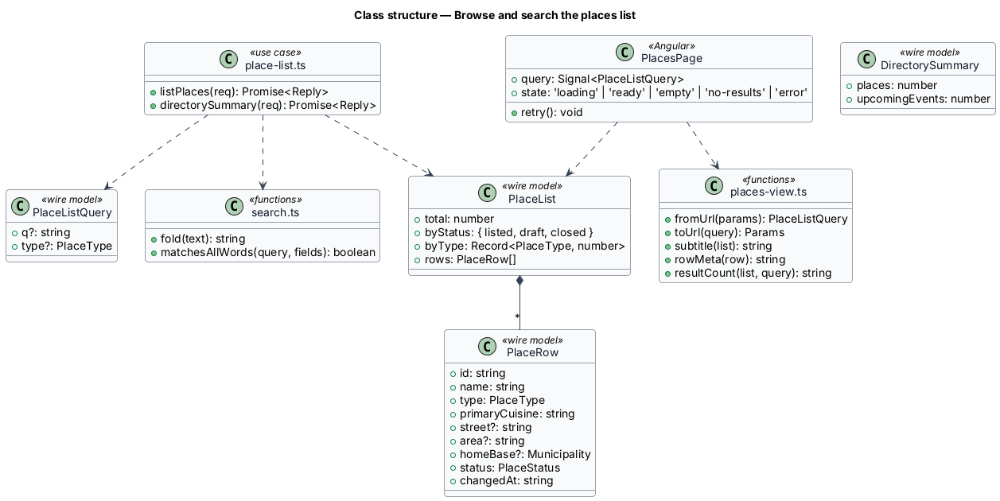
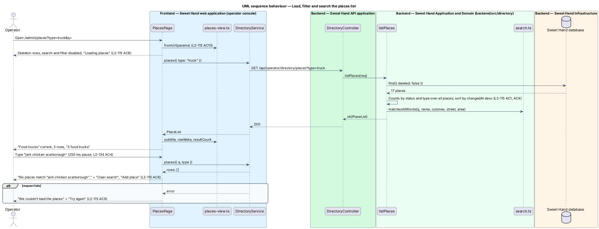

# Browse and search the places list

## Overview

The places list at `/admin/places` is where an operator finds a place to check or change (`L1-026`). It lists every place that is not deleted, most recently changed first, with a search box and a type filter, and it gives the Directory group of the operator side navigation its counts.

> **places list** — operator page listing every place in the directory, newest change first
>
> **type filter** — segmented control that narrows the list to one place type and shows how many places each type has
>
> **directory summary** — counts of places and upcoming events shown in the operator side navigation

The search matches a place when every word typed appears in its name, a cuisine, its street or its area, ignoring case and accents. The type filter keeps the search text, and both live in the URL so a reload or the back button restores them. The list covers loading, empty, no-results, filtered and error states. Opening a row leads to `view-place`; "Edit" and the delete button open the dialogs of `manage-places` and `close-or-delete-place`; the "Map" tab leads to `view-places-map`.

## Description

**Shared directory design.** The directory features share these building blocks and name them the same way:

- **Backend area `backend/src/directory/`** — `directory.controller.ts` (`DirectoryController`) maps routes under `api/operator/directory/` to use cases. Every route declares `@UsePolicy(roles('Operator'))`, so a customer or caterer session receives HTTP 403 and an operator who has not completed the second factor reaches nothing (`L2-133 AC1`). Use cases take the framework-free request context (`Request` in `http/endpoint.ts`) and return a `Reply` built with `http/problems.ts`, as `operator-settings/cuisines.ts` does.
- **Documents** — through the persistence port of ADR 0008: collection `places` (`Place`), collection `directoryEvents` (`DirectoryEvent`) and collection `directoryDeletions` (`Deletion`). Each place and event carries a `version` number for optimistic concurrency; a save with an older `version` returns `conflict(...)` (HTTP 409). The port filters only on top-level scalars, so search and range queries load the non-deleted documents and filter in process; `L2-134` sets the scale this holds for (2,000 places, 5,000 events).
- **Audit and history** — every change calls `recordAudit` (`platform/audit.ts`) with `targetType` `place` or `event` (`L2-133 AC3`). The document keeps `addedAt`, `addedBy`, `changedAt`, `changedBy` and `changeSummary` for the History sections.
- **Frontend** — pages and dialogs live in `frontend/projects/sweet-hand/src/app/features/operator/directory/`, routed from `features/operator/routes.ts` and lazy-loaded (`L2-134 AC5`). Paths come from `core/routing/paths.ts` (`paths.admin.places`, `place(id)`, `placesMap`, `events`, `event(id)`, `calendar`). Pages depend on the abstract `DirectoryService` in `@sweet-hand/api` (`services/directory.service.ts`), implemented by `HttpDirectoryService` and registered in `features/operator/providers.ts`. Wire models sit one type per file in `projects/api/src/lib/models/`, and the backend imports them with `import type`. Rules and view models are plain TypeScript beside each page; dates and times go through `core/format/format.ts` in `America/Toronto`.
- **Tests** — `backend/test/directory/` drives the API over HTTP against the in-memory database (ADR 0007, ADR 0008). `frontend/e2e/specs/directory/` covers each mock state through one page object per screen, with the directory cast seeded in test mode (ADR 0009). The seed cast in `backend/src/seed/` holds the fictional places and events of `docs/mocks/README.md`.

**Frontend — operator console (`features/operator/directory/places/`)**

- **`PlacesPage`** (`places.page.ts`, `.html`, `.css`) — routed at `paths.admin.places` with the operator layout. It reads `q` and `type` from the URL, calls `DirectoryService.places(query)` and renders:
  - the heading "Places" and the subtitle from `subtitle(list)` ("17 places · 15 listed, 1 draft, 1 closed · sorted by last change"), with "Map" and "Add place" (`L2-115 AC1`);
  - a "View" tab bar with "List" and "Map" (`L2-122 AC6`);
  - the search form (`role="search"`) with the hidden label "Search places by name, cuisine, street or area" and the placeholder "Name, cuisine, street or area"; a new request starts 250 ms after typing stops (`L2-134 AC4`);
  - the type filter as links with counts and `aria-current="page"` on the chosen type (`L2-115 AC4`);
  - `sh-list` rows: type icon, the name linking to `paths.admin.place(id)`, the meta line from `rowMeta(row)`, the `sh-status` with "updated {when}", "Edit" (labelled "Edit {name}") and the delete button (labelled "Delete {name}") (`L2-115 AC2`, `L2-115 AC3`). On phones the actions sit below the text (`L2-135 AC2`);
  - loading: 6 `sh-skeleton` rows, disabled search and filter and a hidden status "Loading places" (`L2-115 AC8`); empty: the `sh-empty-state` of `L2-115 AC7`; no results: the status and empty state of `L2-115 AC6`; error: the `sh-empty-state` of `L2-115 AC9` with "Try again".
- **`places-view.ts`** — plain functions: `fromUrl`, `toUrl` (`L2-115 AC10`), `subtitle`, `rowMeta` ("Restaurant · Jamaican · 1742 Eglinton Ave W, York · Little Jamaica", or "Food truck · Jamaican · Home base: Brampton"), `updatedLabel` ("today", "Fri 9 Oct" through `core/format/format.ts`) and `resultCount` ("3 food trucks", an ICU plural per type).
- **`operator-nav.ts`** — gains the "Directory" group: "Places {N}", "Places map", "Events {N}" and "Calendar", fed by `DirectoryService.summary()` (`L2-115 AC11`).

**Frontend — `@sweet-hand/api`**

- **`DirectoryService`** — `places(query: PlaceListQuery)` and `summary()`. Wire models `PlaceListQuery`, `PlaceList`, `PlaceRow`, `DirectorySummary`.

**Backend — `backend/src/directory/`**

- **`directory.controller.ts`** — `GET api/operator/directory/places` calls `listPlaces`; `GET api/operator/directory/summary` calls `directorySummary`.
- **`place-list.ts`** — `listPlaces(req)` loads the places that are not deleted, counts them by status and by type over the whole directory (the counts ignore the search and filter, `L2-115 AC4`), applies `type` and `q`, and sorts by `changedAt`, newest first (`L2-115 AC1`). Each row carries the area from `areaForPostalCode` plus the neighbourhood. `directorySummary(req)` returns the place count and the number of upcoming events (`browse-events`).
- **`search.ts`** — `fold(text)` lowers case and strips accents ("Lakou Kreyòl" matches "kreyol"); `matchesAllWords(query, fields)` requires every word to appear in at least one field (`L2-115 AC5`).

**Performance.** With 2,000 places the list query loads 2,000 small documents and filters them in process; the 95th percentile target is 300 ms (`L2-134 AC1`), checked in a load test. If the directory grows past `L2-134`, the port of ADR 0008 needs an indexed search `<TO SUPPLY>`.

**Responsive layout and accessibility.** The page passes the width checks of `L2-135 AC1` and the automated checks of `L2-136 AC1`; the side navigation folds into the operator menu below LG as on other operator pages.

## Requirements

The feature realizes the following level-2 (L2) requirements from `docs/specs/L2.md`. Each refines the level-1 (L1) requirement cited beside it. Requirement text is quoted from the specification, with *must* rendered as *shall*; the acceptance criteria cited in the Description are in the specification.

| L2 ID | Refines (L1) | Requirement |
|-------|--------------|-------------|
| `L2-115` | `L1-026` | The places list at `/admin/places` shall show every place that is not deleted, most recently changed first, with search and a type filter. |
| `L2-134` | `L1-022` | The directory shall stay fast with 2,000 places and 5,000 events. |
| `L2-135` | `L1-018` | Every directory page, dialog and toast shall work at every width from 320px to 2560px (L2-064), phone first. |
| `L2-136` | `L1-019` | Every directory page, dialog and toast shall meet WCAG 2.2 AA and the platform's accessibility requirements (L2-066 to L2-069). |

## Diagrams

### System context

The operator browses the directory of places in Sweet Hand. No external system takes part.

### Containers

The list page calls the places and summary endpoints of the API, which read places from the database.

### Components

`PlacesPage` derives its view model from `places-view.ts`. `listPlaces` filters with `search.ts`. The side navigation reads `directorySummary`.

### Class structure

`PlaceList` carries the counts and the rows. `PlacesPage` keeps the query as a signal mirrored in the URL.

### Behaviour — load, filter and search the list

The page restores its query from the URL, shows skeleton rows, and renders the rows, counts and result count. A search with no match shows the no-results state.

