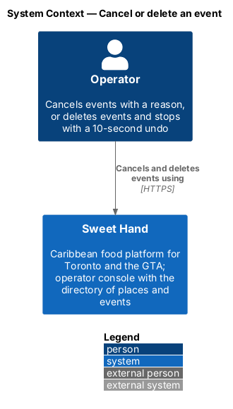
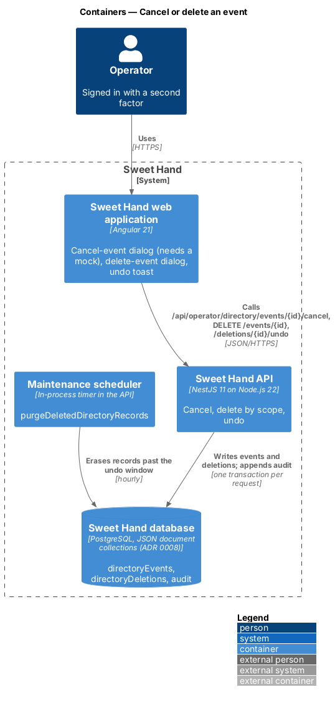
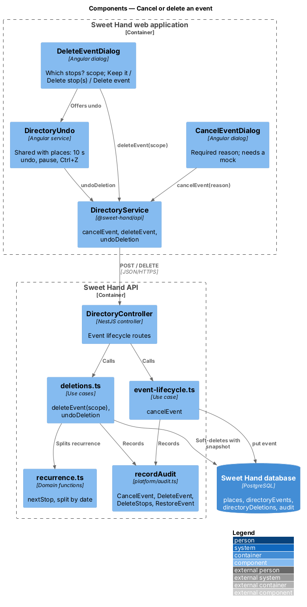
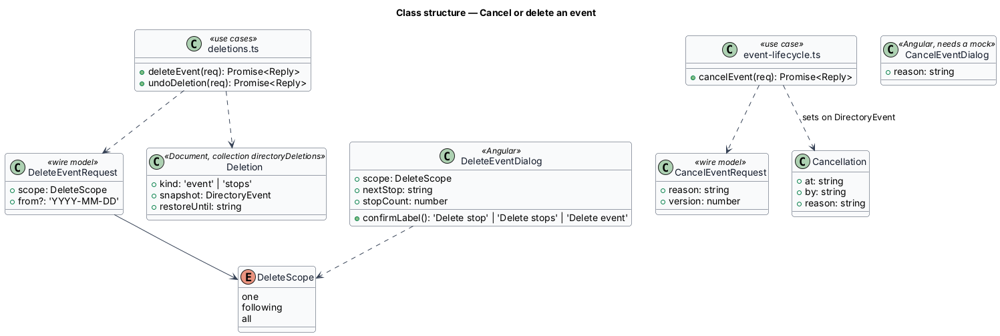
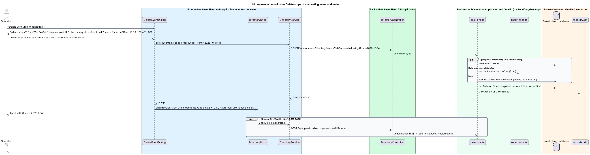
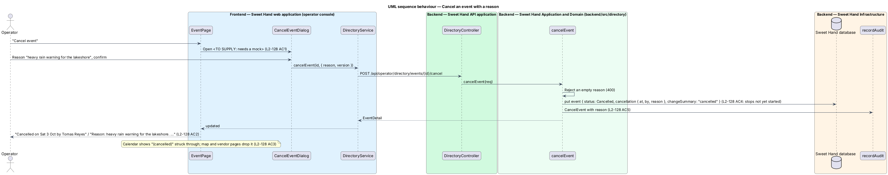

# Cancel or delete an event

## Overview

Events get called off, and events entered by mistake need removing (`L1-028`). Cancelling keeps the event on the calendar, struck through, with its reason, so operators who saw it know. Deleting removes an event, or some stops of a repeating event, after a 10-second chance to undo (assumption A-12).

> **cancelled event** — event with the status `Cancelled`, shown struck through on the calendar and dropped from the map and vendors' pages
>
> **delete scope** — which stops of a repeating event a deletion removes: only one, one and every stop after it, or all
>
> **undo window** — the 10 seconds after a deletion during which "Undo" or Ctrl+Z restores it

The cancel dialog, which asks for a reason, needs a mock before it is built (`L2-128 AC1`). Deletion shares the deletion record, undo toast and hourly purge of `close-or-delete-place`.

## Description

**Shared directory design.** The directory features share these building blocks and name them the same way:

- **Backend area `backend/src/directory/`** — `directory.controller.ts` (`DirectoryController`) maps routes under `api/operator/directory/` to use cases. Every route declares `@UsePolicy(roles('Operator'))`, so a customer or caterer session receives HTTP 403 and an operator who has not completed the second factor reaches nothing (`L2-133 AC1`). Use cases take the framework-free request context (`Request` in `http/endpoint.ts`) and return a `Reply` built with `http/problems.ts`, as `operator-settings/cuisines.ts` does.
- **Documents** — through the persistence port of ADR 0008: collection `places` (`Place`), collection `directoryEvents` (`DirectoryEvent`) and collection `directoryDeletions` (`Deletion`). Each place and event carries a `version` number for optimistic concurrency; a save with an older `version` returns `conflict(...)` (HTTP 409). The port filters only on top-level scalars, so search and range queries load the non-deleted documents and filter in process; `L2-134` sets the scale this holds for (2,000 places, 5,000 events).
- **Audit and history** — every change calls `recordAudit` (`platform/audit.ts`) with `targetType` `place` or `event` (`L2-133 AC3`). The document keeps `addedAt`, `addedBy`, `changedAt`, `changedBy` and `changeSummary` for the History sections.
- **Frontend** — pages and dialogs live in `frontend/projects/sweet-hand/src/app/features/operator/directory/`, routed from `features/operator/routes.ts` and lazy-loaded (`L2-134 AC5`). Paths come from `core/routing/paths.ts` (`paths.admin.places`, `place(id)`, `placesMap`, `events`, `event(id)`, `calendar`). Pages depend on the abstract `DirectoryService` in `@sweet-hand/api` (`services/directory.service.ts`), implemented by `HttpDirectoryService` and registered in `features/operator/providers.ts`. Wire models sit one type per file in `projects/api/src/lib/models/`, and the backend imports them with `import type`. Rules and view models are plain TypeScript beside each page; dates and times go through `core/format/format.ts` in `America/Toronto`.
- **Tests** — `backend/test/directory/` drives the API over HTTP against the in-memory database (ADR 0007, ADR 0008). `frontend/e2e/specs/directory/` covers each mock state through one page object per screen, with the directory cast seeded in test mode (ADR 0009). The seed cast in `backend/src/seed/` holds the fictional places and events of `docs/mocks/README.md`.

**Frontend — operator console**

- **`CancelEventDialog`** (`features/operator/directory/cancel-event/`) — opened from "Cancel event" on a scheduled event's page. It asks for a required reason and calls `cancelEvent(id, { reason, version })`. Its layout, copy and states wait for a mock (`L2-128 AC1`).
- **`EventPage`** (`browse-events`) — for a cancelled event, shows the alert "Cancelled on {date} by {operator}" and "Reason: {reason}. It shows struck through on the calendar and is hidden from the public listing." and the actions "Edit" and "Delete" (`L2-128 AC2`).
- **`DeleteEventDialog`** (`features/operator/directory/delete-event/`) — title "Delete {title}?", description "Deleted events can be restored for 10 seconds.", the vendor sentence with the number of linked places, the "Cancel event" hint, and the buttons "Keep it" and "Delete event", with focus on "Keep it" (`L2-129 AC1`). For a repeating event it adds the `sh-radio-group` "Which stops?" with "Only {date}" ("The other {N} stops stay."), "{date} and every stop after it" and "All {N} stops", where `{date}` is the next stop that has not started; the button reads "Delete stop", "Delete stops" or "Delete event" by choice (`L2-129 AC2`). Busy ("Deleting…", "Deleting the event") and failed ("We couldn’t delete the event" / "Nothing was removed. Try again.") follow `L2-129 AC3`.
- **`DirectoryUndo`** (`close-or-delete-place`) — shows "{title} deleted" with "Undo" for 10 seconds, paused on focus or hover, with Ctrl+Z (`L2-129 AC4`, `L2-129 AC5`). The toast's second line waits for a mock.

**Frontend — `@sweet-hand/api`**

- **`DirectoryService`** — `cancelEvent(id, request)`, `deleteEvent(id, request)`, `undoDeletion(deletionId)`. Wire models `CancelEventRequest`, `DeleteScope`, `DeleteEventRequest`, `DeletionReceipt`.

**Backend — `backend/src/directory/`**

- **`directory.controller.ts`** — `POST api/operator/directory/events/:id/cancel` and `DELETE api/operator/directory/events/:id?scope=one|following|all&from=YYYY-MM-DD`; the undo route is shared.
- **`event-lifecycle.ts`** — `cancelEvent(req)` requires a reason of 1 to 200 characters, checks `version`, sets `Cancelled` and `cancellation { at, by, reason }`, and records "cancelled" and `CancelEvent` with the reason (`L2-128 AC5`). Occurrences that have ended stay as they were in the history; `expandOccurrences` marks only later stops cancelled (`L2-128 AC4`). The map, the vendors' "At events" and "Upcoming stops", and the event lists leave cancelled occurrences out of upcoming views; the calendar keeps them with `status: 'Cancelled'` (`L2-128 AC3`).
- **`deletions.ts`** — `deleteEvent(req)` writes a `Deletion` (`kind: 'event'` or `'stops'`) with the event snapshot and `restoreUntil`, then: for `all`, or `following` from the first stop, marks the event deleted; for `following` from a later stop, sets `Until` to the stop before `from`; for `one`, adds the date to `removedDates`. It writes `DeleteEvent` or `DeleteStops` (`L2-129 AC6`). `undoDeletion` restores the snapshot and writes `RestoreEvent`. `purge.ts` erases expired event deletions as it does places.

Open points:

- The cancel dialog, the deletion toast's second line and the dialog text for an event with no vendors: *(needs a mock)*.
- Whether a cancellation can be reversed (`L2-128 AC5`): `<TO SUPPLY>`.

## Requirements

The feature realizes the following level-2 (L2) requirements from `docs/specs/L2.md`. Each refines the level-1 (L1) requirement cited beside it. Requirement text is quoted from the specification, with *must* rendered as *shall*; the acceptance criteria cited in the Description are in the specification.

| L2 ID | Refines (L1) | Requirement |
|-------|--------------|-------------|
| `L2-128` | `L1-028` | An operator shall be able to cancel an event with a reason. A cancelled event stays on the calendar, struck through, so people who saw it know; it is the gentler alternative to deleting. |
| `L2-129` | `L1-028` | An operator shall be able to delete an event, or some stops of a repeating event, after confirming, and undo it within 10 seconds. After that the deletion is permanent (A-12). |
| `L2-132` | `L1-026` | Results of directory actions shall appear as toasts that follow the toast component (`docs/specs/components/toast.md`). |

## Diagrams

### System context

The operator cancels and deletes events in Sweet Hand. No external system takes part.

### Containers

The dialogs call the cancel and delete endpoints. The scheduler inside the API erases expired deletions.

### Components

`event-lifecycle.ts` cancels; `deletions.ts` deletes by scope and undoes, using `recurrence.ts` to split a series.

### Class structure

`DeleteEventRequest` carries the scope; `Cancellation` sits on the event; `Deletion` holds the snapshot for undo.

### Behaviour — delete stops of a repeating event and undo

The chosen scope decides whether the event is marked deleted, its Until date moves, or one date is removed. A snapshot makes the undo exact.

### Behaviour — cancel an event with a reason

The cancellation keeps the event and its earlier stops, records who cancelled it and why, and every upcoming view drops it.

