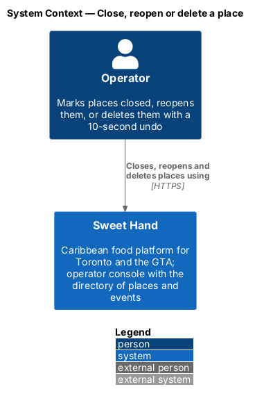
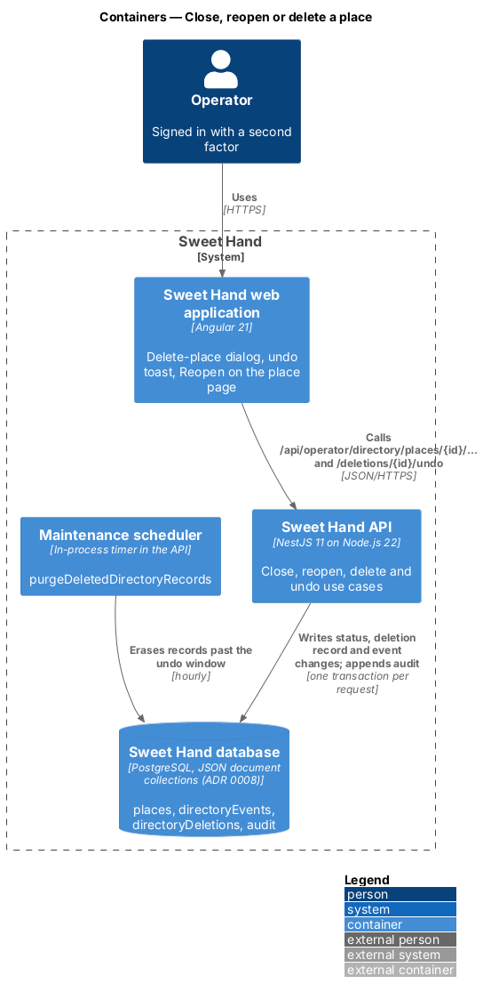
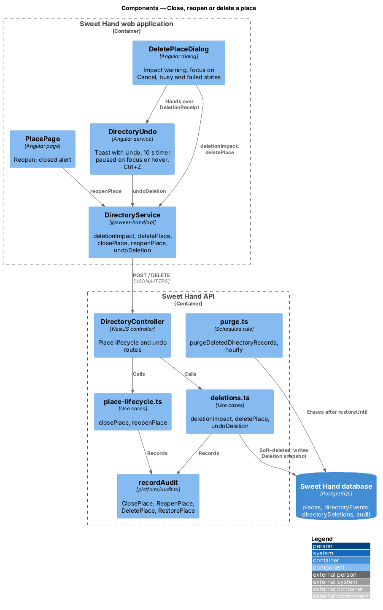
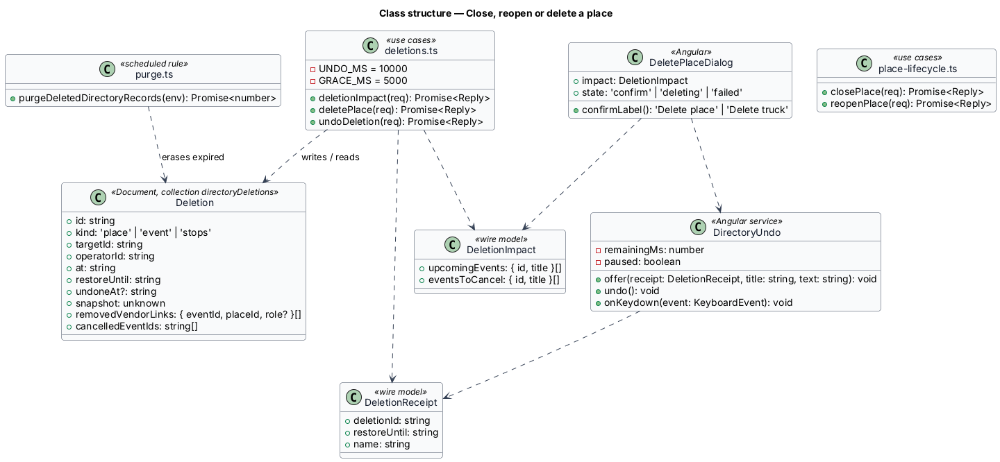
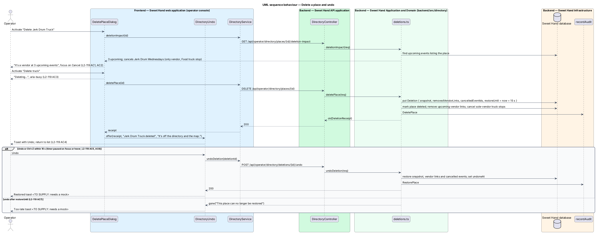
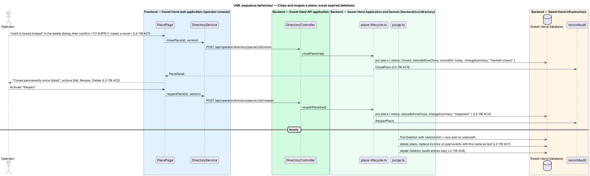

# Close, reopen or delete a place

## Overview

Places close, and records added by mistake need removing (`L1-026`). This feature gives operators a gentle and a final option. Marking a place closed keeps it and its history; deleting removes it after a 10-second chance to undo (assumption A-12).

> **closed place** — place with the status `Closed`, kept in the list and off the map
>
> **deletion** — removal of a place or event, undoable for 10 seconds and permanent after that
>
> **undo window** — the 10 seconds after a deletion during which "Undo" or Ctrl+Z restores it
>
> **deletion impact** — upcoming events a place is a vendor at, and the food truck stops that would be cancelled because it is their only vendor
>
> **purge** — scheduled erasure of a deleted record once its undo window has passed

The delete dialog warns when the place is a vendor at upcoming events and offers "mark it closed instead". Deleting takes the place off the list, the map and every event's vendors at once and shows a toast with "Undo". After the window, an hourly rule erases the record; past events keep its name as plain text, and the audit entries stay. The toast behaviour, shared with event deletion, follows the toast component (`L2-132`).

## Description

**Shared directory design.** The directory features share these building blocks and name them the same way:

- **Backend area `backend/src/directory/`** — `directory.controller.ts` (`DirectoryController`) maps routes under `api/operator/directory/` to use cases. Every route declares `@UsePolicy(roles('Operator'))`, so a customer or caterer session receives HTTP 403 and an operator who has not completed the second factor reaches nothing (`L2-133 AC1`). Use cases take the framework-free request context (`Request` in `http/endpoint.ts`) and return a `Reply` built with `http/problems.ts`, as `operator-settings/cuisines.ts` does.
- **Documents** — through the persistence port of ADR 0008: collection `places` (`Place`), collection `directoryEvents` (`DirectoryEvent`) and collection `directoryDeletions` (`Deletion`). Each place and event carries a `version` number for optimistic concurrency; a save with an older `version` returns `conflict(...)` (HTTP 409). The port filters only on top-level scalars, so search and range queries load the non-deleted documents and filter in process; `L2-134` sets the scale this holds for (2,000 places, 5,000 events).
- **Audit and history** — every change calls `recordAudit` (`platform/audit.ts`) with `targetType` `place` or `event` (`L2-133 AC3`). The document keeps `addedAt`, `addedBy`, `changedAt`, `changedBy` and `changeSummary` for the History sections.
- **Frontend** — pages and dialogs live in `frontend/projects/sweet-hand/src/app/features/operator/directory/`, routed from `features/operator/routes.ts` and lazy-loaded (`L2-134 AC5`). Paths come from `core/routing/paths.ts` (`paths.admin.places`, `place(id)`, `placesMap`, `events`, `event(id)`, `calendar`). Pages depend on the abstract `DirectoryService` in `@sweet-hand/api` (`services/directory.service.ts`), implemented by `HttpDirectoryService` and registered in `features/operator/providers.ts`. Wire models sit one type per file in `projects/api/src/lib/models/`, and the backend imports them with `import type`. Rules and view models are plain TypeScript beside each page; dates and times go through `core/format/format.ts` in `America/Toronto`.
- **Tests** — `backend/test/directory/` drives the API over HTTP against the in-memory database (ADR 0007, ADR 0008). `frontend/e2e/specs/directory/` covers each mock state through one page object per screen, with the directory cast seeded in test mode (ADR 0009). The seed cast in `backend/src/seed/` holds the fictional places and events of `docs/mocks/README.md`.

**Frontend — operator console**

- **`DeletePlaceDialog`** (`features/operator/directory/delete-place/`) — opened from a row's delete button or "Delete" on the place page. On open it calls `DirectoryService.deletionImpact(id)` and renders the title "Delete {name}?", the description "This can’t be undone after 10 seconds.", the text of `L2-119 AC1`, the warning of `L2-119 AC2` when the impact is not empty, and "mark it closed instead" for a place that is not closed. Focus starts on "Cancel" (`L2-136 AC2`). The confirm button reads "Delete place", or "Delete truck" for a food truck. Busy and failed states follow `L2-119 AC3`.
  - "mark it closed instead" closes the dialog and opens the closing confirmation, which waits for a mock, then calls `closePlace` (`L2-118 AC1`).
- **`DirectoryUndo`** (`features/operator/directory/undo/directory-undo.ts`) — an injectable service shared with event deletion. `offer(receipt, title, text)` shows an `sh-toast` with "Undo" in the polite region and starts a 10-second timer that pauses while the toast has focus or the pointer is over it (`L2-119 AC6`, `L2-132 AC2`). A document keydown listener treats Ctrl+Z, or ⌘Z on macOS, as "Undo" while focus is outside a text field (`L2-119 AC5`). It calls `undoDeletion(deletionId)`; a 410 shows the too-late toast, which waits for a mock (`L2-119 AC7`).
- **`PlacePage`** (`view-place`) — for a closed place, shows the `sh-alert` "Closed permanently since {date}" with "It’s off the map and out of search. Its past events keep the name so the history still reads right." and the actions "Edit", "Reopen" and "Delete" (`L2-118 AC2`). After a deletion from the page, the router goes to `paths.admin.places` (`L2-119 AC4`).

**Frontend — `@sweet-hand/api`**

- **`DirectoryService`** — `deletionImpact(id)`, `deletePlace(id)`, `closePlace(id, version)`, `reopenPlace(id, version)`, `undoDeletion(deletionId)`. Wire models `DeletionImpact` and `DeletionReceipt`.

**Backend — `backend/src/directory/`**

- **`directory.controller.ts`** — `GET .../places/:id/deletion-impact`, `DELETE .../places/:id`, `POST .../places/:id/close`, `POST .../places/:id/reopen` and `POST api/operator/directory/deletions/:id/undo`.
- **`place-lifecycle.ts`** — `closePlace` stores `statusBeforeClose`, sets `Closed` and `closedOn` to today in Toronto, and records "marked closed"; `reopenPlace` restores `statusBeforeClose` and records "reopened" (`L2-118 AC4`, `L2-118 AC5`). Each writes an audit entry. A closed place drops out of the map data and the vendor suggestions but stays in the list and its search (`L2-118 AC3`).
- **`deletions.ts`** — `deletionImpact` finds upcoming events that list the place and, among them, Food truck stops whose only vendor it is. `deletePlace`, in one transaction:
  1. writes a `Deletion` with `kind: 'place'`, the place snapshot, the vendor links it removes from upcoming events, the ids of events it cancels and `restoreUntil` = now + 10 s + a 5 s network grace;
  2. sets `deletionId` on the place, which every query treats as deleted;
  3. removes the place from upcoming events' vendors, cancels the sole-vendor truck stops with the reason "Vendor deleted from the directory", and leaves past events' links in place;
  4. writes `DeletePlace` to the audit log and returns the `DeletionReceipt` (`L2-119 AC4`, `L2-119 AC8`).
  `undoDeletion` returns `gone(...)` (HTTP 410) after `restoreUntil` or after a purge; otherwise it restores the snapshot, the vendor links and the cancelled events, sets `undoneAt` and writes `RestorePlace` (`L2-119 AC5`, `L2-119 AC7`).
- **`purge.ts`** — `purgeDeletedDirectoryRecords(env)` runs hourly from `maintenance/scheduler.ts`, beside the launch-list sweep. For each `Deletion` past `restoreUntil` with no `undoneAt`, it deletes the place document, replaces its links on past events with `{ placeId: null, name }` and deletes the `Deletion`, so the record is erased within 1 hour (`L2-119 AC7`). It logs counts only. The retention table of `L2-073` records this rule.

Open points:

- The closing confirmation, the restored toast and the too-late toast: *(needs a mock)*.
- What happens to a closed place's links to upcoming events (`L2-118 AC6`): `<TO SUPPLY>`.
- WCAG 2.2.1 (timing adjustable): the undo pauses on focus and hover, and the dialog states the limit (`L2-136 AC6`). Whether operators also need a setting to lengthen the window: `<TO SUPPLY>`.

## Requirements

The feature realizes the following level-2 (L2) requirements from `docs/specs/L2.md`. Each refines the level-1 (L1) requirement cited beside it. Requirement text is quoted from the specification, with *must* rendered as *shall*; the acceptance criteria cited in the Description are in the specification.

| L2 ID | Refines (L1) | Requirement |
|-------|--------------|-------------|
| `L2-118` | `L1-026` | An operator shall be able to mark a place closed for good and to reopen it. Closing keeps the place and its history; it is the gentler alternative to deleting. |
| `L2-119` | `L1-026` | An operator shall be able to delete a place after confirming, and undo the deletion within 10 seconds. After that the deletion is permanent (A-12). |
| `L2-132` | `L1-026` | Results of directory actions shall appear as toasts that follow the toast component (`docs/specs/components/toast.md`). |
| `L2-133` | `L1-021` | The directory is an operator-only tool (A-9). Every page and endpoint shall enforce that on the server, record every change, and keep home addresses out (A-10, A-11). |

## Diagrams

### System context

The operator closes, reopens and deletes places in Sweet Hand. No external system takes part.

### Containers

The dialogs call the lifecycle and deletion endpoints. The maintenance scheduler inside the API erases expired deletions from the database every hour.

### Components

`deletions.ts` owns the deletion impact, the deletion with its snapshot and the undo. `place-lifecycle.ts` closes and reopens. `purge.ts` runs on the scheduler.

### Class structure

`Deletion` holds everything an undo needs. `DirectoryUndo` turns a `DeletionReceipt` into a toast with a paused-on-focus timer and the Ctrl+Z shortcut.

### Behaviour — delete a place and undo

The dialog loads the deletion impact first. The deletion stores a snapshot and returns a receipt; the undo restores the snapshot within the window and is refused after it.

### Behaviour — close, reopen and purge

Closing remembers the earlier status and reopening restores it. The hourly rule erases deletions whose window has passed.

