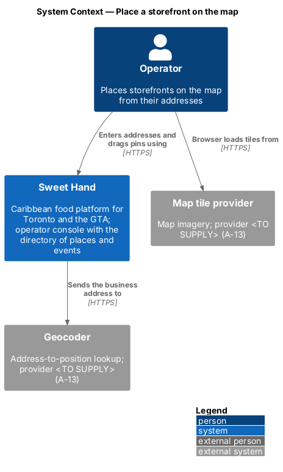
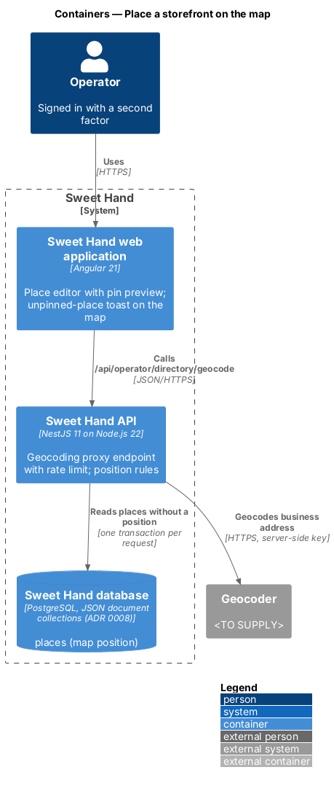
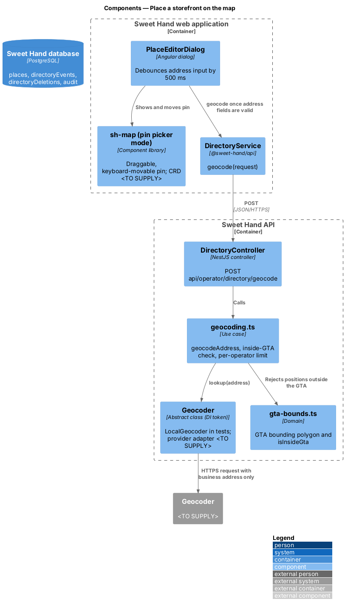
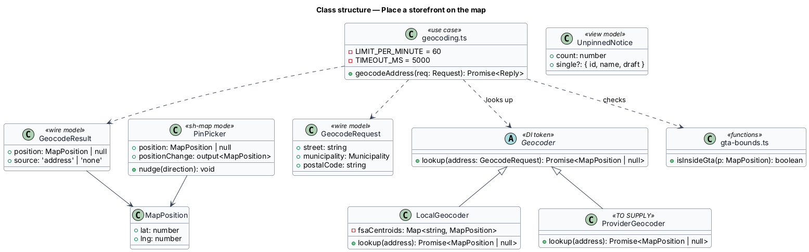
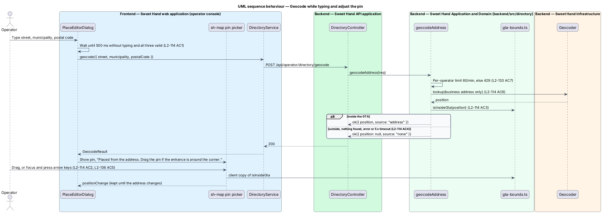
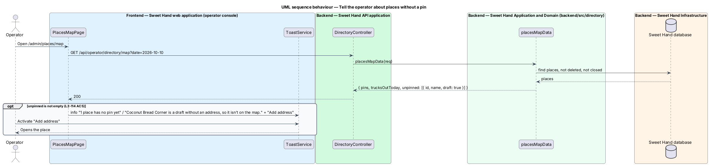

# Place a storefront on the map

## Overview

A storefront appears on the places map at its map position (`L1-027`). This feature turns the address typed into the place editor into that position, lets the operator adjust it, and tells the operator about places that have no position yet.

> **map position** — latitude and longitude of a storefront's entrance, inside the GTA
>
> **geocoder** — external service that converts a business address into a map position; provider `<TO SUPPLY>` (A-13)
>
> **pin picker** — mode of the map component in which one pin can be dragged or moved with the keyboard
>
> **unpinned place** — storefront that is not closed and has no map position

The editor asks for a position once the street, municipality and postal code are valid and the operator has stopped typing for 500 ms. The pin can be dragged when the entrance is around the corner. Positions outside the GTA are not accepted. When the geocoder finds nothing or fails, the place still saves without a pin, and the places map later reports it. Food trucks never get a fixed pin; they appear on the map through their stops (`view-places-map`).

## Description

**Shared directory design.** The directory features share these building blocks and name them the same way:

- **Backend area `backend/src/directory/`** — `directory.controller.ts` (`DirectoryController`) maps routes under `api/operator/directory/` to use cases. Every route declares `@UsePolicy(roles('Operator'))`, so a customer or caterer session receives HTTP 403 and an operator who has not completed the second factor reaches nothing (`L2-133 AC1`). Use cases take the framework-free request context (`Request` in `http/endpoint.ts`) and return a `Reply` built with `http/problems.ts`, as `operator-settings/cuisines.ts` does.
- **Documents** — through the persistence port of ADR 0008: collection `places` (`Place`), collection `directoryEvents` (`DirectoryEvent`) and collection `directoryDeletions` (`Deletion`). Each place and event carries a `version` number for optimistic concurrency; a save with an older `version` returns `conflict(...)` (HTTP 409). The port filters only on top-level scalars, so search and range queries load the non-deleted documents and filter in process; `L2-134` sets the scale this holds for (2,000 places, 5,000 events).
- **Audit and history** — every change calls `recordAudit` (`platform/audit.ts`) with `targetType` `place` or `event` (`L2-133 AC3`). The document keeps `addedAt`, `addedBy`, `changedAt`, `changedBy` and `changeSummary` for the History sections.
- **Frontend** — pages and dialogs live in `frontend/projects/sweet-hand/src/app/features/operator/directory/`, routed from `features/operator/routes.ts` and lazy-loaded (`L2-134 AC5`). Paths come from `core/routing/paths.ts` (`paths.admin.places`, `place(id)`, `placesMap`, `events`, `event(id)`, `calendar`). Pages depend on the abstract `DirectoryService` in `@sweet-hand/api` (`services/directory.service.ts`), implemented by `HttpDirectoryService` and registered in `features/operator/providers.ts`. Wire models sit one type per file in `projects/api/src/lib/models/`, and the backend imports them with `import type`. Rules and view models are plain TypeScript beside each page; dates and times go through `core/format/format.ts` in `America/Toronto`.
- **Tests** — `backend/test/directory/` drives the API over HTTP against the in-memory database (ADR 0007, ADR 0008). `frontend/e2e/specs/directory/` covers each mock state through one page object per screen, with the directory cast seeded in test mode (ADR 0009). The seed cast in `backend/src/seed/` holds the fictional places and events of `docs/mocks/README.md`.

**Frontend — operator console**

- **`PlaceEditorDialog`** (`manage-places`) — watches the three address fields. When all three pass their client checks and 500 ms pass without typing, it calls `DirectoryService.geocode`, with at most one request in flight; a newer address cancels the older request (`L2-114 AC1`, `L2-134 AC4`). The returned position feeds the pin picker, followed by the text "Placed from the address. Drag the pin if the entrance is around the corner." A manual position is kept until the address changes again (`L2-114 AC2`).
- **`sh-map` in pin-picker mode** — a new library component whose CRD is `<TO SUPPLY>` and comes before implementation. The pin is a button named "{name}, {type}, {area}". Dragging moves it; with focus, the arrow keys move it by a fixed step, so dragging is never the only way (`L2-136 AC5`, WCAG 2.2 success criterion 2.5.7). It holds a client copy of the GTA boundary and snaps back to the last accepted position when moved outside it (`L2-114 AC3`). Map tiles load only on the map page, the place page and the editor (`L2-134 AC5`).
- **`PlacesMapPage`** (`view-places-map`) — when `PlacesMap.unpinned` is not empty, shows the info toast "1 place has no pin yet" with "{name} is a draft without an address, so it isn’t on the map." for a single draft, and "Add address", which opens the place (`L2-114 AC5`). The wording for several places, or a listed place, follows the same pattern with an ICU plural.

**Backend — `backend/src/directory/`**

- **`directory.controller.ts`** — `POST api/operator/directory/geocode` calls `geocodeAddress`.
- **`geocoding.ts`** — `geocodeAddress(req)` counts the operator's geocoding requests and returns HTTP 429 above 60 in a minute (`L2-133 AC7`). It calls `req.env.geocoder.lookup` with the street, municipality and postal code only (`L2-114 AC6`), gives up after 5 s, and returns `{ position: null, source: 'none' }` for no result, an error, a timeout or a position outside the GTA (`L2-114 AC3`, `L2-114 AC4`).
- **`Geocoder`** — abstract class and DI token on the environment, like the other provider ports. `LocalGeocoder` answers from a table of postal-code area centroids and is used in every test and until a provider is chosen. The provider adapter, its key (held in Key Vault and never sent to the browser) and its data location are `<TO SUPPLY>` (A-13).
- **`gta-bounds.ts`** — `isInsideGta(position)`, a polygon test shared in spirit with the client copy.
- **`places.ts`** (`manage-places`) — stores the position the editor sends after checking `isInsideGta`; a storefront saved without one is valid.

Open points:

- Geocoder and map tile provider, their terms, keys and data location: `<TO SUPPLY>` (A-13).
- The keyboard step size for moving a pin, and its mock: `<TO SUPPLY>`.
- Whether the server should geocode on save when the editor sent no position: `<TO SUPPLY>`.

## Requirements

The feature realizes the following level-2 (L2) requirements from `docs/specs/L2.md`. Each refines the level-1 (L1) requirement cited beside it. Requirement text is quoted from the specification, with *must* rendered as *shall*; the acceptance criteria cited in the Description are in the specification.

| L2 ID | Refines (L1) | Requirement |
|-------|--------------|-------------|
| `L2-114` | `L1-027` | A storefront's map position shall come from its address, and an operator shall be able to adjust it by hand. Geocoding goes through the Sweet Hand API, using a provider still `<TO SUPPLY>` (A-13). |

## Diagrams

### System context

The operator places storefronts in Sweet Hand. Sweet Hand asks the geocoder for positions; the browser loads map tiles from the tile provider. Both providers are still to be chosen.

### Containers

The editor calls the geocoding endpoint of the API, which calls the geocoder with a server-side key. The database holds the accepted position on the place.

### Components

`geocoding.ts` enforces the per-operator limit and the GTA boundary around the `Geocoder` port. The pin picker in the editor shows and moves the result.

### Class structure

`Geocoder` has a local implementation for tests and a provider implementation still to be supplied. `GeocodeResult` carries a position or none.

### Behaviour — geocode while typing and adjust the pin

The editor waits for a valid address and a pause, the API geocodes it with the business address only, and the pin picker lets the operator adjust the result inside the GTA.

### Behaviour — report places without a pin

The map data lists storefronts without a position, and the map page reports them in an info toast with a way to fix them.

