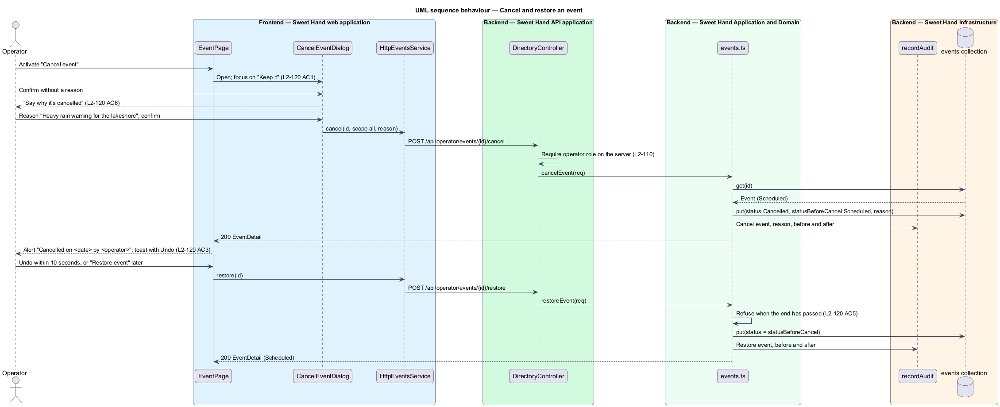
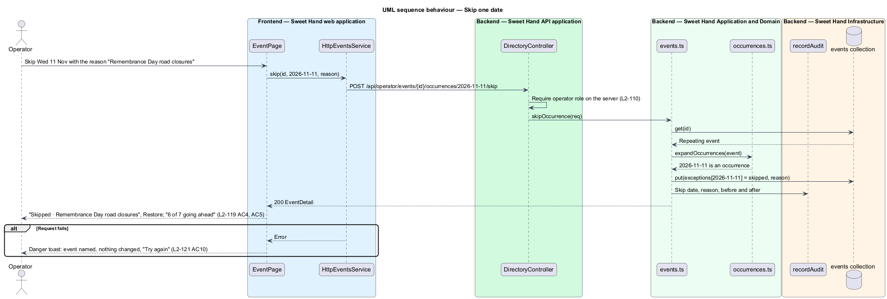

# Manage events

## Overview

The second half of the directory is a record of dated Caribbean food events in
Toronto and the GTA. These are festivals, markets, trade shows, food truck
stops, pop-ups and workshops. Operators keep this record to know what is on
and which places from the directory take part. Like the places half
(`manage-places`), it is for operators only (`L2-110`). This feature covers
the events list, the event page, the event editor, repeating events, skipped
dates, and cancelling and restoring an event.

> **event** — one dated happening, with a venue, an area, admission and vendor places from the directory
>
> **repeat rule** — every week, every 2 weeks or every month, until an end date
>
> **occurrence** — one date an event happens on; a one-off event has one, a repeating event has one per repeat
>
> **skipped occurrence** — one date of a repeating event that will not happen, with a reason; it can be restored
>
> **status** — `Draft`, `Scheduled` or `Cancelled`; a scheduled event reads "Ended" once its last date has passed
>
> **vendor** — a place from the directory linked to an event; the place's page lists the event

The events page lists events in Upcoming, Past and Drafts tabs, and search
finds them by title, venue or area (`L2-116`). The event page shows the record
(`L2-117`). The event editor adds and changes events, checks times in
`America/Toronto`, and links vendor places (`L2-118`). A repeating event
expands into occurrences, and one date can be skipped and restored (`L2-119`).
Events are never deleted by an operator. They are cancelled with a reason and
can be restored (`L2-120`). Events whose last date ended more than 2 years ago
are deleted by the retention job (`L2-116 AC4`). The calendar view of the same
occurrences is `view-events-calendar`.

## Description

The design follows the same as-built backend as `manage-places`: JSON
documents behind the persistence port, plain use-case functions, and
`DirectoryController` routes under `@UsePolicy(roles('Operator'))`.

**Frontend — Sweet Hand web application** (`features/operator/directory/events/`)

- **`EventsPage`** — `/admin/events`. It shows the tabs with counts, the
  search box, rows grouped by "This week", "Later in <month>" and later
  months, and the empty, no-results and error states. Tab and search live in
  the URL.
- **`EventPage`** — `/admin/events/{id}`. It shows "When", venue, area,
  admission, organiser, website, description, vendors with a "Closed" badge
  where needed, stops with skip and restore, and history. It offers "Edit",
  plus "Cancel event" or "Restore event".
- **`EventEditorDialog`** — the add and edit dialog on `sh-dialog`. Opened from
  a calendar day or a food truck's "Add stop", it starts with that date. "Add
  stop" also starts with the truck as vendor and "Food truck stop" as type
  (`L2-118 AC2`). Vendors use the library `sh-combobox` and offer only places
  that are not closed.
- **`CancelEventDialog`** — takes a required reason. For a repeating event, it
  also asks "Which stops?": only this date, this date and every later one, or
  all of them (`L2-120 AC2`).
- **`events-view.ts`** — view models, grouping headings, "When" text and
  validation messages. Dates and times go through `core/format/format.ts`.
- "Events" is added to `operator-nav.ts`, and `paths.admin.events` and
  `paths.admin.event(id)` are added to `core/routing/paths.ts`.

**Frontend — API library**

- **`EventsService`** / **`HttpEventsService`** — `list`, `get`, `add`,
  `edit`, `cancel`, `restore`, `skip` and `restoreOccurrence`.
- Wire models: `EventSummary`, `EventsPage`, `EventDetail`, `EventRequest`,
  `RepeatRule`, `EventOccurrence`, `CancelEventRequest`,
  `SkipOccurrenceRequest`, `EventType`, `EventStatus`.

**Backend — Sweet Hand API application** (`DirectoryController`)

- `GET /api/operator/events` (`tab`, `q`) → `listEvents`
- `GET /api/operator/events/{id}` → `getEvent`
- `POST /api/operator/events` → `addEvent`
- `PUT /api/operator/events/{id}` → `editEvent`
- `POST /api/operator/events/{id}/cancel` (`reason`, `scope`, `from`) → `cancelEvent`
- `POST /api/operator/events/{id}/restore` → `restoreEvent`
- `POST /api/operator/events/{id}/occurrences/{date}/skip` (`reason`) → `skipOccurrence`
- `POST /api/operator/events/{id}/occurrences/{date}/restore` → `restoreOccurrence`

No route deletes an event (`L2-120 AC8`).

**Backend — Sweet Hand Application and Domain** (`backend/src/directory/`)

- **`model.ts`** — the `DirectoryEvent` document and the `events(tx)`
  collection. An event has `id`, `title`, `type`, `startLocal` and `endLocal`
  (wall-clock date and time in `America/Toronto`), `repeat` (`every`,
  `until`), `venue`, `area` and `venuePin`. It also has `admission` (`free`,
  or `price` in cents), `organiser`, `vendorIds`, `about` and `website`.
  Its state is held in `status`, `statusBeforeCancel`, `cancelledAt`,
  `cancelledBy`, `cancelReason` and `exceptions`, keyed by occurrence date.
  An exception holds `skipped` with a reason, `cancelled` with a reason, or a
  frozen `startLocal` and `endLocal`. History is held in `addedAt`, `addedBy`,
  `changedAt` and `changedBy`.
- **`occurrences.ts`** — **`expandOccurrences(event, from, to)`** is the
  single source of occurrence dates. Its rules:
  - It repeats in wall-clock time, so 11 a.m. stays 11 a.m. across
    daylight-saving changes.
  - A monthly repeat from the 31st falls on the last day of a shorter month
    (`L2-119 AC3`).
  - It applies the exceptions.
  - It converts each occurrence to UTC for storage-independent comparison.
  - It caps a series at 52 occurrences and 1 year (`L2-119 AC2`).
- **`events.ts`** — the use cases:
  - **`listEvents`** expands occurrences to group the Upcoming rows. Past
    lists events that ended or were cancelled in the last 30 days.
  - **`addEvent`** and **`editEvent`** run `validateEvent`. A venue pin comes
    from the `Geocoder` (`manage-places`). Editing a repeating event first
    freezes its past occurrences as exceptions, so only future stops change
    (`L2-119 AC6`). Skipped dates stay skipped (`L2-119 AC7`).
  - **`cancelEvent`** has two scopes. Scope `all` sets `Cancelled` and keeps
    `statusBeforeCancel`. Scope `from` marks that date and every later one as
    cancelled exceptions. A single date is a skip.
  - **`restoreEvent`** returns `statusBeforeCancel` while the end has not
    passed. It also serves the Undo toast.
  - Every use case calls `recordAudit`.
- **`event-rules.ts`** — **`validateEvent`** checks:
  - title 1–100 and venue 1–120 characters
  - type, and area from the service areas (`L2-010`)
  - the end after the start, compared in `America/Toronto` (`L2-118 AC3`)
  - at most 14 days per occurrence (`L2-118 AC4`)
  - a ticket price from $0.01 to $9,999.99 when ticketed (`L2-118 AC5`)
  - organiser up to 100 characters, about up to 2,000, an `https://`
    website, and up to 100 vendors that are not closed

**Backend — Sweet Hand Infrastructure**

- **Persistence port** — the `events` collection, plus reads of `places` for
  vendor names and the "Closed" badge (`L2-117 AC3`).
- **`recordAudit`** — one entry per add, edit, cancel, restore, skip and
  restore of a date (`L2-110 AC5`).
- **`privacy/retention.ts`** — the daily retention job gains one rule. It
  deletes events whose last occurrence ended more than 2 years ago
  (`L2-116 AC4`). Places drop the link because their "At events" list is read
  from the events collection.
- **`seed/`** — the fictional October 2026 events from `docs/mocks/README.md`.

**Open points.** Events that span midnight, such as a night market ending at
1 a.m., are treated as ending on the next day. Whether this needs its own
wording on the calendar is `<TO SUPPLY>`.

## Requirements

The feature realizes the following level-2 (L2) requirements from
`docs/specs/L2.md`. Each refines the level-1 (L1) requirement cited beside it.
Requirement text is quoted from the specification, with *must* rendered as
*shall*.

| L2 ID | Refines (L1) | Requirement |
|-------|--------------|-------------|
| `L2-110` | `L1-021` | The places and events directory (L2-111 to L2-121) is for operators only. Every directory page and endpoint shall check for the operator role on the server. Operators with or without the `Admin` permission have the same directory access. No public, customer or caterer page or endpoint may return directory data. Every directory change shall be written to the operator audit log (L2-060). |
| `L2-116` | `L1-027` | The events page (`/admin/events`) shall list events in three tabs: Upcoming, Past and Drafts. An event's status is `Draft`, `Scheduled` or `Cancelled`; a scheduled event is shown as "Ended" once its last date has passed. |
| `L2-117` | `L1-027` | An event has a title, a type (`Festival`, `Market`, `Trade show`, `Food truck stop`, `Pop-up` or `Workshop`), a start and an end date and time in `America/Toronto`, an optional repeat rule (L2-119), a venue, an area, admission, an optional organiser, vendor places from the directory, an optional description and website, and a status. The event page (`/admin/events/{id}`) shows the record. |
| `L2-118` | `L1-027` | Operators add an event from "Add event" (on the events page, the calendar or a calendar day) or from a food truck's "Add stop", and change one from "Edit". Each opens the event editor dialog. An event saved with "Scheduled" ticked becomes `Scheduled`; otherwise it is `Draft`. |
| `L2-119` | `L1-027` | An event can repeat every week, every 2 weeks or every month until an end date. Each date it happens on is an occurrence. An operator can skip a single occurrence, with a reason, and restore it. |
| `L2-120` | `L1-027` | Events are never deleted by an operator. An operator cancels an event that will not happen; it stays on the calendar, struck through, and can be restored. Only the retention job deletes an event (L2-116). |

## Diagrams

### System context

Operators keep the events record in Sweet Hand. The geocoding provider pins
each venue, so food truck stops appear on the places map.

### Containers

The operator console calls the directory endpoints in the Sweet Hand API. The
API keeps events and audit entries in the Sweet Hand database. Its daily
retention job deletes old events.

### Components

The events pages and dialogs call `HttpEventsService`. The use cases in
`events.ts` validate through `event-rules.ts`, expand dates through
`occurrences.ts`, and write the `events` collection and the audit log.

### Class structure

`DirectoryEvent` holds the repeat rule and per-date exceptions.
`expandOccurrences` turns them into `Occurrence` values for every reader.

### Behaviour — add a repeating event

An operator adds a weekly food truck stop. The server validates it in Toronto
time, expands 7 occurrences, links the truck as vendor and records the audit
entry (`L2-118`, `L2-119`).

### Behaviour — cancel and restore an event

An operator cancels an event with a reason. It stays on the calendar, struck
through. Undo or "Restore event" returns its earlier status (`L2-120`).

### Behaviour — skip one date

An operator skips one date of a repeating event with a reason. The other dates
stay, and the skipped one can be restored (`L2-119 AC5`).

