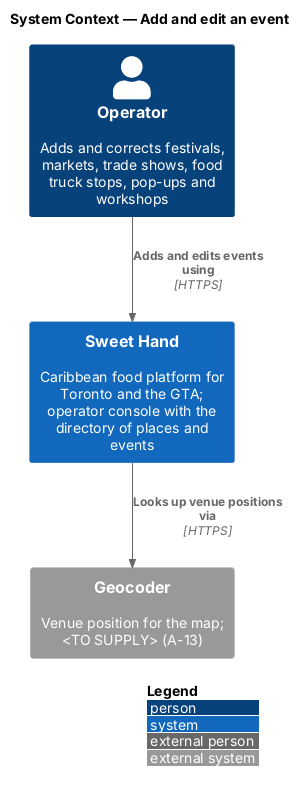
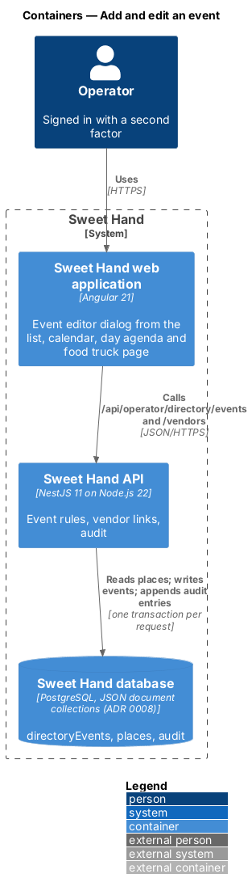
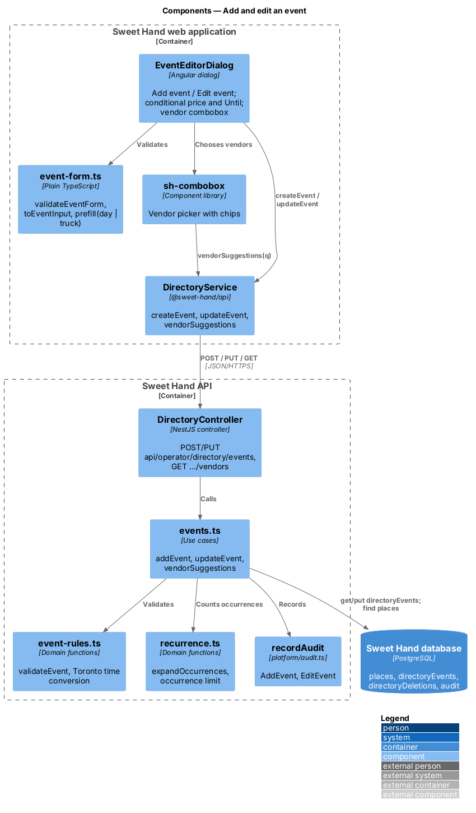
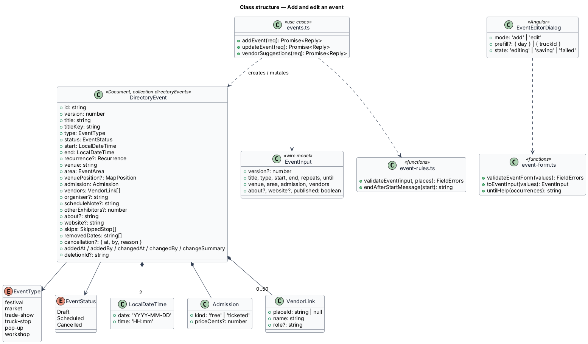
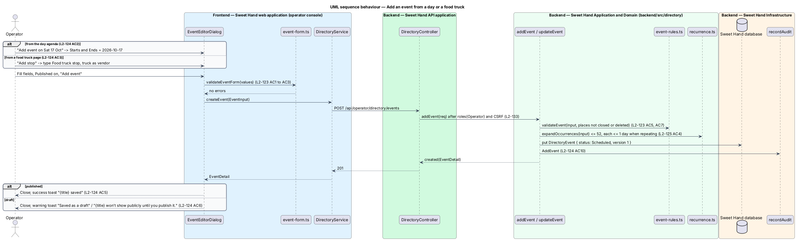
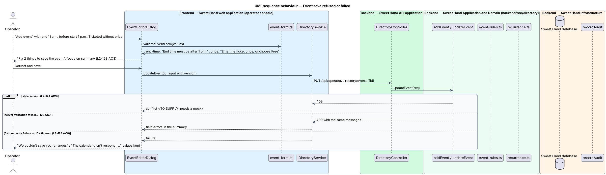

# Add and edit an event

## Overview

The directory also records Caribbean food events in Toronto and the GTA (`L1-028`): festivals, markets, trade shows, food truck stops, pop-ups and workshops. This feature lets an operator add an event and change it through one dialog, the event editor, and link the directory places taking part.

> **event** — dated happening recorded in the directory, of one of 6 types, with the status `Draft`, `Scheduled` or `Cancelled`
>
> **occurrence** — one dated run of an event; a repeating event has one per repeat, and the mocks call them stops
>
> **vendor** — directory place linked to an event; the place's page then lists the event
>
> **venue** — where an event happens, given as a venue name or an intersection, never a home address (A-11)

The editor opens from "Add event" on the events list and calendar, from a day's "Add event on {date}", and from "Add stop" on a food truck's page, each with suitable values filled in. Dates and times are entered and stored as Toronto wall-clock values. Repeats are `schedule-repeating-events`; the list and page that show the result are `browse-events`; the calendar is `view-event-calendar`.

## Description

**Shared directory design.** The directory features share these building blocks and name them the same way:

- **Backend area `backend/src/directory/`** — `directory.controller.ts` (`DirectoryController`) maps routes under `api/operator/directory/` to use cases. Every route declares `@UsePolicy(roles('Operator'))`, so a customer or caterer session receives HTTP 403 and an operator who has not completed the second factor reaches nothing (`L2-133 AC1`). Use cases take the framework-free request context (`Request` in `http/endpoint.ts`) and return a `Reply` built with `http/problems.ts`, as `operator-settings/cuisines.ts` does.
- **Documents** — through the persistence port of ADR 0008: collection `places` (`Place`), collection `directoryEvents` (`DirectoryEvent`) and collection `directoryDeletions` (`Deletion`). Each place and event carries a `version` number for optimistic concurrency; a save with an older `version` returns `conflict(...)` (HTTP 409). The port filters only on top-level scalars, so search and range queries load the non-deleted documents and filter in process; `L2-134` sets the scale this holds for (2,000 places, 5,000 events).
- **Audit and history** — every change calls `recordAudit` (`platform/audit.ts`) with `targetType` `place` or `event` (`L2-133 AC3`). The document keeps `addedAt`, `addedBy`, `changedAt`, `changedBy` and `changeSummary` for the History sections.
- **Frontend** — pages and dialogs live in `frontend/projects/sweet-hand/src/app/features/operator/directory/`, routed from `features/operator/routes.ts` and lazy-loaded (`L2-134 AC5`). Paths come from `core/routing/paths.ts` (`paths.admin.places`, `place(id)`, `placesMap`, `events`, `event(id)`, `calendar`). Pages depend on the abstract `DirectoryService` in `@sweet-hand/api` (`services/directory.service.ts`), implemented by `HttpDirectoryService` and registered in `features/operator/providers.ts`. Wire models sit one type per file in `projects/api/src/lib/models/`, and the backend imports them with `import type`. Rules and view models are plain TypeScript beside each page; dates and times go through `core/format/format.ts` in `America/Toronto`.
- **Tests** — `backend/test/directory/` drives the API over HTTP against the in-memory database (ADR 0007, ADR 0008). `frontend/e2e/specs/directory/` covers each mock state through one page object per screen, with the directory cast seeded in test mode (ADR 0009). The seed cast in `backend/src/seed/` holds the fictional places and events of `docs/mocks/README.md`.

**Frontend — operator console (`features/operator/directory/event-editor/`)**

- **`EventEditorDialog`** (`event-editor.dialog.ts`, `.html`, `.css`) — an `sh-dialog`. In `add` mode: title "Add event", description "Festivals, markets, trade shows, pop-ups, workshops and food truck stops in Toronto and the GTA.", empty fields, Published off, button "Add event", focus on Title (`L2-124 AC1`). `prefill` takes `{ day }` from the day agenda, which fills Starts and Ends (`L2-124 AC2`), or `{ truckId }` from a food truck page, which sets the type Food truck stop and the truck as a vendor (`L2-124 AC3`). In `edit` mode: title "Edit event", the description "Changes go live as soon as you save." or, for a repeating event, "Changes to a repeating event apply to every future stop.", button "Save changes" (`L2-124 AC7`).
  - Fields: Title, Type ("Choose a type"), Starts, Start time, Ends, End time ("Times are Toronto time."), Repeats, Until (shown only when repeating), Venue ("A venue name or an intersection. Never a home address."), Area ("Choose an area"), Admission (Free or Ticketed), Ticket price (CAD) (shown only when Ticketed, "From-price is fine, like 15.00."), Vendors from the directory, About, Website, and the switch "Published — shows on the public events listing" (`L2-123 AC4`, `L2-124 AC4`).
  - Vendors use `sh-combobox`: typing calls `vendorSuggestions(q)`, which offers places that are not closed or deleted; each choice becomes a chip with "Remove {name}", and a place cannot be chosen twice (`L2-123 AC5`).
  - Organiser, schedule note, other exhibitors and vendor role notes wait for their mock (`L2-123`).
  - Validation, busy and failed states mirror the place editor: summary "Fix {N} thing(s) to save the event", "Saving…" with "Saving {title}", and the failure alert "We couldn’t save your changes" / "The calendar didn’t respond. Everything you typed is still here; try saving again." (`L2-123 AC3`, `L2-124 AC8`). A 409 shows the conflict message that waits for a mock (`L2-124 AC9`).
  - On success the dialog closes; a scheduled event shows the success toast "{title} saved", a draft the warning toast "Saved as a draft" / "{title} won’t show publicly until you publish it." (`L2-124 AC5`, `L2-124 AC6`).
- **`event-form.ts`** — `validateEventForm` holds the client copy of `L2-123`, including "End time must be after {start time}" with the start formatted "1 p.m." and "Enter the ticket price, or choose Free" (`L2-123 AC1`, `L2-123 AC2`). `untilHelp(n)` gives "{n} stops. Skip a single date from the event page." `toEventInput` converts the price to cents and drops it for Free.

**Frontend — `@sweet-hand/api`**

- **`DirectoryService`** — `createEvent`, `updateEvent`, `vendorSuggestions(q)`. Wire models `EventType`, `EventStatus`, `EventInput`, `EventDetail`, `LocalDateTime`, `Admission`, `VendorLink`, `VendorSuggestion`, `EventArea`.

**Backend — `backend/src/directory/`**

- **`directory.controller.ts`** — `POST api/operator/directory/events`, `PUT api/operator/directory/events/:id` and `GET api/operator/directory/vendors?q=`.
- **`model.ts`** — `DirectoryEvent` in collection `directoryEvents`: `id` (`event-<uuid>`), `version`, `title`, `titleKey`, `type`, `status`, `start` and `end` as `{ date, time }` Toronto wall-clock values, `recurrence?`, `venue`, `area`, `venuePosition?`, `admission` (`{ kind, priceCents? }`), `vendors` (`{ placeId, name, role? }[]`, the name kept for history), `organiser?`, `scheduleNote?`, `otherExhibitors?`, `about?`, `website?`, `skips`, `removedDates`, `cancellation?`, history fields and `deletionId?`.
- **`event-rules.ts`** — `validateEvent(input, places)` applies `L2-123` on the server with the same messages: the end after the start in Toronto time, at most 14 days per occurrence, a price from 1 to 999,999 cents when Ticketed, vendors that exist and are not closed or deleted, at most 50, no duplicates, and `https://` websites (`L2-123 AC6`, `L2-123 AC7`). Text fields refuse control characters; "About" keeps line breaks (`L2-133 AC6`).
- **`events.ts`** — `addEvent` validates, counts occurrences with `recurrence.ts` (`schedule-repeating-events`), geocodes the venue through the `Geocoder` port when the operator has not set a position, stores the event as `Scheduled` or `Draft` and writes `AddEvent`. `updateEvent` also checks `version` and writes `EditEvent` with the values before and after (`L2-124 AC10`). `vendorSuggestions` matches folded names and returns at most 10 places.

Open points:

- Fields for organiser, schedule note, other exhibitors and vendor role notes, and the remaining validation messages: *(needs a mock)*.
- The "public events listing" named by the Published switch does not exist in this release (A-9).

## Requirements

The feature realizes the following level-2 (L2) requirements from `docs/specs/L2.md`. Each refines the level-1 (L1) requirement cited beside it. Requirement text is quoted from the specification, with *must* rendered as *shall*; the acceptance criteria cited in the Description are in the specification.

| L2 ID | Refines (L1) | Requirement |
|-------|--------------|-------------|
| `L2-123` | `L1-028` | Every event shall hold the fields in its table in `docs/specs/L2.md`. Dates and times are entered and shown in `America/Toronto`. |
| `L2-124` | `L1-028` | An operator shall be able to add an event from the events list, the calendar and a food truck's page, and edit it from its row or page, through the event editor dialog. |
| `L2-133` | `L1-021` | The directory is an operator-only tool (A-9). Every page and endpoint shall enforce that on the server, record every change, and keep home addresses out (A-10, A-11). |

## Diagrams

### System context

The operator records events in Sweet Hand. Sweet Hand looks up venue positions with the geocoder, still to be chosen.

### Containers

The editor calls the event and vendor endpoints. The API reads places for the vendor links and writes events and audit entries.

### Components

`events.ts` validates with `event-rules.ts` and counts occurrences with `recurrence.ts`. The dialog uses `sh-combobox` for vendors.

### Class structure

`DirectoryEvent` stores Toronto wall-clock start and end, admission, vendor links with names kept for history, skips and the cancellation.

### Behaviour — add an event from a day or a food truck

The opener decides the prefilled values. The API validates again, counts occurrences, stores the event and its audit entry, and the toast reflects whether it was published or saved as a draft.

### Behaviour — save refused or failed

Client errors stop at the summary. A stale version, a server refusal or a failure keeps the dialog open with the values typed.

