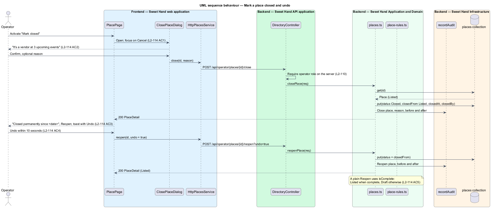

# Manage places

## Overview

Sweet Hand lists caterers publicly. Operators also keep an internal record of
other Caribbean food businesses in Toronto and the GTA. These include
restaurants, takeout counters, grocery stores, bakeries and food trucks. That
record is the *directory*. This feature covers the places half of it: the places
list, the place page, the place editor, and closing and reopening a place.
Visitors, customers and caterers never see the directory (`L2-110`).

> **place** — one business in the directory: a separate record, never linked to a caterer account
>
> **storefront** — a place of any type except `Food truck`; it has a street address, a postal code and a map pin
>
> **food truck** — a place with only a home-base municipality; it has no street address and no fixed pin
>
> **status** — `Draft` (incomplete or not yet confirmed), `Listed` (complete and current) or `Closed` (stopped trading)
>
> **pin** — the latitude and longitude that place a storefront on the places map (`view-places-map`)

An operator finds places by name, cuisine, "Known for" dishes, street or area,
and narrows the list by type (`L2-111`). The place page shows the full record,
including dietary and allergen tags, which are the business's own statements
(`L2-112`). The place editor adds and changes places. It checks the postal
code, phone and website, and refuses a duplicate name in the same municipality
(`L2-113`). Places are never deleted. An operator marks a place closed and can
reopen it, and a 10-second Undo follows each close (`L2-114`). Every change
goes to the operator audit log (`L2-110`).

The map view of the same records is `view-places-map`. The events that list a
place as a vendor are `manage-events`.

## Description

The backend follows the as-built design in ADR 0008. Each area keeps JSON
document collections behind the persistence port (`backend/src/platform/database.ts`).
Use cases are plain functions that take a framework-free `Request` and return
a `Reply`, and a NestJS controller maps routes to them. Each route declares
`@UsePolicy(roles('Operator'))`, so operators with or without the `Admin`
permission have the same access (`L2-110`). The design introduces a new area,
`backend/src/directory/`.

**Frontend — Sweet Hand web application** (`frontend/projects/sweet-hand/src/app/features/operator/directory/places/`)

- **`PlacesPage`** — `/admin/places`. It shows the status summary, search box,
  type filter, rows, pagination and the empty, no-results and error states.
  Search text, type and page live in the URL (`L2-111 AC9`).
- **`PlacePage`** — `/admin/places/{id}`. It shows location, details, hours,
  linked events and history. It offers "Edit", plus "Mark closed" or "Reopen".
- **`PlaceEditorDialog`** — the add and edit dialog, built on the library
  `sh-dialog` (a full-height sheet on phones). Choosing "Food truck" swaps the
  address fields for "Home base area". A storefront's address calls
  `PlacesService.geocode` 500 ms after typing stops, and the result moves the
  pin in a small `sh-map` preview.
- **`ClosePlaceDialog`** — the confirmation dialog. It names the upcoming
  events that list the place as a vendor and takes an optional reason.
- **`places-view.ts`** — plain TypeScript view models, labels and validation
  messages, beside the pages.
- Paths `paths.admin.places`, `paths.admin.place(id)` are added to
  `core/routing/paths.ts`. A "Places" item is added to
  `features/operator/layout/operator-nav.ts` for every operator.

**Frontend — API library** (`frontend/projects/api/src/lib/`)

- **`PlacesService`** (`places.service.ts`) — abstract class and DI token.
  **`HttpPlacesService`** (`http-places.service.ts`) implements it.
- Wire models, one type per file: `PlaceSummary`, `PlacesPage`, `PlaceDetail`,
  `PlaceRequest`, `PlaceHours`, `ClosePlaceRequest`, `GeocodeRequest`,
  `GeocodeResult`, `PlaceType`, `PlaceStatus`.

**Backend — Sweet Hand API application** (`backend/src/directory/directory.controller.ts`)

- `GET /api/operator/places` (`q`, `type`, `page`) → `listPlaces`
- `GET /api/operator/places/{id}` → `getPlace`
- `POST /api/operator/places` → `addPlace`
- `PUT /api/operator/places/{id}` → `editPlace`
- `POST /api/operator/places/{id}/close` → `closePlace`
- `POST /api/operator/places/{id}/reopen` (`undo`) → `reopenPlace`
- `POST /api/operator/geocode` → `geocodeAddress`

No route deletes a place (`L2-114 AC6`).

**Backend — Sweet Hand Application and Domain** (`backend/src/directory/`)

- **`model.ts`** — the `Place` document and the `places(tx)` collection. A
  place has `id`, `name`, `type`, `primaryCuisine` and `otherCuisines`
  (cuisine IDs from `discovery/taxonomy.ts`). It also has `knownFor`,
  `dietary` tags, `phone`, `website`, `instagram`, `hours` (seven `PlaceDay`
  entries) and `hoursNote`. Location is `street`, `municipality`,
  `postalCode`, `area` and `pin` for a storefront, or `homeBase` for a food
  truck. The rest is `status`, `closedFrom`, `closedAt`, `closedBy`,
  `closeReason`, `addedAt`, `addedBy`, `changedAt` and `changedBy`.
- **`places.ts`** — the use cases:
  - **`listPlaces`** filters in memory with `fold` from
    `operator-settings/text.ts`, which ignores case and accents. It sorts by
    `changedAt`, newest first, and returns 50 rows per page with the count of
    each status and type.
  - **`addPlace`** and **`editPlace`** run `validatePlace`, check for a
    duplicate, derive `area` from the postal code's FSA, and record the audit
    entry.
  - **`closePlace`** and **`reopenPlace`** change only `status` and the closing
    fields.
- **`place-rules.ts`** — the pure rules:
  - **`validatePlace`** checks field lengths, required fields by type, the
    postal code (`A1A 1A1`, stored upper case with one space), the 10-digit
    North American phone number and the `https://` website.
  - **`isComplete`** decides whether a place can be `Listed`.
  - **`duplicateOf`** matches the same folded name in the same municipality,
    excluding the record itself.
  - **`areaForPostalCode`** reuses the FSA-to-area lookup behind postal-code
    search (`L2-012`).
- **`reopenPlace`** restores `closedFrom` when `undo` is set, which is the
  Undo toast within 10 seconds (`L2-114 AC4`). Otherwise it returns the place
  to `Listed` when `isComplete` holds, and to `Draft` when it does not
  (`L2-114 AC5`).

**Backend — Sweet Hand Infrastructure**

- **`Geocoder`** (`backend/src/platform/geocoder.ts`) — an abstract class and
  DI token that turns an address into a pin. **`LocalGeocoder`** is the
  stand-in for development and tests; it returns fixed pins for the seeded
  addresses and nothing otherwise. The production provider is `<TO SUPPLY>`. A
  failed or empty lookup saves the place without a pin (`L2-113 AC4`).
- **Persistence port** — the `places` collection, written in the request's
  single transaction.
- **`recordAudit`** (`backend/src/platform/audit.ts`) — appends one entry per
  add, edit, close and reopen. Each entry holds the values before and after,
  and the reason when one is given (`L2-110 AC5`).
- **`seed/`** — fictional places for the cast in `docs/mocks/README.md`
  ("Directory: places and events"), loaded idempotently by `npm run seed`.

**Open points.**

- The geocoding provider and its Canadian data-residency terms are
  `<TO SUPPLY>`.
- Nearest intersection is shown on the place page but has no input yet. The
  design derives it from the pin through the geocoder, and the geocoder call
  for it is `<TO SUPPLY>`.

## Requirements

The feature realizes the following level-2 (L2) requirements from
`docs/specs/L2.md`. Each refines the level-1 (L1) requirement cited beside it.
Requirement text is quoted from the specification, with *must* rendered as
*shall*.

| L2 ID | Refines (L1) | Requirement |
|-------|--------------|-------------|
| `L2-110` | `L1-021` | The places and events directory (L2-111 to L2-121) is for operators only. Every directory page and endpoint shall check for the operator role on the server. Operators with or without the `Admin` permission have the same directory access. No public, customer or caterer page or endpoint may return directory data. Every directory change shall be written to the operator audit log (L2-060). |
| `L2-111` | `L1-026` | The places page (`/admin/places`) shall list every place in the directory, newest change first, with a search box, a type filter and the number of places in each status. |
| `L2-112` | `L1-026` | Each place is a separate record, never linked to a caterer account. A place has a name, a type (`Restaurant`, `Takeout`, `Grocery store`, `Bakery` or `Food truck`), a primary cuisine and any other cuisines from the cuisine list (L2-007), "Known for" dishes, dietary and allergen tags, contact details, opening hours and a status (`Draft`, `Listed` or `Closed`). A storefront (every type except `Food truck`) has a street address, a municipality, a postal code and a map pin. A food truck has only a home-base municipality; it has no street address and no fixed pin. The place page (`/admin/places/{id}`) shows the record. |
| `L2-113` | `L1-026` | Operators add a place from "Add place" and change one from "Edit". Both open the place editor dialog. A place saved with "Listed" ticked becomes `Listed`; otherwise it is `Draft`. Saved changes show on the operator's list and map at once. |
| `L2-114` | `L1-026` | Places are never deleted. An operator marks a place closed when it stops trading, and reopens it if it comes back. A closed place keeps its record and history, leaves the map, and keeps its name on past events. |

`L2-110` is shared with `manage-events`. This feature realizes it for places.

## Diagrams

### System context

Operators keep the directory in Sweet Hand. Sweet Hand asks a geocoding
provider to place each storefront on the map. The provider is still to be
chosen.

### Containers

The operator console in the web application calls the directory endpoints in
the Sweet Hand API. The API keeps places and audit entries in the Sweet Hand
database.

### Components

The places pages and dialogs call `HttpPlacesService`. Its endpoints in
`DirectoryController` run the use cases in `places.ts`, which apply
`place-rules.ts`, ask the `Geocoder` for pins, and write the `places`
collection and the audit log.

### Class structure

`Place` holds either a storefront location or a food truck's home base. The
use cases depend on the pure rules, the `Geocoder` port and `recordAudit`.

### Behaviour — add a place

An operator adds a storefront. The editor places the pin while the address is
typed. On save, the server validates the form, refuses a duplicate, stores the
place, records the audit entry and returns it (`L2-113`).

### Behaviour — mark a place closed and undo

An operator marks a place closed. The place leaves the map and keeps its
history. Undo within 10 seconds returns it to its earlier status (`L2-114`).

