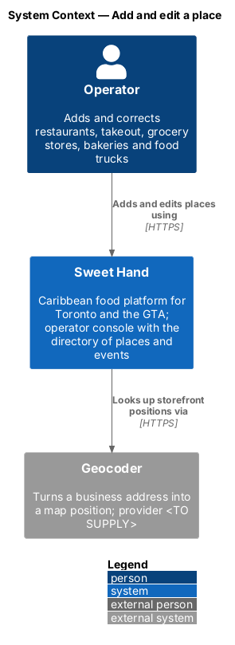
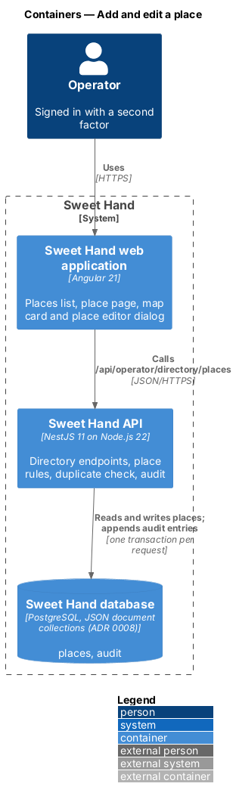
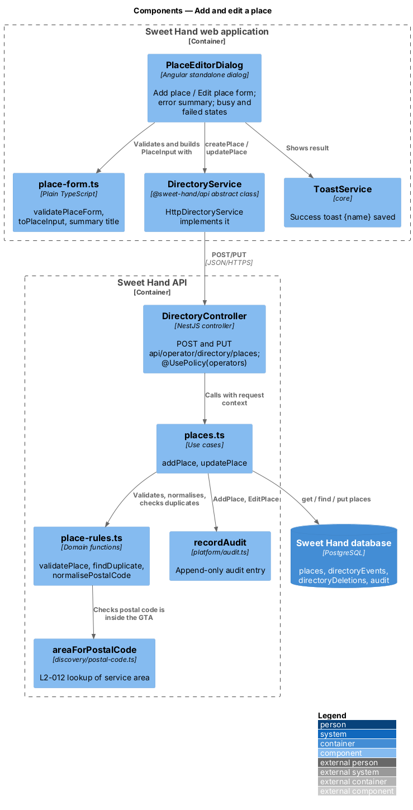
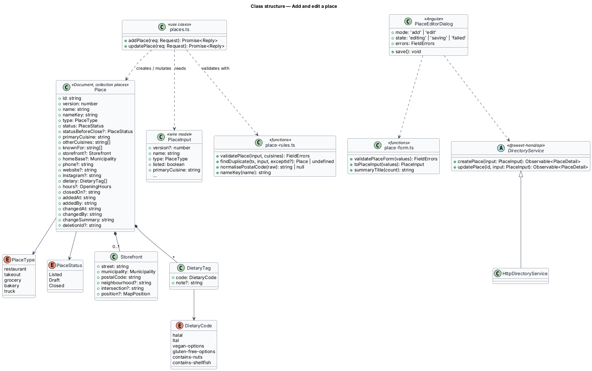
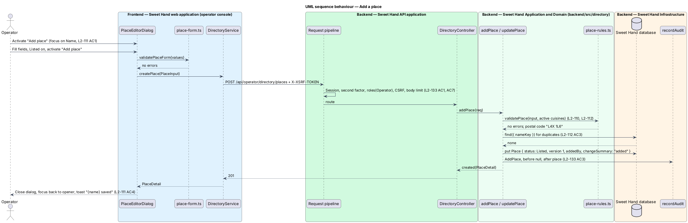
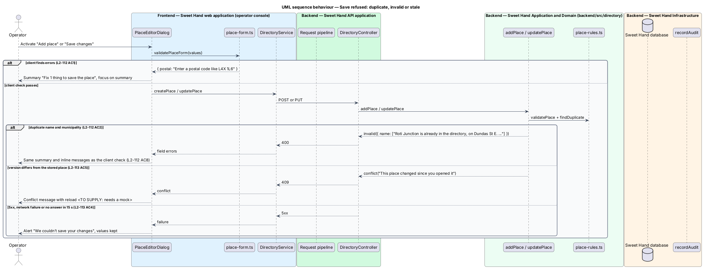

# Add and edit a place

## Overview

The directory is the operator's record of Caribbean food businesses and events in Toronto and the GTA (`L1-026`, assumption A-9). This feature lets an operator add a place and change any of its fields through one dialog, the place editor. Places are separate from caterers (A-10): a caterer is an account that receives enquiries, while a place is a business the Sweet Hand team records on its behalf.

> **place** — storefront business or food truck recorded in the directory by an operator
>
> **storefront** — place of type Restaurant, Takeout, Grocery store or Bakery, with a street address and a map position
>
> **home base** — municipality a food truck works from, recorded instead of a street address and never shown outside the operator console
>
> **listed place** — place with the status `Listed`; a later public directory would show it (A-9)
>
> **draft place** — place with the status `Draft`, saved with only a name, type and primary cuisine

The editor opens from "Add place" on the places list, the places map and their empty and no-results states, and from "Edit" on a list row, a place page or a map card. A storefront records a business address, which may be shown wherever the place is shown (A-11). A food truck records only its home base; its whereabouts come from the events it attends (`manage-events`). Dietary and allergen information is structured data, stated as the business's own claim; Sweet Hand does not certify kitchens. Geocoding of the address is the `locate-places` feature; the list, page and map that show the result are `browse-places`, `view-place` and `view-places-map`.

## Description

**Shared directory design.** The directory features share these building blocks and name them the same way:

- **Backend area `backend/src/directory/`** — `directory.controller.ts` (`DirectoryController`) maps routes under `api/operator/directory/` to use cases. Every route declares `@UsePolicy(roles('Operator'))`, so a customer or caterer session receives HTTP 403 and an operator who has not completed the second factor reaches nothing (`L2-133 AC1`). Use cases take the framework-free request context (`Request` in `http/endpoint.ts`) and return a `Reply` built with `http/problems.ts`, as `operator-settings/cuisines.ts` does.
- **Documents** — through the persistence port of ADR 0008: collection `places` (`Place`), collection `directoryEvents` (`DirectoryEvent`) and collection `directoryDeletions` (`Deletion`). Each place and event carries a `version` number for optimistic concurrency; a save with an older `version` returns `conflict(...)` (HTTP 409). The port filters only on top-level scalars, so search and range queries load the non-deleted documents and filter in process; `L2-134` sets the scale this holds for (2,000 places, 5,000 events).
- **Audit and history** — every change calls `recordAudit` (`platform/audit.ts`) with `targetType` `place` or `event` (`L2-133 AC3`). The document keeps `addedAt`, `addedBy`, `changedAt`, `changedBy` and `changeSummary` for the History sections.
- **Frontend** — pages and dialogs live in `frontend/projects/sweet-hand/src/app/features/operator/directory/`, routed from `features/operator/routes.ts` and lazy-loaded (`L2-134 AC5`). Paths come from `core/routing/paths.ts` (`paths.admin.places`, `place(id)`, `placesMap`, `events`, `event(id)`, `calendar`). Pages depend on the abstract `DirectoryService` in `@sweet-hand/api` (`services/directory.service.ts`), implemented by `HttpDirectoryService` and registered in `features/operator/providers.ts`. Wire models sit one type per file in `projects/api/src/lib/models/`, and the backend imports them with `import type`. Rules and view models are plain TypeScript beside each page; dates and times go through `core/format/format.ts` in `America/Toronto`.
- **Tests** — `backend/test/directory/` drives the API over HTTP against the in-memory database (ADR 0007, ADR 0008). `frontend/e2e/specs/directory/` covers each mock state through one page object per screen, with the directory cast seeded in test mode (ADR 0009). The seed cast in `backend/src/seed/` holds the fictional places and events of `docs/mocks/README.md`.

**Frontend — operator console (`features/operator/directory/place-editor/`)**

- **`PlaceEditorDialog`** (`place-editor.dialog.ts`, `.html`, `.css`) — an `sh-dialog` with `aria-labelledby` on its title. In `add` mode the title is "Add place", the description "Restaurants, takeout, grocery stores, bakeries and food trucks in Toronto and the GTA.", the fields are empty, the Listed switch is off and focus starts on Name (`L2-111 AC1`). In `edit` mode the title is "Edit place", the description "Changes go live as soon as you save." ("{name} · Food truck" for a truck), the values are loaded and the button reads "Save changes" (`L2-113 AC1`).
  - Fields follow the order and help text of `L2-111 AC2`. The type is an `sh-radio-group` with card options. Choosing Food truck swaps the address block, the pin and Hours for "Home base area" with its help and the private note; the address values stay in the form state, so switching back restores them (`L2-111 AC3`).
  - The cuisine select offers only active cuisines from the cuisine catalogue (`L2-110 AC4`), with the help "Name the island or country, not just “Caribbean”, when the business does." (`L2-110 AC6`).
  - Fields the mocks do not yet have — other cuisines, neighbourhood, nearest intersection, Instagram, dietary notes — wait for their mock (`L2-110`).
  - `save()` runs `validatePlaceForm`. On errors it renders the `sh-form` error summary titled by `summaryTitle(count)` ("Fix 2 things to save the place"), moves focus to it, and sets `aria-invalid` and `aria-describedby` on each field (`L2-112 AC1`).
  - While saving, `state` is `saving`: fields and "Cancel" are disabled, the button reads "Saving…" with `aria-busy="true"` and `aria-disabled="true"`, a polite status says "Saving {name}", and a second activation is ignored (`L2-113 AC2`).
  - On a 5xx, a network failure or no answer within 15 s, `state` is `failed` and the `sh-alert` reads "We couldn’t save your changes" / "The directory didn’t respond. Everything you typed is still here; try saving again." (`L2-113 AC4`). A 400 maps the server's `errors` onto the same summary (`L2-112 AC8`). A 409 shows the conflict message, which waits for a mock (`L2-113 AC5`).
  - On success the dialog closes, focus returns to the opener (`L2-111 AC6`), and `ToastService` shows "{name} saved", with the changed-fields line for an edit ("Hours updated. The map and search show the change now.") (`L2-111 AC4`, `L2-113 AC3`).
  - Below 768px the dialog is a full-height sheet with a sticky footer inside the safe areas (`L2-135 AC3`).
- **`place-form.ts`** — `validatePlaceForm(values)` holds the client copy of the field rules in `L2-110` and the messages of `L2-112` ("Enter a postal code like L4X 1L6", the duplicate message comes only from the server). `postalExample(municipality)` returns M6E 2H8 for Toronto and L4X 1L6 for Mississauga; examples for the other municipalities are `<TO SUPPLY>` (`L2-112 AC4`). `toPlaceInput(values)` builds `PlaceInput`, dropping storefront fields for a truck.

**Frontend — `@sweet-hand/api`**

- **`DirectoryService`** — `createPlace(input)` and `updatePlace(id, input)`; `HttpDirectoryService` sends `POST` and `PUT` with the `X-XSRF-TOKEN` header.
- **Wire models** — `PlaceType`, `PlaceStatus`, `DietaryCode`, `DietaryTag`, `PlaceInput`, `PlaceDetail`, `Municipality`, `MapPosition`.

**Backend — `backend/src/directory/`**

- **`directory.controller.ts`** — `POST api/operator/directory/places` calls `addPlace`; `PUT api/operator/directory/places/:id` calls `updatePlace`. Both carry `@MaxBody` as other operator writes do; `CsrfGuard` and the rate-limit guard apply (`L2-133 AC7`).
- **`model.ts`** — `Place` in collection `places`: `id` (`place-<uuid>`), `version`, `name`, `nameKey`, `type`, `status`, `primaryCuisine`, `otherCuisines`, `knownFor`, `storefront?` (`street`, `municipality`, `postalCode`, `neighbourhood?`, `intersection?`, `position?`), `homeBase?`, `phone?`, `website?`, `instagram?`, `dietary` (`{ code, note? }[]`), `hours?`, history fields and `deletionId?`. `nameKey` is the folded name plus the municipality or home base, so `find({ nameKey })` is the duplicate lookup.
- **`place-rules.ts`** — `validatePlace(input, cuisines)` applies every rule of `L2-110` on the server and refuses a food truck that carries a street address, postal code or position (`L2-110 AC2`, `L2-133 AC5`). `normalisePostalCode` accepts `l4x1l6` and stores "L4X 1L6" (`L2-112 AC5`), and `areaForPostalCode` from `discovery/postal-code.ts` refuses codes outside the GTA (`L2-112 AC6`). `nameKey` folds case, accents and outer spaces with `fold` from `operator-settings/text.ts` (`L2-112 AC3`). Text fields refuse control characters (`L2-133 AC6`).
- **`places.ts`** — `addPlace(req)` validates, checks `findDuplicate` (deleted places excluded, closed places included), stores the place as `Listed` or `Draft` from the switch, requiring the address fields only to list a storefront (`L2-111 AC5`), records `addedBy` and writes `AddPlace` to the audit log (`L2-111 AC7`). `updatePlace(req)` also compares `version`; on a match it applies the input, clears storefront fields when the type becomes Food truck (`L2-113 AC6`), sets `changeSummary` from the changed fields ("hours updated") and writes `EditPlace` with the values before and after (`L2-113 AC7`).

Open points:

- The wording of the remaining validation messages (`L2-112 AC7`) and the conflict message (`L2-113 AC5`) wait for mocks.
- Postal code examples for municipalities other than Toronto and Mississauga: `<TO SUPPLY>`.

## Requirements

The feature realizes the following level-2 (L2) requirements from `docs/specs/L2.md`. Each refines the level-1 (L1) requirement cited beside it. Requirement text is quoted from the specification, with *must* rendered as *shall*; the acceptance criteria cited in the Description are in the specification.

| L2 ID | Refines (L1) | Requirement |
|-------|--------------|-------------|
| `L2-110` | `L1-026` | Every place shall hold the fields in its table in `docs/specs/L2.md` as structured data. Text limits count characters after trimming (see Conventions). |
| `L2-111` | `L1-026` | An operator shall be able to add a place from the places list, the places map and their empty and no-results states, through the place editor dialog. |
| `L2-112` | `L1-026` | The place editor shall check every field before saving and the server shall apply the same checks, returning the same messages. |
| `L2-113` | `L1-026` | An operator shall be able to change any field of a place from its list row, its page or its map card. Changes go live when saved. |
| `L2-133` | `L1-021` | The directory is an operator-only tool (A-9). Every page and endpoint shall enforce that on the server, record every change, and keep home addresses out (A-10, A-11). |

## Diagrams

### System context

The operator records places in Sweet Hand. Sweet Hand looks up storefront positions with a geocoder whose provider is still to be chosen.

### Containers

The editor in the web application calls the directory endpoints of the API, which writes places and audit entries to the database.

### Components

`DirectoryController` hands each save to `addPlace` or `updatePlace`. The use cases validate with `place-rules.ts`, check the GTA postal code through the discovery lookup and append audit entries.

### Class structure

`Place` holds a `Storefront` or a home base, never both, and its dietary tags as codes. The dialog depends on `place-form.ts` and the abstract `DirectoryService`.

### Behaviour — add a place

The editor validates on the client, the API validates again, checks for a duplicate and stores the place with its audit entry in one transaction.

### Behaviour — save refused or failed

A client error stops at the summary. A server refusal for a duplicate, a stale version or a failure keeps every value in the dialog.

