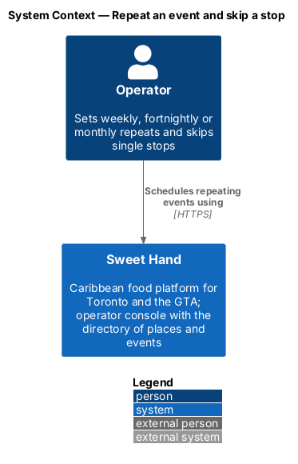
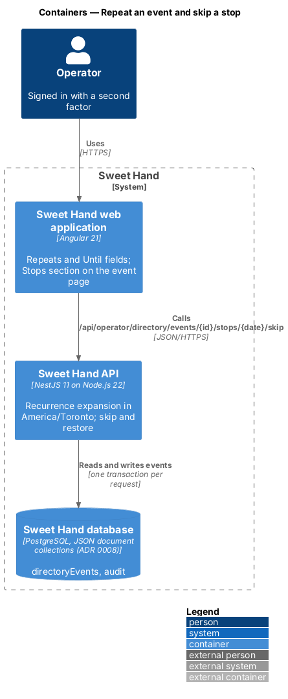
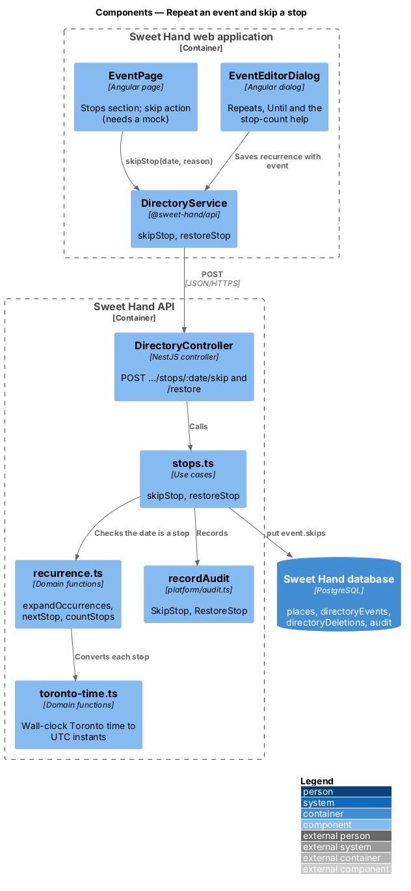
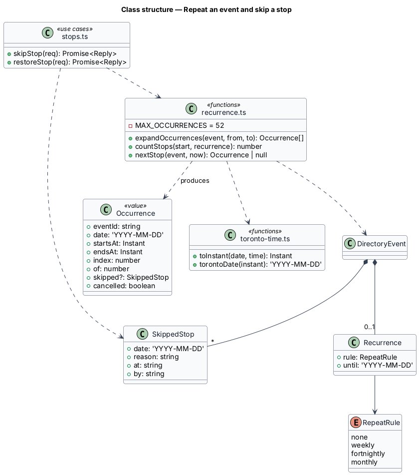
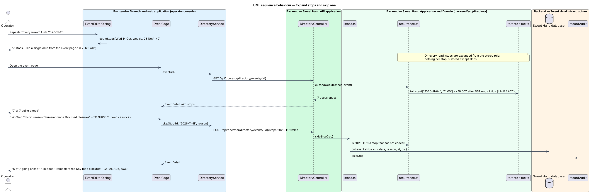

# Repeat an event and skip a stop

## Overview

Markets run every Saturday and food trucks return to the same corner every Wednesday (`L1-028`). This feature lets an event repeat every week, every 2 weeks or every month until a chosen date, and lets an operator skip one stop with a reason without touching the others.

> **repeat rule** — Doesn't repeat, Every week, Every 2 weeks or Every month, with an Until date
>
> **stop** — one occurrence of a repeating event
>
> **skipped stop** — stop that does not happen, kept on the event page with its reason and left off the calendar, the map and the vendors' pages
>
> **wall-clock time** — time of day as read on a Toronto clock, which stays the same across daylight saving changes

Stops are never stored one by one. Every read expands them from the start, the end and the repeat rule, so changing the rule changes every future stop at once; only skips and removed dates are stored. A repeating event has at most 52 stops, each lasting at most one day. Skipping a stop needs a mock before it is built (`L2-125`).

## Description

**Shared directory design.** The directory features share these building blocks and name them the same way:

- **Backend area `backend/src/directory/`** — `directory.controller.ts` (`DirectoryController`) maps routes under `api/operator/directory/` to use cases. Every route declares `@UsePolicy(roles('Operator'))`, so a customer or caterer session receives HTTP 403 and an operator who has not completed the second factor reaches nothing (`L2-133 AC1`). Use cases take the framework-free request context (`Request` in `http/endpoint.ts`) and return a `Reply` built with `http/problems.ts`, as `operator-settings/cuisines.ts` does.
- **Documents** — through the persistence port of ADR 0008: collection `places` (`Place`), collection `directoryEvents` (`DirectoryEvent`) and collection `directoryDeletions` (`Deletion`). Each place and event carries a `version` number for optimistic concurrency; a save with an older `version` returns `conflict(...)` (HTTP 409). The port filters only on top-level scalars, so search and range queries load the non-deleted documents and filter in process; `L2-134` sets the scale this holds for (2,000 places, 5,000 events).
- **Audit and history** — every change calls `recordAudit` (`platform/audit.ts`) with `targetType` `place` or `event` (`L2-133 AC3`). The document keeps `addedAt`, `addedBy`, `changedAt`, `changedBy` and `changeSummary` for the History sections.
- **Frontend** — pages and dialogs live in `frontend/projects/sweet-hand/src/app/features/operator/directory/`, routed from `features/operator/routes.ts` and lazy-loaded (`L2-134 AC5`). Paths come from `core/routing/paths.ts` (`paths.admin.places`, `place(id)`, `placesMap`, `events`, `event(id)`, `calendar`). Pages depend on the abstract `DirectoryService` in `@sweet-hand/api` (`services/directory.service.ts`), implemented by `HttpDirectoryService` and registered in `features/operator/providers.ts`. Wire models sit one type per file in `projects/api/src/lib/models/`, and the backend imports them with `import type`. Rules and view models are plain TypeScript beside each page; dates and times go through `core/format/format.ts` in `America/Toronto`.
- **Tests** — `backend/test/directory/` drives the API over HTTP against the in-memory database (ADR 0007, ADR 0008). `frontend/e2e/specs/directory/` covers each mock state through one page object per screen, with the directory cast seeded in test mode (ADR 0009). The seed cast in `backend/src/seed/` holds the fictional places and events of `docs/mocks/README.md`.

**Frontend — operator console**

- **`EventEditorDialog`** (`manage-events`) — "Repeats" offers "Doesn’t repeat", "Every week", "Every 2 weeks" and "Every month". Any rule other than the first shows "Until", required, with the help from `untilHelp(countStops(...))` ("7 stops. Skip a single date from the event page.") (`L2-125 AC1`). The client counts with the same `countStops` logic as the server.
- **`EventPage`** (`browse-events`) — the "Stops" section lists each stop by date and time and reads "{going ahead} of {total} going ahead"; a skipped stop reads "Skipped · {reason}" (`L2-125 AC5`). The skip and restore actions per stop, and their dialog with a required reason, wait for a mock (`L2-125 AC6`).

**Frontend — `@sweet-hand/api`**

- **`DirectoryService`** — `skipStop(id, date, reason)` and `restoreStop(id, date)`. Wire models `RepeatRule`, `Recurrence`, `Occurrence`, `SkippedStop`.

**Backend — `backend/src/directory/`**

- **`recurrence.ts`** — `expandOccurrences(event, from, to)` walks the rule from the start date: `weekly` adds 7 days, `fortnightly` 14, and `monthly` keeps the day of the month and skips months without it, so a series on the 31st has no stop in a 30-day month (`L2-125 AC3`). Each stop takes the event's start and end times on its own date, converted with `toronto-time.ts`; a stop on 4 Nov 2026 at 11 a.m. is 16:00 UTC while one on 28 Oct is 15:00 UTC (`L2-125 AC2`). Dates in `removedDates` are left out; dates in `skips` are returned marked skipped. `countStops` and `nextStop` build on it. The validation in `events.ts` refuses more than 52 stops or a repeating occurrence longer than one day (`L2-125 AC4`).
- **`toronto-time.ts`** — `toInstant(date, time)` and `torontoDate(instant)` using the `America/Toronto` zone, beside the existing `torontoDate` of `discovery/listing.ts`.
- **`stops.ts`** — `skipStop(req)` checks that the date is a stop that has not ended, requires a reason of up to 120 characters, adds the skip, records `SkipStop` and returns the event detail. `restoreStop` removes the skip and records `RestoreStop` (`L2-125 AC6`).
- **Editing the schedule** — `updateEvent` (`manage-events`) applies a schedule change only to stops that have not ended, and skips stay on dates that still occur and fall away otherwise (`L2-125 AC7`). How the event page keeps listing the ended stops of the old rule is an open point.
- **Consumers** — `view-place`, `view-places-map`, `browse-events` and `view-event-calendar` all read stops through `expandOccurrences`, so skipped and removed stops disappear from every view at once.

Open points:

- The skip and restore dialog, and per-stop notes such as "Last stop of the season": *(needs a mock)*.
- How a schedule change keeps the ended stops of the old rule visible on the event page: `<TO SUPPLY>`.

## Requirements

The feature realizes the following level-2 (L2) requirements from `docs/specs/L2.md`. Each refines the level-1 (L1) requirement cited beside it. Requirement text is quoted from the specification, with *must* rendered as *shall*; the acceptance criteria cited in the Description are in the specification.

| L2 ID | Refines (L1) | Requirement |
|-------|--------------|-------------|
| `L2-125` | `L1-028` | A repeating event shall produce one occurrence per repeat from its start date to its Until date inclusive, at the same wall-clock times in `America/Toronto`. A repeating event has at most 52 occurrences, each lasting at most one day. |

## Diagrams

### System context

The operator schedules repeating events in Sweet Hand. No external system takes part.

### Containers

The editor and the event page call the event and stop endpoints. The API stores the rule and the skips on the event document.

### Components

`recurrence.ts` expands stops through `toronto-time.ts`. `stops.ts` records skips and restores them.

### Class structure

`Recurrence` and `SkippedStop` live on `DirectoryEvent`; `Occurrence` is a computed value, never stored.

### Behaviour — expand stops and skip one

The editor shows the stop count before saving. Each read expands the stops in Toronto wall-clock time; skipping stores only the date, reason, operator and time.

