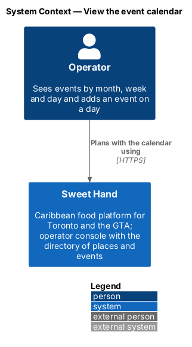
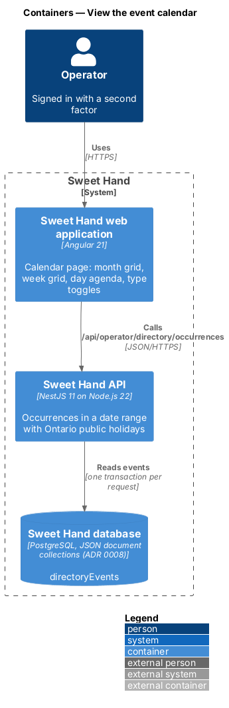
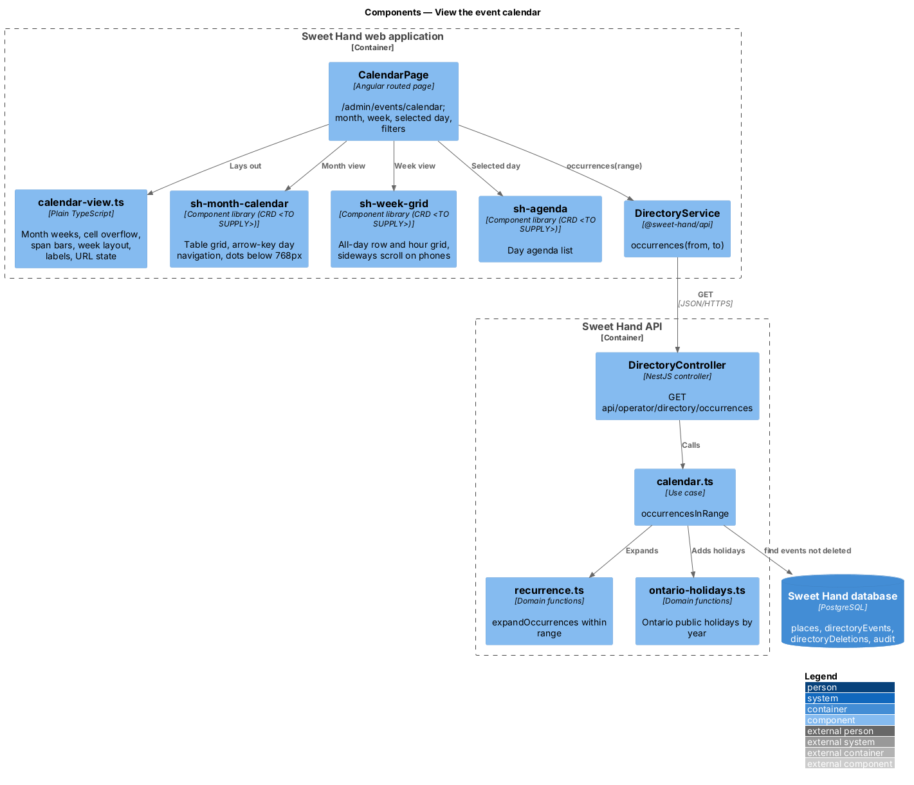
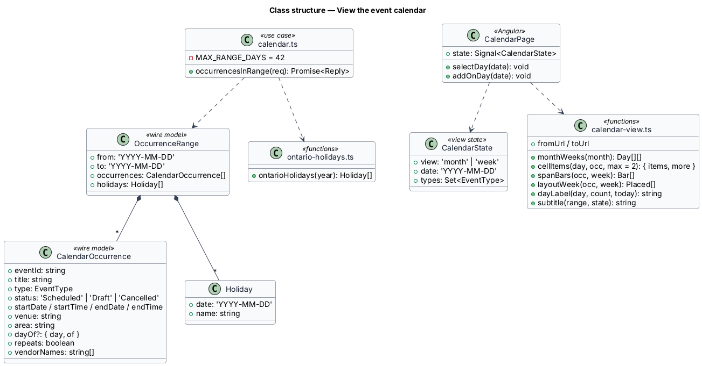
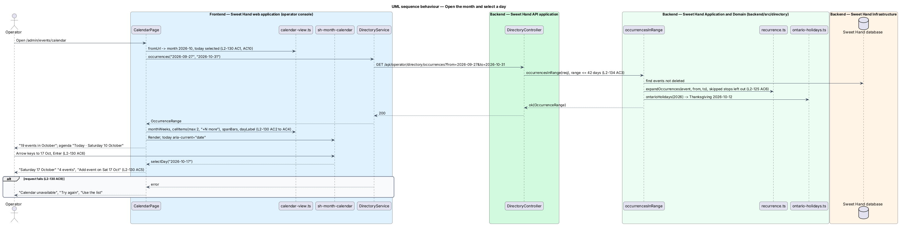
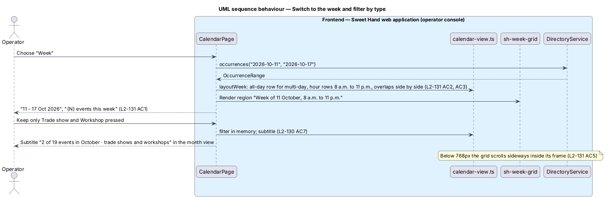

# View the event calendar

## Overview

The calendar at `/admin/events/calendar` shows event occurrences by month and by week, with an agenda for the chosen day (`L1-029`). Operators use it to see busy weekends at a glance, spot clashes, and add an event on a chosen day.

> **month view** — table of weeks from Sunday to Saturday with each day's occurrences
>
> **week view** — time grid of one week, 8 a.m. to 11 p.m., with an all-day row for multi-day events
>
> **day agenda** — list of the selected day's occurrences with "Add event on {date}"
>
> **Ontario public holiday** — statutory holiday in Ontario, named on its day ("Thanksgiving")

Every view counts and shows occurrences, so a weekly market appears on each Saturday and a 3-day expo shows as one bar across its days. Drafts and cancelled occurrences stay visible and marked. The type toggles and the chosen view and day live in the URL. Month grid, week grid and agenda are new library components whose CRDs come before implementation.

## Description

**Shared directory design.** The directory features share these building blocks and name them the same way:

- **Backend area `backend/src/directory/`** — `directory.controller.ts` (`DirectoryController`) maps routes under `api/operator/directory/` to use cases. Every route declares `@UsePolicy(roles('Operator'))`, so a customer or caterer session receives HTTP 403 and an operator who has not completed the second factor reaches nothing (`L2-133 AC1`). Use cases take the framework-free request context (`Request` in `http/endpoint.ts`) and return a `Reply` built with `http/problems.ts`, as `operator-settings/cuisines.ts` does.
- **Documents** — through the persistence port of ADR 0008: collection `places` (`Place`), collection `directoryEvents` (`DirectoryEvent`) and collection `directoryDeletions` (`Deletion`). Each place and event carries a `version` number for optimistic concurrency; a save with an older `version` returns `conflict(...)` (HTTP 409). The port filters only on top-level scalars, so search and range queries load the non-deleted documents and filter in process; `L2-134` sets the scale this holds for (2,000 places, 5,000 events).
- **Audit and history** — every change calls `recordAudit` (`platform/audit.ts`) with `targetType` `place` or `event` (`L2-133 AC3`). The document keeps `addedAt`, `addedBy`, `changedAt`, `changedBy` and `changeSummary` for the History sections.
- **Frontend** — pages and dialogs live in `frontend/projects/sweet-hand/src/app/features/operator/directory/`, routed from `features/operator/routes.ts` and lazy-loaded (`L2-134 AC5`). Paths come from `core/routing/paths.ts` (`paths.admin.places`, `place(id)`, `placesMap`, `events`, `event(id)`, `calendar`). Pages depend on the abstract `DirectoryService` in `@sweet-hand/api` (`services/directory.service.ts`), implemented by `HttpDirectoryService` and registered in `features/operator/providers.ts`. Wire models sit one type per file in `projects/api/src/lib/models/`, and the backend imports them with `import type`. Rules and view models are plain TypeScript beside each page; dates and times go through `core/format/format.ts` in `America/Toronto`.
- **Tests** — `backend/test/directory/` drives the API over HTTP against the in-memory database (ADR 0007, ADR 0008). `frontend/e2e/specs/directory/` covers each mock state through one page object per screen, with the directory cast seeded in test mode (ADR 0009). The seed cast in `backend/src/seed/` holds the fictional places and events of `docs/mocks/README.md`.

**Frontend — operator console (`features/operator/directory/calendar/`)**

- **`CalendarPage`** (`calendar.page.ts`, `.html`, `.css`) — routed at `paths.admin.calendar`. It reads `view`, `date` and `types` from the URL (`L2-130 AC10`), requests the visible range with `DirectoryService.occurrences(from, to)`, and renders:
  - the heading "Calendar", the subtitle ("{N} events in October", "{shown} of {total} events in October · trade shows and workshops", "{N} events this week"), "Add event", and the "View" tabs (`L2-130 AC1`, `L2-130 AC7`, `L2-131 AC1`);
  - the group "Show event types" of toggle buttons, all pressed by default; filtering is done in the browser on the loaded range (`L2-130 AC7`);
  - the toolbar: "Previous month" / "Next month" (or week), "Today", the period heading in a polite live region, and the "Month" / "Week" switch;
  - the month view, the week view and the day agenda, with the type legend;
  - the empty month ("Nothing scheduled in {month}") and the error state ("Calendar unavailable", "Try again", "Use the list", navigation disabled) (`L2-130 AC8`, `L2-130 AC9`).
- **`calendar-view.ts`** — `monthWeeks(month)` gives the Sunday-to-Saturday weeks covering the month; `cellItems(day, occurrences, 2)` returns at most 2 entries and the "+{N} more" count; `spanBars` lays a multi-day occurrence across its days with start, continues and end pieces; `entryLabel` gives "{start time} {title}" with " (draft)" or " (cancelled)"; `dayLabel` gives "{weekday} {day} {month}[, today], {N} event(s)" (`L2-130 AC2` to `L2-130 AC4`); `layoutWeek(occurrences, week)` places timed entries by start and end, side by side when they overlap, and extends the grid when one falls outside 8 a.m. to 11 p.m. (`L2-131 AC2` to `L2-131 AC4`); `agendaDetail` gives "day 2 of 3", "weekly" or the vendor names.
- **`sh-month-calendar`** — a `table` grid; each day's date is a link with the label from `dayLabel`, today has `aria-current="date"`, and the selected day `aria-pressed="true"`. Arrow keys move between days and weeks and Enter selects (`L2-130 AC5`, `L2-130 AC6`). Below 768px cells show the number and a coloured dot per occurrence, and the agenda carries the detail (`L2-135 AC4`). Type colour is always paired with a text label in the agenda and legend (`L2-136 AC3`). CRD `<TO SUPPLY>`.
- **`sh-week-grid`** — region "Week of {day} {month}, 8 a.m. to 11 p.m." with day columns, the all-day row and hour rows; on phones it scrolls sideways inside its frame and the page never does (`L2-131 AC5`). CRD `<TO SUPPLY>`.
- **`sh-agenda`** — the selected day's heading ("Today · Saturday 10 October", "{N} events"), its entries linking to event pages, and the button "Add event on {Sat 17 Oct}", which opens the event editor prefilled with that day (`manage-events`). CRD `<TO SUPPLY>`.

**Frontend — `@sweet-hand/api`**

- **`DirectoryService`** — `occurrences(from, to)`. Wire models `OccurrenceRange`, `CalendarOccurrence`, `Holiday`.

**Backend — `backend/src/directory/`**

- **`directory.controller.ts`** — `GET api/operator/directory/occurrences?from=&to=`.
- **`calendar.ts`** — `occurrencesInRange(req)` refuses a range longer than 42 days with HTTP 400, loads events that are not deleted, expands each with `expandOccurrences(event, from, to)`, leaves skipped and removed stops out, keeps drafts and cancelled occurrences with their status, and adds `dayOf` for multi-day events (`L2-134 AC3`). It returns only that range, so the response stays small with 5,000 events.
- **`ontario-holidays.ts`** — `ontarioHolidays(year)` computes Ontario's public holidays by rule (for example Thanksgiving, the second Monday of October). Whether to include days that are commonly observed but not statutory, such as Civic Holiday, is `<TO SUPPLY>`.

**Responsive layout and accessibility.** Every state passes `L2-135 AC1` and `L2-136 AC1`; the calendar and agenda are usable with the keyboard alone (`L2-136 AC4`).

Open points:

- Short titles in calendar cells: the mocks shorten titles ("Patty Crawl", "Jerk Drum Wed."). This design truncates with an ellipsis and keeps the full title in the accessible name; whether events need a short-title field is `<TO SUPPLY>`.
- Empty-month text for months other than December, and a week with entries outside 8 a.m. to 11 p.m.: *(needs a mock)*.
- Moving an event by dragging it on the calendar, implied by the "We couldn’t move {title}" toast (`L2-132 AC3`): `<TO SUPPLY>` *(needs a mock)*.
- CRDs for `sh-month-calendar`, `sh-week-grid` and `sh-agenda`: `<TO SUPPLY>`.

## Requirements

The feature realizes the following level-2 (L2) requirements from `docs/specs/L2.md`. Each refines the level-1 (L1) requirement cited beside it. Requirement text is quoted from the specification, with *must* rendered as *shall*; the acceptance criteria cited in the Description are in the specification.

| L2 ID | Refines (L1) | Requirement |
|-------|--------------|-------------|
| `L2-130` | `L1-029` | The calendar at `/admin/events/calendar` shall show event occurrences by month, with a day agenda. |
| `L2-131` | `L1-029` | The calendar shall also show one week at a time on a time grid. |
| `L2-134` | `L1-022` | The directory shall stay fast with 2,000 places and 5,000 events. |
| `L2-135` | `L1-018` | Every directory page, dialog and toast shall work at every width from 320px to 2560px (L2-064), phone first. |
| `L2-136` | `L1-019` | Every directory page, dialog and toast shall meet WCAG 2.2 AA and the platform's accessibility requirements (L2-066 to L2-069). |

## Diagrams

### System context

The operator plans with the event calendar in Sweet Hand. No external system takes part.

### Containers

The calendar page calls the occurrences endpoint for the visible range only.

### Components

`occurrencesInRange` expands events with `recurrence.ts` and adds `ontario-holidays.ts`. `CalendarPage` lays out with `calendar-view.ts` and draws with three new library components.

### Class structure

`OccurrenceRange` holds occurrences and holidays for one range. `CalendarState` is the URL-backed view state.

### Behaviour — open the month and select a day

The page requests the visible weeks, the API expands occurrences and adds holidays, and the grid supports arrow keys and Enter to pick the agenda day.

### Behaviour — switch to the week and filter by type

The week view requests its 7 days and lays them out on the hour grid. Type filtering works in the browser on the loaded range.

