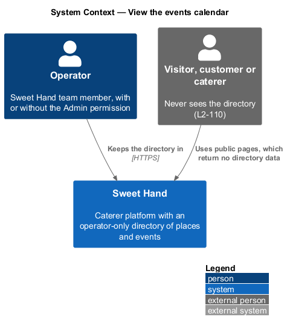
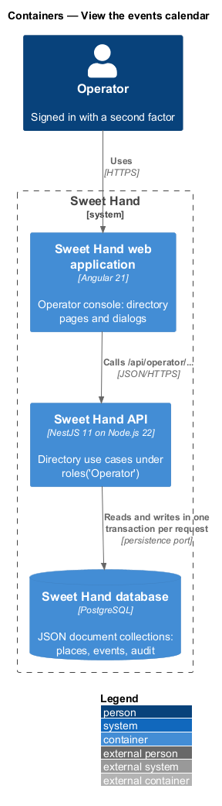
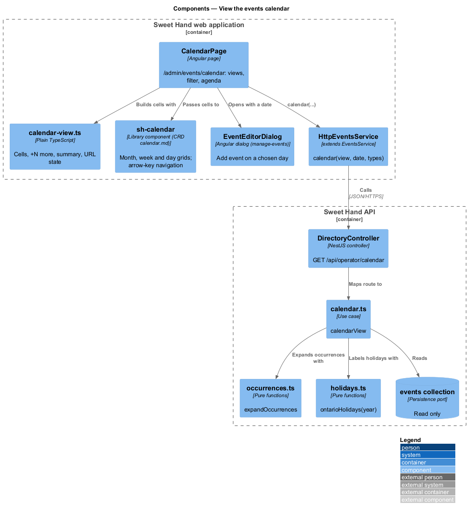
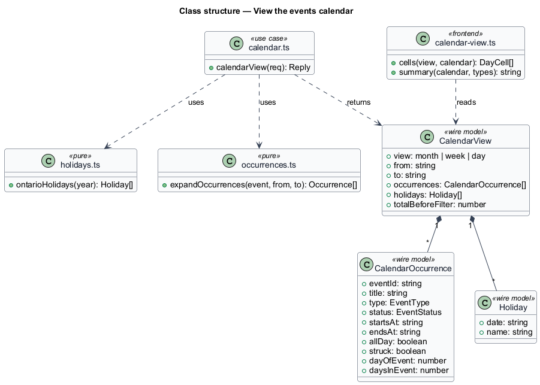
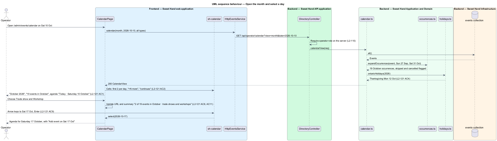

# View the events calendar

## Overview

The events calendar shows the directory's event occurrences by month, week or
day. Operators can see at a glance what is on, spot clashes, and add an event
on a chosen day. It reads the same records as `manage-events` and is for
operators only (`L2-110`).

> **occurrence** — one date an event happens on (`manage-events`)
>
> **agenda** — the list of the selected day's occurrences shown below the month grid
>
> **statutory holiday** — an Ontario public holiday, such as Thanksgiving, labelled on its day

The calendar opens on the current month with today selected. A day shows its
first 2 occurrences and "+N more". A multi-day event shows on each of its days.
Drafts read "(draft)", and cancelled or skipped dates read "(cancelled)" and
are struck through. The week view puts all-day and multi-day events in a top
row and timed occurrences by hour. The day view lists occurrences with
"Add event on <day>". A type filter narrows every view. View, month and filter
live in the URL (`L2-121`).

## Description

**Frontend — Sweet Hand web application** (`features/operator/directory/events/`)

- **`CalendarPage`** — `/admin/events/calendar`. It shows the summary, such as
  "19 events in October", the type filter, Today, previous and next, and the
  Month and Week switch. It shows the grid, the agenda for the selected day,
  and the empty and error states. The error state offers "Use the list", which
  links to `/admin/events`. "Add event" and "Add event on <day>" open
  `EventEditorDialog` (`manage-events`) with the date filled in.
- **`calendar-view.ts`** — builds cells, "+N more", "continues" labels, the
  summary text, such as "2 of 19 events in October · trade shows and
  workshops", and the URL state. Dates go through `core/format/format.ts`.
- **`sh-calendar`** — a new library component, specified by its own CRD
  (`docs/specs/components/calendar.md`). It draws month, week and day grids
  from the cells it is given. Arrow keys move between days, and Enter selects
  one (`L2-121 AC9`). Below `SM` it shrinks day cells to the date and a dot per
  type, and the week grid scrolls sideways inside its frame (`L2-121 AC12`).
  It holds no user-facing strings.
- A "Calendar" item is added to `operator-nav.ts`, and
  `paths.admin.calendar` to `core/routing/paths.ts`.

**Frontend — API library**

- **`EventsService.calendar(view, date, types)`** — implemented by
  `HttpEventsService`. It returns a `CalendarView` wire model: the range,
  `CalendarOccurrence` rows (event id, title, type, status, start, end,
  all-day, cancelled or skipped, day index within a multi-day event),
  `Holiday` rows and the total before filtering.

**Backend — Sweet Hand API application**

- `GET /api/operator/calendar` (`view`, `date`, `types`) → `calendarView`, in
  `DirectoryController` under `@UsePolicy(roles('Operator'))`.

**Backend — Sweet Hand Application and Domain** (`backend/src/directory/`)

- **`calendar.ts`** — `calendarView` works out the range for the view. The
  month range runs from the Sunday before the 1st to the Saturday after the
  last day. It calls `expandOccurrences` (`manage-events`) for every event
  that overlaps the range, applies the type filter, and adds holidays. It
  sorts by start time.
- **`holidays.ts`** — `ontarioHolidays(year)` computes Ontario's statutory
  holidays. They are New Year's Day, Family Day, Good Friday, Victoria Day,
  Canada Day, Labour Day, Thanksgiving Day, Christmas Day and Boxing Day.
  Each has its date rule, and no external service is involved.

**Backend — Sweet Hand Infrastructure**

- **Persistence port** — the `events` collection, read only.

**Open points.** Whether the civic holiday in August is labelled, since it is
not statutory in Ontario, is `<TO SUPPLY>`.

## Requirements

The feature realizes the following level-2 (L2) requirements from
`docs/specs/L2.md`. Each refines the level-1 (L1) requirement cited beside it.
Requirement text is quoted from the specification, with *must* rendered as
*shall*.

| L2 ID | Refines (L1) | Requirement |
|-------|--------------|-------------|
| `L2-121` | `L1-027` | The calendar (`/admin/events/calendar`) shows event occurrences by month, week or day, with a type filter and an agenda for the selected day. It opens on the current month with today selected. |

Operator-only access (`L2-110`) is realized in `manage-events` and applies to
the calendar endpoint unchanged. Skipping and restoring a date from the agenda
uses the `manage-events` endpoints (`L2-119`). A failure there shows the
danger toast in `L2-121 AC10`.

## Diagrams

### System context

Operators view the calendar in Sweet Hand. No external system is involved.

### Containers

The web application draws the calendar from occurrences that the Sweet Hand
API expands from the events in the Sweet Hand database.

### Components

`CalendarPage` passes cells to `sh-calendar` and reads them through
`HttpEventsService`. `calendarView` combines `expandOccurrences` and
`ontarioHolidays`.

### Class structure

`CalendarView` carries occurrences and holidays for one range.

### Behaviour — open the month and select a day

An operator opens October, filters to trade shows and workshops, and moves
with the arrow keys to Sat 17 Oct. The agenda shows that day's occurrences
(`L2-121`).

