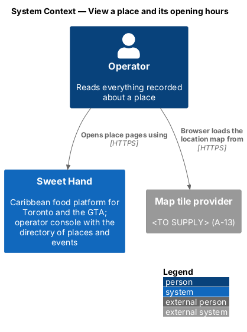
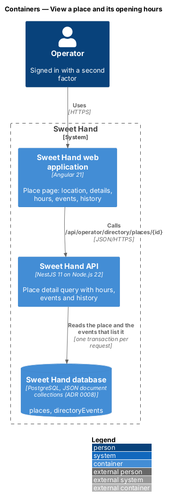
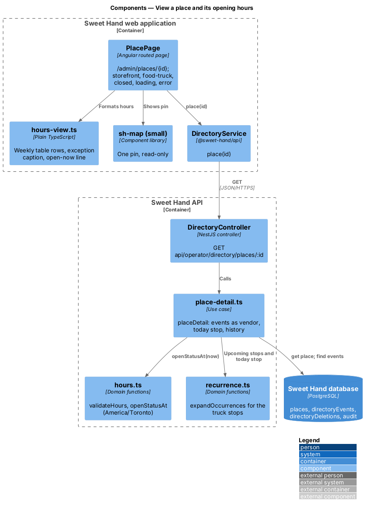
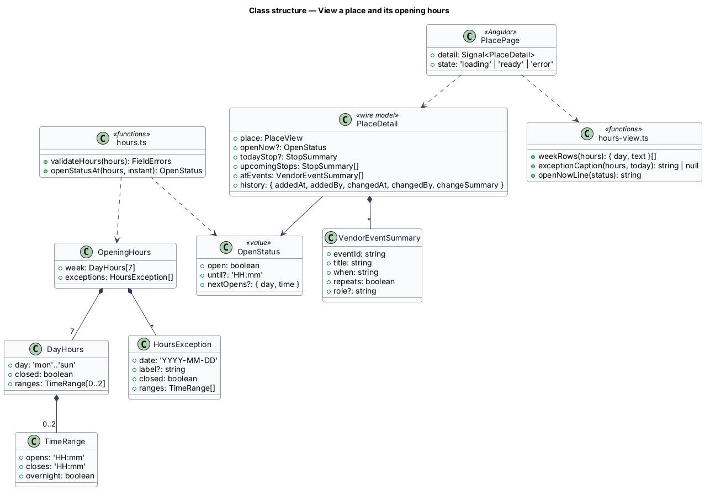
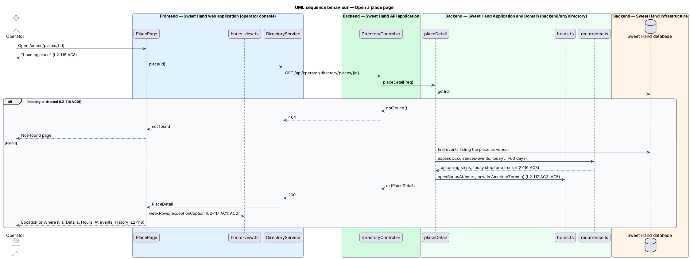

# View a place and its opening hours

## Overview

Each place has an operator page at `/admin/places/{id}` that shows everything recorded about it (`L1-026`). This feature covers that page and the opening hours it shows, including the "Open now" line the map card reuses.

> **place page** — operator page for one place: location, details, hours, events and history
>
> **opening hours** — weekly hours of a storefront, stored per weekday as closed or up to 2 time ranges in `America/Toronto`, with dated exceptions
>
> **hours exception** — dated change to the weekly hours, closed or other hours, with an optional label such as "Thanksgiving Monday"
>
> **open status** — whether a storefront is open at a given instant and until when, worked out in Toronto wall-clock time

A storefront's page shows its pin, address, area and nearest intersection. A food truck's page shows its home base as an area only, today's stop when there is one, and its upcoming stops, with "Add stop" to schedule another (`manage-events`). Every page lists the upcoming events the place is a vendor at, and its history. How hours are entered — the single "Hours" field of the editor, a day-by-day editor on this page, or both — is undecided and needs a mock (`L2-117`); this design fixes the stored shape and the display.

## Description

**Shared directory design.** The directory features share these building blocks and name them the same way:

- **Backend area `backend/src/directory/`** — `directory.controller.ts` (`DirectoryController`) maps routes under `api/operator/directory/` to use cases. Every route declares `@UsePolicy(roles('Operator'))`, so a customer or caterer session receives HTTP 403 and an operator who has not completed the second factor reaches nothing (`L2-133 AC1`). Use cases take the framework-free request context (`Request` in `http/endpoint.ts`) and return a `Reply` built with `http/problems.ts`, as `operator-settings/cuisines.ts` does.
- **Documents** — through the persistence port of ADR 0008: collection `places` (`Place`), collection `directoryEvents` (`DirectoryEvent`) and collection `directoryDeletions` (`Deletion`). Each place and event carries a `version` number for optimistic concurrency; a save with an older `version` returns `conflict(...)` (HTTP 409). The port filters only on top-level scalars, so search and range queries load the non-deleted documents and filter in process; `L2-134` sets the scale this holds for (2,000 places, 5,000 events).
- **Audit and history** — every change calls `recordAudit` (`platform/audit.ts`) with `targetType` `place` or `event` (`L2-133 AC3`). The document keeps `addedAt`, `addedBy`, `changedAt`, `changedBy` and `changeSummary` for the History sections.
- **Frontend** — pages and dialogs live in `frontend/projects/sweet-hand/src/app/features/operator/directory/`, routed from `features/operator/routes.ts` and lazy-loaded (`L2-134 AC5`). Paths come from `core/routing/paths.ts` (`paths.admin.places`, `place(id)`, `placesMap`, `events`, `event(id)`, `calendar`). Pages depend on the abstract `DirectoryService` in `@sweet-hand/api` (`services/directory.service.ts`), implemented by `HttpDirectoryService` and registered in `features/operator/providers.ts`. Wire models sit one type per file in `projects/api/src/lib/models/`, and the backend imports them with `import type`. Rules and view models are plain TypeScript beside each page; dates and times go through `core/format/format.ts` in `America/Toronto`.
- **Tests** — `backend/test/directory/` drives the API over HTTP against the in-memory database (ADR 0007, ADR 0008). `frontend/e2e/specs/directory/` covers each mock state through one page object per screen, with the directory cast seeded in test mode (ADR 0009). The seed cast in `backend/src/seed/` holds the fictional places and events of `docs/mocks/README.md`.

**Frontend — operator console (`features/operator/directory/place/`)**

- **`PlacePage`** (`place.page.ts`, `.html`, `.css`) — routed at `paths.admin.place(id)`. It calls `DirectoryService.place(id)` and renders:
  - the heading, the `sh-status` and "{type} · {primary cuisine}", with "Edit" and "Delete" (`L2-116 AC1`); a closed place adds "Reopen" (`close-or-delete-place`);
  - for a storefront, "Location": a small read-only `sh-map` with one pin, an `sh-description-list` of "Address" ("1742 Eglinton Ave W, Toronto ON M6E 2H8"), "Area" and "Nearest intersection", and the caption of `L2-116 AC2`;
  - for a food truck, "Where it is" with "Home base {municipality}" and "Area only. Food trucks never show where they park overnight.", "Today" when a stop runs today, and "Upcoming stops" as an `sh-list` agenda with "Add stop" (`L2-116 AC3`, `L2-116 AC4`);
  - "Details": Cuisine with "(primary)" when there are others, Known for, Dietary (the tag name and its note, "Contains nuts (peanut punch)"), Phone, Website as an external link with `rel="noopener noreferrer"`, and Instagram, leaving out empty entries (`L2-116 AC5`, `L2-133 AC6`);
  - "Hours" as an `sh-table` from `weekRows(hours)` plus `exceptionCaption` (`L2-117 AC1`, `L2-117 AC2`);
  - "At events" with each event's date or "Every {weekday}", title and role note (`L2-116 AC6`);
  - "History" with "Added {date} by {operator}" and "Last change {when} by {operator} · {summary}" (`L2-116 AC7`);
  - loading ("Loading place" as heading and hidden status) and error ("We couldn’t load this place", "Try again", "Back to places") (`L2-116 AC8`). A 404 shows the shared not-found page (`L2-116 AC9`).
- **`hours-view.ts`** — `weekRows` lists Monday to Sunday with "Closed" or ranges formatted "11 a.m.–9 p.m." and "12–8 p.m."; `exceptionCaption(hours, today)` names exceptions in the next 30 days ("Thanksgiving Monday 12 Oct: closed."); `openNowLine(status)` gives "Open now · until 11 p.m."; the closed-now wording waits for a mock (`L2-117 AC3`).

**Backend — `backend/src/directory/`**

- **`directory.controller.ts`** — `GET api/operator/directory/places/:id` calls `placeDetail`.
- **`place-detail.ts`** — `placeDetail(req)` returns `notFound()` for an unknown or deleted id. Otherwise it loads the events that list the place as a vendor, expands their occurrences for the next 60 days with `expandOccurrences` (`schedule-repeating-events`), picks today's stop for a truck, computes `openStatusAt(hours, req.now)` and returns `PlaceDetail` with the history fields.
- **`hours.ts`** — `OpeningHours` is `{ week: DayHours[7], exceptions: HoursException[] }`. `validateHours` refuses a range whose end is not after its start unless it ends after midnight by 4 a.m. (`L2-117 AC4`; message waits for a mock). `openStatusAt(hours, instant)` converts the instant to the Toronto date and time with `toronto-time.ts`, applies an exception for that date first, and handles ranges that run past midnight from the previous day, so daylight saving changes use wall-clock hours (`L2-117 AC5`).

Open points:

- How hours are entered, and the wording when a place is closed now: `<TO SUPPLY>` *(needs a mock)*.
- The role note per vendor shown under "At events" needs its field in the event editor *(needs a mock)*.

## Requirements

The feature realizes the following level-2 (L2) requirements from `docs/specs/L2.md`. Each refines the level-1 (L1) requirement cited beside it. Requirement text is quoted from the specification, with *must* rendered as *shall*; the acceptance criteria cited in the Description are in the specification.

| L2 ID | Refines (L1) | Requirement |
|-------|--------------|-------------|
| `L2-116` | `L1-026` | Each place shall have an operator page at `/admin/places/{id}` showing everything recorded about it. |
| `L2-117` | `L1-026` | A storefront's opening hours shall be structured data: for each weekday, either closed or up to 2 time ranges in `America/Toronto`, plus dated exceptions (closed, or other hours) with an optional label. A range can end after midnight, up to 4 a.m. How hours are entered — the single "Hours" field in the editor, a day-by-day editor on the place page ("Edit day by day on the place page once it’s saved."), or both — is undecided and *(needs a mock)* before it is built. |

## Diagrams

### System context

The operator reads a place in Sweet Hand. The browser loads the location map from the tile provider, still to be chosen.

### Containers

The place page calls the place detail endpoint, which reads the place and the events that list it.

### Components

`placeDetail` combines the place, the expanded occurrences of its events and `openStatusAt`. `PlacePage` formats hours with `hours-view.ts`.

### Class structure

`OpeningHours` holds 7 `DayHours` and dated `HoursException` entries. `PlaceDetail` adds the open status, today stop, upcoming stops and events as vendor.

### Behaviour — open a place page

The page loads the place, its events as vendor and its open status in one request; a missing or deleted place shows the not-found page.

