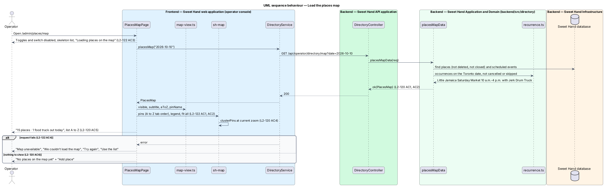
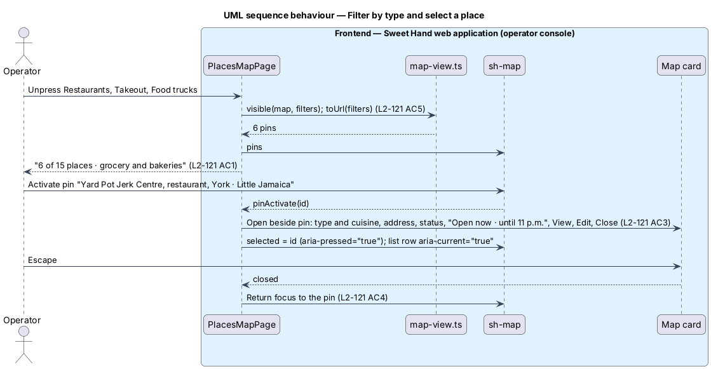

# View the places map

## Overview

The places map at `/admin/places/map` shows the directory geographically (`L1-027`). Storefronts appear as typed pins; food trucks appear only on days they have a stop, at that stop's venue. The map has a type filter, a switch for today's food trucks, an A to Z list that mirrors the pins, and a card for the selected place.

> **pin** — map marker for one place, showing a type letter: R Restaurant, T Takeout, G Grocery store, B Bakery, F Food truck
>
> **cluster** — single marker standing for pins that would overlap at the current zoom, showing their count
>
> **truck out today** — food truck that is a vendor at an occurrence today, in `America/Toronto`, of a scheduled event that is not cancelled or skipped and has a venue position
>
> **map card** — popover summary of the selected place with View, Edit and Close

Drafts show as outlined pins so operators can check them before listing; closed and deleted places are not on the map. Map tiles come from a provider still to be chosen (A-13); until then, the map draws the schematic of the GTA that the mocks use. Placing a storefront is `locate-places`; the hours behind "Open now" are `view-place`.

## Description

**Shared directory design.** The directory features share these building blocks and name them the same way:

- **Backend area `backend/src/directory/`** — `directory.controller.ts` (`DirectoryController`) maps routes under `api/operator/directory/` to use cases. Every route declares `@UsePolicy(roles('Operator'))`, so a customer or caterer session receives HTTP 403 and an operator who has not completed the second factor reaches nothing (`L2-133 AC1`). Use cases take the framework-free request context (`Request` in `http/endpoint.ts`) and return a `Reply` built with `http/problems.ts`, as `operator-settings/cuisines.ts` does.
- **Documents** — through the persistence port of ADR 0008: collection `places` (`Place`), collection `directoryEvents` (`DirectoryEvent`) and collection `directoryDeletions` (`Deletion`). Each place and event carries a `version` number for optimistic concurrency; a save with an older `version` returns `conflict(...)` (HTTP 409). The port filters only on top-level scalars, so search and range queries load the non-deleted documents and filter in process; `L2-134` sets the scale this holds for (2,000 places, 5,000 events).
- **Audit and history** — every change calls `recordAudit` (`platform/audit.ts`) with `targetType` `place` or `event` (`L2-133 AC3`). The document keeps `addedAt`, `addedBy`, `changedAt`, `changedBy` and `changeSummary` for the History sections.
- **Frontend** — pages and dialogs live in `frontend/projects/sweet-hand/src/app/features/operator/directory/`, routed from `features/operator/routes.ts` and lazy-loaded (`L2-134 AC5`). Paths come from `core/routing/paths.ts` (`paths.admin.places`, `place(id)`, `placesMap`, `events`, `event(id)`, `calendar`). Pages depend on the abstract `DirectoryService` in `@sweet-hand/api` (`services/directory.service.ts`), implemented by `HttpDirectoryService` and registered in `features/operator/providers.ts`. Wire models sit one type per file in `projects/api/src/lib/models/`, and the backend imports them with `import type`. Rules and view models are plain TypeScript beside each page; dates and times go through `core/format/format.ts` in `America/Toronto`.
- **Tests** — `backend/test/directory/` drives the API over HTTP against the in-memory database (ADR 0007, ADR 0008). `frontend/e2e/specs/directory/` covers each mock state through one page object per screen, with the directory cast seeded in test mode (ADR 0009). The seed cast in `backend/src/seed/` holds the fictional places and events of `docs/mocks/README.md`.

**Frontend — operator console (`features/operator/directory/places-map/`)**

- **`PlacesMapPage`** (`places-map.page.ts`, `.html`, `.css`) — routed at `paths.admin.placesMap`. It calls `DirectoryService.placesMap(today)` and renders:
  - the heading "Places map", the subtitle from `subtitle(map, filters)` ("15 places · 1 food truck out today", or "6 of 15 places · grocery and bakeries"), "Add place", and the "View" tabs (`L2-120 AC5`, `L2-121 AC1`, `L2-122 AC6`);
  - the group "Show types" of `sh-chip` toggle buttons with `aria-pressed`, and the switch "Food trucks out today", on by default (`L2-121 AC1`, `L2-121 AC2`);
  - the A to Z list of `section-link` rows, "{name}" and "{type} · {area}", with `aria-current="true"` on the selected row; below 1600px it follows the map, from 1600px it sits beside it (`L2-135 AC5`);
  - the `sh-map` with pins, clusters and the legend, and the map card as an `sh-popover` with `role="dialog"` (`L2-121 AC3`);
  - loading with disabled toggles, 6 skeleton rows and "Loading places on the map"; error with "Map unavailable", "Try again" and "Use the list"; and the empty state of `L2-120 AC6` (`L2-122 AC3`, `L2-122 AC4`);
  - the unpinned toast of `locate-places`.
- **`map-view.ts`** — `fromUrl` and `toUrl` keep `types`, `trucks` and `place` in the URL (`L2-121 AC5`); `visible(map, filters)` hides trucks when the Food trucks toggle or the switch is off; `pinName(pin)` builds "{name}, {type}, {area}" with ", draft", or the truck form "{name}, food truck, Home base: {municipality}, out today at {event} until {end time}" (`L2-120 AC3`); `aToZ(visible)` sorts with `Intl.Collator('en-CA')`, so the list order equals the pins' tab order (`L2-120 AC5`).
- **`sh-map`** — a new library component; its CRD is `<TO SUPPLY>` and comes before implementation. It knows nothing of the API and takes every label as input. It renders a region named "Places map" with "Zoom in", "Zoom out" and "Fit all places", opens fitted to its pins, pans with the arrow keys and zooms with + and − while focused (`L2-122 AC1`, `L2-122 AC2`). Pins are buttons in input order; `clusterPins(pins, zoom)` merges pins closer than 44px into a cluster button named by the page ("3 places downtown: Lakou Kreyòl, Pepperpot Lunch Counter, and 1 more. Zoom in to see them.") that zooms to its members (`L2-120 AC4`). Drafts use an outline, and every pin carries its letter, so colour is never the only cue (`L2-136 AC3`). When tiles fail, the pins still draw over a plain background (`L2-122 AC5`, needs a mock). The tile source is an injected adapter: a schematic source now, the provider later (A-13).
- **Map card** — "{type} · {primary cuisine}", the name as heading, "{street} · {area}", the status, the open-now line, "View", "Edit" and "Close". Escape or "Close" returns focus to the pin or row that opened it; opening another place replaces it (`L2-121 AC3`, `L2-121 AC4`).

**Backend — `backend/src/directory/`**

- **`directory.controller.ts`** — `GET api/operator/directory/map?date=YYYY-MM-DD` calls `placesMapData`; the date defaults to today in Toronto.
- **`places-map.ts`** — `placesMapData(req)` returns `PlacesMap`: every storefront that is `Listed` or `Draft`, not deleted and with a position, with its open status (`L2-120 AC1`); every food truck with an occurrence that day of a scheduled event that lists it, is not cancelled or skipped and has a `venuePosition`, placed at that position with the event title and end time (`L2-120 AC2`); and the unpinned storefronts.

**Performance.** With 2,000 places the map data stays under the 300 ms server target (`L2-134 AC1`). Clustering keeps the number of rendered markers bounded, and pins are drawn in a single pass so no main-thread task exceeds 200 ms while panning or zooming (`L2-134 AC2`). The map component and tiles load only on the map page, the place page and the editor (`L2-134 AC5`).

Open points:

- Map tile provider, attribution and data location: `<TO SUPPLY>` (A-13).
- The CRD for `sh-map` (pins, clusters, card anchoring, keyboard model): `<TO SUPPLY>`.
- Mock drift: the default mock counts 15 places but lists 13 and leaves Jerk Drum Truck out of the A to Z list; this design lists every visible place, trucks included.
- Whether the Food trucks toggle and the "Food trucks out today" switch should merge into one control: `<TO SUPPLY>`.

## Requirements

The feature realizes the following level-2 (L2) requirements from `docs/specs/L2.md`. Each refines the level-1 (L1) requirement cited beside it. Requirement text is quoted from the specification, with *must* rendered as *shall*; the acceptance criteria cited in the Description are in the specification.

| L2 ID | Refines (L1) | Requirement |
|-------|--------------|-------------|
| `L2-120` | `L1-027` | The places map at `/admin/places/map` shall show the directory's storefronts and today's food trucks as typed pins over the GTA. |
| `L2-121` | `L1-027` | The operator shall be able to filter the map by type, show or hide today's food trucks, and open a summary card for any place. |
| `L2-122` | `L1-027` | The map shall be usable with a pointer, touch and keyboard alone, and shall fail gracefully. |
| `L2-134` | `L1-022` | The directory shall stay fast with 2,000 places and 5,000 events. |
| `L2-135` | `L1-018` | Every directory page, dialog and toast shall work at every width from 320px to 2560px (L2-064), phone first. |
| `L2-136` | `L1-019` | Every directory page, dialog and toast shall meet WCAG 2.2 AA and the platform's accessibility requirements (L2-066 to L2-069). |

## Diagrams

### System context

The operator views the places map in Sweet Hand. The browser loads tiles from a tile provider still to be chosen.

### Containers

The map page calls the map endpoint of the API, which reads places and today's occurrences. Tiles load from the provider only on the pages that show a map.

### Components

`placesMapData` combines places, expanded occurrences and open status. `PlacesMapPage` applies filters with `map-view.ts` and draws with `sh-map`.

### Class structure

`PlacesMap` separates storefront pins from today's truck pins. `MapFilters` is the URL-backed view state; `sh-map` owns clustering.

### Behaviour — load the map

The page fetches one payload of pins, today's trucks and unpinned places, then fits the map, clusters overlapping pins and lists the places A to Z.

### Behaviour — filter and select a place

Filtering happens in the browser and updates the URL. Selecting a pin or row opens the card; Escape returns focus to where it came from.

