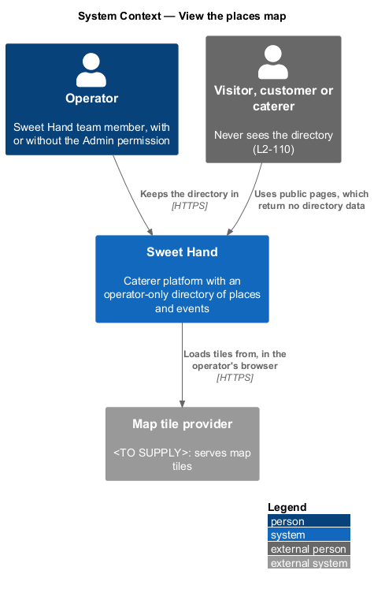
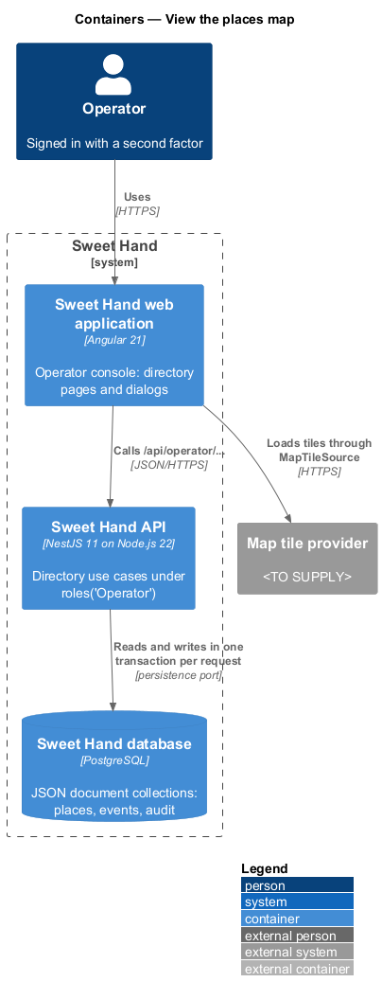
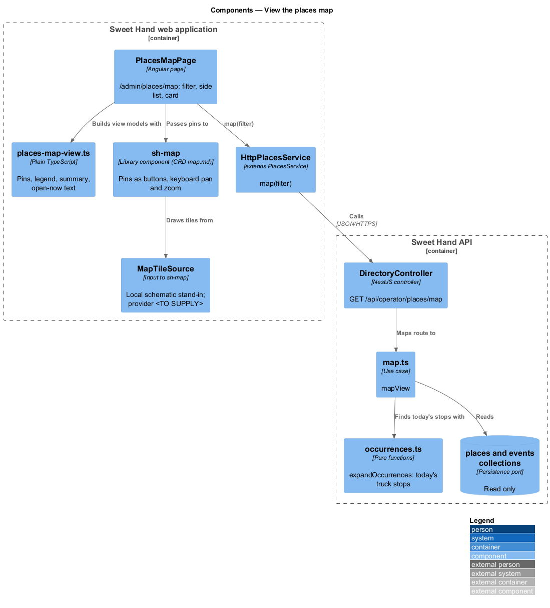
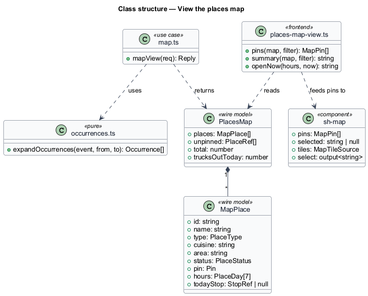
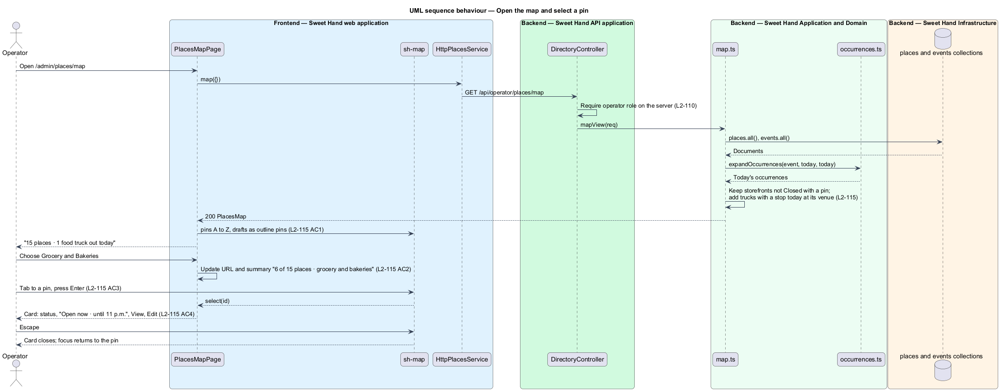

# View the places map

## Overview

The places map shows the directory's places on a map of Toronto and the GTA.
Operators can see where the businesses they track sit and which food trucks
are out today. It is the second view of the records kept by `manage-places`,
and like the rest of the directory it is for operators only (`L2-110`).

> **pin** — a marker at a place's latitude and longitude, lettered by type: R, T, G, B or F
>
> **outline pin** — the pin of a `Draft` place
>
> **out today** — a food truck that has a scheduled stop today; it appears at that stop's location
>
> **map provider** — the third-party service that serves map tiles; still to be chosen (`<TO SUPPLY>`)

The map shows each storefront that is not closed and has a pin. It also shows
each food truck with a stop today, at that stop's location. A food truck never
shows its home base on the map. The type filter and the "Food trucks out today"
checkbox narrow the pins and the side list together. Pins are buttons in A-to-Z
order, so the map works by keyboard. Selecting a pin opens a card with the
place's status and whether it is open now (`L2-115`).

## Description

**Frontend — Sweet Hand web application** (`features/operator/directory/places/`)

- **`PlacesMapPage`** — `/admin/places/map`. It shows the summary, the type
  filter, the "Food trucks out today" checkbox, the A-to-Z side list, the map,
  the legend and the selected-place card. Its states are default, loading,
  empty and error. The error state offers "Use the list", which links to
  `/admin/places`. The filter lives in the URL.
- **`places-map-view.ts`** — builds the pins, legend and summary, such as
  "6 of 15 places · grocery and bakeries". It also builds the "Open now ·
  until 11 p.m." and "Closed now" text from the place's hours in
  `America/Toronto`, through `core/format/format.ts`.
- **`sh-map`** — a new library component, specified by its own CRD
  (`docs/specs/components/map.md`). It draws pins as buttons in the order
  given. It pans with the arrow keys, zooms with "+" and "−", and returns focus
  to the pin when a card closes. It holds no user-facing strings. Tiles come
  from a `MapTileSource` input. A local stand-in draws the schematic GTA map
  from the mocks until the provider is chosen.
- A "Places map" item is added to `operator-nav.ts`, and `paths.admin.placesMap`
  to `core/routing/paths.ts`.

**Frontend — API library**

- **`PlacesService.map(filter)`** — implemented by `HttpPlacesService`. It
  returns a `PlacesMap` wire model: `MapPlace` rows (id, name, type, cuisine,
  area, status, pin, hours, today's stop for a truck) and the counts for the
  summary. It also lists the `unpinned` places behind the info toast "1 place
  has no pin yet" (`L2-115 AC7`).

**Backend — Sweet Hand API application**

- `GET /api/operator/places/map` (`types`, `trucksToday`) → `mapView`, in
  `DirectoryController` under `@UsePolicy(roles('Operator'))`.

**Backend — Sweet Hand Application and Domain** (`backend/src/directory/map.ts`)

- **`mapView`** — reads `places` and today's occurrences from the events
  collection through `expandOccurrences` (`manage-events`). It keeps
  storefronts that are not `Closed` and have a `pin`. It adds each food truck
  that is a vendor at an occurrence today that is not cancelled, pinned at that
  occurrence's venue. It sorts A to Z with the same folding as search. Listed
  storefronts without a pin are returned as `unpinned`.

**Backend — Sweet Hand Infrastructure**

- **Persistence port** — `places` and `events` collections, read only.
- An event's venue gets its pin from the `Geocoder` (`manage-places`) when the
  event is saved. A venue with no pin leaves its truck off the map.

**Open points.**

- The map tile provider, its licence, and whether tiles may be cached are
  `<TO SUPPLY>`.
- Clustering (`L2-115 AC9`) happens in the frontend. `places-map-view.ts`
  groups pins whose heads would overlap at the current zoom, and `sh-map` draws
  each group as a cluster button. The overlap distance is the 44 px pin target.

## Requirements

The feature realizes the following level-2 (L2) requirements from
`docs/specs/L2.md`. Each refines the level-1 (L1) requirement cited beside it.
Requirement text is quoted from the specification, with *must* rendered as
*shall*.

| L2 ID | Refines (L1) | Requirement |
|-------|--------------|-------------|
| `L2-115` | `L1-026` | The places map (`/admin/places/map`) shows each storefront that is not closed and has a pin, plus each food truck with a scheduled stop today, at that stop's location. The map tile provider and geocoding provider are still to be chosen (`<TO SUPPLY>`); they sit behind a port with a local stand-in. |

Operator-only access (`L2-110`) is realized in `manage-places` and applies to
the map endpoint unchanged.

## Diagrams

### System context

Operators view the map in Sweet Hand. The web application loads map tiles from
a map provider that is still to be chosen.

### Containers

The web application draws the map and asks the Sweet Hand API for the pins.
The API reads places and events from the Sweet Hand database.

### Components

`PlacesMapPage` passes pins to `sh-map` and reads them through
`HttpPlacesService`. `mapView` combines places with today's food truck stops.

### Class structure

`PlacesMap` carries `MapPlace` rows and counts. `mapView` uses
`expandOccurrences` to find today's stops.

### Behaviour — open the map and select a pin

An operator opens the map, filters it to grocery stores and bakeries, and
selects a pin. The card shows whether the place is open now, and Escape returns
focus to the pin (`L2-115`).

