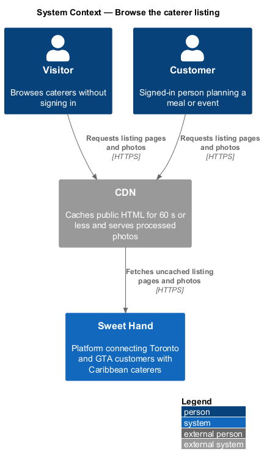
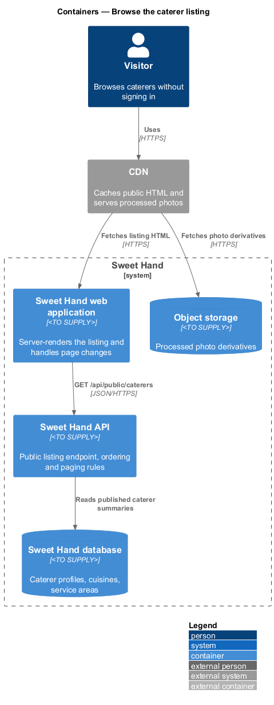
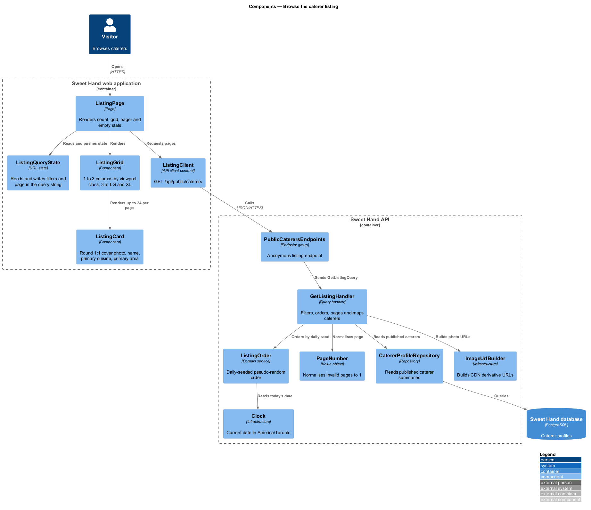
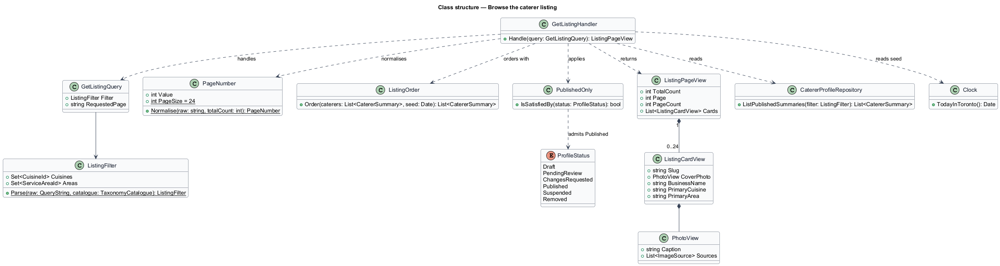
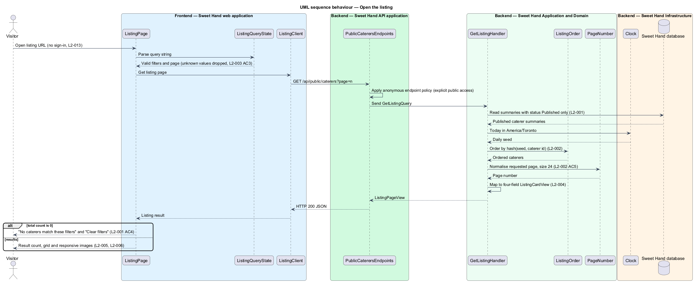
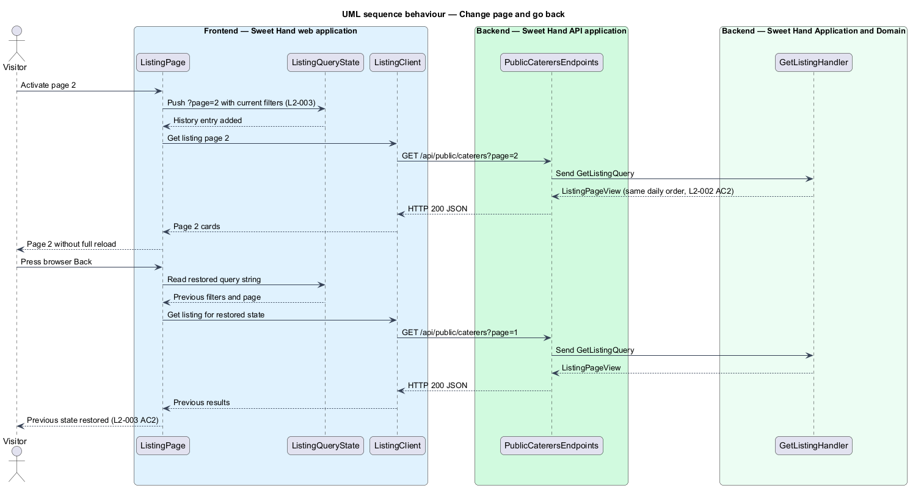

# Browse the caterer listing

## Overview

Sweet Hand connects people in Toronto and the Greater Toronto Area (GTA) with
caterers who sell Caribbean food. The *caterer listing* is the front door of the
platform: a grid of photo-led cards, one per caterer, from which a visitor opens
a caterer's page. This feature covers opening the listing, the order in which
caterers appear, paging through results, and keeping that state in the URL.

> **visitor** — person using Sweet Hand without signing in
>
> **published caterer** — caterer whose profile status is `Published`, the only status shown to visitors and customers
>
> **listing card** — tile that represents one published caterer in the listing grid
>
> **viewport class** — width band of the browser window: XS < 576 px, SM ≥ 576 px, MD ≥ 768 px, LG ≥ 992 px, XL ≥ 1200 px
>
> **daily seed** — current date in `America/Toronto`, used to derive the listing order for that day

The listing is public by deliberate choice. A visitor browses, filters and pages
through results with no sign-in prompt (`L2-013`). Only published caterers
appear, so an operator's approval or suspension elsewhere in the platform
changes what the listing shows within 60 seconds.

No caterer is permanently favoured. With no sort chosen, caterers appear in a
pseudo-random order derived from the daily seed. The order is stable for one
calendar day and changes on the next. The filter features
(`filter-by-cuisine`, `filter-by-area`, `search-by-postal-code`) narrow the same
listing. This feature owns the unfiltered listing, its order, its paging and
the card itself.

## Description

Technology choices are `<TO SUPPLY>` pending architecture decision records in
`docs/adr/`. The components below are described by role.

**Frontend — Sweet Hand web application**

- **`ListingPage`** — server-rendered page at the listing route (path
  `<TO SUPPLY>`). It renders the result count ("3 caterers"), the grid, the
  pager and the empty state. It depends on the `ListingClient` contract for
  client-side page changes.
- **`ListingQueryState`** — reads and writes the listing state in the URL query
  string: filters, search terms and `page` (`L2-003`). Unknown filter values are
  dropped before the request is built (`L2-003 AC3`). Each change pushes a
  browser history entry, so the Back button restores the previous state
  (`L2-003 AC2`).
- **`ListingGrid`** — lays out cards in 1 column at XS, 2 at SM and MD, and 3
  at LG and XL (`L2-005`). At XL the grid keeps 3 columns and the extra width
  goes to white space around it (`L2-005 AC4`). The grid causes no horizontal
  scrolling at 320 px.
- **`ListingCard`** — a single link to `/caterers/{slug}` that shows exactly the
  cover photo, business name, primary cuisine and primary service area
  (`L2-004`). The name truncates with an ellipsis after 2 lines; the full name
  stays in the link's accessible name. The photo is a 1:1 circle that fills at
  least 60% of the card height (`L2-005 AC5`). A neutral circular placeholder
  of the same size holds the space before the photo loads or when it fails
  (`L2-006 AC5`).
- **`ResponsiveCardImage`** — emits `srcset` widths 400, 800 and 1200, a `sizes`
  attribute that matches the 3-column grid and its capped circle
  (`(min-width: 62rem) 17.5rem, (min-width: 36rem) 45vw, 90vw`, the value the
  caterer-card component requirements fix), AVIF and WebP sources with a JPEG
  fallback, and `alt` set to the caterer's caption for that photo (`L2-006`).
  Cards in the first viewport load eagerly; all others use `loading="lazy"`.
  The eager count follows the viewport class: the first 2 cards at XS, 4 at SM
  and MD, and 6 at LG and XL (`L2-006 AC3`). Without a known viewport the
  server renders the XS count.
- **`ListingEmptyState`** — shows "No caterers match these filters" with a
  "Clear filters" control when a page has no results (`L2-001 AC4`).
- **`ListingClient`** — API client contract for `GET /api/public/caterers`. The
  page depends on the contract, not on the concrete HTTP client.

**Backend — Sweet Hand API application**

- **`PublicCaterersEndpoints`** — anonymous endpoint group. Anonymous access is
  an explicit choice for public browsing (`L2-013`). `GET /api/public/caterers`
  accepts filter parameters and `page`, and returns HTTP 200 with a
  `ListingPageView`.

**Backend — Sweet Hand Application and Domain**

- **`GetListingQuery`** — carries the parsed `ListingFilter` and the requested
  page.
- **`GetListingHandler`** — reads the published caterers that match the filter,
  orders them with `ListingOrder`, normalises the page with `PageNumber`, and
  maps each caterer to a `ListingCardView`.
- **`ListingFilter`** — the set of valid filter values. Values absent from the
  cuisine or service area catalogues are ignored, not rejected.
- **`PageNumber`** — value object that turns zero, negative, non-integer or
  past-the-end values into page 1 (`L2-002 AC5`). The page size is fixed at 24.
- **`ListingOrder`** — domain service that sorts caterers by a stable hash of
  the daily seed and the caterer identifier. The same seed always yields the
  same order; a different date yields a different order (`L2-002 AC3`,
  `L2-002 AC4`). The hash function is `<TO SUPPLY>`.
- **`PublishedOnly`** — specification that admits only `ProfileStatus.Published`
  (`L2-001`).
- **`ListingCardView`** — read model with exactly four display fields plus the
  slug for the link. It carries no rating, price, contact detail or status.

**Backend — Sweet Hand Infrastructure**

- **`CatererProfileRepository`** — reads published caterer summaries from the
  Sweet Hand database.
- **`ImageUrlBuilder`** — builds CDN URLs for each processed photo derivative.
- **`Clock`** — supplies the current date in `America/Toronto` for the daily
  seed.

**Visibility.** The listing reads profile status on every uncached request. The
CDN caches public HTML for 60 seconds or less, so an approval or a suspension
shows in the listing within 60 seconds (`L2-001 AC2`, `L2-001 AC3`).

## Requirements

The feature realizes the following level-2 (L2) requirements from
`docs/specs/L2.md`. Each refines the level-1 (L1) requirement cited beside it.
Requirement text is quoted from the specification, with *must* rendered as
*shall*.

| L2 ID | Refines (L1) | Requirement |
|-------|--------------|-------------|
| `L2-001` | `L1-001` | The caterer listing shall include every caterer whose profile status is `Published` and shall exclude every other status (`Draft`, `Pending review`, `Changes requested`, `Suspended`, `Removed`). |
| `L2-002` | `L1-001` | The listing shall show 24 caterers per page. With no sort chosen by the user, caterers shall appear in a pseudo-random order seeded by the current date, so that no caterer is permanently favoured and the order stays stable within a day. |
| `L2-003` | `L1-001` | The active filters, search terms and page number shall be stored in the URL query string. A listing URL shall be shareable and bookmarkable, and shall work with the browser Back button. |
| `L2-004` | `L1-002` | Each listing card shall show exactly four things: the caterer's cover photo, business name, primary cuisine and primary service area. It shall show nothing else, including ratings, prices and contact details. The whole card shall be a single link to the caterer page. |
| `L2-005` | `L1-002` | The listing shall use a grid of cards whose column count depends on the viewport class. Photos are round (1:1) and shall take up at least 60% of each card's height. |
| `L2-006` | `L1-002` | Listing photos shall be delivered in sizes matched to the viewport and in modern formats. Photos below the fold shall load lazily. Every image shall have a text alternative. |
| `L2-013` | `L1-005` | The listing, all filters and searches, and all caterer pages, including reviews, shall be fully usable without signing in. The platform shall ask a visitor to sign in only when they try to send an enquiry, leave a review, or open their account pages. |

This feature realizes the listing part of `L2-013`. The caterer page part
belongs to `view-caterer-page`.

## Diagrams

### System context

Visitors and customers browse the listing in Sweet Hand. The CDN delivers cached
listing HTML and processed photos.

### Containers

The web application renders the listing from the Sweet Hand API, which reads
published caterers from the Sweet Hand database. Photos come from object storage
through the CDN.

### Components

`ListingPage` builds its request through `ListingQueryState` and the
`ListingClient` contract. In the API, `GetListingHandler` applies
`PublishedOnly`, `ListingOrder` and `PageNumber` before it maps each caterer to
a `ListingCardView`.

### Class structure

`GetListingHandler` handles `GetListingQuery` and composes the filter, page and
order rules. `ListingPageView` holds at most 24 `ListingCardView` items.

### Behaviour — open the listing

The server renders the first page. The handler keeps only published caterers
(`L2-001`), orders them by the daily seed (`L2-002`), and returns four fields per
card (`L2-004`).

### Behaviour — change page and go back

A page change updates the URL and fetches the next page without a full reload.
The Back button restores the previous state from the URL (`L2-003`).

