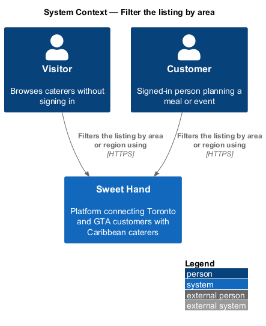
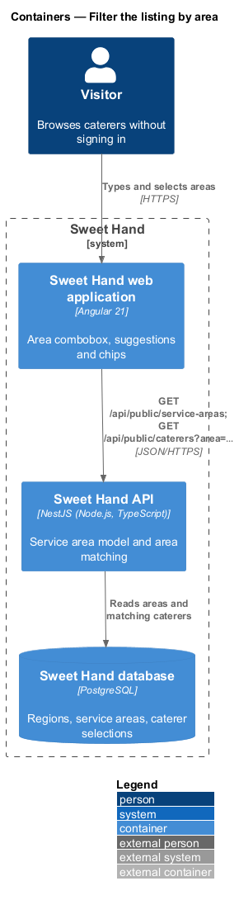
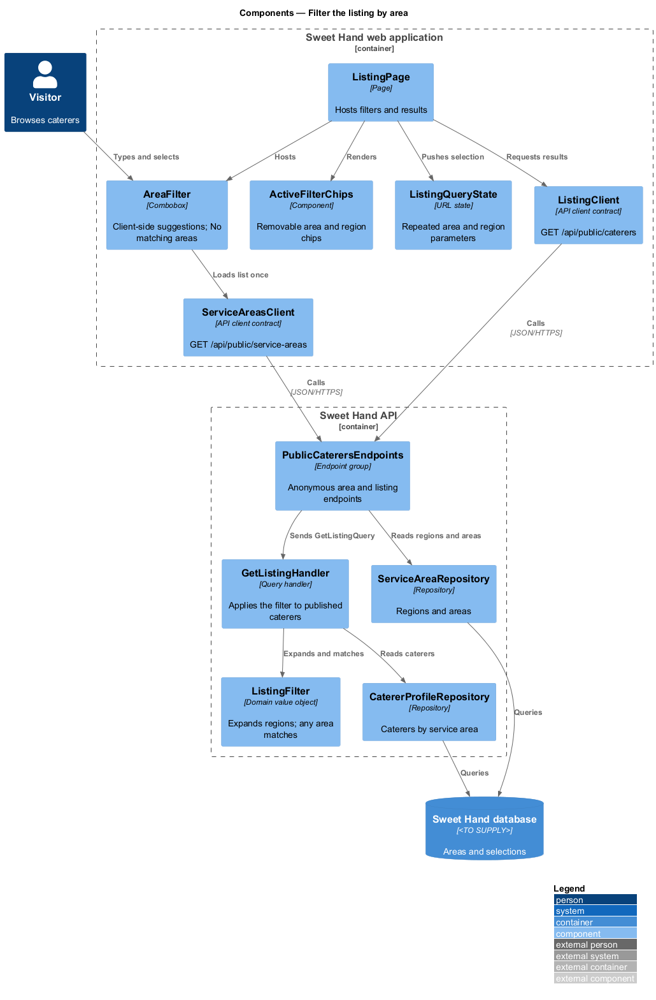
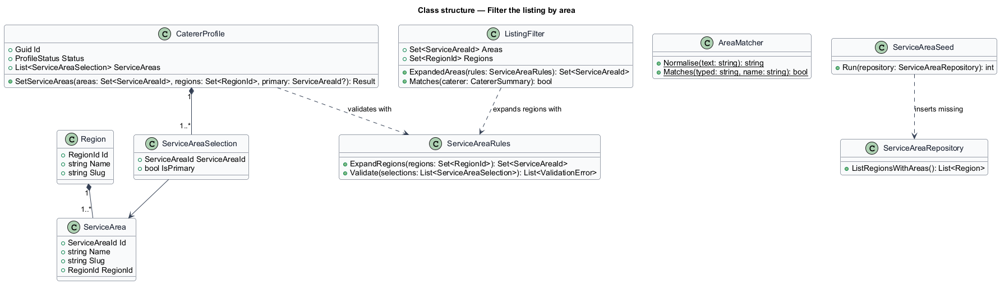
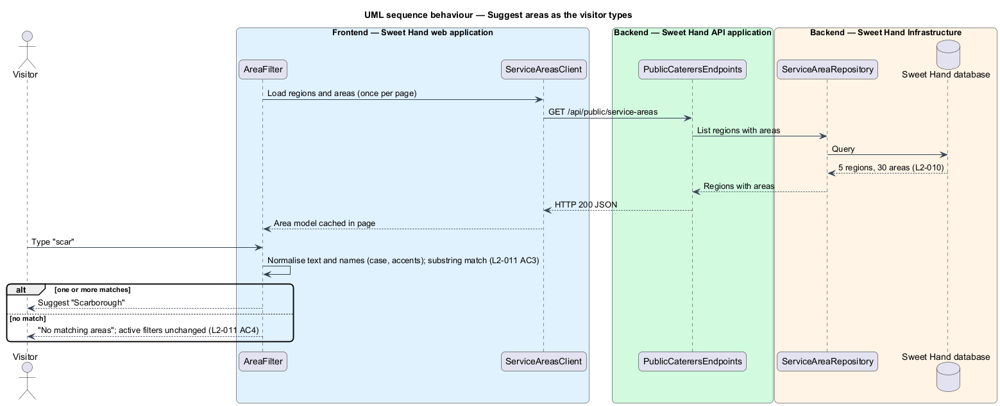
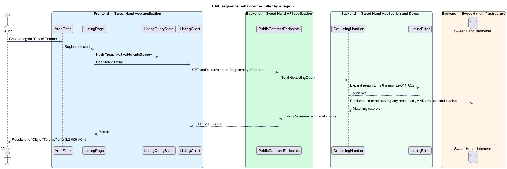

# Filter the listing by area

## Overview

Caterers in Toronto and the Greater Toronto Area (GTA) travel to some places
and not others. A customer planning an event in Scarborough wants caterers who
serve Scarborough. This feature gives the platform a fixed model of service
areas and lets a visitor narrow the listing to one or more areas or whole
regions, with suggestions as they type.

> **service area** — named municipality or former municipality within Toronto and the GTA in which a caterer offers to cater
>
> **region** — named group of service areas: City of Toronto, Peel, York Region, Durham or Halton
>
> **primary service area** — the one area a caterer marks as the main one, shown on the listing card
>
> **area control** — combobox in the listing filters that suggests areas and regions as the visitor types

The platform holds 30 service areas in 5 regions (`L2-010`). Each caterer
serves at least one area and marks one as primary. The caterer-profiles
subsystem provides the editing screens. This feature defines the model and the
selection rules those screens apply.

A visitor filters by an area or by a whole region. A region selection matches
every caterer that serves at least one area in that region (`L2-011 AC2`).
Several selected areas widen the result; an area selection and a cuisine
selection narrow each other (`L2-008 AC4`). The area control is one of the
filter controls whose presentation changes by viewport class (`L2-009`). Those
presentations are described in `filter-by-cuisine`.

## Description

Technology choices are `<TO SUPPLY>` pending architecture decision records in
`docs/adr/`. The components below are described by role.

**Service area model.** The initial list, loaded by an idempotent seed through an
explicit command:

| Region | Service areas |
|--------|---------------|
| City of Toronto | Downtown Toronto, East York, Etobicoke, North York, Scarborough, York |
| Peel | Brampton, Caledon, Mississauga |
| York Region | Aurora, East Gwillimbury, Georgina, King, Markham, Newmarket, Richmond Hill, Vaughan, Whitchurch-Stouffville |
| Durham | Ajax, Brock, Clarington, Oshawa, Pickering, Scugog, Uxbridge, Whitby |
| Halton | Burlington, Halton Hills, Milton, Oakville |

**Frontend — Sweet Hand web application**

- **`AreaFilter`** — combobox with a listbox of suggestions. It loads the
  30 areas and 5 regions once and matches typed text on the client: case and
  accents are ignored, and the text may appear anywhere in the name
  (`L2-011 AC3`). With no match, it shows "No matching areas" and leaves the
  active filters unchanged (`L2-011 AC4`). Choosing a suggestion adds an area
  or region filter.
- **`ListingFilters`** — hosts `AreaFilter` in the panel dialog (XS, SM), the
  bar (MD) or the sidebar (LG, XL), as described in `filter-by-cuisine`.
- **`ActiveFilterChips`** — shows one removable chip per selected area or
  region (`L2-009 AC4`).
- **`ListingQueryState`** — writes repeated `area` and `region` parameters
  (slugs) to the URL.
- **`ServiceAreasClient`** — API client contract for
  `GET /api/public/service-areas`. The listing request itself goes through
  `ListingClient`.

**Backend — Sweet Hand API application**

- **`PublicCaterersEndpoints`** — `GET /api/public/service-areas` returns the
  regions with their areas. `GET /api/public/caterers` accepts `area` and
  `region` parameters. Both are anonymous by explicit choice.

**Backend — Sweet Hand Application and Domain**

- **`Region`** and **`ServiceArea`** — fixed reference entities; each area
  belongs to exactly one region.
- **`ServiceAreaSelection`** — link between a `CatererProfile` and a
  `ServiceArea` with an `isPrimary` flag.
- **`ServiceAreaRules`** — domain rules the profile editor calls on save. At
  least one area is required ("Choose at least one area you serve",
  `L2-010 AC2`). Exactly one area is primary ("Choose your primary area",
  `L2-010 AC4`). A region selection expands to every area in that region before
  it is stored (`L2-010 AC3`).
- **`ListingFilter`** — expands each selected region into its areas, unions
  them with the selected areas, and matches a caterer that serves any of them.
- **`AreaMatcher`** — normalisation shared by suggestion matching on the client
  and any server-side lookup: Unicode decomposition, removal of combining
  marks, lower case, substring match.

**Backend — Sweet Hand Infrastructure**

- **`ServiceAreaRepository`** — reads regions and areas.
- **`CatererProfileRepository`** — returns published caterers whose
  `ServiceAreaSelection` rows match the expanded area set.
- **`ServiceAreaSeed`** — inserts missing regions and areas by slug and never
  duplicates or alters existing rows.

## Requirements

The feature realizes the following level-2 (L2) requirements from
`docs/specs/L2.md`. Each refines the level-1 (L1) requirement cited beside it.
Requirement text is quoted from the specification, with *must* rendered as
*shall*.

| L2 ID | Refines (L1) | Requirement |
|-------|--------------|-------------|
| `L2-010` | `L1-004` | The platform shall keep a fixed list of service areas within Toronto and the GTA, grouped by region. Each caterer shall pick at least 1 service area and mark exactly one as primary. The initial list is: (the 30 areas in 5 regions shown in the Description). |
| `L2-011` | `L1-004` | A visitor shall be able to filter the listing by one or more service areas or whole regions. The area control shall suggest matching areas as the visitor types. |
| `L2-009` | `L1-003` | The filter controls shall suit each viewport class. |

This feature realizes `L2-009` for the area control only. The shared filter
presentations belong to `filter-by-cuisine`.

## Diagrams

### System context

Visitors and customers filter the listing by area in Sweet Hand. No external
system takes part.

### Containers

The web application loads the area model once from the Sweet Hand API and sends
selected areas and regions with each listing request.

### Components

`AreaFilter` suggests areas on the client from the list that
`ServiceAreasClient` returns. In the API, `ListingFilter` expands regions to
areas before `CatererProfileRepository` reads matching caterers.

### Class structure

`Region` groups `ServiceArea` entries. `CatererProfile` holds one or more
`ServiceAreaSelection` rows, checked by `ServiceAreaRules`.

### Behaviour — suggest areas as the visitor types

Suggestions are computed on the client from the loaded list. Typed text that
matches nothing shows "No matching areas" and changes no filter
(`L2-011 AC3`, `L2-011 AC4`).

### Behaviour — filter by a region

Selecting the region "City of Toronto" expands to its six areas, and the listing
shows every published caterer that serves at least one of them (`L2-011 AC2`).

