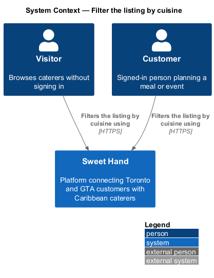
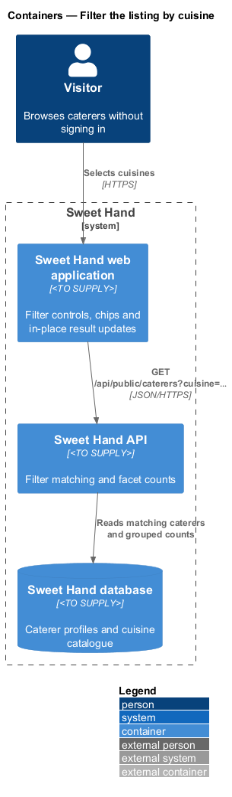
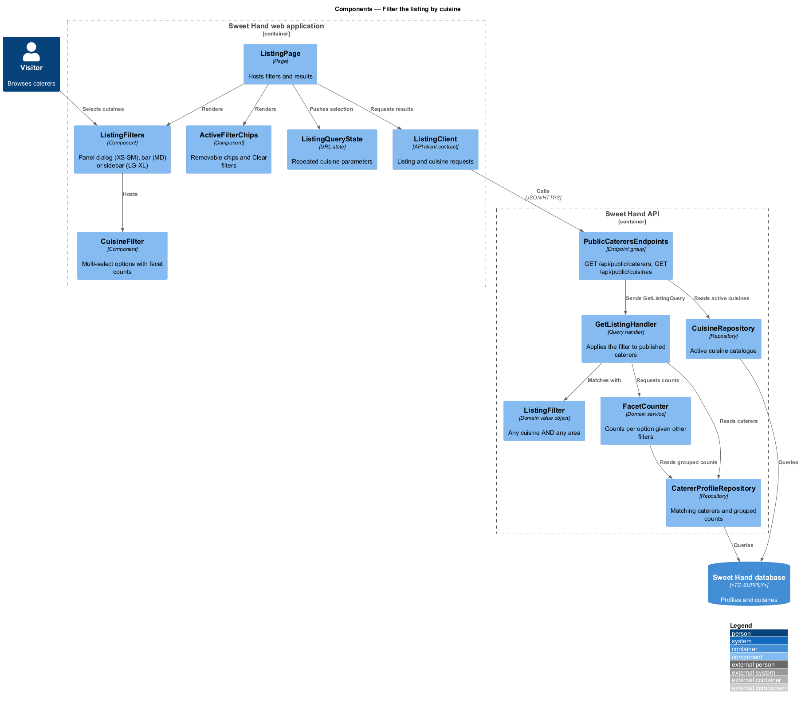
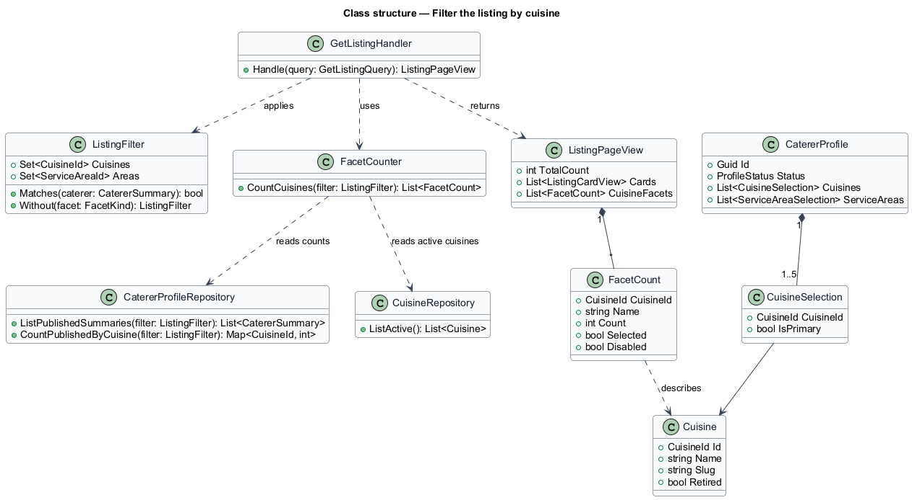
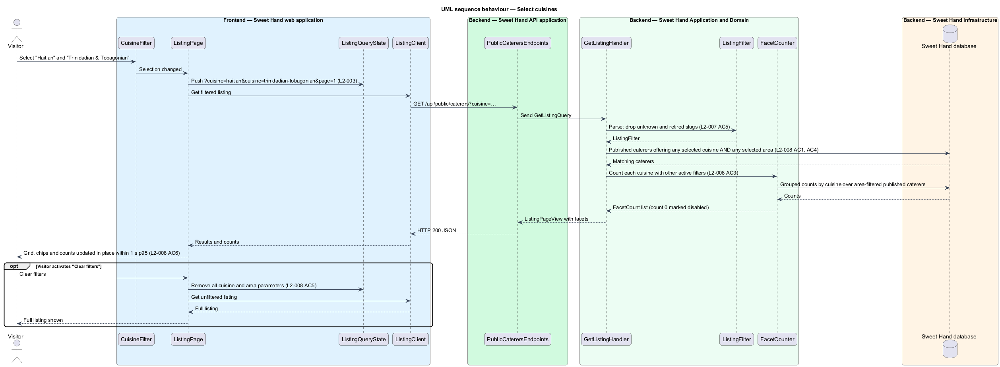
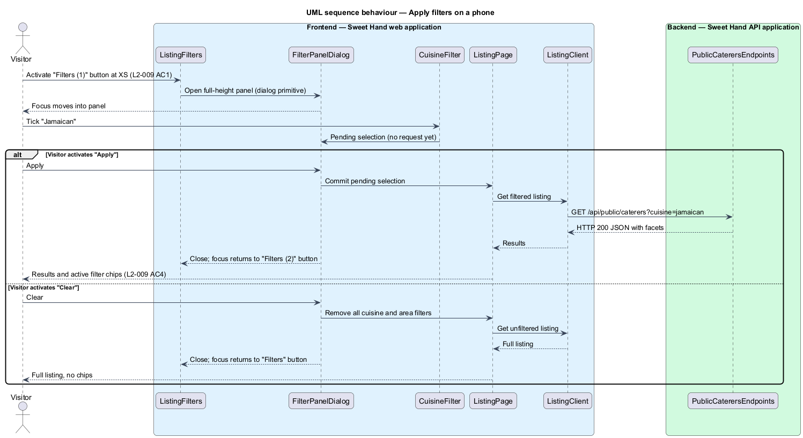

# Filter the listing by cuisine

## Overview

The Caribbean is many islands and traditions, and a customer often looks for
one in particular: Jamaican for a wedding, Haitian for a family gathering,
Trinidadian & Tobagonian for a community event. This feature lets a visitor
narrow the caterer listing to one or more cuisines, and presents the filter
controls in a form that suits each screen size.

> **cuisine** — Caribbean culinary tradition named by island or country of origin, kept in an operator-managed list
>
> **primary cuisine** — the one cuisine a caterer marks as the main one, shown on the listing card
>
> **facet count** — number of published caterers an unselected filter option would match, given the other active filters
>
> **active filter chip** — removable tag above the results that names one active filter value

Each caterer offers 1 to 5 cuisines and marks one as primary (`L2-007`). The
caterer-profiles subsystem enforces that rule when a caterer edits a profile.
This feature reads the result. Several selected cuisines widen the result
(a caterer matches when it offers *any* of them). A cuisine selection and an
area selection narrow each other: a caterer matches only when it satisfies both
(`L2-008 AC4`).

The filter controls change shape by viewport class (`L2-009`). Phones and small
tablets get a "Filters" button that opens a full-height panel. Tablets in
landscape get a horizontal bar of dropdowns. Desktops get a sidebar beside the
grid. The listing itself, its order and its paging belong to `browse-listing`.
The cuisine list is maintained in `manage-cuisine-list`.

## Description

Technology choices are `<TO SUPPLY>` pending architecture decision records in
`docs/adr/`. The components below are described by role.

**Frontend — Sweet Hand web application**

- **`ListingFilters`** — chooses the presentation by viewport class and hosts
  the cuisine and area controls.
  - **`FilterPanelDialog`** (XS, SM) — opened by a "Filters" button that shows
    the number of active filters. It is a full-height panel built on the UI
    framework's accessible dialog primitive, with "Apply" and "Clear" buttons.
    Selections inside the panel take effect on "Apply".
  - **`FilterBar`** (MD) — horizontal bar of dropdown controls above the grid.
  - **`FilterSidebar`** (LG, XL) — sidebar that stays visible to the left of
    the grid.
- **`CuisineFilter`** — multi-select list of active cuisines in alphabetical
  order. Each option shows its facet count. Options with a count of 0 are shown
  but disabled (`L2-008 AC3`).
- **`ActiveFilterChips`** — one removable chip per active filter value above the
  results at every viewport class (`L2-009 AC4`), plus a "Clear filters"
  control that removes all cuisine and area filters (`L2-008 AC5`).
- **`ListingQueryState`** — writes repeated `cuisine` parameters (cuisine slugs)
  to the URL and pushes a history entry (`L2-003`).
- **`ListingClient`** — API client contract. Selection changes fetch JSON and
  replace the grid in place, with no full page reload (`L2-008 AC6`).

**Backend — Sweet Hand API application**

- **`PublicCaterersEndpoints`** — `GET /api/public/caterers` accepts repeated
  `cuisine` and `area` parameters and returns the page of cards together with
  facet counts. `GET /api/public/cuisines` returns the active cuisine list.
  Both are anonymous by explicit choice.

**Backend — Sweet Hand Application and Domain**

- **`ListingFilter`** — holds the selected cuisines and areas. Its match rule is
  *any* selected cuisine **and** *any* selected area; an empty facet matches
  every caterer. Unknown or retired cuisine slugs are dropped.
- **`GetListingHandler`** — applies the filter to published caterers and returns
  the page (see `browse-listing`).
- **`FacetCounter`** — computes each cuisine option's count over published
  caterers that match the *other* active filters (the area selection). An
  option's own selection never reduces its count.
- **`Cuisine`** — catalogue entry with a name, a slug and a `retired` flag.
  Retired cuisines are never offered as filter options (`L2-007 AC5`).
- **`CuisineSelection`** — link between a `CatererProfile` and a `Cuisine`
  with an `isPrimary` flag.

**Backend — Sweet Hand Infrastructure**

- **`CatererProfileRepository`** — returns published caterers matching a
  `ListingFilter`, and grouped counts per cuisine for `FacetCounter`.
- **`CuisineRepository`** — reads the cuisine catalogue.

**Performance.** New results appear within 1 second at the 95th percentile on a
broadband connection (`L2-008 AC6`). The indexing strategy that meets this
target is `<TO SUPPLY>`.

## Requirements

The feature realizes the following level-2 (L2) requirements from
`docs/specs/L2.md`. Each refines the level-1 (L1) requirement cited beside it.
Requirement text is quoted from the specification, with *must* rendered as
*shall*.

| L2 ID | Refines (L1) | Requirement |
|-------|--------------|-------------|
| `L2-007` | `L1-003` | The platform shall keep a list of Caribbean cuisines (by island or country of origin) that operators manage. Each caterer shall pick 1 to 5 cuisines and mark exactly one as primary. The initial list is: Antiguan & Barbudan, Bahamian, Barbadian (Bajan), Belizean, Cuban, Dominican (Dominica), Dominican (Dominican Republic), Grenadian, Guyanese, Haitian, Jamaican, Kittitian & Nevisian, Puerto Rican, St. Lucian, Surinamese, Trinidadian & Tobagonian, Vincentian, Pan-Caribbean. |
| `L2-008` | `L1-003` | A visitor shall be able to filter the listing by one or more cuisines. If several are selected, a caterer matches when it offers *any* of them. Each option shall show how many published caterers it matches when combined with the other active filters. |
| `L2-009` | `L1-003` | The filter controls shall suit each viewport class. |

This feature realizes the part of `L2-007` that the filter reads: caterers'
cuisine selections and the exclusion of retired cuisines from filter options.
Operator maintenance of the list belongs to `manage-cuisine-list`.

## Diagrams

### System context

Visitors and customers filter the listing in Sweet Hand. No external system
takes part in filtering.

### Containers

The web application sends the cuisine selection to the Sweet Hand API, which
filters and counts published caterers in the Sweet Hand database.

### Components

`ListingFilters` hosts `CuisineFilter` in the presentation that suits the
viewport class. In the API, `GetListingHandler` applies `ListingFilter` and
`FacetCounter` computes the per-option counts.

### Class structure

`ListingFilter` holds cuisine and area selections and owns the match rule.
`FacetCounter` produces a `FacetCount` per active `Cuisine`.

### Behaviour — select cuisines

A selection change updates the URL, fetches filtered results and facet counts,
and replaces the grid without a page reload (`L2-008`).

### Behaviour — apply filters on a phone

At XS and SM, the "Filters" button opens a full-height panel. Selections take
effect on "Apply", and focus returns to the button when the panel closes
(`L2-009 AC1`).

