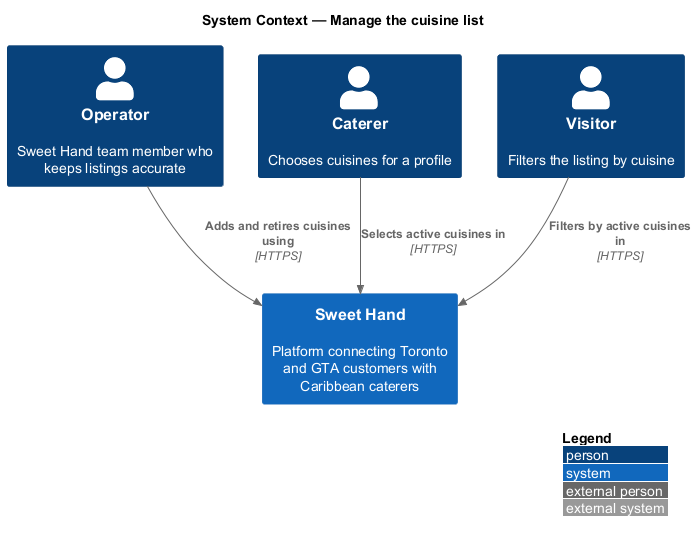
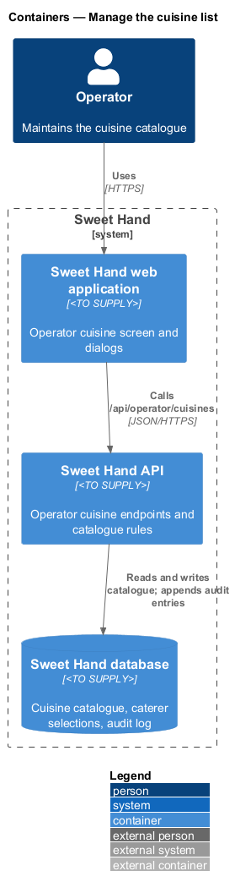
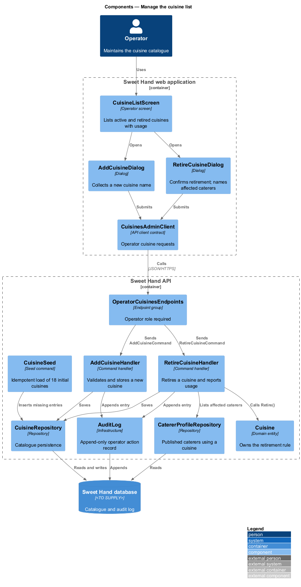
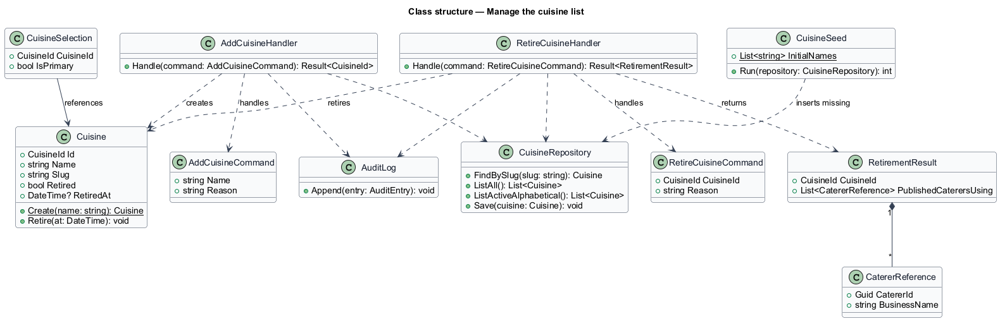
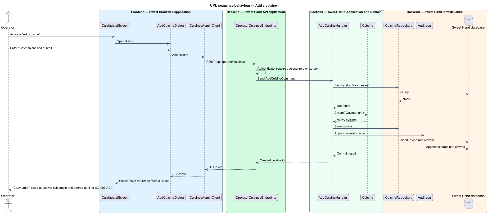
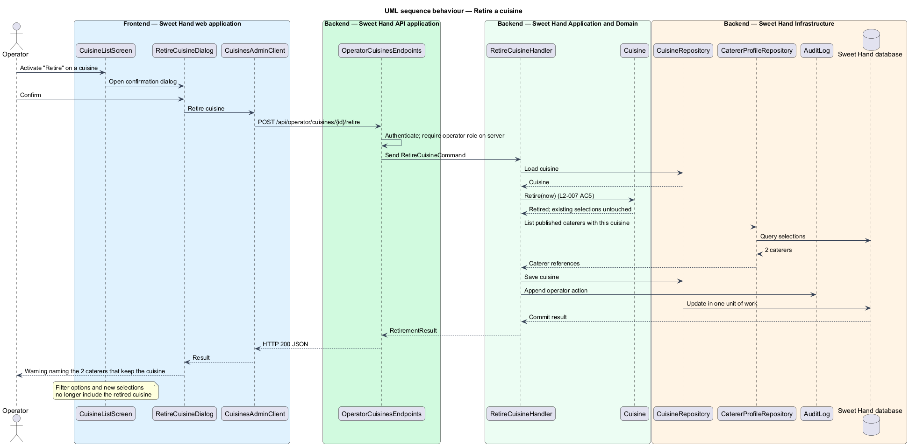

# Manage the cuisine list

## Overview

Sweet Hand names each caterer's food by its Caribbean tradition, such as
Jamaican, Guyanese or Haitian, instead of one generic "Caribbean" label. Those
names come from one shared list, the *cuisine catalogue*. Caterers choose their
cuisines from it, and the listing filter offers it to visitors. This feature
covers how the catalogue starts and how operators keep it current.

> **cuisine catalogue** — operator-managed list of Caribbean cuisines, named by island or country of origin
>
> **operator** — member of the Sweet Hand team who approves caterers and keeps listings accurate
>
> **retired cuisine** — catalogue entry withdrawn from new selections and from the listing filter, kept on the profiles that already use it
>
> **seed** — idempotent data load that creates the 18 initial cuisines, run through an explicit command

A new installation holds exactly 18 cuisines, listed alphabetically
(`L2-007 AC1`). An operator adds a cuisine when caterers ask for one that is
missing. The new entry becomes selectable in the profile editor and appears as
a listing filter option (`L2-007 AC4`). An operator retires a cuisine instead of
deleting it. Retirement removes it from new selections and from the filter.
Caterers who already use it keep it on their pages, and the operator sees which
published caterers those are (`L2-007 AC5`).

The caterer's own choice of 1 to 5 cuisines with one primary is enforced by the
caterer-profiles subsystem. The listing filter that reads the catalogue is
`filter-by-cuisine`.

## Description

Technology choices are `<TO SUPPLY>` pending architecture decision records in
`docs/adr/`. The components below are described by role.

**Frontend — Sweet Hand web application**

- **`CuisineListScreen`** — operator screen that lists every cuisine, active and
  retired, with the number of published caterers that use each one.
- **`AddCuisineDialog`** — dialog opened from an "Add cuisine" button, built on
  the UI framework's accessible dialog primitive. It collects the cuisine name.
- **`RetireCuisineDialog`** — confirmation dialog opened from a "Retire" button.
  After the retirement is saved, it shows a warning that names each published
  caterer still using the cuisine.
- **`CuisinesAdminClient`** — API client contract for the operator cuisine
  endpoints.

**Backend — Sweet Hand API application**

- **`OperatorCuisinesEndpoints`** — `GET /api/operator/cuisines`,
  `POST /api/operator/cuisines` and `POST /api/operator/cuisines/{id}/retire`.
  The request pipeline requires an authenticated operator session on the server
  for each endpoint.

**Backend — Sweet Hand Application and Domain**

- **`AddCuisineCommand`** / **`AddCuisineHandler`** — validates the name, derives
  a slug, rejects a duplicate name, and stores the new `Cuisine` as active.
  Name length limits and duplicate-detection rules (case, accents) are
  `<TO SUPPLY>`.
- **`RetireCuisineCommand`** / **`RetireCuisineHandler`** — calls
  `Cuisine.Retire()`, saves the change, and returns a `RetirementResult` that
  lists the published caterers whose `CuisineSelection` points at the cuisine.
- **`Cuisine`** — catalogue entry (`Id`, `Name`, `Slug`, `Retired`,
  `RetiredAt`). `Retire()` is idempotent. Existing `CuisineSelection` rows are
  left unchanged.
- **`CuisineCatalogue`** — query side that returns active cuisines sorted
  alphabetically for the profile editor and the filter. Retired entries are
  excluded.
- **`CuisineSeed`** — the 18 initial entries from `L2-007`. It inserts any entry
  that is missing by slug and never alters or duplicates an existing one, so it
  is safe to re-run. It runs through an explicit seed command, never on
  application startup.

**Backend — Sweet Hand Infrastructure**

- **`CuisineRepository`** — reads and writes catalogue entries.
- **`CatererProfileRepository`** — lists published caterers that use a given
  cuisine.
- **`AuditLog`** — append-only record of each operator action, written in the
  same unit of work as the change. Both commands carry a `Reason` for the audit
  entry; whether the reason is mandatory for cuisine changes is `<TO SUPPLY>`.

**Open points.** Whether a caterer who holds a retired cuisine keeps it when
saving other profile edits, whether an operator can rename or reinstate a
cuisine, and the alphabetical collation for entries such as
"Dominican (Dominica)" are `<TO SUPPLY>`. The design assumes existing selections
are kept until the caterer removes them.

## Requirements

The feature realizes the following level-2 (L2) requirements from
`docs/specs/L2.md`. Each refines the level-1 (L1) requirement cited beside it.
Requirement text is quoted from the specification, with *must* rendered as
*shall*.

| L2 ID | Refines (L1) | Requirement |
|-------|--------------|-------------|
| `L2-007` | `L1-003` | The platform shall keep a list of Caribbean cuisines (by island or country of origin) that operators manage. Each caterer shall pick 1 to 5 cuisines and mark exactly one as primary. The initial list is: Antiguan & Barbudan, Bahamian, Barbadian (Bajan), Belizean, Cuban, Dominican (Dominica), Dominican (Dominican Republic), Grenadian, Guyanese, Haitian, Jamaican, Kittitian & Nevisian, Puerto Rican, St. Lucian, Surinamese, Trinidadian & Tobagonian, Vincentian, Pan-Caribbean. |

This feature realizes the operator-managed list, the initial seed and the
retirement rule of `L2-007` (`AC1`, `AC4`, `AC5`). The caterer selection rules
(`AC2`, `AC3`) belong to the caterer-profiles subsystem.

## Diagrams

### System context

Operators maintain the cuisine catalogue in Sweet Hand. Caterers and visitors
see its effect in the profile editor and the listing filter.

### Containers

The operator screen in the web application calls operator endpoints in the
Sweet Hand API. The API stores the catalogue and the audit entry in the Sweet
Hand database.

### Components

`CuisineListScreen` opens `AddCuisineDialog` and `RetireCuisineDialog`, which
call `OperatorCuisinesEndpoints` through `CuisinesAdminClient`. The handlers
change `Cuisine` and write the `AuditLog`. `CuisineSeed` loads the initial list
through an explicit command.

### Class structure

`Cuisine` owns the retirement rule. `RetireCuisineHandler` returns a
`RetirementResult` that names affected caterers. `CuisineSeed` holds the 18
initial entries.

### Behaviour — add a cuisine

An operator adds "Caymanian". The handler checks for a duplicate, stores the
active entry, and records the action (`L2-007 AC4`).

### Behaviour — retire a cuisine

An operator retires a cuisine in use. The entry leaves the filter and new
selections, existing selections stay, and the dialog names the published
caterers affected (`L2-007 AC5`).

