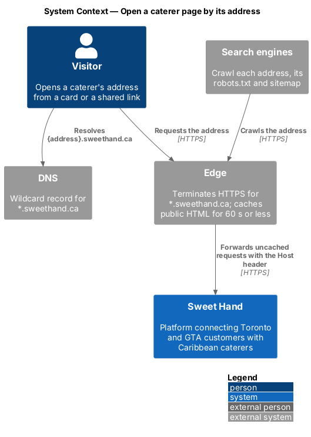
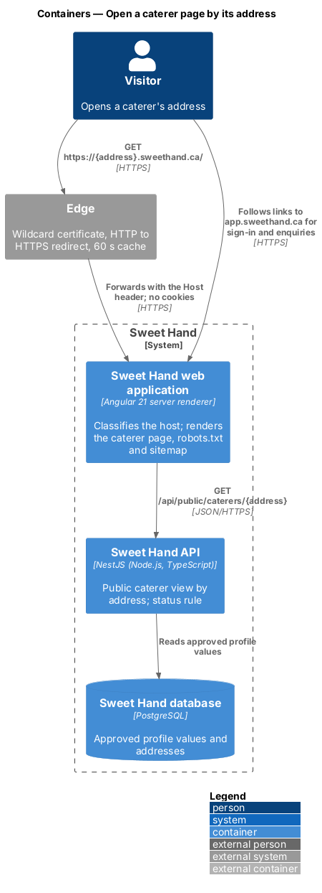
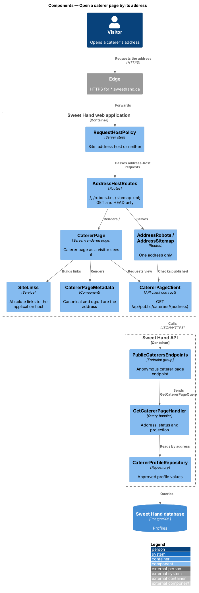
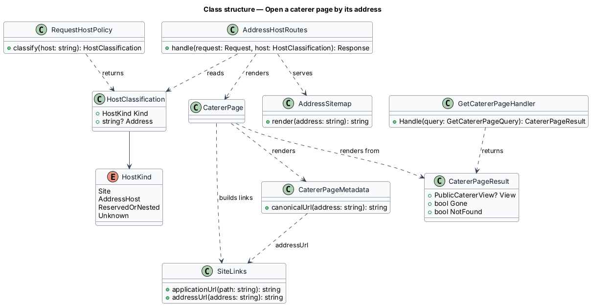
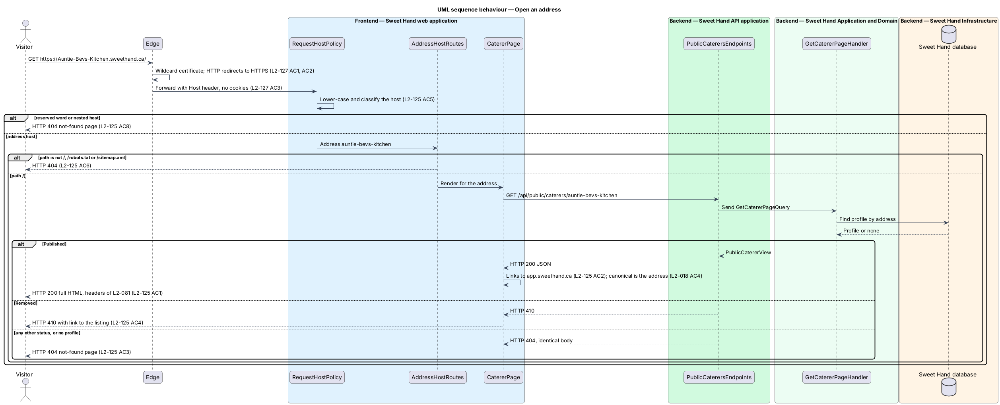
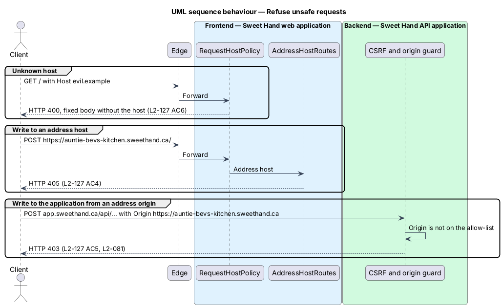

# Open a caterer page by its address

## Overview

Each published caterer has a public web address of their own,
`https://{address}.sweethand.ca`, chosen in `choose-caterer-address`. This
feature serves the caterer page at that address. The page is the one described
in `view-caterer-page`, shown as a visitor sees it.

> **address** — the one label a caterer holds under `sweethand.ca`, such as `auntie-bevs-kitchen`
>
> **address host** — a request host of the form `{address}.sweethand.ca` that is not a Sweet Hand site
>
> **Sweet Hand site** — one of the platform's own hosts: `www.sweethand.ca` (marketing), `app.sweethand.ca` (application), and the environment hosts
>
> **application host** — `app.sweethand.ca`, where people sign in, send enquiries and manage profiles
>
> **edge** — the component that terminates HTTPS for every host under `sweethand.ca` and forwards requests to the web application

An address host is read-only and sessionless. It answers `GET` and `HEAD` for
the page, `robots.txt` and `sitemap.xml`, and nothing else (`L2-125 AC6`,
`L2-127 AC4`). The session and CSRF cookies belong to the application host and
never reach an address host (`L2-127 AC3`). Every link and action on the page
that needs an account points to the application host (`L2-125 AC2`). A signed-in
customer therefore sees the visitor header at an address.

The same page stays reachable at `/caterers/{address}` on the application host
for people browsing the listing. Both renderings name the address as the
canonical URL (`L2-018 AC4`), so search engines index one page per caterer.

An address shows only a `Published` profile. A removed caterer's address
answers "gone". Every other status, and an address nobody holds, answers "not
found" with one identical body (`L2-125 AC3`, `AC4`).

## Description

Technology choices follow ADR 0001 (Angular 21), ADR 0006 (NestJS on Node.js,
PostgreSQL), ADR 0011 (Azure hosting) and ADR 0016 (`www` and `app`
hostnames). The components below are described by role.

**Edge and DNS**

- **Wildcard DNS record** — `*.sweethand.ca` points to the edge. Named records
  such as `www`, `app`, `staging` and `uat` take precedence over it.
- **Wildcard certificate** — one certificate for `*.sweethand.ca` serves every
  address, so a new address answers over HTTPS at once (`L2-127 AC1`). The edge
  redirects plain HTTP to HTTPS at the same host with HTTP 301
  (`L2-127 AC2`).
- **Edge product** — `<TO SUPPLY>`. Azure Static Web Apps, which serves the
  application today, does not accept a wildcard custom domain. The choice of
  edge, its certificate renewal and its cost need an ADR before
  implementation.
- **Environments** — staging and UAT use `*.staging.sweethand.ca` and
  `*.uat.sweethand.ca` with their own certificates and the environment's shared
  password. `*.sweethand.ca` does not match those two-label hosts, so no
  production address resolves to them (`L2-127 AC11`).
- **Caching** — the edge caches address responses for 60 seconds or less, as it
  does for `/caterers/{slug}`, so approval, suspension, reinstatement and
  removal reach the address within 60 seconds (`L2-125 AC10`).

**Frontend — Sweet Hand web application (server renderer)**

Server rendering of the caterer page is a precondition of this feature; ADR
0001 records that it is not yet switched on.

- **`RequestHostPolicy`** — first step of the server renderer. It classifies
  the `Host` header as a Sweet Hand site, an address host or neither. A host
  that is neither answers HTTP 400 with a fixed body that does not repeat the
  host (`L2-127 AC6`). A reserved word that is not a Sweet Hand site, and a host
  more than one label deep, answer the not-found page (`L2-125 AC8`). The host
  is lower-cased before classification (`L2-125 AC5`).
- **`AddressHostRoutes`** — the routes of an address host: `/`,
  `/robots.txt` and `/sitemap.xml`. Any other path answers HTTP 404
  (`L2-125 AC6`). A method other than `GET` or `HEAD` answers HTTP 405
  (`L2-127 AC4`). The routes read no cookie and set none.
- **`CatererPage`** — the page of `view-caterer-page`, rendered with the
  address taken from the host. It depends on the same `CatererPageClient`.
- **`SiteLinks`** — builds every header, footer, "Send an enquiry", review and
  report link. At an address host it returns absolute URLs on the application
  host (`L2-125 AC2`); on the application host it returns paths as before.
- **`CatererPageMetadata`** — writes the canonical link and `og:url` as
  `https://{address}.sweethand.ca/` on both hosts (`L2-018 AC4`).
- **`GoneNotice`** and the not-found page — unchanged, with links through
  `SiteLinks`.
- **`AddressRobots`** and **`AddressSitemap`** — for a published caterer,
  `robots.txt` names the sitemap and the sitemap lists that address only. For
  any other address both answer HTTP 404 (`L2-125 AC7`).
- **Security headers** — the headers of `L2-081` apply to every address
  response (`L2-127 AC2`). `Strict-Transport-Security` already carries
  `includeSubDomains`.

**Backend — Sweet Hand API application**

- **`PublicCaterersEndpoints`** — `GET /api/public/caterers/{slug}` is
  unchanged in shape. It no longer answers HTTP 301, because an address never
  changes (`L2-126`). The slug is the address.
- **`SitemapEndpoint`** — `GET /sitemap.xml` on the application host lists the
  address URL of every published caterer (`L2-018 AC6`).
- **Session and CSRF cookies** — set without a `Domain` attribute, so the
  browser sends them to the application host only (`L2-127 AC3`).
- **Origin allow-list** — holds the application host only. A state-changing
  request whose `Origin` is an address host answers HTTP 403 (`L2-127 AC5`).
- **Rate limits** — the public read limit of `L2-082` counts requests through
  an address host with those through the application host (`L2-127 AC9`).
- **Visit counting** — a page view at an address records a visit for that
  caterer through the same path as `/caterers/{slug}` (`L2-125 AC11`,
  `L2-062`).

**Backend — Sweet Hand Application and Domain**

- **`GetCatererPageHandler`** — resolves the address, applies the status rule
  and maps to `PublicCatererView`, as in `view-caterer-page`. `SlugRedirect` is
  removed.
- **`GetSitemapHandler`** — returns addresses of published caterers.

**Open points**

- The edge product and wildcard certificate renewal are `<TO SUPPLY>` and
  need an ADR.
- No mock draws the caterer page at an address; the page is the existing
  caterer page mock with the visitor header.

## Requirements

The feature realizes the following level-2 (L2) requirements from
`docs/specs/L2.md`. Each refines the level-1 (L1) requirement cited beside it.
Requirement text is quoted from the specification, with *must* rendered as
*shall*.

| L2 ID | Refines (L1) | Requirement |
|-------|--------------|-------------|
| `L2-018` | `L1-006` | Each caterer page shall have a stable, readable URL of the form `/caterers/{slug}`, where the slug is the caterer's address (L2-123), suggested from the business name. The same page is served at the caterer's own address, `https://{slug}.sweethand.ca` (L2-125), which is its canonical URL. Pages shall be rendered on the server and include metadata for search engines and link previews. |
| `L2-125` | `L1-028` | The address is the caterer's front door. It shows the public page of a published caterer, as a visitor sees it, and nothing else. |
| `L2-127` | `L1-021` | An address per caterer shall not weaken a person's session or the security of the application. |

This feature realizes the canonical URL and sitemap criteria of `L2-018` (AC4,
AC6). Criteria 7 and 8 of `L2-127` belong to `choose-caterer-address`.

## Diagrams

### System context

Visitors open a caterer's address from a card, a sticker or a shared link.
Search engines crawl it. The edge terminates HTTPS for every address.

### Containers

The edge forwards an address request to the web application, which renders the
page from the Sweet Hand API. The request carries no session.

### Components

`RequestHostPolicy` classifies the host. `AddressHostRoutes` limits an address
host to three read-only paths. `CatererPage` renders with links from
`SiteLinks`.

### Class structure

`HostClassification` is the result of `RequestHostPolicy`. `SiteLinks` and
`CatererPageMetadata` depend on it to build absolute URLs.

### Behaviour — open an address

The host is classified, the path and method are checked, and the profile
status decides between the page, "gone" and "not found".

### Behaviour — refuse unsafe requests

An unknown host, a write to an address host, and a write to the application
from an address origin are each refused.

