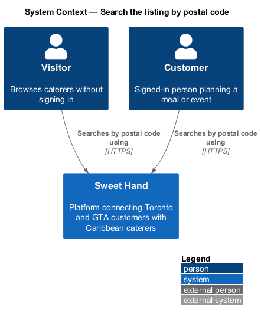
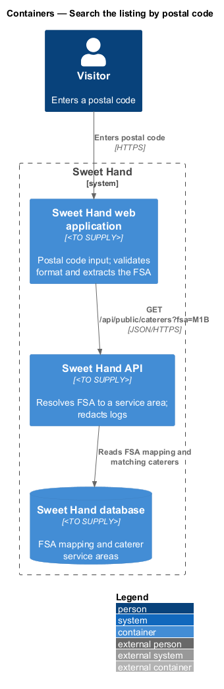
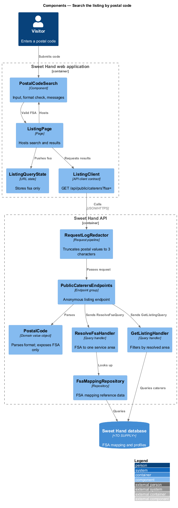
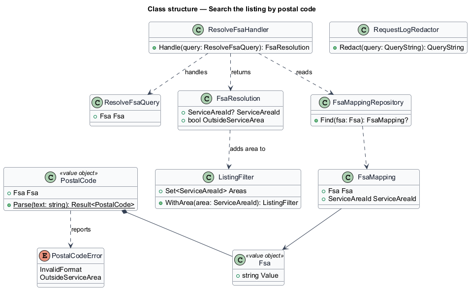
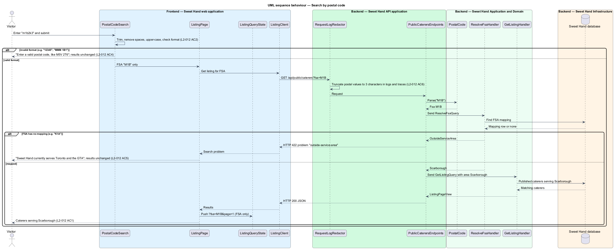

# Search the listing by postal code

## Overview

Many customers know their event's postal code better than the name of the
service area it falls in. This feature lets a visitor type a Canadian postal
code and see the caterers that serve the area containing it. It works by
mapping the first three characters of the code to one of the platform's
30 service areas, and it treats the full postal code as personal information
that is never kept.

> **postal code** — six-character Canadian postal address code in the pattern letter-digit-letter digit-letter-digit, such as `M5V 2T6`
>
> **forward sortation area (FSA)** — first three characters of a postal code, such as `M1B`, which identify a broad geographic area
>
> **FSA mapping** — reference table that assigns each FSA inside Toronto and the GTA to one service area

The search accepts a full postal code in any letter case, with or without the
space, or an FSA on its own (`L2-012 AC1` to `AC3`). A code that is not in a
valid format gets a format message. A valid code outside the service areas gets
a message that Sweet Hand serves Toronto and the GTA. In both cases the results
stay as they were (`L2-012 AC4`, `AC5`).

Only the FSA travels beyond the input field and only the FSA is kept. The
listing URL, the API request, application logs and analytics records hold at
most three characters of any postal code (`L2-012 AC6`). The area filter that
the search applies is the one described in `filter-by-area`.

## Description

Technology choices are `<TO SUPPLY>` pending architecture decision records in
`docs/adr/`. The components below are described by role.

**Frontend — Sweet Hand web application**

- **`PostalCodeSearch`** — labelled text input with
  `autocapitalize="characters"` and a submit button. On submit it calls
  `PostalCode.parse` on the client. It shows the format error without a
  request and sends only the FSA when the format is valid.
- **`PostalCode` (client)** — mirror of the server value object used for
  immediate feedback. The server remains the authority.
- **`ListingQueryState`** — writes the search as `fsa=M1B` in the URL. The full
  code never enters the URL or browser history (`L2-003`, `L2-012`).
- **`ListingClient`** — API client contract. It sends
  `GET /api/public/caterers?fsa=M1B` and receives either a filtered listing or
  a search problem.

**Backend — Sweet Hand API application**

- **`PublicCaterersEndpoints`** — accepts `fsa` on the listing endpoint
  (anonymous by explicit choice). A no-script form submission sends `postal`;
  the endpoint parses it, discards everything after the FSA, and answers with a
  redirect to the `fsa` form of the URL. An FSA with no mapping returns HTTP 422
  with an `outside-service-area` problem; the specification fixes the message
  but not the status code.
- **`RequestLogRedactor`** — part of the request pipeline. It truncates any
  `postal` or `fsa` query value to three characters before the request is
  written to logs, traces or analytics (`L2-012 AC6`).

**Backend — Sweet Hand Application and Domain**

- **`PostalCode`** — value object. `Parse(text)` trims, removes spaces, upper-
  cases, and checks the Canadian format (first letter from
  `ABCEGHJKLMNPRSTVXY`, letters `D`, `F`, `I`, `O`, `Q`, `U` excluded in all
  positions, `W` and `Z` excluded in the first). It accepts six characters or
  three. It exposes only `Fsa` and is never persisted.
- **`Fsa`** — three-character value object.
- **`ResolveFsaQuery`** / **`ResolveFsaHandler`** — looks up the `FsaMapping` and
  returns one `ServiceAreaId`, or `OutsideServiceArea` when the FSA has no
  mapping.
- **`GetListingHandler`** — adds the resolved area to the `ListingFilter` and
  returns the listing (see `browse-listing`).

**Backend — Sweet Hand Infrastructure**

- **`FsaMappingRepository`** — reads FSA-to-area rows from the Sweet Hand
  database. The rows are reference data loaded by an idempotent seed through an
  explicit command.

**Messages.** "Enter a valid postal code, like M5V 2T6" for an invalid format;
"Sweet Hand currently serves Toronto and the GTA" for a valid code with no
mapping.

**Open points.** The source dataset for the FSA mapping and its update
schedule are `<TO SUPPLY>`. The rule for an FSA that spans two service areas is
`<TO SUPPLY>`; `L2-012` requires each FSA to resolve to exactly one area.

## Requirements

The feature realizes the following level-2 (L2) requirements from
`docs/specs/L2.md`. Each refines the level-1 (L1) requirement cited beside it.
Requirement text is quoted from the specification, with *must* rendered as
*shall*.

| L2 ID | Refines (L1) | Requirement |
|-------|--------------|-------------|
| `L2-012` | `L1-004` | A visitor shall be able to enter a Canadian postal code and see caterers that serve the area containing it. The platform shall resolve the postal code's forward sortation area (FSA, the first 3 characters) to one of the service areas in L2-010. Only the FSA is used. The full postal code is never stored with any analytics or log entry. |

## Diagrams

### System context

Visitors and customers search Sweet Hand by postal code. No external geocoding
service takes part; the FSA mapping is reference data inside Sweet Hand.

### Containers

The web application sends only the FSA to the Sweet Hand API, which resolves it
against the FSA mapping in the Sweet Hand database.

### Components

`PostalCodeSearch` validates the format and extracts the FSA on the client. In
the API, `RequestLogRedactor` truncates logged values, `ResolveFsaHandler` maps
the FSA, and `GetListingHandler` filters by the resolved area.

### Class structure

`PostalCode` exposes only its `Fsa`. `ResolveFsaHandler` turns an `Fsa` into an
`FsaResolution` that holds a `ServiceAreaId` or the outside-area result.

### Behaviour — search by postal code

A valid code inside the GTA filters the listing to its service area. An invalid
format or an FSA with no mapping shows a message and leaves the results
unchanged (`L2-012`).

