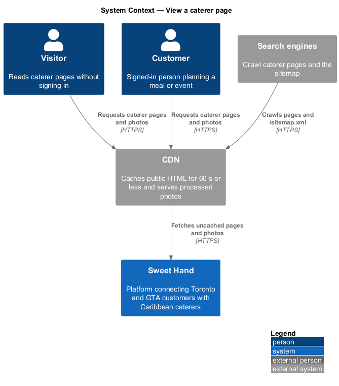
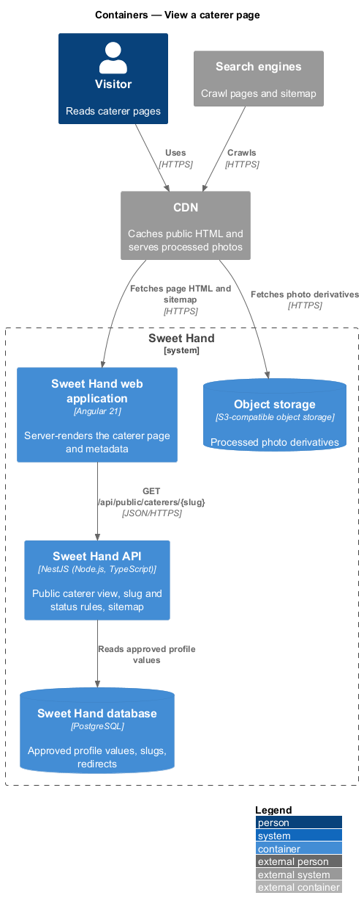
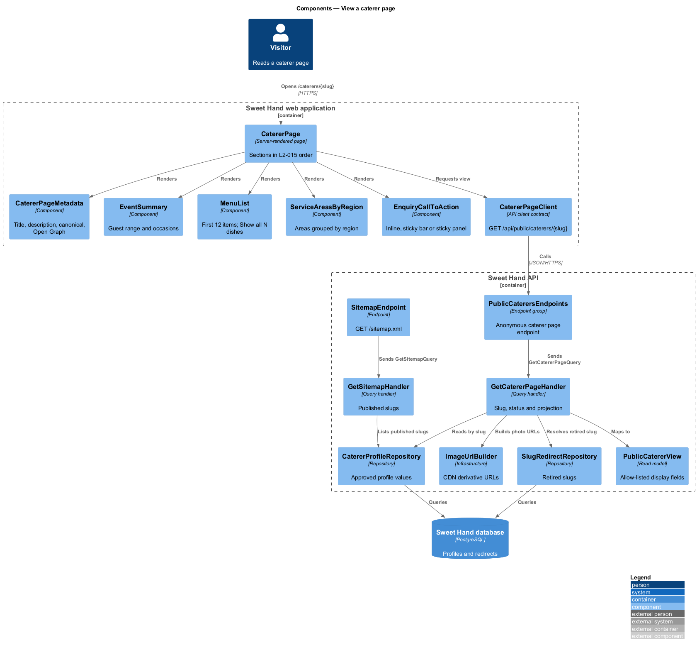
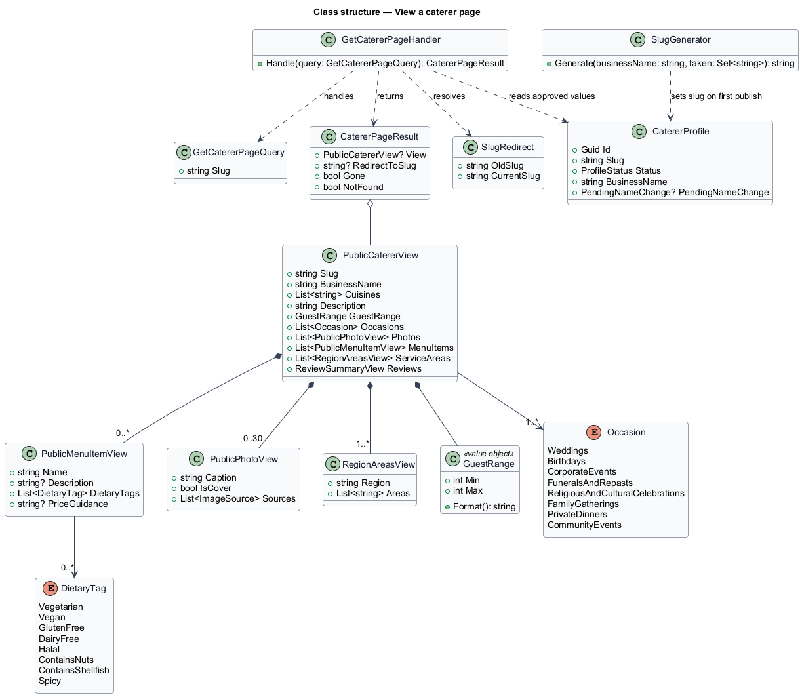
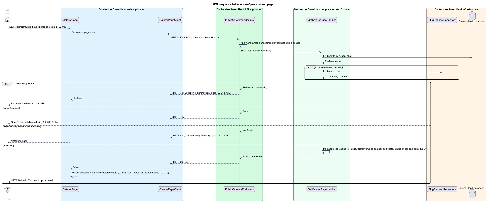
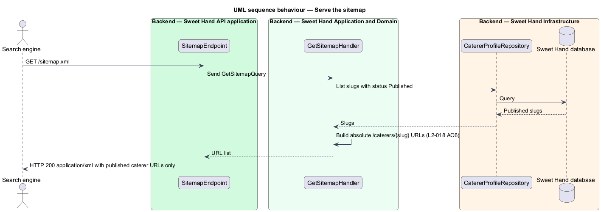

# View a caterer page

## Overview

Each published caterer on Sweet Hand has one public page. It is where a customer
decides whether a caterer suits an event: photos of the food, the caterer's
cuisines and description, how many guests they serve, the occasions they take
on, sample dishes with dietary tags, the areas they serve, and reviews. The page
ends in a "Send an enquiry" button that starts the enquiry flow.

> **caterer page** — public, server-rendered page for one published caterer at `/caterers/{slug}`
>
> **slug** — lower-case, hyphenated form of the business name used in the page URL, such as `auntie-bevs-kitchen`
>
> **guest range** — minimum and maximum number of guests a caterer serves, each a whole number from 1 to 5,000
>
> **occasion** — kind of event from a fixed list of 8, such as Weddings or Funerals and repasts
>
> **dietary tag** — label from a fixed list of 8, such as Halal or Contains shellfish, attached to a menu item
>
> **public view** — allow-listed projection of a caterer profile that holds only approved display fields

The page is public by deliberate choice: anyone can read it without signing in
(`L2-013`). It shows only what the caterer has had approved and only fields
meant for display. Contact details, the food handler certificate, internal
notes, unpublished edits and the record status never reach the page or the API
behind it (`L2-014`).

The page is rendered on the server so that search engines and link previews
read the full content, and it carries title, description, canonical and Open
Graph metadata (`L2-018`). The URL is stable and readable. A business name
change keeps the old URL working through a permanent redirect. A removed
caterer's URL answers "gone"; a suspended or unpublished one answers "not
found". The photo gallery at the top of the page is described in
`view-photo-gallery`. The reviews section comes from the reviews subsystem. The
enquiry flow behind the button belongs to the enquiries subsystem.

## Description

Technology choices follow ADR 0001 (Angular 21) and ADR 0006 (NestJS on
Node.js, PostgreSQL through Drizzle ORM, S3-compatible object storage);
providers not named there remain `<TO SUPPLY>`. The components below are
described by role.

**Frontend — Sweet Hand web application**

- **`CatererPage`** — server-rendered page at `/caterers/{slug}`. It renders the
  sections in the order `L2-015` fixes: gallery, business name, cuisines
  (primary first), description, event summary, menu, service areas by region,
  reviews, and "Send an enquiry". It depends on the `CatererPageClient`
  contract.
- **`CatererPageMetadata`** — writes `<title>`, meta description, the canonical
  link, and `og:title`, `og:description`, `og:image` (cover photo) and `og:url`
  (`L2-018 AC4`).
- **`DescriptionParagraphs`** — splits the description on blank lines into
  paragraphs. Text is encoded for HTML output; markup in the description appears
  as literal text (`L2-015 AC2`).
- **`EventSummary`** — shows "Serves 20–300 guests", or "Serves 50 guests" when
  the minimum equals the maximum (`L2-020 AC1`, `AC2`), and the chosen
  occasions under the heading "Occasions" (`L2-021 AC1`).
- **`MenuList`** and **`MenuItemView`** — each item shows its name and, when
  present, description, dietary tags and price guidance. Absent values leave no
  empty label (`L2-017 AC2`). All items are in the server HTML. Items after the
  12th start collapsed behind a "Show all N dishes" control that expands them
  without a reload (`L2-017 AC4`).
- **`ServiceAreasByRegion`** — groups the caterer's areas under their region
  names (`L2-015 AC3`).
- **`EnquiryCallToAction`** — the "Send an enquiry" button in the content flow.
  Once it scrolls out of view, **`StickyEnquiryBar`** (XS to MD) or
  **`StickyEnquiryPanel`** (LG, XL) keeps a button in view (`L2-015 AC4`).
  Activating it while signed out leads to sign-in (`L2-013 AC3`, realized in
  the enquiries subsystem).
- **`CatererPageLayout`** — one column at XS to MD; at LG and XL, two columns
  with a side panel that holds event sizes, occasions and the enquiry button
  (`L2-019 AC3`). No horizontal scrolling at 320 px or wider (`L2-019 AC4`).
- **`GoneNotice`** — HTTP 410 page with a link back to the listing.
- **`CatererPageClient`** — API client contract for
  `GET /api/public/caterers/{slug}`.

**Backend — Sweet Hand API application**

- **`PublicCaterersEndpoints`** — `GET /api/public/caterers/{slug}` returns a
  `PublicCatererView`, HTTP 301 with the new location for a retired slug,
  HTTP 410 for a `Removed` caterer, and HTTP 404 for every other non-published
  status or an unknown slug, with one identical body for all 404 cases
  (`L2-014 AC2`, `L2-018 AC5`). Anonymous by explicit choice.
- **`SitemapEndpoint`** — `GET /sitemap.xml` lists the URL of every published
  caterer and no others (`L2-018 AC6`).

**Backend — Sweet Hand Application and Domain**

- **`GetCatererPageQuery`** / **`GetCatererPageHandler`** — resolves the slug,
  applies the status rule, and maps the approved profile to a
  `PublicCatererView`.
- **`PublicCatererView`** — allow-listed read model: slug, business name,
  cuisines with primary first, description, guest range, occasions, photos
  (caption and image sources), menu items, service areas by region, and the
  review summary. It has no field for email, phone, certificate, notes, status
  or pending edits. A published caterer's pending business name change is not
  part of it; the approved name stays until approval (`L2-014 AC3`).
- **`GuestRange`** — value object with `Min` and `Max` in 1 to 5,000 and
  `Min ≤ Max`. `Format()` produces the "Serves …" text. Validation on save
  belongs to the caterer-profiles subsystem.
- **`Occasion`** and **`DietaryTag`** — fixed enumerations. Values outside the
  lists are rejected on input with HTTP 400 (`L2-021 AC3`, `L2-017 AC3`).
- **`SlugGenerator`** — derives a slug from the business name on first
  publication: lower case, apostrophes removed, other non-alphanumeric runs
  replaced by one hyphen, and a numeric suffix (`-2`, `-3` …) on collision
  (`L2-018 AC1`, `AC2`). The approval flow in the moderation subsystem calls it.
- **`SlugRedirect`** — maps a retired slug to the current one. An approved
  business name change creates one (`L2-018 AC3`).
- **`GetSitemapQuery`** / **`GetSitemapHandler`** — lists published slugs.

**Backend — Sweet Hand Infrastructure**

- **`CatererProfileRepository`** — reads approved profile values by slug.
- **`SlugRedirectRepository`** — reads retired slugs.
- **`ImageUrlBuilder`** — builds CDN URLs for photo derivatives.

**Caching.** The CDN caches the page HTML for 60 seconds or less, so profile
changes and status changes reach the page within 60 seconds.

## Requirements

The feature realizes the following level-2 (L2) requirements from
`docs/specs/L2.md`. Each refines the level-1 (L1) requirement cited beside it.
Requirement text is quoted from the specification, with *must* rendered as
*shall*.

| L2 ID | Refines (L1) | Requirement |
|-------|--------------|-------------|
| `L2-013` | `L1-005` | The listing, all filters and searches, and all caterer pages, including reviews, shall be fully usable without signing in. The platform shall ask a visitor to sign in only when they try to send an enquiry, leave a review, or open their account pages. |
| `L2-014` | `L1-005` | Public pages and the public API they use shall expose only the fields needed for display. Caterer email addresses, phone numbers, food safety credentials, internal notes, unpublished content and record status shall never appear in public responses. |
| `L2-015` | `L1-006` | Each published caterer shall have a page showing, in this order: a photo gallery, the business name, cuisines (primary first), a description, a summary of event sizes and occasions (L2-020, L2-021), menu or sample dishes, service areas grouped by region, reviews (L2-051), and a "Send an enquiry" button. |
| `L2-017` | `L1-006` | The caterer page shall list the caterer's menu items. Each item shows a name, an optional description, optional dietary tags and optional price guidance. |
| `L2-018` | `L1-006` | Each caterer page shall have a stable, readable URL of the form `/caterers/{slug}`, where the slug comes from the business name. Pages shall be rendered on the server and include metadata for search engines and link previews. |
| `L2-019` | `L1-006` | The caterer page layout shall suit each viewport class. |
| `L2-020` | `L1-007` | Each caterer shall state the minimum and maximum number of guests they cater for. Both are whole numbers from 1 to 5,000, and the minimum cannot be larger than the maximum. The caterer page shall display the range. |
| `L2-021` | `L1-007` | Each caterer shall pick at least 1 occasion from a fixed list: Weddings, Birthdays, Corporate events, Funerals and repasts, Religious and cultural celebrations, Family gatherings, Private dinners, Community events. The caterer page shall display the chosen occasions. |

This feature realizes the caterer page part of `L2-013`, the page layout of
`L2-019` outside the gallery, and the display parts of `L2-020` and `L2-021`.
Entry and validation of the guest range and occasions belong to the
caterer-profiles subsystem.

## Diagrams

### System context

Visitors and customers read caterer pages. Search engines crawl the pages and
the sitemap. The CDN serves cached HTML and photos.

### Containers

The web application renders the page on the server from the Sweet Hand API,
which reads approved profile values from the Sweet Hand database. Photos come
from object storage through the CDN.

### Components

`CatererPage` composes its sections from one `PublicCatererView`. In the API,
`GetCatererPageHandler` resolves the slug and status, and `SitemapEndpoint` lists
published URLs.

### Class structure

`PublicCatererView` is the only shape that leaves the API for a caterer page. It
holds value objects such as `GuestRange` and the fixed `Occasion` and
`DietaryTag` lists. `SlugRedirect` keeps old URLs working.

### Behaviour — open a caterer page

The handler resolves the slug. A retired slug redirects, a removed caterer
answers 410, any other non-published status answers 404, and a published
caterer renders with allow-listed fields only (`L2-014`, `L2-018`).

### Behaviour — serve the sitemap

A search engine requests `/sitemap.xml` and receives the URLs of published
caterers only (`L2-018 AC6`).

