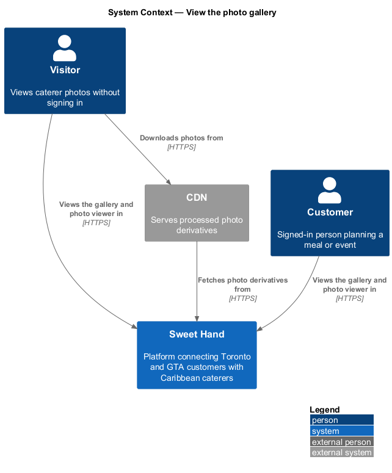
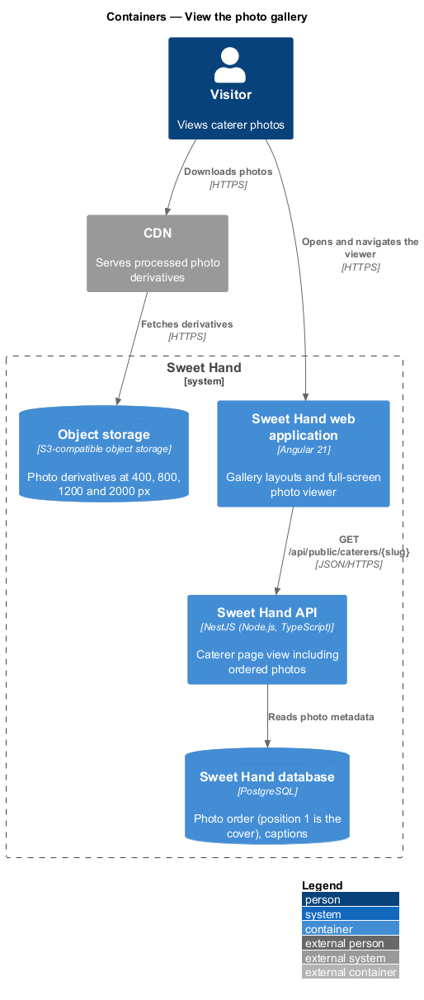
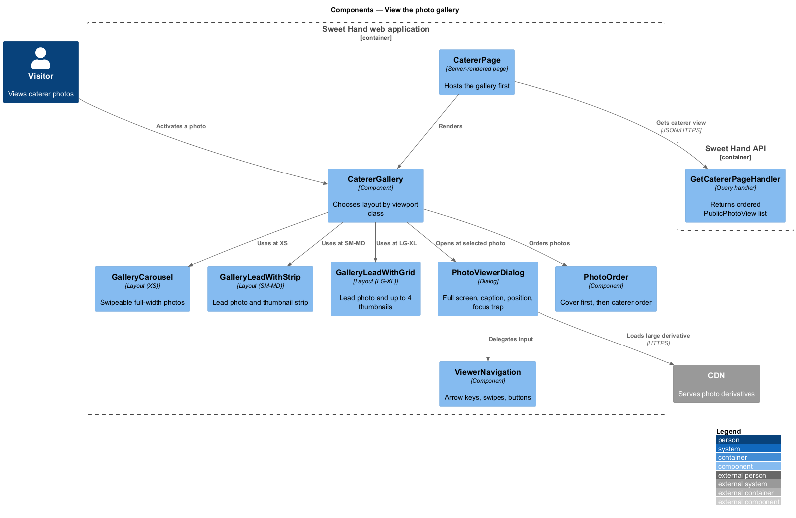
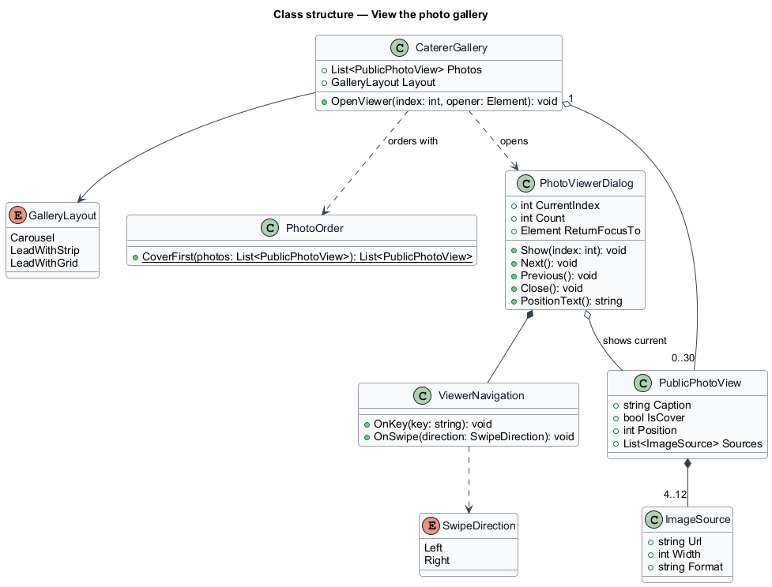
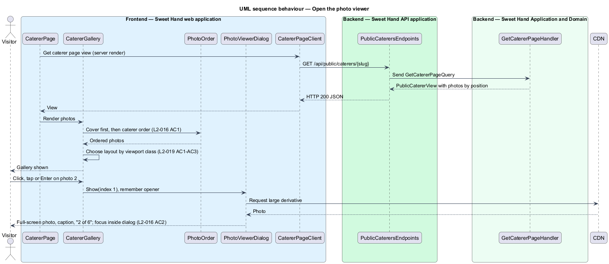
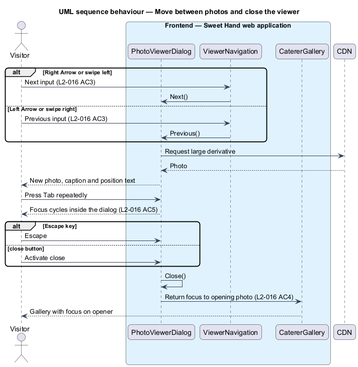

# View the photo gallery

## Overview

Food photography carries a caterer page. A customer judges a caterer first by
how the food looks. This feature covers the gallery at the top of the caterer
page and the full-screen viewer it opens, at every screen size and with mouse,
touch and keyboard.

> **gallery** — photo area at the top of a caterer page, showing the caterer's photos with the cover photo first
>
> **cover photo** — the first photo in the caterer's order, which represents the business on the listing card, as `og:image`, and first in the gallery
>
> **caption** — 5 to 125 character description of a photo, written by the caterer and used as its text alternative
>
> **photo viewer** — full-screen dialog that shows one photo at a time with its caption and position, such as "2 of 6"

The gallery shows photos in the order the caterer set, starting with the cover
photo (`L2-016 AC1`). Its layout depends on the viewport class (`L2-019`). On a
phone it is a swipeable carousel of full-width photos. On a tablet it is a large
lead photo with a strip of thumbnails. On a desktop it is a lead photo with a
grid of up to 4 thumbnails.

Any photo opens the viewer at that photo. The viewer moves to the next or
previous photo with the arrow keys or a swipe. It closes with Escape or a close
button, and returns focus to the photo that opened it. While it is open,
keyboard focus stays inside it (`L2-016`). Photo upload, ordering and captions
are managed by the caterer-profiles subsystem. The rest of the caterer page is
described in `view-caterer-page`.

## Description

Technology choices follow ADR 0001 (Angular 21) and ADR 0006 (NestJS on
Node.js, PostgreSQL through Drizzle ORM, S3-compatible object storage);
providers not named there remain `<TO SUPPLY>`. The components below are
described by role.

**Frontend — Sweet Hand web application**

- **`CatererGallery`** — receives the ordered `PublicPhotoView` list and chooses
  a layout by viewport class:
  - **`GalleryCarousel`** (XS) — swipeable carousel of full-width photos, one
    per view (`L2-019 AC1`).
  - **`GalleryLeadWithStrip`** (SM, MD) — large lead photo with a strip of
    thumbnails beneath it (`L2-019 AC2`).
  - **`GalleryLeadWithGrid`** (LG, XL) — lead photo plus a grid of up to 4
    thumbnails (`L2-019 AC3`). The number of further photos is shown on the
    last thumbnail; that presentation is `<TO SUPPLY>` pending the mocks.
- **`GalleryPhotoButton`** — each photo or thumbnail is a button whose accessible
  name includes the caption and position. Activating it by click, tap or Enter
  opens the viewer at that photo.
- **`PhotoViewerDialog`** — full-screen dialog built on the UI framework's
  accessible dialog primitive. It traps focus while open, closes on Escape or
  the close button, and returns focus to the opening `GalleryPhotoButton`
  (`L2-016 AC4`, `AC5`). It shows the photo, its caption and a position
  indicator such as "2 of 6" (`L2-016 AC2`). It loads the largest derivative
  that suits the screen.
- **`ViewerNavigation`** — maps Right Arrow and Left Arrow, horizontal swipes,
  and the next and previous buttons to the next and previous photo
  (`L2-016 AC3`). Behaviour at the first and last photo (stop or wrap) is
  `<TO SUPPLY>`.
- **`PhotoOrder`** — sorts photos by their stored position. The cover is
  always the photo at position 1 (`L2-042 AC6`), so the result starts with the
  cover and keeps the caterer's order for the rest.

**Backend**

- The gallery has no endpoint of its own. `GetCatererPageHandler` (see
  `view-caterer-page`) returns photos inside `PublicCatererView`, ordered by
  position, each with caption, position, and image sources at widths 400, 800,
  1200 and 2000 built by `ImageUrlBuilder`. Processed derivatives are served from
  object storage through the CDN.

## Requirements

The feature realizes the following level-2 (L2) requirements from
`docs/specs/L2.md`. Each refines the level-1 (L1) requirement cited beside it.
Requirement text is quoted from the specification, with *must* rendered as
*shall*.

| L2 ID | Refines (L1) | Requirement |
|-------|--------------|-------------|
| `L2-016` | `L1-006` | The caterer page gallery shall show the caterer's photos in the order they set, starting with the cover photo. It shall open a full-screen viewer that works with mouse, touch and keyboard. |
| `L2-019` | `L1-006` | The caterer page layout shall suit each viewport class. |

This feature realizes the gallery part of `L2-019` (`AC1` to `AC3`). The rest of
the page layout belongs to `view-caterer-page`.

## Diagrams

### System context

Visitors and customers view caterer photos in Sweet Hand. The CDN serves the
processed photo derivatives.

### Containers

The web application renders the gallery from the caterer page view that the
Sweet Hand API returns. Photo derivatives come from object storage through the
CDN.

### Components

`CatererGallery` chooses a layout by viewport class and opens
`PhotoViewerDialog`. `ViewerNavigation` handles keys and swipes. The API side is
the shared caterer page query.

### Class structure

`CatererGallery` holds an ordered list of `PublicPhotoView` items and one
`GalleryLayout`. `PhotoViewerDialog` tracks the current index and the element to
refocus on close.

### Behaviour — open the viewer

Activating a photo opens the viewer at that photo with its caption and position
indicator, and moves focus into the dialog (`L2-016 AC2`).

### Behaviour — move between photos and close

Arrow keys and swipes change the photo, Tab stays inside the dialog, and
Escape closes it and restores focus (`L2-016 AC3` to `AC5`).

