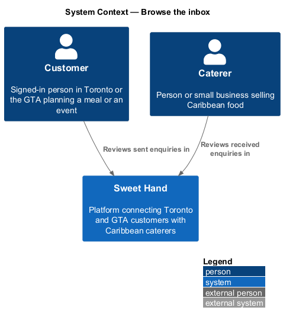
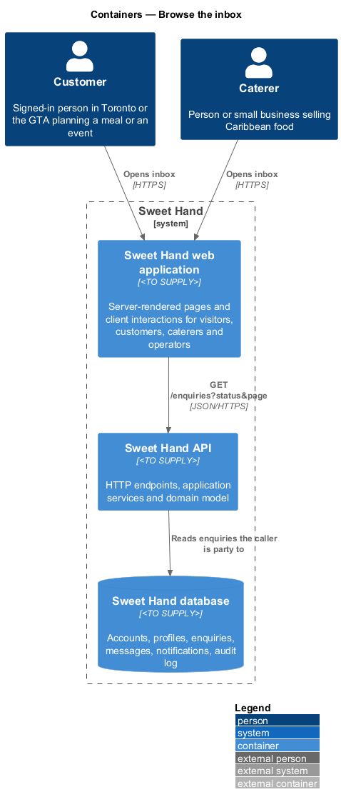
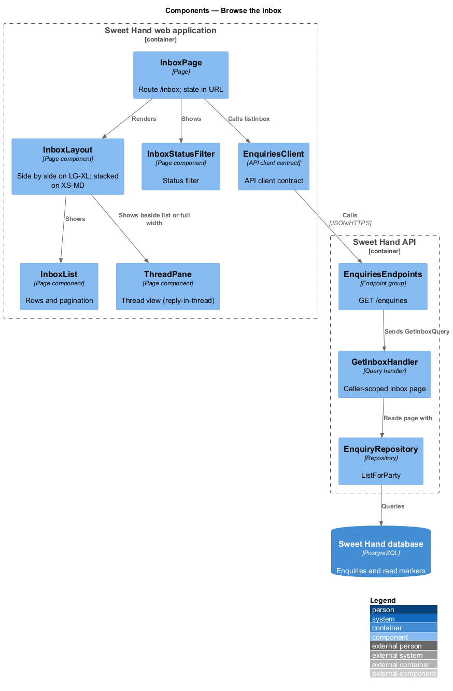
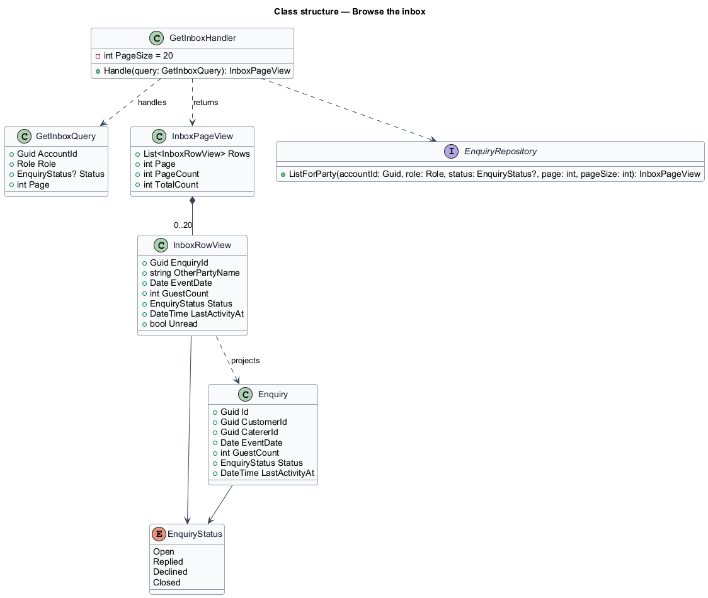
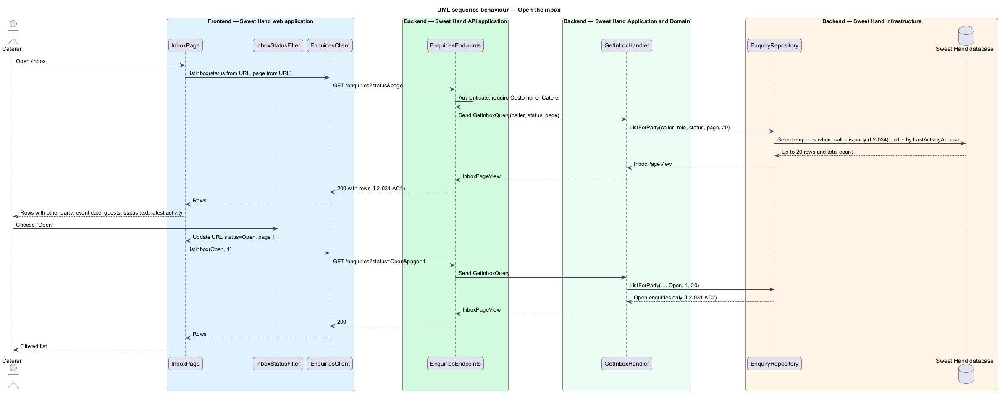
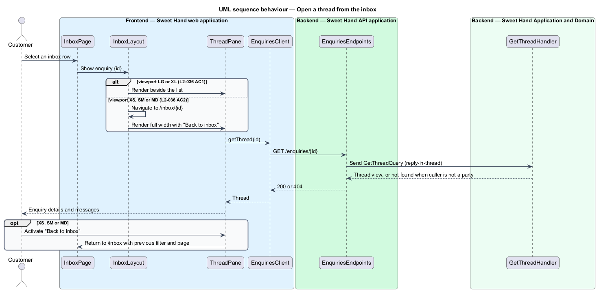

# Browse the inbox

## Overview

Every enquiry on Sweet Hand has two parties: the customer who sent it and the caterer who received it. Each party needs one place to find all of their enquiries, past and present. This feature provides that place, the inbox, and makes it work on phones, tablets and desktops.

> **inbox** — signed-in user's list of every enquiry they are a party to, newest activity first

> **latest activity** — time of the most recent event in a thread: creation, a message, a decline, a close, or a contact share

> **other party** — for a customer, the caterer the enquiry was sent to; for a caterer, the customer who sent it

Each inbox row shows the other party, the event date, the guest count, the status and the time of the latest activity. Rows are sorted by latest activity, newest first, 20 to a page. A status filter narrows the list to one status, such as `Open`. The inbox holds every enquiry the user has ever been part of, except enquiries removed by the retention rules (`L2-073`).

The layout depends on the viewport class. On LG and XL the list and the selected thread sit side by side. On XS, SM and MD only the list shows, and opening an enquiry shows the thread full width with a back link to the inbox labelled with the destination only, "Inbox". The thread view itself belongs to feature `enquiries/reply-in-thread`. Unread highlighting belongs to feature `enquiries/show-unread-indicators`.

## Description

Technology choices for every component are `<TO SUPPLY>`, pending architecture decision records in `docs/adr/`.

**Frontend — Sweet Hand web application**

- **`InboxPage`** — screen at `/inbox`. It keeps the status filter, the page number and the selected enquiry in the URL so that Back and refresh restore the same view. The exact query parameter names are `<TO SUPPLY>`.
- **`InboxLayout`** — chooses the arrangement for the viewport class. On LG and XL it renders `InboxList` and `ThreadPane` side by side. On XS, SM and MD it renders `InboxList` alone, and selecting a row navigates to `/inbox/{id}`, which renders `ThreadPane` full width with a back link labelled "Inbox" (`L2-036 AC1`, `L2-036 AC2`).
- **`InboxList`** — renders the rows and the pagination control.
- **`InboxRow`** — one enquiry: other party's name, event date, guest count, status (shown as text, not colour alone, per `L2-069 AC5`), latest activity time in `America/Toronto`, and an unread highlight.
- **`InboxStatusFilter`** — filter control with "All", "Open", "Replied", "Declined" and "Closed".
- **`EnquiriesClient`** — API client contract: `listInbox(status, page)`.

**Backend — Sweet Hand API application**

- **`EnquiriesEndpoints`** — `GET /enquiries?status={status}&page={n}`. It requires a signed-in customer or caterer. An unknown status value is ignored, and an out-of-range page returns page 1. These fallbacks follow the listing behaviour in `L2-002 AC5` and `L2-003 AC3`. Applying them to the inbox is a design choice.

**Backend — Sweet Hand Application and Domain**

- **`GetInboxQuery`** / **`GetInboxHandler`** — returns one page of `InboxRowView` for the caller. The handler scopes the query to enquiries where the caller is the customer or the caterer. Nothing in the request can widen that scope (`L2-034`, `L2-079`).
- **`InboxRowView`** — read model: `enquiryId`, `otherPartyName`, `eventDate`, `guestCount`, `status`, `lastActivityAt`, `unread`. For a customer, `otherPartyName` is the caterer's business name. For a caterer, it is the customer's display name. A deleted customer appears as "Former Sweet Hand user" (`L2-072`).
- **`Enquiry`** — `lastActivityAt` moves forward on every event in the thread, so a new message moves the enquiry to the top of the list (`L2-031 AC3`).

**Backend — Sweet Hand Infrastructure**

- **`EnquiryRepository`** — `ListForParty(accountId, role, status, page, pageSize = 20)` orders by `lastActivityAt` descending, with the enquiry identifier as a tie-breaker so that paging is stable. It joins the read marker to set `unread`.

## Requirements

The feature realizes the following level-2 (L2) requirements from `docs/specs/L2.md`. Each refines the level-1 (L1) requirement cited beside it. Requirement text is quoted from the specification, with *must* rendered as *shall*.

| L2 ID | Refines (L1) | Requirement |
|-------|--------------|-------------|
| `L2-031` | `L1-010` | Customers and caterers shall each have an inbox listing every enquiry they are part of. Each row shows the other party, event date, guest count, status and the time of the latest activity, and rows are sorted by latest activity, newest first. |
| `L2-036` | `L1-010` | The inbox and thread views shall suit each viewport class. |

`L2-036 AC3`, the reply box held at the bottom of the screen on XS while the on-screen keyboard is open, is realized by `ReplyBox` in feature `enquiries/reply-in-thread`.

## Diagrams

### System context

Customers and caterers use the inbox in Sweet Hand. No external system takes part.

### Containers

The web application renders the inbox and calls the Sweet Hand API, which reads enquiries from the Sweet Hand database.

### Components

`InboxPage` arranges `InboxList` and `ThreadPane` by viewport class and depends on the `EnquiriesClient` contract. `GetInboxHandler` reads one page through `EnquiryRepository`.

### Class structure

`GetInboxHandler` returns an `InboxPageView` of `InboxRowView` rows built from `Enquiry` records the caller is a party to.

### Behaviour — open the inbox

The handler scopes the query to the caller, filters by status when one is chosen, and returns 20 rows sorted by latest activity.

### Behaviour — open a thread from the inbox

The same action shows the thread beside the list on LG and XL, and full width with the "Inbox" back link on XS, SM and MD.

