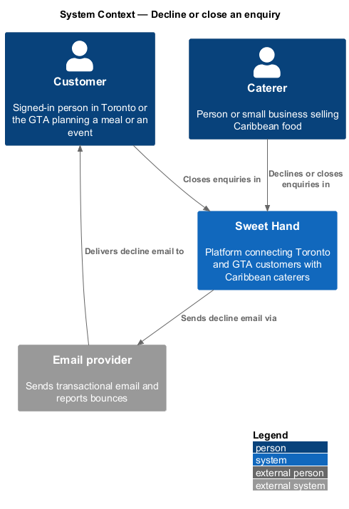
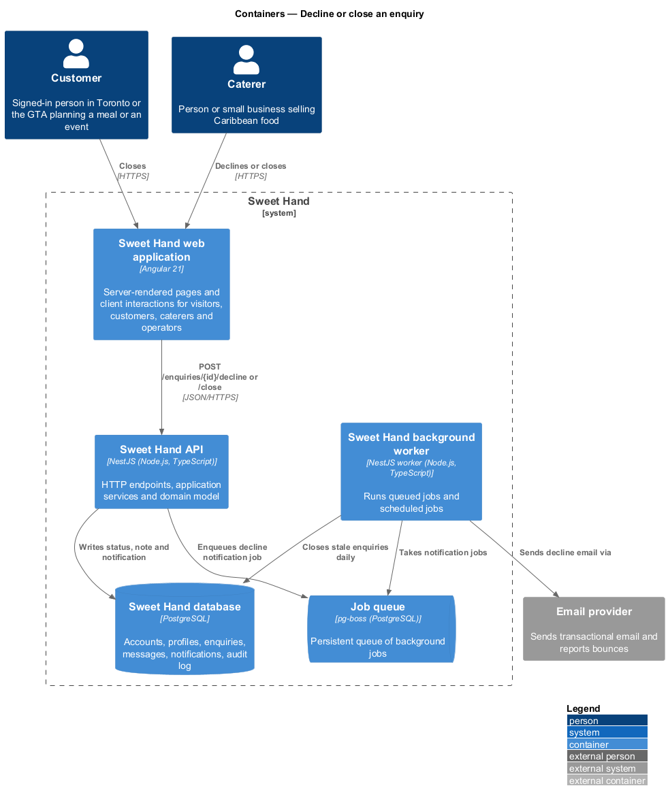
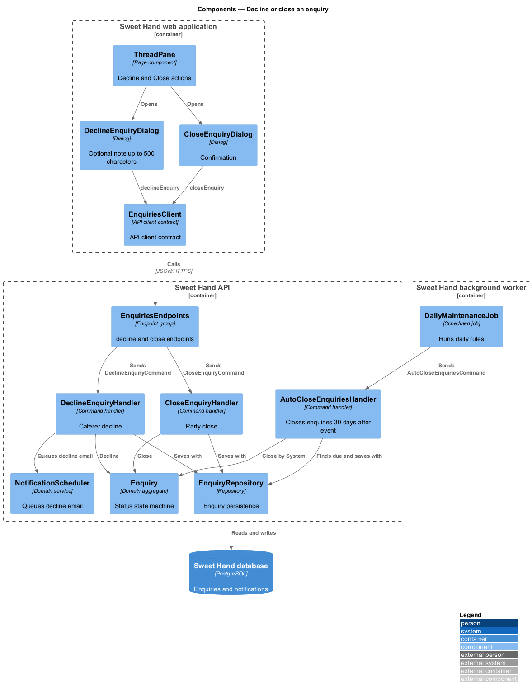
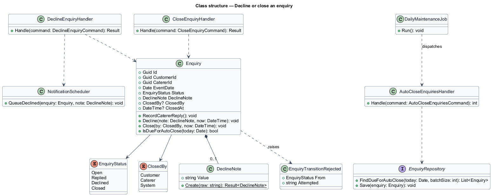
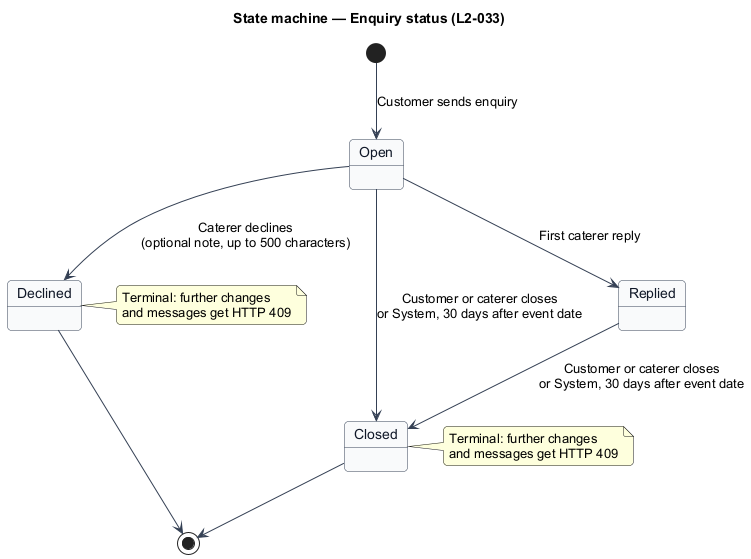
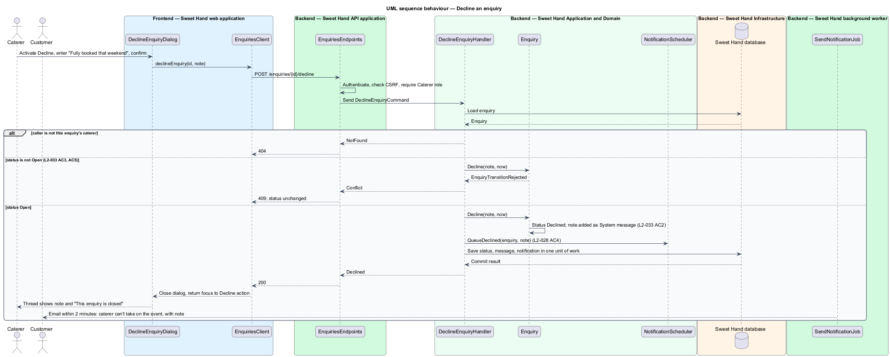
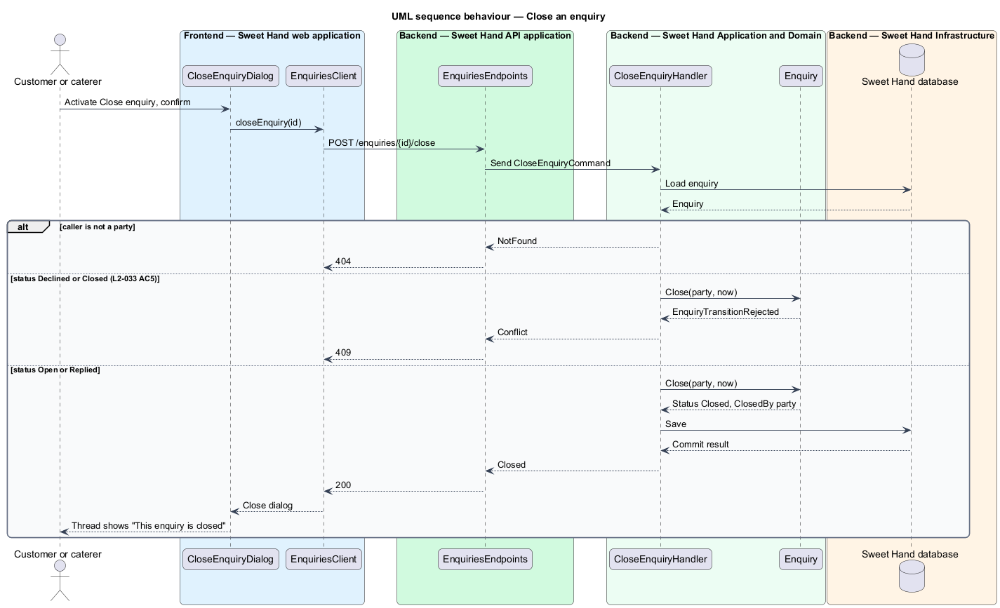
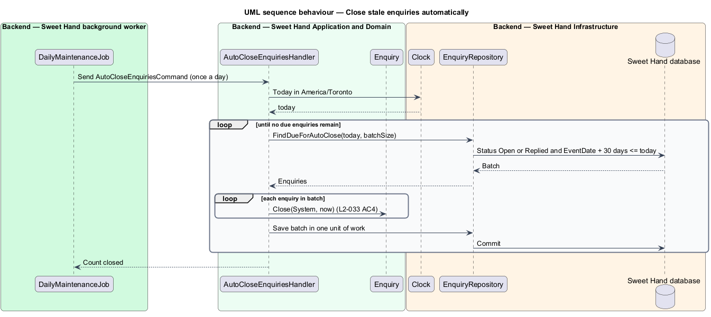

# Decline or close an enquiry

## Overview

An enquiry on Sweet Hand moves through a small, fixed set of statuses from the moment a customer sends it until the conversation ends. This feature owns that status lifecycle. It covers the caterer declining an enquiry they cannot take on, either party closing an enquiry, and the platform closing stale enquiries automatically after the event has passed.

> **enquiry status** — one of `Open`, `Replied`, `Declined` or `Closed`, recording where an enquiry stands

> **decline** — caterer's decision, made before their first reply, not to take on an enquiry, optionally with a note of up to 500 characters

> **close** — ending of an `Open` or `Replied` enquiry by the customer, the caterer, or the platform

> **daily maintenance job** — scheduled background job that runs once a day and applies time-based rules such as automatic closing

The statuses mean:

- `Open` — just sent, with no reply from the caterer yet;
- `Replied` — the caterer has replied at least once;
- `Declined` — the caterer declined it;
- `Closed` — either party closed it, or it was closed automatically.

`Declined` and `Closed` are terminal. No further status change or message is accepted, and any attempt receives HTTP 409 (`L2-033 AC5`). When a caterer declines, the customer receives an email within 2 minutes saying the caterer can't take on the event, including any decline note (`L2-028 AC4`).

## Description

Technology choices follow ADR 0001 (Angular 21) and ADR 0006 (NestJS on Node.js, PostgreSQL through Drizzle ORM, S3-compatible object storage); providers not named there remain `<TO SUPPLY>`. The time of day the daily maintenance job runs is `<TO SUPPLY>`.

The allowed transitions, from the table in `L2-033`, are:

| From | To | By |
|------|----|----|
| `Open` | `Replied` | First caterer reply |
| `Open` | `Declined` | Caterer, with an optional note of up to 500 characters |
| `Open`, `Replied` | `Closed` | Customer or caterer |
| `Open`, `Replied` | `Closed` | System, 30 days after the event date |

**Frontend — Sweet Hand web application**

- **`ThreadPane`** — shows a "Decline" action to the caterer while the enquiry is `Open`, and a "Close enquiry" action to either party while it is `Open` or `Replied`. The actions are hidden in other statuses. The server enforces the rules regardless of what the UI shows (`L2-079`).
- **`DeclineEnquiryDialog`** — dialog with an optional note field (up to 500 characters) and a confirm button. It uses the UI framework's accessible dialog primitive and returns focus to the "Decline" action when it closes (`L2-067 AC4`).
- **`CloseEnquiryDialog`** — confirmation dialog for closing.
- **`EnquiriesClient`** — API client contract: `declineEnquiry(id, note)`, `closeEnquiry(id)`.

**Backend — Sweet Hand API application**

- **`EnquiriesEndpoints`** — `POST /enquiries/{id}/decline` (caterer only) and `POST /enquiries/{id}/close` (customer or caterer). A caller who is not a party receives HTTP 404 (`L2-034`). A transition the lifecycle does not allow receives HTTP 409.

**Backend — Sweet Hand Application and Domain**

- **`Enquiry`** — aggregate root that owns the state machine:
  - `RecordCatererReply()` — `Open` to `Replied`; called from `AddMessage` (feature `enquiries/reply-in-thread`);
  - `Decline(note, now)` — `Open` to `Declined`; any other status raises `EnquiryTransitionRejected` (`L2-033 AC3`); a non-empty note becomes a `System` message in the thread (`L2-033 AC2`);
  - `Close(closedBy, now)` — `Open` or `Replied` to `Closed`; records `closedBy` and `closedAt`;
  - `IsDueForAutoClose(today)` — true when the status is `Open` or `Replied` and `today` is at least 30 days after the event date, where today is the current date in `America/Toronto`.
- **`DeclineNote`** — value object: 0 to 500 characters of plain text.
- **`ClosedBy`** — `Customer`, `Caterer` or `System`. Moderation also closes enquiries with `System` when a caterer is suspended or removed (`L2-058 AC2`); that trigger belongs to the moderation subsystem.
- **`EnquiryTransitionRejected`** — domain error that endpoints map to HTTP 409.
- **`DeclineEnquiryCommand`** / **`DeclineEnquiryHandler`** — checks the caller is the enquiry's caterer, calls `Decline`, and asks `NotificationScheduler` to queue the decline email to the customer. All changes commit in one unit of work.
- **`CloseEnquiryCommand`** / **`CloseEnquiryHandler`** — checks the caller is a party and calls `Close`. Whether closing by one party notifies the other is not stated in the specification and is `<TO SUPPLY>`.
- **`AutoCloseEnquiriesCommand`** / **`AutoCloseEnquiriesHandler`** — selects `Open` and `Replied` enquiries whose event date is 30 or more days before today and closes each with `ClosedBy.System` (`L2-033 AC4`). It processes them in batches, so a failure in one batch leaves the others committed. The batch size is `<TO SUPPLY>`.

**Backend — Sweet Hand background worker**

- **`DailyMaintenanceJob`** — runs once a day and dispatches `AutoCloseEnquiriesCommand`. The same job runs other daily rules, such as certificate reminders (`L2-040`), owned by other features.

**Backend — Sweet Hand Infrastructure**

- **`EnquiryRepository`** — `FindDueForAutoClose(today, batchSize)` and save.
- **`Clock`** — supplies today in `America/Toronto`.

## Requirements

The feature realizes the following level-2 (L2) requirements from `docs/specs/L2.md`. Each refines the level-1 (L1) requirement cited beside it. Requirement text is quoted from the specification, with *must* rendered as *shall*.

| L2 ID | Refines (L1) | Requirement |
|-------|--------------|-------------|
| `L2-033` | `L1-010` | An enquiry shall always have one of these statuses: `Open` (just sent, no reply from the caterer yet), `Replied` (the caterer has replied at least once), `Declined` (the caterer declined it) or `Closed` (either party closed it, or it was closed automatically). Only the transitions below are allowed. [The transition table is reproduced in the Description.] |
| `L2-028` | `L1-009` | When a caterer replies in an enquiry thread, the platform shall email the customer. Several replies within 10 minutes shall be combined into one email. |

This feature realizes `L2-028 AC4`, the decline email. The rest of `L2-028` belongs to feature `enquiries/notify-enquiry-activity`.

## Diagrams

### System context

Caterers decline enquiries and either party closes them in Sweet Hand. Sweet Hand emails the customer about a decline through the email provider.

### Containers

The web application sends decline and close actions to the Sweet Hand API. The background worker runs the daily maintenance job that closes stale enquiries, and sends the decline email.

### Components

Three handlers drive the `Enquiry` state machine: decline, close and automatic close. The worker's `DailyMaintenanceJob` dispatches the automatic close.

### Class structure

`Enquiry` holds its `EnquiryStatus`, `ClosedBy` and optional `DeclineNote`. The handlers depend on the aggregate and on `NotificationScheduler`.

### State machine

The status chart shows the four statuses and every allowed transition from `L2-033`. Any other transition is rejected with HTTP 409.

### Behaviour — decline an enquiry

The caterer declines an `Open` enquiry with an optional note. A `Replied` enquiry cannot be declined. The decline and its email notification commit together.

### Behaviour — close an enquiry

Either party closes an `Open` or `Replied` enquiry. A terminal enquiry rejects the request.

### Behaviour — close stale enquiries automatically

Once a day the worker closes every `Open` or `Replied` enquiry whose event date was 30 or more days ago.

