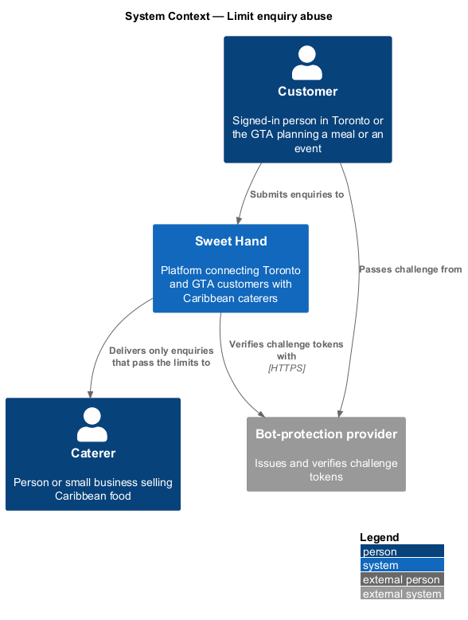
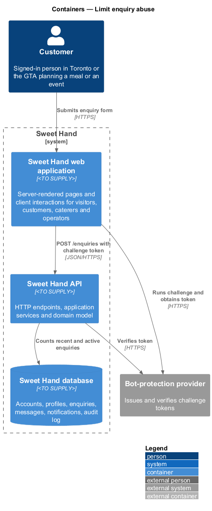
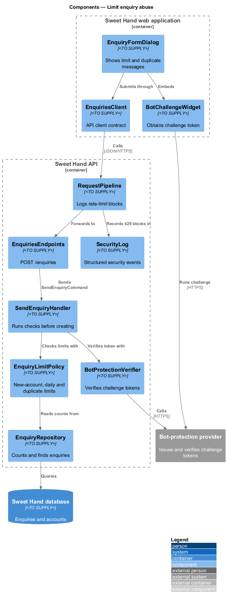
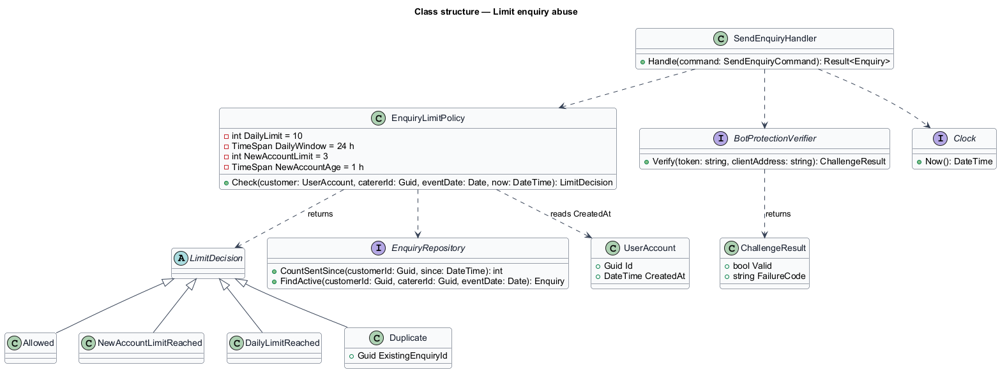
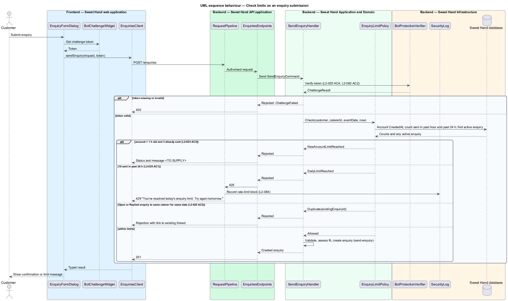

# Limit enquiry abuse

## Overview

Caterers on Sweet Hand are people and small businesses. An inbox flooded with spam or repeated enquiries costs them time and hides real customers. This feature protects caterers by limiting how many enquiries one customer can send, by blocking a second enquiry to the same caterer for the same event date, and by requiring a bot-protection challenge on the enquiry form.

> **bot-protection challenge** — privacy-respecting check, issued by an external provider, that a form submission comes from a person rather than an automated script

> **challenge token** — short-lived value the provider issues when the challenge is passed, sent with the form and verified by the server

> **active enquiry** — enquiry in status `Open` or `Replied`

The checks run on the server each time a customer submits the enquiry form (feature `enquiries/send-enquiry`), before any enquiry is created. They apply three limits:

- no more than 10 enquiries from one customer in the past 24 hours (`L2-025 AC1`);
- no more than 3 enquiries in the first hour after a customer account is created (`L2-025 AC3`);
- no second active enquiry from one customer to one caterer for the same event date (`L2-025 AC2`).

Platform-wide request rate limits for public read endpoints, and the stricter fallback when the bot-protection provider cannot be reached (`L2-091 AC4`), belong to the identity and security and platform subsystems. This feature covers the enquiry form only.

## Description

Technology choices for every component are `<TO SUPPLY>`, pending architecture decision records in `docs/adr/`. The bot-protection provider is `<TO SUPPLY>`.

**Frontend — Sweet Hand web application**

- **`BotChallengeWidget`** — runs the provider's challenge inside `EnquiryFormDialog` and hands the resulting challenge token to the form.
- **`EnquiryFormDialog`** — sends the challenge token with the enquiry. It shows the limit messages returned by the server. For a duplicate it shows "You already have an open enquiry with this caterer for that date" with a link to the existing thread.
- **`EnquiriesClient`** — API client contract. `sendEnquiry(request)` maps HTTP 429 and the duplicate rejection into typed results the form can display.

**Backend — Sweet Hand API application**

- **`EnquiriesEndpoints`** — `POST /enquiries`. It passes the challenge token into `SendEnquiryCommand`.
- **`RequestPipeline`** — records a rate-limit block as a security event (`L2-084`) when the endpoint returns HTTP 429.

**Backend — Sweet Hand Application and Domain**

- **`SendEnquiryHandler`** — calls `BotProtectionVerifier` first. A missing or invalid token is rejected with HTTP 400 (`L2-025 AC4`). It then calls `EnquiryLimitPolicy` before any field of the enquiry is written.
- **`EnquiryLimitPolicy`** — domain service that returns a `LimitDecision`. It checks, in order:
  1. new-account limit: when the account is less than 1 hour old and has already sent 3 enquiries, the decision is `NewAccountLimitReached`;
  2. daily limit: when the customer has sent 10 enquiries in the 24 hours before now, the decision is `DailyLimitReached`, returned as HTTP 429 with "You've reached today's enquiry limit. Try again tomorrow.";
  3. duplicate: when the customer already has an active enquiry to the same caterer for the same event date, the decision is `Duplicate` and carries the existing enquiry's identifier.
- **`LimitDecision`** — result type: `Allowed`, `NewAccountLimitReached`, `DailyLimitReached` or `Duplicate(existingEnquiryId)`.

The specification leaves these details open, and they are marked for completion:

- the HTTP status and message for `NewAccountLimitReached` — `<TO SUPPLY>`;
- the HTTP status for `Duplicate` — `<TO SUPPLY>`;
- the `Retry-After` value returned with the daily-limit HTTP 429 — `<TO SUPPLY>`.

The 24-hour window is a rolling window measured back from the time of the submission, as `L2-025 AC1` describes "the past 24 hours".

**Backend — Sweet Hand Infrastructure**

- **`BotProtectionVerifier`** — calls the bot-protection provider to verify a challenge token and returns `ChallengeResult`.
- **`EnquiryRepository`** — `CountSentSince(customerId, since)` and `FindActive(customerId, catererId, eventDate)` support the policy.
- **`UserAccountRepository`** — supplies the account's `CreatedAt`.
- **`Clock`** — supplies the current time.
- **`SecurityLog`** — records rate-limit blocks.

## Requirements

The feature realizes the following level-2 (L2) requirements from `docs/specs/L2.md`. Each refines the level-1 (L1) requirement cited beside it. Requirement text is quoted from the specification, with *must* rendered as *shall*.

| L2 ID | Refines (L1) | Requirement |
|-------|--------------|-------------|
| `L2-025` | `L1-008` | The platform shall limit how many enquiries one customer can send and block duplicates, to protect caterers from spam. |
| `L2-082` | `L1-021` | The platform shall limit request rates for each client and require bot-protection challenges on forms that are open to abuse. |

This feature realizes the enquiry-form part of `L2-082` (`L2-082 AC2` for the enquiry form). The remaining forms and the read-endpoint rate limit (`L2-082 AC1`, `L2-082 AC3`) belong to the identity and security subsystem.

## Diagrams

### System context

A customer submits enquiries through Sweet Hand. Sweet Hand verifies each submission's challenge token with the bot-protection provider.

### Containers

The web application obtains a challenge token from the provider and sends it with the enquiry. The Sweet Hand API verifies the token with the provider and counts recent enquiries in the Sweet Hand database.

### Components

`SendEnquiryHandler` calls `BotProtectionVerifier` and then `EnquiryLimitPolicy`, which reads counts through `EnquiryRepository`.

### Class structure

`EnquiryLimitPolicy` depends on the repository and the clock and returns one `LimitDecision`. `BotProtectionVerifier` returns a `ChallengeResult`.

### Behaviour — check limits on an enquiry submission

The token check runs first, then the new-account, daily and duplicate limits. Only an `Allowed` decision lets the enquiry be created.

