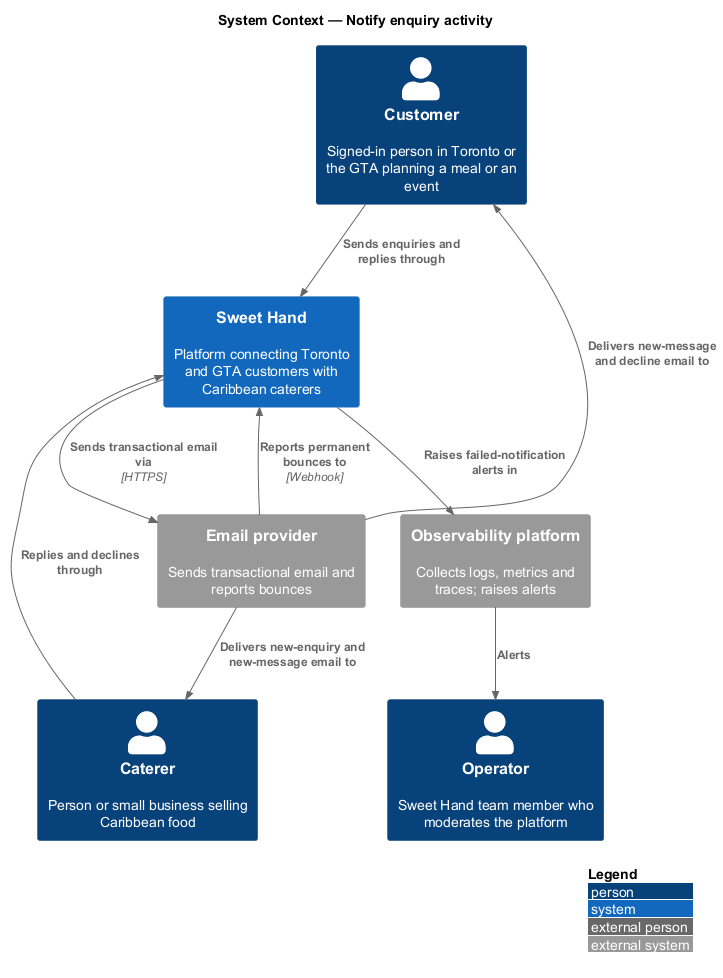
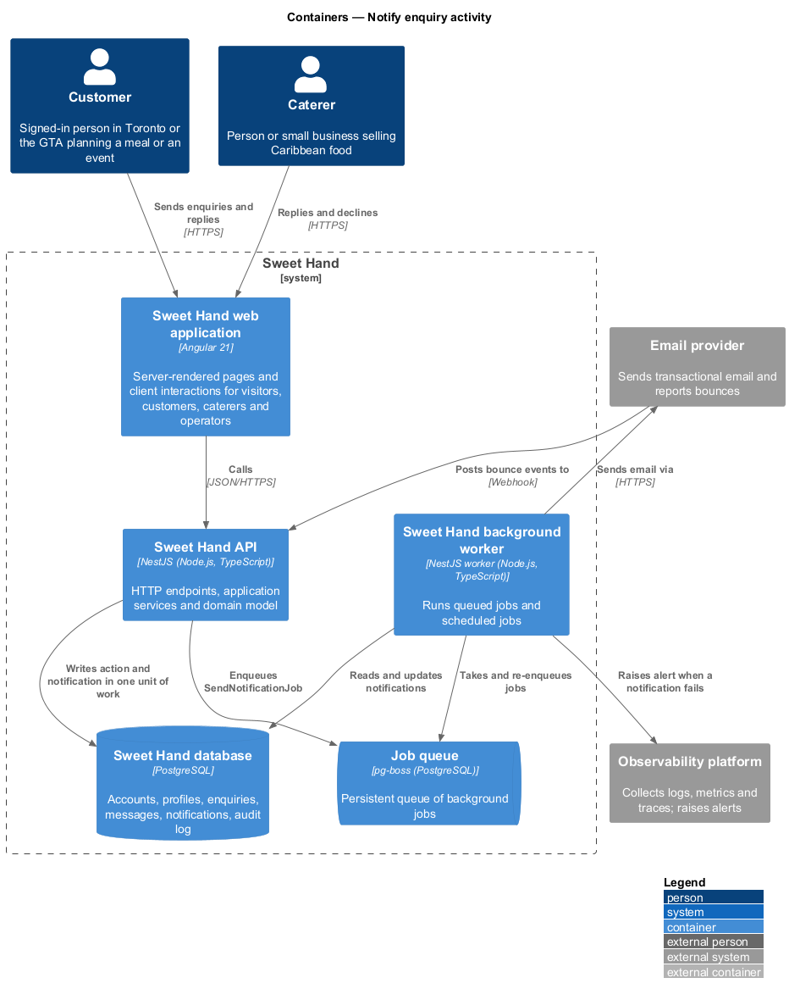
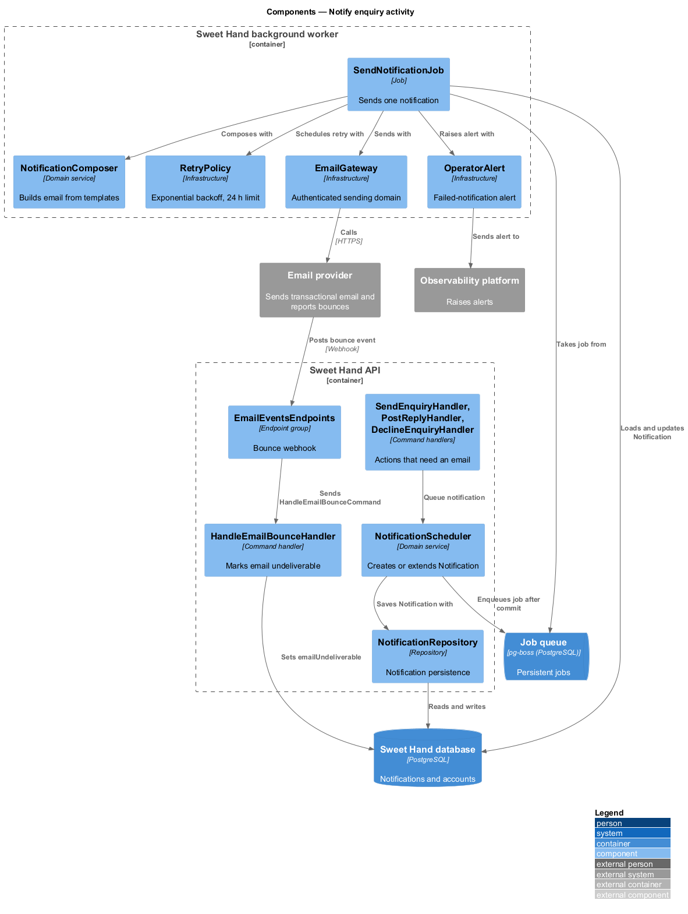
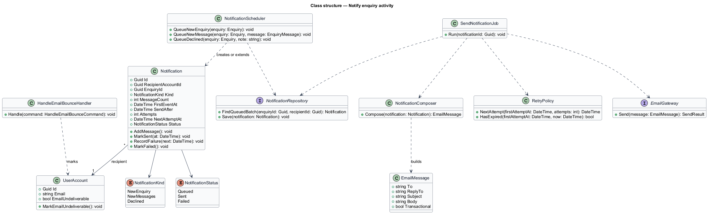
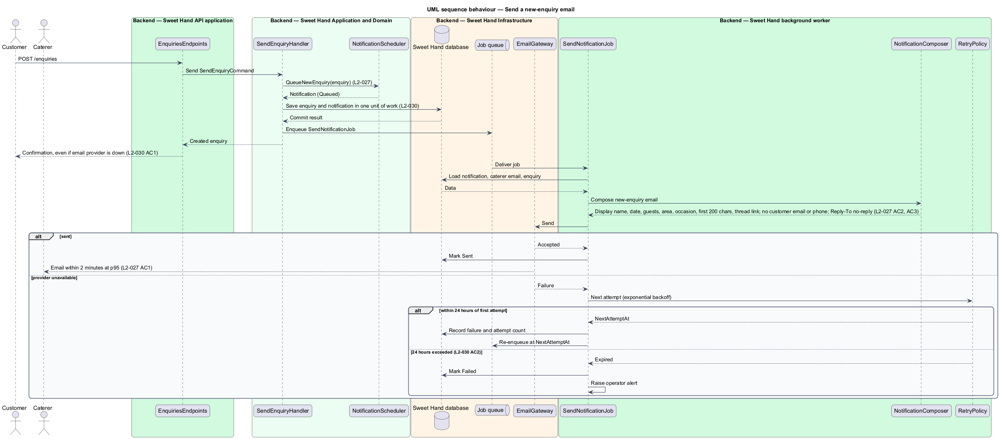
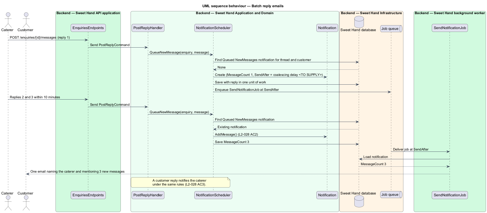
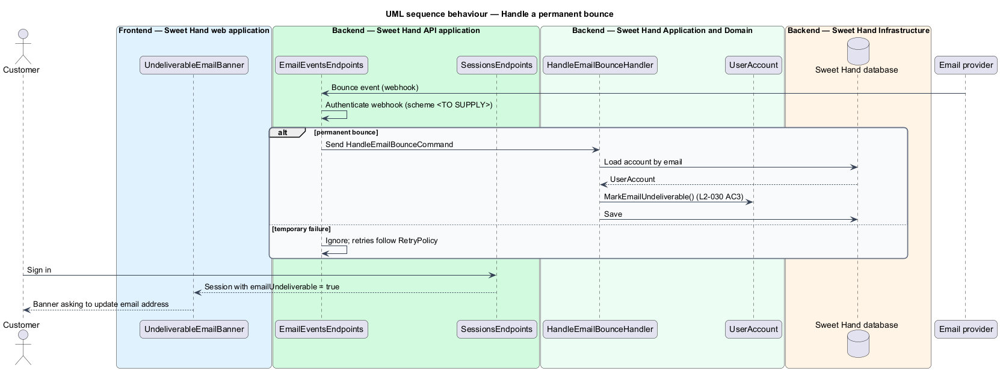

# Notify enquiry activity

## Overview

An enquiry on Sweet Hand is a conversation between one customer and one caterer about one event. Neither party watches the site all day, so the platform emails them when something happens in their conversation. This feature sends those emails and keeps them reliable.

> **notification** — record of one email the platform owes one recipient about one enquiry thread, kept until it is sent or marked `Failed`

> **thread** — the original enquiry together with every message the customer and caterer exchange about it

> **message batch** — group of messages in one thread, to one recipient, that the platform reports in a single email

> **permanent bounce** — report from the email provider that an address cannot receive mail, as opposed to a temporary delivery failure

> **transactional email** — email sent because of an action in the user's own account, with no marketing content

Four events produce a notification:

- a customer creates an enquiry, and the caterer receives a new-enquiry email (`L2-027`);
- a caterer replies, and the customer receives a new-message email (`L2-028`);
- a customer replies, and the caterer receives a new-message email under the same rules (`L2-028 AC3`);
- a caterer declines an enquiry, and the customer receives a decline email that includes any decline note (`L2-028 AC4`, triggered by feature `enquiries/decline-or-close-enquiry`).

Emails never carry the customer's email address or phone number. The `Reply-To` header is a no-reply platform address, so replies happen in the thread, not by email. A notification is written in the same unit of work as the action that caused it and is sent later by the background worker. When the email provider is down, the enquiry or reply still succeeds and the notification waits in the queue (`L2-030 AC1`).

## Description

Technology choices follow ADR 0001 (Angular 21) and ADR 0006 (NestJS on Node.js, PostgreSQL through Drizzle ORM, S3-compatible object storage); providers not named there remain `<TO SUPPLY>`. The email provider is `<TO SUPPLY>`.

**Backend — Sweet Hand Application and Domain**

- **`NotificationScheduler`** — application service called by `SendEnquiryHandler`, `PostReplyHandler` and `DeclineEnquiryHandler`. It creates or extends a `Notification` in the caller's unit of work and enqueues a `SendNotificationJob` once the unit of work commits. Because the notification row and the business change commit together, a failed send can never lose the notification or undo the action.
- **`Notification`** — entity with `recipientAccountId`, `enquiryId`, `kind` (`NewEnquiry`, `NewMessages`, `Declined`), `messageCount`, `firstEventAt`, `sendAfter`, `attempts`, `nextAttemptAt` and `status` (`Queued`, `Sent`, `Failed`).
- **Message batching (`L2-028 AC2`)** — while a `NewMessages` notification for the same thread and recipient is still `Queued`, a further message increments `messageCount` instead of creating a second notification. The email then mentions the count, for example "3 new messages". The specification sets two targets that pull against each other: each reply is emailed within 2 minutes at the 95th percentile (`L2-028 AC1`), and 3 replies within 10 minutes produce 1 email (`L2-028 AC2`). The coalescing delay held in `sendAfter`, and how it reconciles the two targets, is `<TO SUPPLY>`.
- **`RetryPolicy`** — exponential backoff for failed sends, for up to 24 hours from the first attempt. After that the notification becomes `Failed` and an operator alert is raised (`L2-030 AC2`). The base delay and multiplier are `<TO SUPPLY>`.
- **`HandleEmailBounceCommand`** / **`HandleEmailBounceHandler`** — on a permanent bounce, marks the recipient's `UserAccount.emailUndeliverable` flag (`L2-030 AC3`).
- **`UserAccount`** — gains `emailUndeliverable`. On the next sign-in, the web application shows a banner asking the user to update their email.

**Backend — Sweet Hand background worker**

- **`SendNotificationJob`** — loads the notification and, when `sendAfter` has passed, asks `NotificationComposer` for the email and hands it to `EmailGateway`. On success it marks the notification `Sent`. On failure it asks `RetryPolicy` for `nextAttemptAt` and re-enqueues the job.
- **`NotificationComposer`** — builds the email from externalised templates (`L2-064`). A new-enquiry email holds the customer's display name, event date, guest count, location area, occasion, the first 200 characters of the message and a link to the thread (`L2-027 AC2`). A new-message email names the sender, shows the first 200 characters of the latest message, and links to the thread (`L2-028 AC1`). A decline email says the caterer can't take on the event and includes any decline note. The composer never reads the customer's email address or phone number into the content or headers (`L2-027 AC3`), and marks every email as transactional (`L2-030 AC5`). The exact header used to mark an email transactional is `<TO SUPPLY>`.

**Backend — Sweet Hand API application**

- **`EmailEventsEndpoints`** — receives bounce events from the email provider and dispatches `HandleEmailBounceCommand`. The webhook authentication scheme is `<TO SUPPLY>`.
- **`EnquiriesEndpoints`** — the thread link in every email points to the thread page. A request that is not signed in as a party of the thread is sent to sign in, and the thread is shown only after signing in as that party (`L2-027 AC4`, `L2-034`).

**Backend — Sweet Hand Infrastructure**

- **`JobQueue`** — persistent queue of `SendNotificationJob` entries.
- **`EmailGateway`** — sends through the email provider with authenticated sending domains. DNS for the sending domain holds SPF, DKIM and DMARC records, with a DMARC policy of `quarantine` or stricter (`L2-030 AC4`).
- **`NotificationRepository`** — persistence of `Notification` rows.
- **`OperatorAlert`** — raises an alert in the observability platform when a notification becomes `Failed`.

**Frontend — Sweet Hand web application**

- **`UndeliverableEmailBanner`** — shown after sign-in when the account's email is marked undeliverable, linking to account settings.

## Requirements

The feature realizes the following level-2 (L2) requirements from `docs/specs/L2.md`. Each refines the level-1 (L1) requirement cited beside it. Requirement text is quoted from the specification, with *must* rendered as *shall*.

| L2 ID | Refines (L1) | Requirement |
|-------|--------------|-------------|
| `L2-027` | `L1-009` | When an enquiry is created, the platform shall email the caterer at the address on their account. The email shall not include the customer's email address or phone number. |
| `L2-028` | `L1-009` | When a caterer replies in an enquiry thread, the platform shall email the customer. Several replies within 10 minutes shall be combined into one email. |
| `L2-030` | `L1-009` | Notification emails shall be sent through a queue that persists, so a failed send does not lose the notification or fail the action that caused it. Sending domains shall be authenticated. |

## Diagrams

### System context

Sweet Hand emails caterers and customers through the email provider, receives bounce reports from it, and raises alerts in the observability platform.

### Containers

The Sweet Hand API writes notifications to the database and jobs to the job queue. The background worker sends them through the email provider. The provider reports bounces back to the API.

### Components

`NotificationScheduler` in the API and `SendNotificationJob` in the worker share the `Notification` record. The worker composes the email and sends it through `EmailGateway`, applying `RetryPolicy` on failure.

### Class structure

`Notification` holds its kind, status and retry state. `SendNotificationJob` depends on the composer, the gateway and the retry policy.

### Behaviour — send a new-enquiry email

The enquiry and its notification commit together. The worker sends the email and retries with backoff when the provider is unavailable, ending in `Failed` and an operator alert after 24 hours.

### Behaviour — batch reply emails

Replies to the same recipient in the same thread extend one queued notification, so the recipient receives one email that counts the new messages.

### Behaviour — handle a permanent bounce

A permanent bounce marks the email undeliverable, and the next sign-in shows a banner asking the user to update the address.

