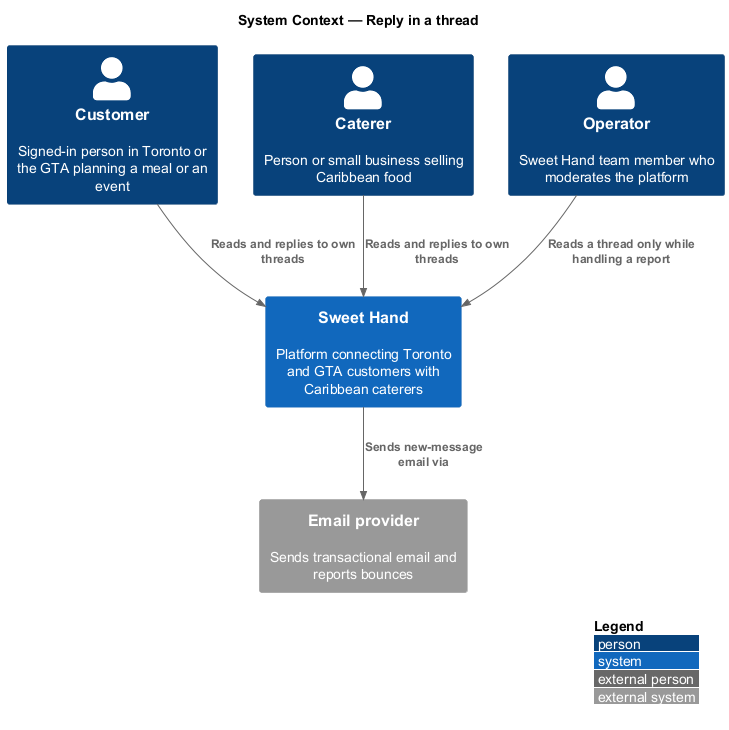
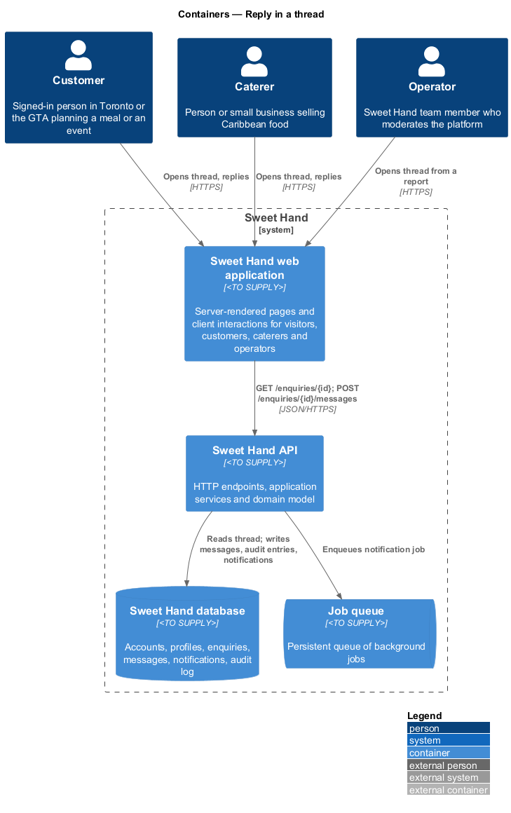
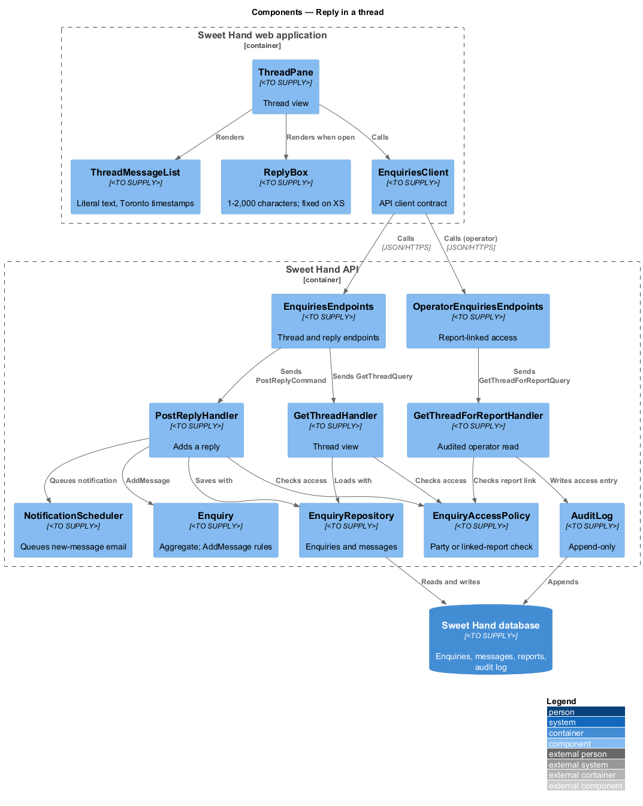
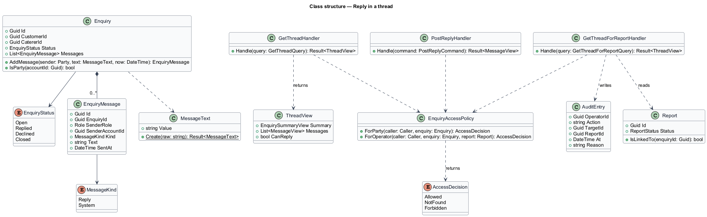
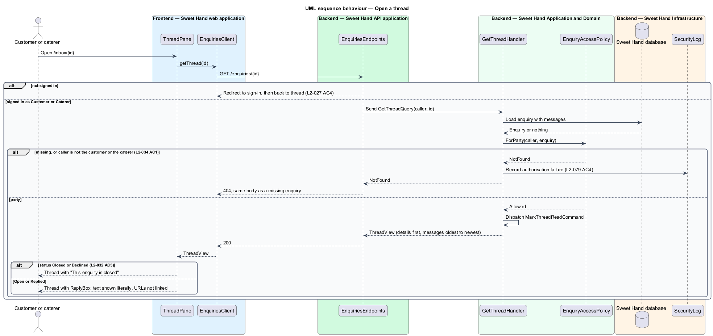
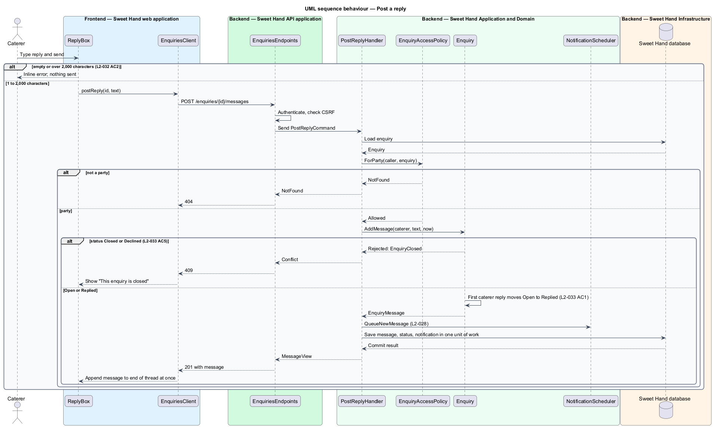
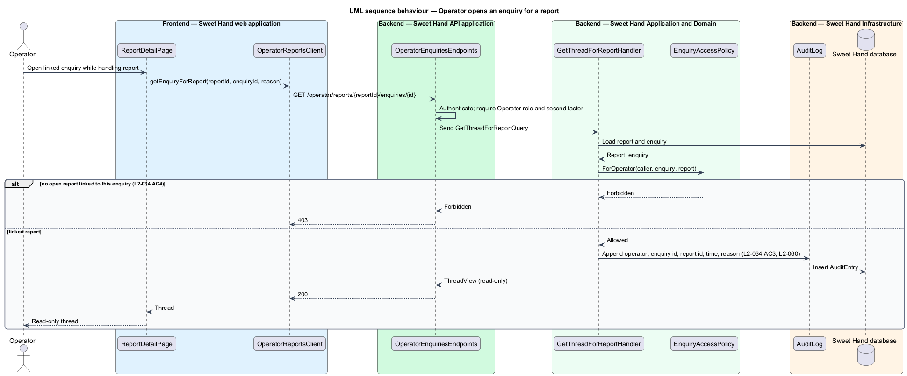

# Reply in a thread

## Overview

After a customer sends an enquiry, the customer and the caterer talk it through on Sweet Hand: menus, numbers, timing. Because the platform is enquiry only and contact details are private by default, the thread is where that conversation happens. This feature shows a thread and lets either party reply, and it keeps every thread private to its two parties.

> **thread** — the original enquiry details followed by every message the two parties exchange about it, in time order

> **party** — the customer who sent an enquiry or the caterer it was sent to

> **linked report** — open report (`L2-054`) that an operator is handling and that is connected to an enquiry, the only ground on which an operator reads that enquiry

A party opens the thread from the inbox or from an email link. The thread shows the enquiry details first, then each message oldest to newest, with the sender's name and a timestamp in `America/Toronto`. A reply is 1 to 2,000 characters of plain text and appears at the end of the thread at once. Text is always shown literally: markup never runs and URLs are not turned into links. When the enquiry is `Closed` or `Declined`, the reply box gives way to the text "This enquiry is closed".

Only the two parties can read a thread. Anyone else, through the UI or the API, receives the same not-found response as for a missing thread. Enquiry identifiers are random UUIDv4 values, so they cannot be guessed. An operator can open a thread only while handling a report, and each such access is written to the audit log.

The first caterer reply moves an `Open` enquiry to `Replied`. That transition is part of the status lifecycle in feature `enquiries/decline-or-close-enquiry`. The email to the other party belongs to feature `enquiries/notify-enquiry-activity`.

## Description

Technology choices for every component are `<TO SUPPLY>`, pending architecture decision records in `docs/adr/`.

**Frontend — Sweet Hand web application**

- **`ThreadPane`** — thread view at `/inbox/{id}`. It renders `EnquirySummary`, `ThreadMessageList` and either `ReplyBox` or the closed notice.
- **`EnquirySummary`** — original details: event date, guest count, location area, occasion, message, and any fit warnings (`L2-024 AC3`).
- **`ThreadMessageList`** — messages oldest to newest, each with sender name and a timestamp formatted for `America/Toronto` (`L2-032 AC1`). Message text renders as escaped plain text with line breaks preserved. URLs stay as plain text (`L2-032 AC3`, `L2-032 AC4`).
- **`ReplyBox`** — reply field with a visible label and a character count. It rejects an empty reply or one over 2,000 characters with an inline error before sending. On XS it stays fixed at the bottom of the screen and stays visible while the on-screen keyboard is open (`L2-036 AC3`). After a successful send it appends the returned message without reloading the page.
- **`EnquiriesClient`** — API client contract: `getThread(id)`, `postReply(id, text)`.

**Backend — Sweet Hand API application**

- **`EnquiriesEndpoints`** — `GET /enquiries/{id}` returns the thread view and `POST /enquiries/{id}/messages` adds a reply. Both require a signed-in customer or caterer. A caller who is not signed in, for example after following an email link, is sent to sign in and then returned to the thread (`L2-027 AC4`).
- **`OperatorEnquiriesEndpoints`** — `GET /operator/reports/{reportId}/enquiries/{id}` returns the thread for an operator handling a report. A request without a linked report is denied with HTTP 403 (`L2-034 AC4`). The route path is `<TO SUPPLY>`.

**Backend — Sweet Hand Application and Domain**

- **`EnquiryAccessPolicy`** — decides access to one enquiry. A customer or caterer is allowed only when they are its customer or its caterer. Otherwise the result is `NotFound`, which the endpoint returns as HTTP 404 with the same body as for a missing enquiry (`L2-034 AC1`). An operator is allowed only when the given report is open and linked to the enquiry. Otherwise the result is `Forbidden`.
- **`GetThreadQuery`** / **`GetThreadHandler`** — applies the access policy, loads the enquiry and its messages, and returns `ThreadView`. For a party it also dispatches `MarkThreadReadCommand` (feature `enquiries/show-unread-indicators`).
- **`GetThreadForReportQuery`** / **`GetThreadForReportHandler`** — operator path. It writes an `AuditEntry` holding the operator, enquiry identifier, report identifier, time and reason before returning the thread (`L2-034 AC3`, `L2-060`). The source of the "reason" value is `<TO SUPPLY>`; the design takes it from the operator's request.
- **`PostReplyCommand`** / **`PostReplyHandler`** — applies the access policy, then calls `Enquiry.AddMessage(sender, text, now)` and asks `NotificationScheduler` to queue the email to the other party. All changes commit in one unit of work.
- **`Enquiry.AddMessage`** — rejects a message when the status is `Closed` or `Declined` (HTTP 409, `L2-033 AC5`). It moves `Open` to `Replied` on the first caterer message (`L2-033 AC1`) and updates the activity timestamps.
- **`MessageText`** — value object holding 1 to 2,000 characters after trimming, stored exactly as given. Control characters other than tab and newline are removed (`L2-080 AC4`).
- **`EnquiryMessage`** — `id`, `enquiryId`, `senderRole`, `senderAccountId`, `kind` (`Reply` or `System`), `text`, `sentAt`.

**Backend — Sweet Hand Infrastructure**

- **`EnquiryRepository`** — loads an enquiry with its messages and saves new messages.
- **`ReportRepository`** — confirms that an open report is linked to the enquiry. The specification does not state how a report becomes linked to an enquiry: `L2-054` limits reports to caterer profiles and reviews. The linking rule is `<TO SUPPLY>`.
- **`AuditLog`** — append-only audit writer.
- **`SecurityLog`** — records each authorisation failure (`L2-079 AC4`).

## Requirements

The feature realizes the following level-2 (L2) requirements from `docs/specs/L2.md`. Each refines the level-1 (L1) requirement cited beside it. Requirement text is quoted from the specification, with *must* rendered as *shall*.

| L2 ID | Refines (L1) | Requirement |
|-------|--------------|-------------|
| `L2-032` | `L1-010` | Opening an enquiry shall show the original enquiry details followed by every message in time order, each with the sender's name and a timestamp. Either party can reply while the enquiry is not closed. |
| `L2-034` | `L1-010` | An enquiry and its messages can be read only by the customer who sent it and the caterer it was sent to. Operators can read one only when handling a report (L2-055), and each such access shall be written to the audit log (L2-060). |

## Diagrams

### System context

Customers and caterers exchange messages in Sweet Hand. Operators can read a thread only while handling a report.

### Containers

The web application renders the thread and sends replies to the Sweet Hand API. The API stores messages, audit entries and queued notifications in the Sweet Hand database.

### Components

`ThreadPane` depends on the `EnquiriesClient` contract. In the API, every read and write passes through `EnquiryAccessPolicy` before the `Enquiry` aggregate is touched.

### Class structure

`Enquiry` composes its `EnquiryMessage` list and enforces the closed rule in `AddMessage`. `EnquiryAccessPolicy` returns an `AccessDecision` that the handlers turn into a result or a not-found response.

### Behaviour — open a thread

A party receives the thread view. Any other customer or caterer receives not found, whether the thread exists or not.

### Behaviour — post a reply

The aggregate rejects replies to closed threads, moves `Open` to `Replied` on the first caterer reply, and the reply and its notification commit together.

### Behaviour — operator opens an enquiry for a report

An operator reads a thread only through a linked report, and the access is written to the audit log first.

