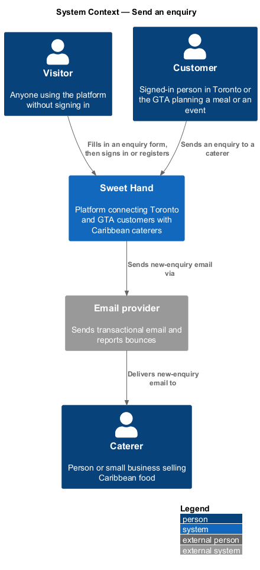
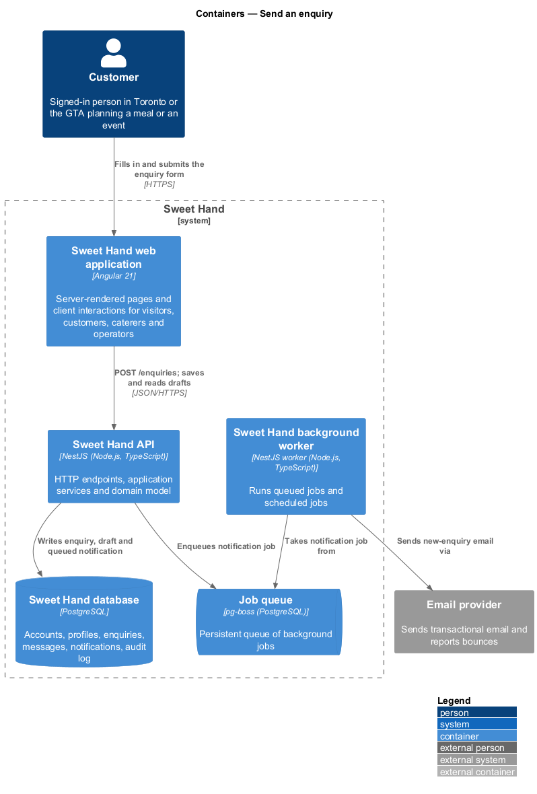
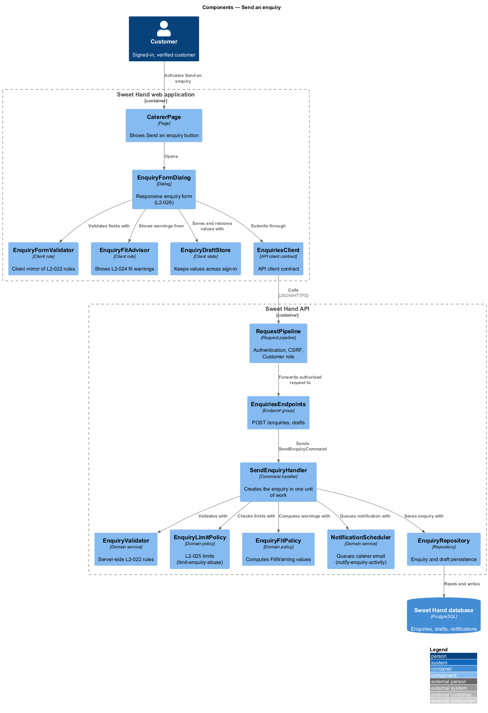
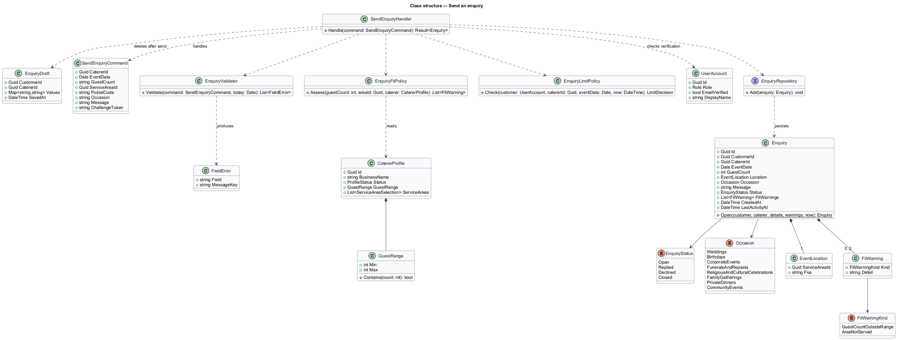
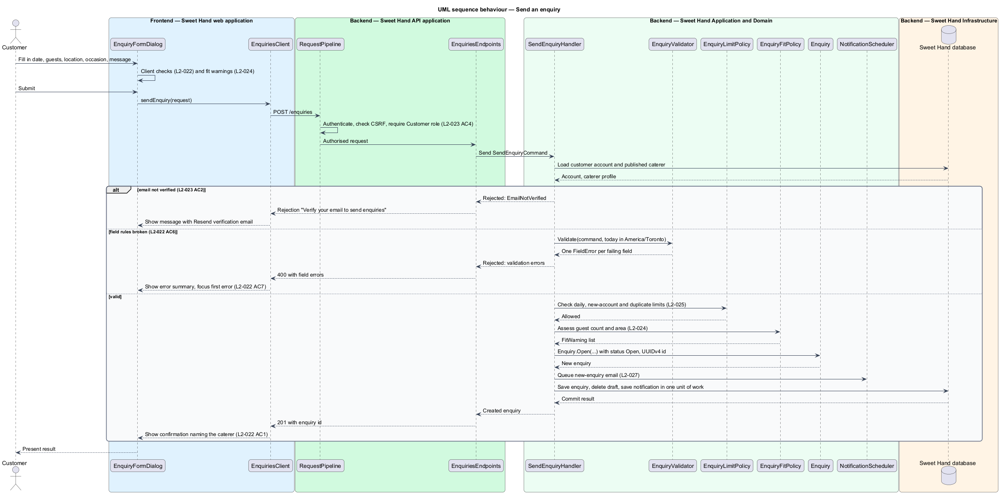
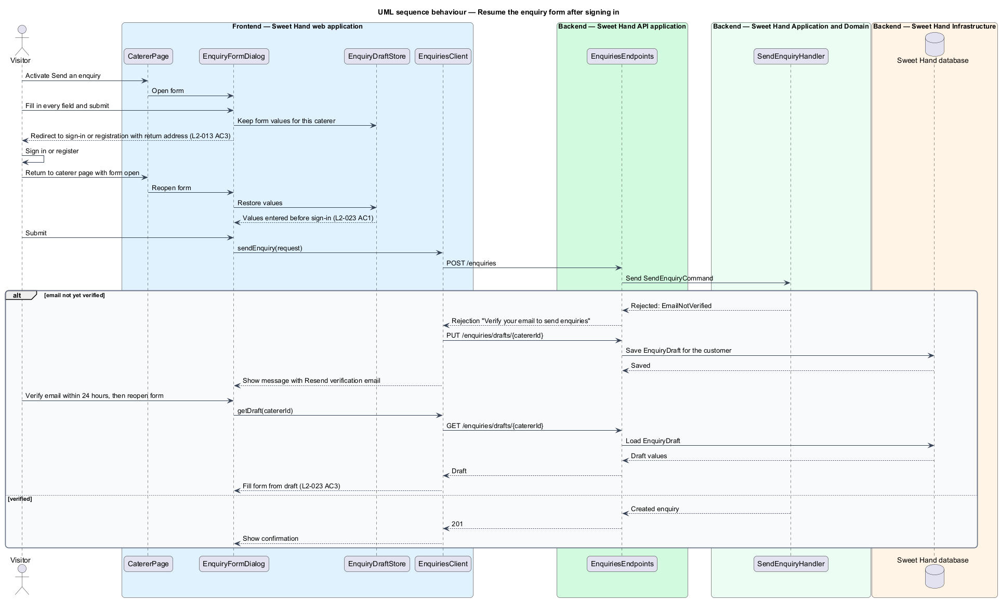

# Send an enquiry

## Overview

Sweet Hand connects people in Toronto and the Greater Toronto Area (GTA) with caterers who sell Caribbean food. The first release is enquiry only: no booking or payment passes through the platform (assumption A-2 in `docs/specs/L1.md`). This feature is the step where a customer first contacts a caterer about an event.

> **enquiry** — customer's written request to one caterer to cater one event, holding an event date, guest count, event location, occasion and message

> **verified customer** — signed-in customer account whose email address has been confirmed through a verification link

> **fit warning** — non-blocking notice that an enquiry falls outside the guest range or service areas the caterer lists

> **enquiry draft** — set of enquiry form values not yet sent, kept so that signing in or verifying an email does not lose them

A visitor finds the caterer through the listing, opens the caterer page, and activates "Send an enquiry". Only a verified customer can send. A visitor who is not signed in is sent to sign in or register and then returns to the same form with every value still filled in. The form checks each field as the customer types, and the server checks every field again. When the event is larger than the caterer's guest range, or in an area the caterer does not list, the form shows a fit warning but still lets the customer send.

A sent enquiry starts in status `Open` and appears in both the customer's and the caterer's inbox (feature `enquiries/browse-inbox`). The email to the caterer belongs to feature `enquiries/notify-enquiry-activity`. The daily limits, duplicate block and bot-protection check belong to feature `enquiries/limit-enquiry-abuse`; this feature calls them before an enquiry is created.

## Description

Technology choices follow ADR 0001 (Angular 21) and ADR 0006 (NestJS on Node.js, PostgreSQL through Drizzle ORM, S3-compatible object storage); providers not named there remain `<TO SUPPLY>`. The components below are described by role.

**Frontend — Sweet Hand web application**

- **`CatererPage`** — public caterer page. It shows the "Send an enquiry" button and opens `EnquiryFormDialog`. For a visitor who is not signed in, it routes to sign-in or registration with a return address that reopens the form (`L2-013 AC3`).
- **`EnquiryFormDialog`** — the enquiry form. On viewport classes XS and SM it fills the screen as one column with the submit button fixed at the bottom. On MD, LG and XL it opens as a dialog or side panel no wider than 640 px, with the caterer's name and cover photo at the top (`L2-026`). It uses the UI framework's accessible dialog primitive. The guest count field declares `inputmode="numeric"` and the event date field declares `type="date"` so that touch devices show a numeric keypad and the native date picker. The focused field scrolls clear of the on-screen keyboard.
- **`EnquiryFormValidator`** — client-side mirror of the server rules. It gives immediate feedback, moves focus to the error summary, and links each error to its field (`L2-022 AC7`, `L2-068`).
- **`EnquiryFitAdvisor`** — compares the entered guest count and location with the caterer's public guest range and service areas, and shows the warnings "This caterer usually serves {min}–{max} guests" and "This caterer doesn't list {area} as an area they serve" (`L2-024`).
- **`EnquiryDraftStore`** — keeps the form values while a visitor signs in or registers, and restores them when the form reopens (`L2-023 AC1`). The browser-side storage mechanism is `<TO SUPPLY>`.
- **`EnquiriesClient`** — API client contract the form depends on: `sendEnquiry(request)`, `saveDraft(catererId, values)`, `getDraft(catererId)`. `HttpEnquiriesClient` implements it.

**Backend — Sweet Hand API application**

- **`EnquiriesEndpoints`** — `POST /enquiries` creates an enquiry. `PUT /enquiries/drafts/{catererId}` and `GET /enquiries/drafts/{catererId}` save and read the signed-in customer's server-side draft. Exact route paths are `<TO SUPPLY>`.
- **`RequestPipeline`** — shared pipeline. It authenticates the session, checks the CSRF token, and requires the `Customer` role. A caterer session receives the message "Sign in with a customer account to send enquiries" (`L2-023 AC4`).

**Backend — Sweet Hand Application and Domain**

- **`SendEnquiryCommand`** — carries `catererId`, `eventDate`, `guestCount`, `serviceAreaId`, optional `postalCode`, `occasion`, `message` and the bot-protection token.
- **`SendEnquiryHandler`** — loads the customer account and the published caterer profile, rejects an unverified email with "Verify your email to send enquiries" (`L2-023 AC2`), runs `EnquiryValidator`, asks `EnquiryLimitPolicy` (feature `enquiries/limit-enquiry-abuse`) to allow the send, computes fit warnings, creates the `Enquiry`, deletes any draft, and asks `NotificationScheduler` (feature `enquiries/notify-enquiry-activity`) to queue the caterer email. It writes all of this in one unit of work.
- **`EnquiryValidator`** — applies the field rules of `L2-022` and returns one error per failing field. A request that breaks any rule receives HTTP 400 and nothing is created (`L2-022 AC6`). The rules are:
  - event date: required, at least 2 days after today and no more than 24 months after today, where today is the current date in `America/Toronto`;
  - guest count: required, whole number from 1 to 5,000;
  - event location: required, one service area from `L2-010`, with an optional postal code that is reduced to its forward sortation area (FSA, the first 3 characters) before storage;
  - occasion: required, one value of the fixed `Occasion` list (`L2-021`);
  - message: required, 20 to 2,000 characters of plain text.
- **`EnquiryFitPolicy`** — domain service that returns zero or more `FitWarning` values from the caterer's `GuestRange` and `ServiceAreaSelection` list. Warnings never block the send. They are stored on the enquiry so that the caterer sees the same warnings (`L2-024 AC3`).
- **`Enquiry`** — aggregate root. `Enquiry.Open(...)` creates it with a random UUIDv4 identifier, status `Open`, the `EventLocation`, the fit warnings, `createdAt` and `lastActivityAt`.
- **`EnquiryDraft`** — signed-in customer's unsent values for one caterer. It is kept for at least 24 hours so that a customer who verifies their email within that time finds the form still filled in (`L2-023 AC3`). The deletion schedule after 24 hours is `<TO SUPPLY>`.

**Backend — Sweet Hand Infrastructure**

- **`EnquiryRepository`**, **`EnquiryDraftRepository`**, **`CatererProfileRepository`**, **`UserAccountRepository`** — persistence in the Sweet Hand database.
- **`Clock`** — supplies the current date in `America/Toronto` for the date rules.

Registration and email verification themselves belong to the identity and security subsystem. This feature depends on their outcome only.

## Requirements

The feature realizes the following level-2 (L2) requirements from `docs/specs/L2.md`. Each refines the level-1 (L1) requirement cited beside it. Requirement text is quoted from the specification, with *must* rendered as *shall*.

| L2 ID | Refines (L1) | Requirement |
|-------|--------------|-------------|
| `L2-022` | `L1-008` | The enquiry form shall capture the event date, guest count, event location, occasion and a message. All fields shall be checked on the server, and also on the client for immediate feedback. |
| `L2-023` | `L1-008` | Only a signed-in customer with a verified email address can send an enquiry. Customer registration asks for a display name (2–50 characters), an email address, a password (L2-076) and consent to the privacy notice (L2-070). Anything the visitor typed into the enquiry form before signing in shall be kept. |
| `L2-024` | `L1-008` | The form shall warn the customer, without blocking them, when the enquiry falls outside what the caterer says they take on. |
| `L2-026` | `L1-008` | The enquiry form shall suit each viewport class and use input types that bring up the right mobile keyboard. |

The field rule table in `L2-022` is summarised under `EnquiryValidator` in the Description.

## Diagrams

### System context

A visitor becomes a customer to send an enquiry to a caterer through Sweet Hand. Sweet Hand emails the caterer through the email provider.

### Containers

The web application renders the form and calls the Sweet Hand API. The API stores the enquiry and a queued notification in the Sweet Hand database and places a job on the job queue for the background worker.

### Components

`EnquiryFormDialog` depends on the `EnquiriesClient` contract. In the API, `EnquiriesEndpoints` dispatches `SendEnquiryCommand` to `SendEnquiryHandler`, which uses the validator, the limit policy, the fit policy and the repositories.

### Class structure

`Enquiry` composes an `EventLocation` and a list of `FitWarning` values and holds an `EnquiryStatus`. `SendEnquiryHandler` depends on the validator and the two policies, and reads the caterer's `GuestRange` and service areas.

### Behaviour — send an enquiry

The handler checks verification, field rules (`L2-022`) and abuse limits (`L2-025`) before it creates the `Open` enquiry. Field errors return HTTP 400 and focus moves to the error summary.

### Behaviour — resume the form after signing in

A visitor's values survive the trip through sign-in. After sign-in the form reopens with the same values. An unverified customer's values are saved as a server-side draft so that they are still there after verification (`L2-023 AC1`, `L2-023 AC3`).

