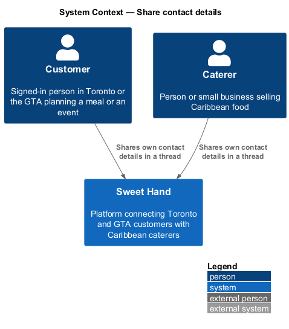
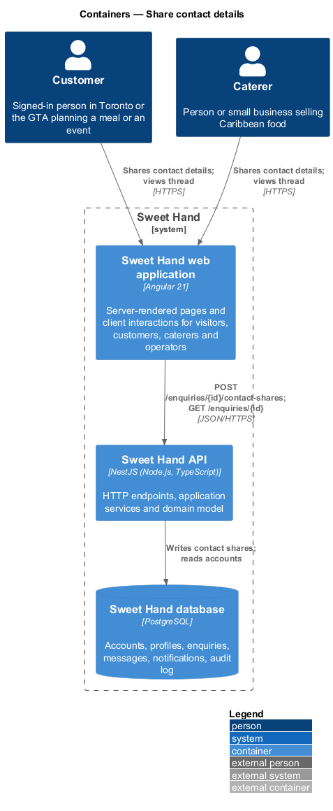
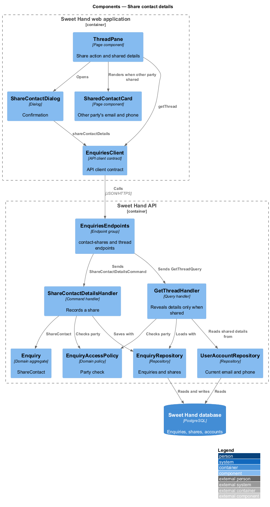
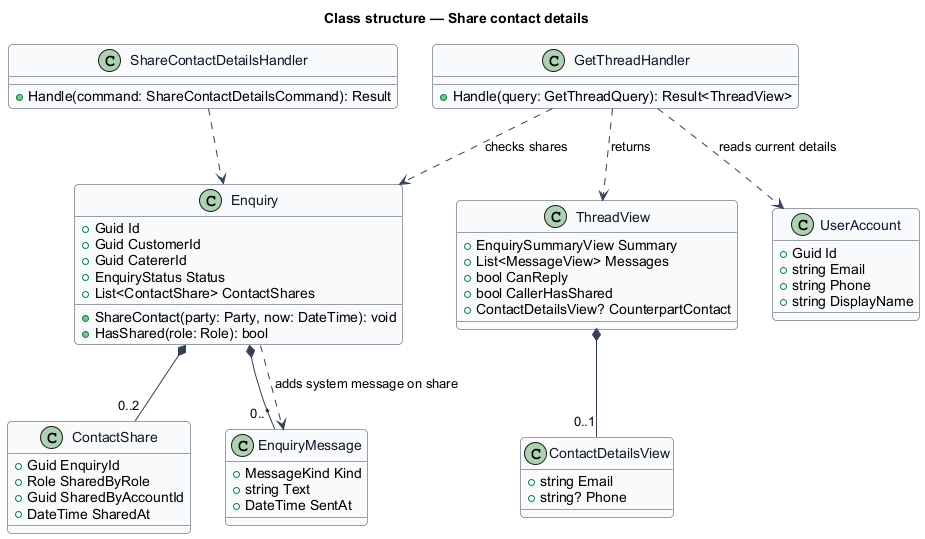
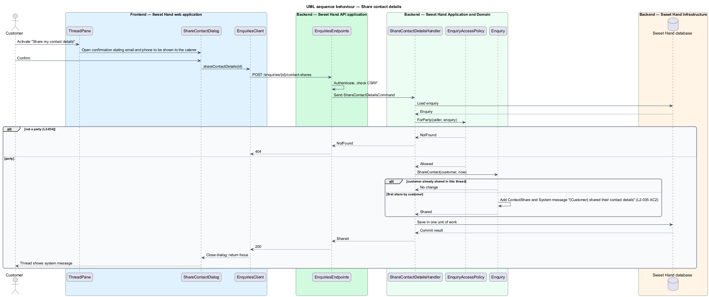
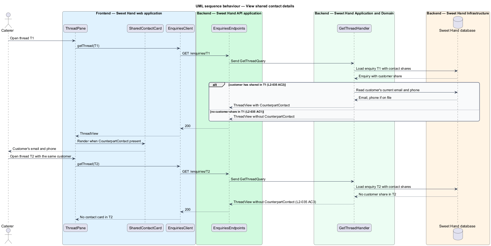

# Share contact details

## Overview

Sweet Hand keeps customers' and caterers' contact details private by default. A new enquiry reaches the caterer without the customer's email address or phone number, and notification emails never carry them (`L2-027`). Once a conversation is going well, either party may want to talk by phone or email instead. This feature lets each party choose to reveal their own contact details to the other party, in one specific thread.

> **contact details** — a party's email address and, when one is on file, phone number

> **contact share** — record that one party revealed their contact details to the other party in one enquiry thread

> **system message** — thread entry written by the platform rather than by either party, such as "{Customer} shared their contact details"

A party activates "Share my contact details" in the thread and confirms. From then on, the other party sees those details in that thread, and the thread records a system message naming who shared. A share applies to one thread only. If the same customer and caterer have a second thread, the details do not appear there until someone shares in that thread too (`L2-035 AC3`). Each direction is separate: a customer sharing does not reveal the caterer's details.

For a customer the details are the account email and, if on file, phone number. For a caterer, the specification names a "business email and phone". Caterer registration (`L2-037`) collects one email address and one phone number. The design uses those values. Whether a separate business email exists is `<TO SUPPLY>`.

## Description

Technology choices follow ADR 0001 (Angular 21) and ADR 0006 (NestJS on Node.js, PostgreSQL through Drizzle ORM, S3-compatible object storage); providers not named there remain `<TO SUPPLY>`.

**Frontend — Sweet Hand web application**

- **`ThreadPane`** — shows a "Share my contact details" action while the caller has not yet shared in this thread. It shows `SharedContactCard` when the other party has shared.
- **`ShareContactDialog`** — confirmation dialog that states exactly which details will be shown and to whom. It uses the UI framework's accessible dialog primitive.
- **`SharedContactCard`** — shows the other party's email address and phone number, as `mailto:` and `tel:` links. These are the only links in a thread; message text stays plain (`L2-032 AC4`).
- **`EnquiriesClient`** — API client contract: `shareContactDetails(id)`.

**Backend — Sweet Hand API application**

- **`EnquiriesEndpoints`** — `POST /enquiries/{id}/contact-shares`. It requires a signed-in party. Any other caller receives HTTP 404 (`L2-034`).

**Backend — Sweet Hand Application and Domain**

- **`ShareContactDetailsCommand`** / **`ShareContactDetailsHandler`** — applies `EnquiryAccessPolicy`, calls `Enquiry.ShareContact(party, now)`, and saves in one unit of work.
- **`Enquiry.ShareContact`** — creates a `ContactShare` for the calling party and adds the system message "{name} shared their contact details", using the customer's display name or the caterer's business name. Sharing twice from the same party leaves the existing share in place and adds no second message. Whether sharing is allowed after the enquiry is `Closed` or `Declined` is not stated in the specification and is `<TO SUPPLY>`. Whether a share can be withdrawn is also `<TO SUPPLY>`; the design offers no withdrawal.
- **`ContactShare`** — `enquiryId`, `sharedByRole`, `sharedByAccountId`, `sharedAt`. It stores no copy of the details.
- **`GetThreadHandler`** — when building `ThreadView`, it fills `counterpartContact` only when a `ContactShare` by the other party exists for this enquiry. It reads the details from the other party's current account at that moment, so an updated phone number shows the new value. A deleted account yields no details (`L2-072 AC2`).
- **`ContactDetailsView`** — `email`, optional `phone`.

Contact details that a party has shared also determine what appears in the other party's data export (`L2-071 AC4`); that rule belongs to the privacy subsystem.

**Backend — Sweet Hand Infrastructure**

- **`EnquiryRepository`** — saves contact shares and system messages with the enquiry.
- **`UserAccountRepository`** — reads current email and phone for the sharing party.

## Requirements

The feature realizes the following level-2 (L2) requirements from `docs/specs/L2.md`. Each refines the level-1 (L1) requirement cited beside it. Requirement text is quoted from the specification, with *must* rendered as *shall*.

| L2 ID | Refines (L1) | Requirement |
|-------|--------------|-------------|
| `L2-035` | `L1-010` | Customer and caterer contact details are private by default. Either party can choose to share their email address or phone number with the other party in a specific thread. |

## Diagrams

### System context

Customers and caterers reveal their own contact details to each other in Sweet Hand. No external system takes part.

### Containers

The web application sends the share action to the Sweet Hand API, which records the share in the Sweet Hand database and reads current details from the sharing party's account when the thread is viewed.

### Components

`ShareContactDialog` calls the `EnquiriesClient` contract. `ShareContactDetailsHandler` records the share on the `Enquiry`. `GetThreadHandler` reveals details only when the other party has shared in that thread.

### Class structure

`Enquiry` composes up to two `ContactShare` records, one per party. `ThreadView` carries an optional `ContactDetailsView` for the other party.

### Behaviour — share contact details

The customer confirms sharing. The platform records the share and adds a system message to the thread.

### Behaviour — view shared contact details

When the caterer opens the thread, the customer's details appear because a share exists for that thread. In another thread with the same customer they do not.

