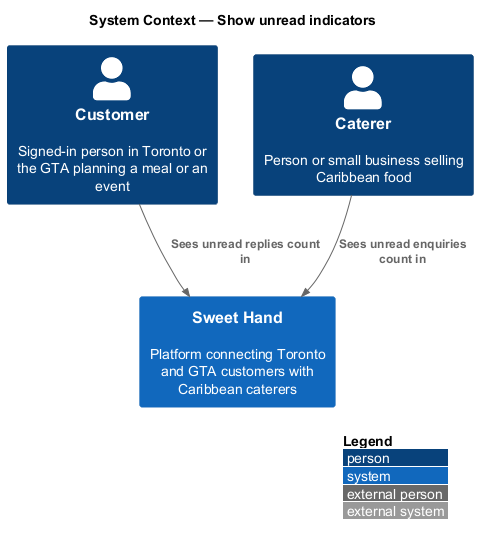
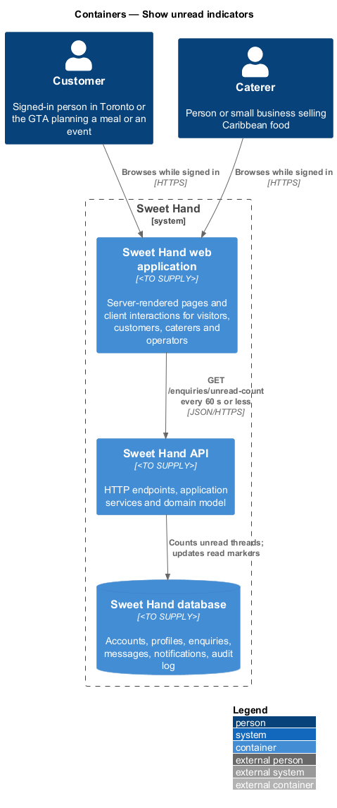
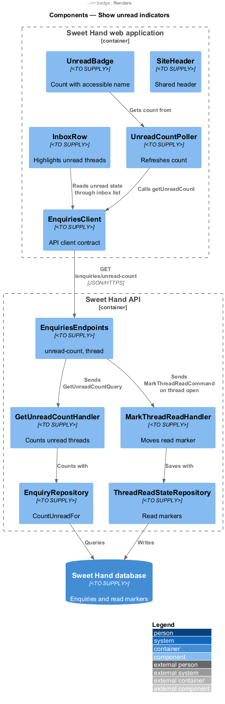
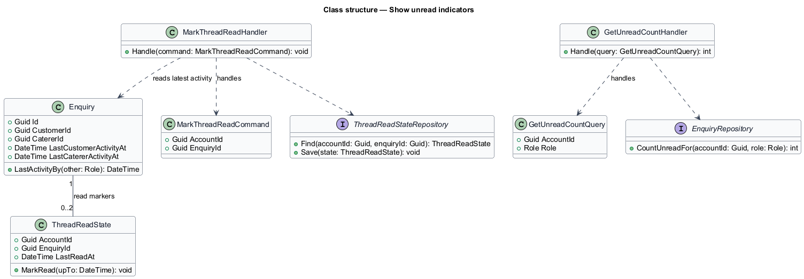
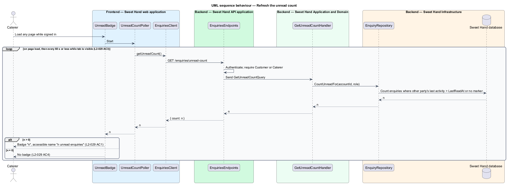
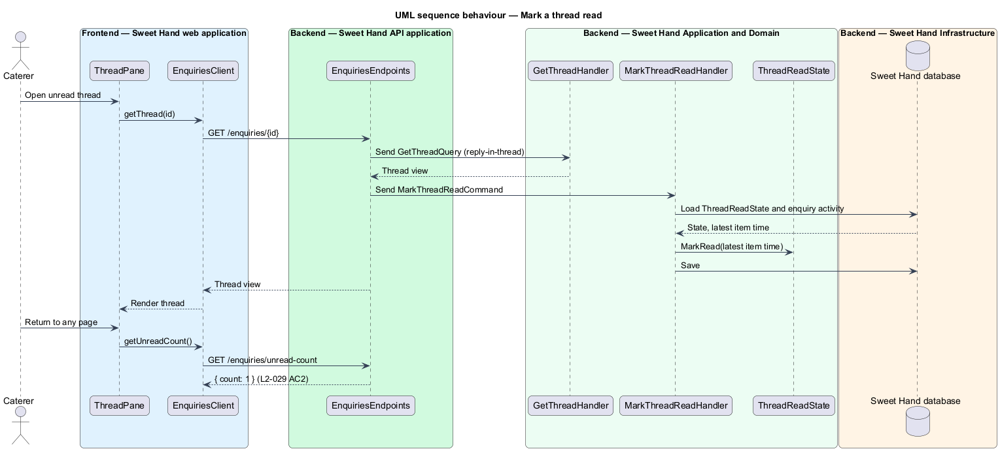

# Show unread indicators

## Overview

Customers and caterers on Sweet Hand talk about events in enquiry threads. Email tells them when something new arrives (feature `enquiries/notify-enquiry-activity`), but a signed-in user also needs to see it on the site itself. This feature shows a count of unread threads in the site header and highlights unread threads in the inbox.

> **unread thread** — enquiry thread that holds at least one item from the other party newer than the time the viewing user last opened it

> **unread badge** — small counter in the site header showing the number of unread threads

> **read marker** — per-user, per-thread record of when that user last opened the thread

For a caterer, a newly received enquiry counts as an unread thread until the caterer opens it, because the original enquiry is an item from the other party. For a customer, a thread becomes unread when the caterer replies, declines, or shares contact details. This reading of "threads with unread messages" in `L2-029 AC1` is the design's interpretation of the specification.

The badge appears on every page while the user is signed in. It shows the number, such as "2", and its accessible name reads "2 unread enquiries". When the count is zero no badge appears. The badge refreshes without a page reload so that a new message shows up within 60 seconds (`L2-029 AC3`).

## Description

Technology choices for every component are `<TO SUPPLY>`, pending architecture decision records in `docs/adr/`.

**Frontend — Sweet Hand web application**

- **`SiteHeader`** — shared header. For a signed-in customer or caterer it renders `UnreadBadge` beside the inbox link.
- **`UnreadBadge`** — renders the count. Its accessible name comes from the externalised string "{count} unread enquiries" (`L2-068 AC4`). It renders nothing when the count is zero (`L2-029 AC4`).
- **`UnreadCountPoller`** — asks for the count when a page loads and again at a fixed interval of 60 seconds or less. The exact interval, and whether a server push channel replaces polling, are `<TO SUPPLY>`. Polling pauses while the browser tab is hidden and resumes with an immediate request when it becomes visible.
- **`InboxRow`** — row in the inbox (feature `enquiries/browse-inbox`). It shows the unread state with both a visual highlight and text, so colour is not the only signal (`L2-069 AC5`).
- **`EnquiriesClient`** — API client contract: `getUnreadCount()`.

**Backend — Sweet Hand API application**

- **`EnquiriesEndpoints`** — `GET /enquiries/unread-count` returns `{ "count": n }` for the signed-in party. Opening a thread through `GET /enquiries/{id}` (feature `enquiries/reply-in-thread`) updates the read marker. The route path is `<TO SUPPLY>`.

**Backend — Sweet Hand Application and Domain**

- **`GetUnreadCountQuery`** / **`GetUnreadCountHandler`** — counts the enquiries the account is party to whose latest item from the other party is newer than the account's read marker, or that have no read marker at all.
- **`MarkThreadReadCommand`** / **`MarkThreadReadHandler`** — sets the read marker to the time of the newest item in the thread when the user opens it (`L2-029 AC2`).
- **`ThreadReadState`** — read marker: `accountId`, `enquiryId`, `lastReadAt`.
- **`Enquiry`** — holds `lastCustomerActivityAt` and `lastCatererActivityAt`, updated whenever that party creates the enquiry, posts a message, declines, or shares contact details. The unread rule compares the other party's timestamp with the read marker.

**Backend — Sweet Hand Infrastructure**

- **`EnquiryRepository`** — `CountUnreadFor(accountId, role)` runs the count as one indexed query.
- **`ThreadReadStateRepository`** — persistence for read markers.

## Requirements

The feature realizes the following level-2 (L2) requirements from `docs/specs/L2.md`. Each refines the level-1 (L1) requirement cited beside it. Requirement text is quoted from the specification, with *must* rendered as *shall*.

| L2 ID | Refines (L1) | Requirement |
|-------|--------------|-------------|
| `L2-029` | `L1-009` | Signed-in customers and caterers shall see an unread count for their enquiries in the site header, and unread threads shall be highlighted in their inbox. |

## Diagrams

### System context

Customers and caterers see unread counts in Sweet Hand. No external system takes part.

### Containers

The web application polls the Sweet Hand API for the count. The API computes it from enquiries and read markers in the Sweet Hand database.

### Components

`UnreadCountPoller` feeds `UnreadBadge` through the `EnquiriesClient` contract. In the API, the count query and the mark-read command share the `ThreadReadState` read marker.

### Class structure

`ThreadReadState` links one account to one enquiry. `Enquiry` keeps the last activity time for each party, and the handlers compare the two.

### Behaviour — refresh the unread count

Each page load and each poll asks for the count. The badge shows the number or disappears when it is zero.

### Behaviour — mark a thread read

Opening a thread moves the read marker forward, so the next count is one lower.

