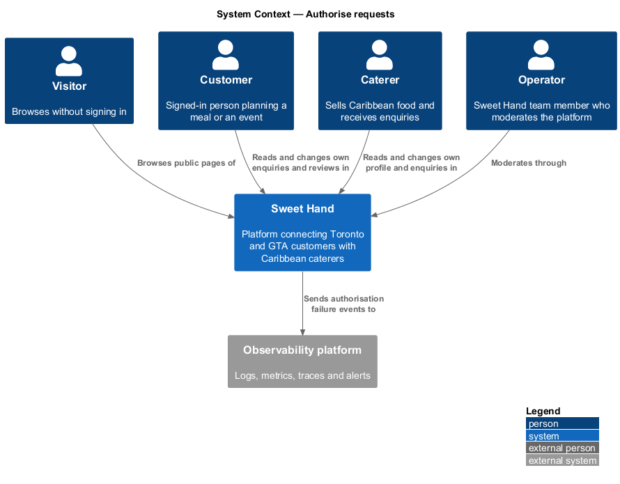
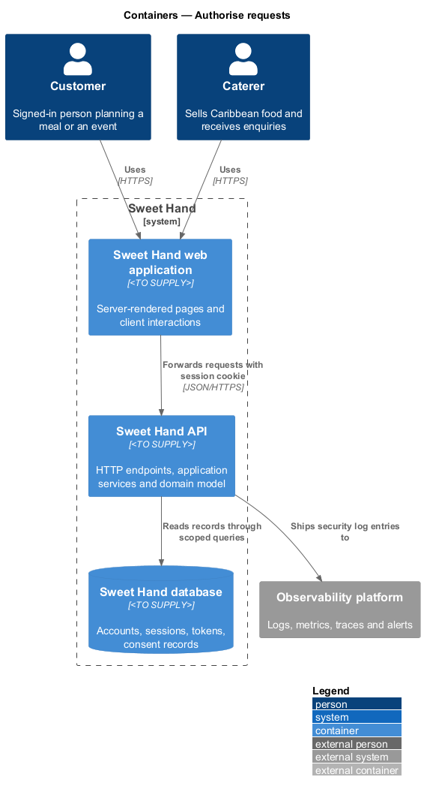
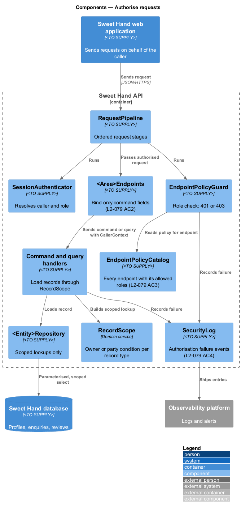
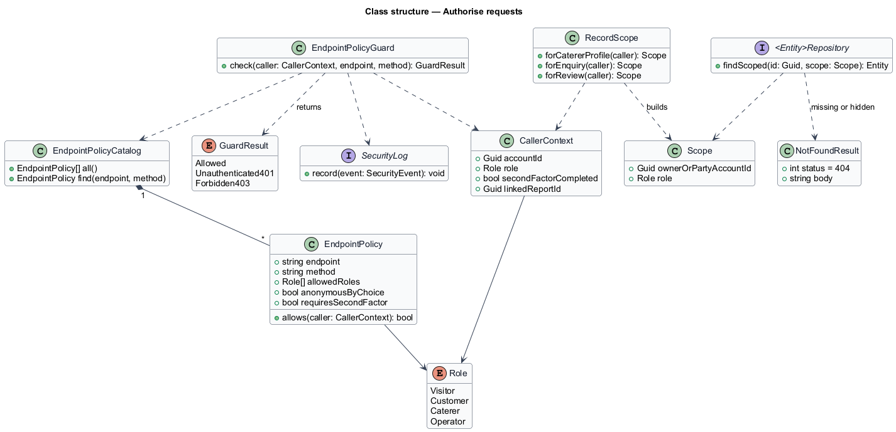
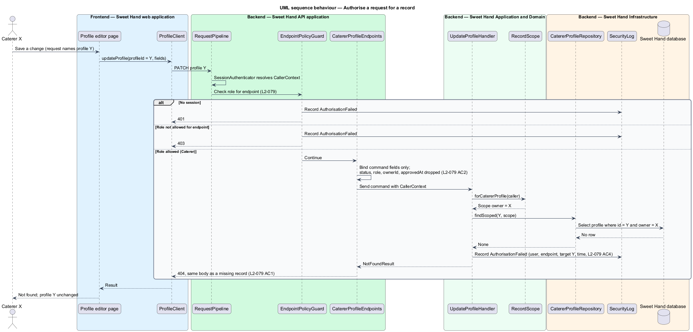

# Authorise requests

## Overview

Sweet Hand holds private data for every party: a caterer's draft profile and
food handler certificate, a customer's enquiries and messages, and the
operators' moderation tools. Hiding a button in the user interface does not
protect any of it, because any caller can send a request straight to the API.
This feature puts the authorisation decision on the server, for every request,
in two steps.

The first step is the **role check**. Each endpoint declares which roles may
call it: Visitor (no session), Customer, Caterer or Operator. A request from a
role that is not allowed stops before any record is read.

The second step is the **record check**. When a request names a record, the
application layer loads that record only through a query scoped to the caller:
the owner of a caterer profile, the two parties to an enquiry, or the author of
a review. A record the caller may not see is reported as not found, with the
same response as a record that does not exist, so the platform never confirms
that a hidden record exists.

The feature also prevents mass assignment, in which a caller sets a field such
as `status` or `ownerId` by adding it to a request body.

Terms used in this document:

- **endpoint policy** — declaration attached to an endpoint that names the roles allowed to call it, or marks it anonymous by explicit choice
- **record scope** — condition that limits a record lookup to records the caller owns or is a party to
- **party** — customer who sent an enquiry, or caterer who received it
- **mass assignment** — setting a protected field by including it in a request body
- **not found response** — HTTP 404 with a body identical for a missing record and a hidden one

## Description

Technology choices for every component below are `<TO SUPPLY>` pending
architecture decision records in `docs/adr/`.

**Backend — Sweet Hand API application**

- **`RequestPipeline`** — ordered stages every request passes through:
  correlation ID, rate limit, `SessionAuthenticator` (see `manage-sessions`),
  CSRF check, request schema, then `EndpointPolicyGuard`.
- **`EndpointPolicy`** — per-endpoint declaration of allowed roles. An endpoint
  with no declaration is denied, so anonymous access is always an explicit
  choice (AGENTS.md: endpoints require authentication by default).
- **`EndpointPolicyGuard`** — compares the caller's role with the endpoint
  policy. No session on a protected endpoint returns HTTP 401. A session with a
  role that is not allowed returns HTTP 403. Operator endpoints also require a
  completed second factor (`sign-in`, `L2-056 AC2`).
- **`EndpointPolicyCatalog`** — enumerates every endpoint with its policy. The
  automated test suite reads it to generate one test per endpoint and
  disallowed role, each expecting 401 or 403 (`L2-079 AC3`).
- **Endpoint groups** (`<Area>Endpoints` in each subsystem) — bind request
  bodies only to the fields of their command type. Fields outside that type,
  such as `status`, `role`, `ownerId` or `approvedAt`, are dropped before the
  command exists (`L2-079 AC2`).

**Backend — Sweet Hand Application and Domain**

- **`CallerContext`** — account identifier, role and, for operators, the linked
  report identifier when one applies. Every handler receives it.
- **`RecordScope`** — builds the scoped lookup for a record type: the owning
  account for caterer profiles, photos, menu items and certificates; the
  customer or caterer party for enquiries and messages; the author for reviews.
  Operator access follows the rules of each feature, for example a linked report
  for enquiries (`L2-034`).
- **Command and query handlers** — load records only through `RecordScope`. A
  lookup that returns nothing produces `NotFoundResult`, whatever the cause.
- **`NotFoundResult`** — maps to HTTP 404 with one fixed body.

**Backend — Sweet Hand Infrastructure**

- **`<Entity>Repository`** — each repository exposes scoped lookup methods that
  take the `CallerContext`, so an unscoped read of private data is not
  available to handlers.
- **`SecurityLog`** — records each authorisation failure with the user, the
  endpoint, the target identifier and the time (`L2-079 AC4`, `L2-084`).
- **`AuthorisationFailureMonitor`** — counts failures per session for alerting
  (`log-security-events`).

**Rules the slice enforces**

- A caterer that changes the identifier in a request to reach another
  caterer's profile, photos or menu receives not found (HTTP 404), and the
  other caterer's data does not change (`L2-079 AC1`).
- Record identifiers that face the outside are random, not sequential
  (`L2-034 AC2` sets UUIDv4 for enquiries). The identifier scheme for other
  record types is `<TO SUPPLY>`.
- Authorisation never depends on what the user interface shows or hides.

## Requirements

The feature realizes the following level-2 (L2) requirements from
`docs/specs/L2.md`. Each refines the level-1 (L1) requirement cited beside it.
Requirement text is quoted from the specification, with *must* rendered as
*shall*.

| L2 ID | Refines (L1) | Requirement |
|-------|--------------|-------------|
| `L2-079` | `L1-021` | Every request shall be authorised on the server by checking the role (Visitor, Customer, Caterer, Operator) and, for each record, that the user owns it or is a party to it. Authorisation shall never rely on hiding things in the UI. |

## Diagrams

### System context

Every Sweet Hand role reaches the platform through the same authorisation
rules. Sweet Hand sends security events to the observability platform.

### Containers

The web application forwards requests to the Sweet Hand API, which authorises
them and reads records through scoped queries on the Sweet Hand database.

### Components

Inside the API, `RequestPipeline` runs `SessionAuthenticator` and
`EndpointPolicyGuard` before the endpoint. Handlers then read records through
`RecordScope` and scoped repositories. Failures go to `SecurityLog`.

### Class structure

`EndpointPolicyGuard` reads `EndpointPolicy` entries from
`EndpointPolicyCatalog`. Handlers take a `CallerContext` and use `RecordScope`
to build scoped repository lookups that return a record or `NotFoundResult`.

### Behaviour — authorise a request for a record

The role check runs first and can end the request with 401 or 403. The record
check runs inside the handler, where a scoped lookup that finds nothing returns
404, and the failure is written to the security log. The diagram uses a
caterer profile update as the example record; every scoped record type
follows the same steps.

