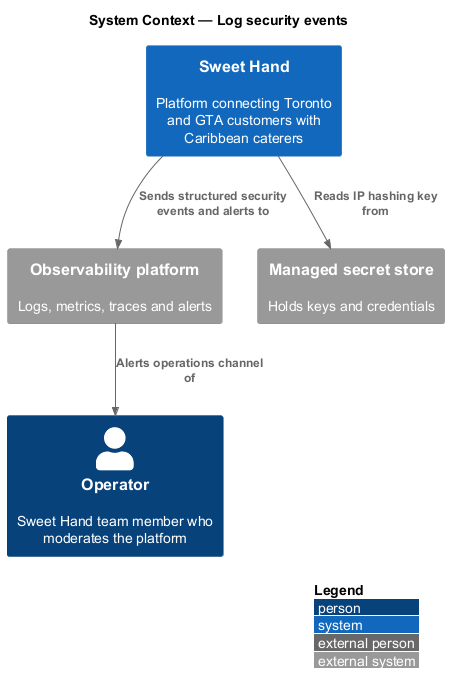
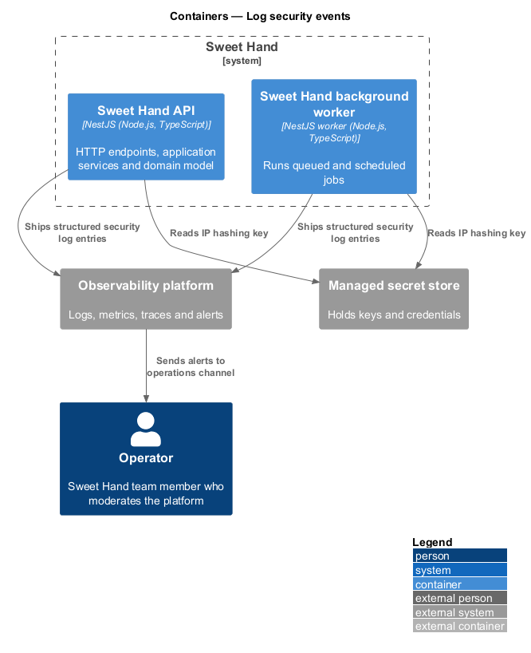
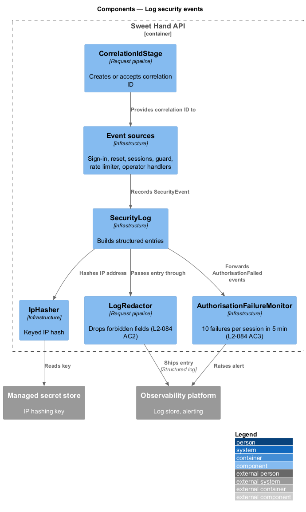
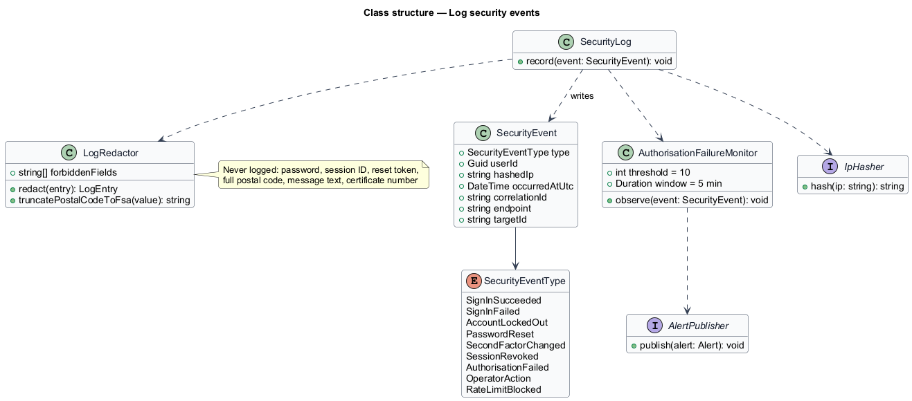
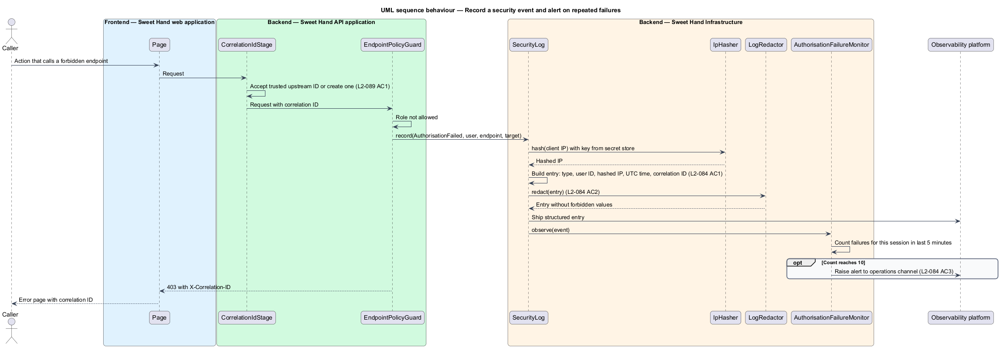

# Log security events

## Overview

Sweet Hand records security-relevant events so the operations team can detect
an attack, investigate an incident and show what happened afterwards. A
security event is something that affects who can do what on the platform: a
sign-in, a lockout, a password reset, a change to a second factor, a revoked
session, a refused request, an operator action, or a rate-limit block.

The log has to be useful without becoming a store of personal information. Each
entry records only the fields needed to investigate: the event type, the user
identifier if known, a hashed IP address, the time and the correlation ID. It
never holds passwords, session identifiers, tokens, full postal codes, message
text or certificate numbers.

The feature also raises an alert when one session collects 10 or more
authorisation failures within 5 minutes, a pattern that points to a caller
probing for records it may not see.

Terms used in this document:

- **security event** — record of an action that changes or tests access to the platform
- **correlation ID** — identifier attached to one request and to every log entry and trace span it produces
- **hashed IP address** — keyed one-way hash of an IP address, stored in place of the address
- **redaction** — removal of a forbidden value from a log entry before it is written
- **operator action** — moderation or administration step an operator takes, also written to the audit log (`L2-060`)

The operator audit log (`moderation/query-audit-log`) is a separate,
append-only store for operator decisions. Operator actions appear in both: the
audit log records the decision with before and after values, and the security
log records the event for detection.

## Description

Technology choices follow ADR 0001 (Angular 21) and ADR 0006 (NestJS on
Node.js, PostgreSQL through Drizzle ORM, S3-compatible object storage);
providers not named there remain `<TO SUPPLY>`.

**Backend — Sweet Hand API application and background worker**

- **Event sources** — `SignInHandler`, `ResetPasswordHandler`,
  `CompleteSecondFactorHandler`, `SessionsEndpoints`, `EndpointPolicyGuard`,
  scoped repositories, `RateLimiter` and operator handlers call `SecurityLog`
  with a `SecurityEvent`.
- **`CorrelationIdStage`** — first stage of `RequestPipeline`. It takes the
  correlation ID from a trusted upstream header or creates one, and makes it
  available to every log entry (`L2-089 AC1`).

**Backend — Sweet Hand Application and Domain**

- **`SecurityEvent`** — event type, user identifier (optional), hashed IP
  address, UTC time, correlation ID, and an optional target: endpoint and target
  record identifier for authorisation failures (`L2-079 AC4`).
- **`SecurityEventType`** — `SignInSucceeded`, `SignInFailed`,
  `AccountLockedOut`, `PasswordReset`, `SecondFactorChanged`,
  `SessionRevoked`, `AuthorisationFailed`, `OperatorAction`,
  `RateLimitBlocked` (`L2-084 AC1`).

**Backend — Sweet Hand Infrastructure**

- **`SecurityLog`** — builds a structured entry from a `SecurityEvent`, passes it
  through `LogRedactor` and writes it to the log pipeline, which ships it to the
  observability platform.
- **`IpHasher`** — produces the hashed IP address with a secret key held in the
  managed secret store. The hash algorithm and key rotation schedule are
  `<TO SUPPLY>`.
- **`LogRedactor`** — a last line of defence against fields that shall not be
  logged (`L2-084 AC2`). It drops fields by name (password, session ID, reset
  token, message text, certificate number) and truncates any postal code to its
  forward sortation area (FSA, the first 3 characters). `SecurityEvent` has no
  field for any of these values, so the redactor acts only on values that reach
  the log by another route, such as an exception message.
- **`AuthorisationFailureMonitor`** — counts `AuthorisationFailed` events per
  session in a 5-minute window. At 10 it raises one alert to the operations
  channel through the observability platform (`L2-084 AC3`). The counter store
  is a PostgreSQL table shared across API instances (ADR 0006).

**Rules the slice enforces**

- Security and access logs are kept for 13 months (`L2-073`), enforced by the
  log store's retention setting. The log store is `<TO SUPPLY>` and is located
  in a Canadian region (`L2-075`).
- A failure to write a security log entry does not fail the user's request. How
  such failures are counted and alerted is `<TO SUPPLY>`.
- The operations channel and its alert routing are `<TO SUPPLY>`.

## Requirements

The feature realizes the following level-2 (L2) requirements from
`docs/specs/L2.md`. Each refines the level-1 (L1) requirement cited beside it.
Requirement text is quoted from the specification, with *must* rendered as
*shall*.

| L2 ID | Refines (L1) | Requirement |
|-------|--------------|-------------|
| `L2-084` | `L1-021` | Security-relevant events shall be logged in a structured format, and the logs shall never contain secrets or more personal information than needed. |

## Diagrams

### System context

Sweet Hand sends structured security events and alerts to the observability
platform, which notifies the operations team. The hashing key comes from the
managed secret store.

### Containers

The Sweet Hand API and the background worker both write security events. They
read the IP hashing key from the managed secret store and ship entries to the
observability platform.

### Components

Event sources in the API call `SecurityLog`, which uses `IpHasher` and
`LogRedactor` before writing. `AuthorisationFailureMonitor` watches
authorisation failures and raises alerts.

### Class structure

`SecurityLog` writes `SecurityEvent` records typed by `SecurityEventType`. It
depends on `IpHasher` and `LogRedactor`, and forwards authorisation failures to
`AuthorisationFailureMonitor`.

### Behaviour — record a security event and alert on repeated failures

An authorisation failure becomes a structured, redacted entry with a hashed IP
address and the request's correlation ID. The tenth failure from one session
within 5 minutes raises an alert to the operations channel.

