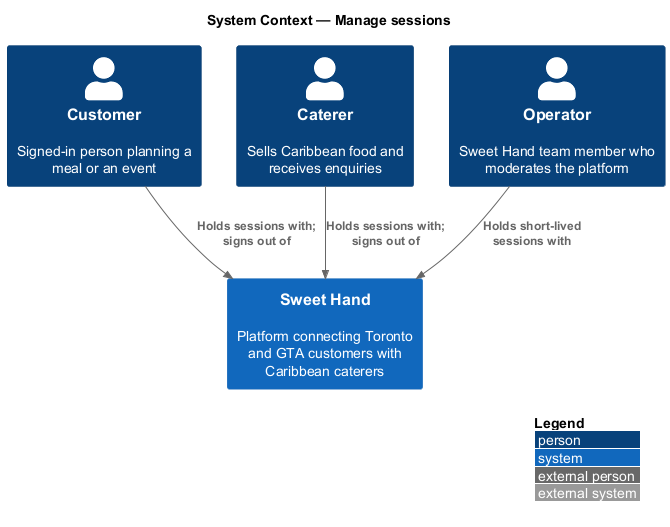
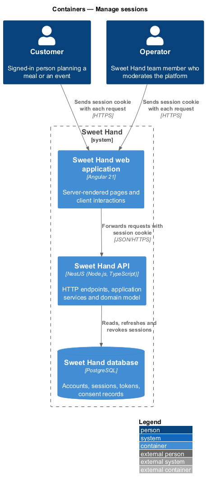
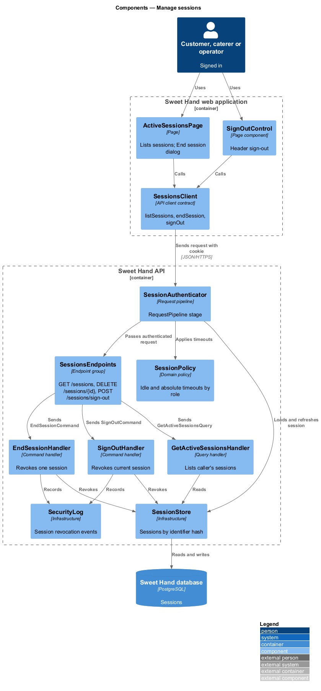
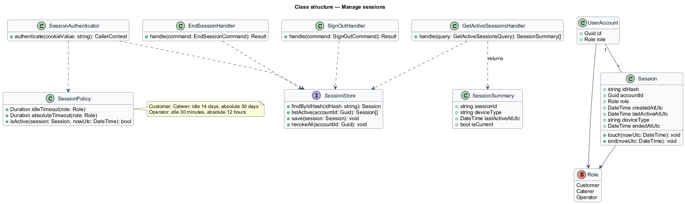
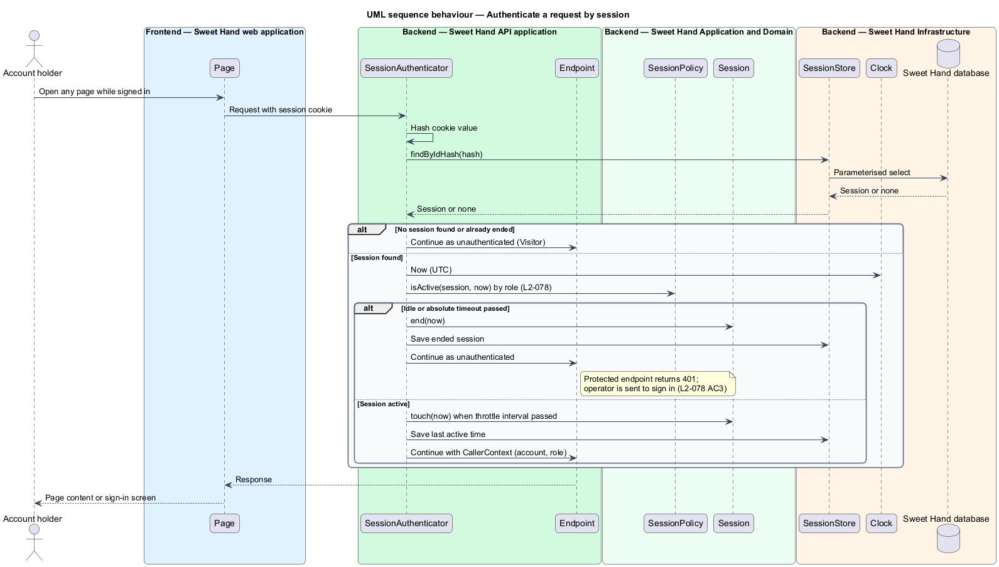
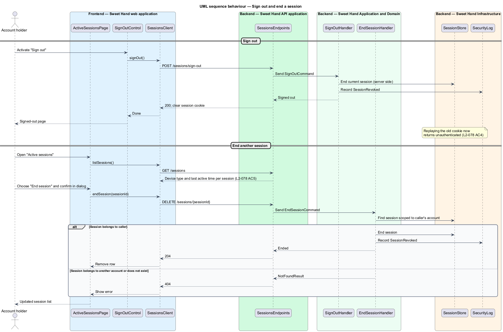

# Manage sessions

## Overview

After sign-in, a Sweet Hand account holder stays signed in through a session. A
session is a record on the server, identified by an opaque random value that the
browser holds in a cookie. The cookie carries no user data; the server looks the
session up on each request.

This feature covers the life of a session after it is created: the timeouts
that end it, signing out, and the "Active sessions" list in account settings
where an account holder sees every device they are signed in on and can end any
of them. Session creation and replacement at sign-in belong to `sign-in`.

Timeouts depend on the role. Customers and caterers use the platform
occasionally and from personal phones, so their sessions last days. Operators
hold moderation powers over every caterer and review, so their sessions end
after a short idle period.

Terms used in this document:

- **session** — server-side record that links an opaque identifier to an account, a role and activity times
- **idle timeout** — maximum time between two requests in one session before the session ends
- **absolute timeout** — maximum lifetime of a session from creation, whatever the activity
- **active session** — session that has not ended through sign-out, revocation or a timeout
- **revocation** — ending a session on the server so that its identifier is rejected from then on

## Description

Technology choices follow ADR 0001 (Angular 21) and ADR 0006 (NestJS on
Node.js, PostgreSQL through Drizzle ORM, S3-compatible object storage);
providers not named there remain `<TO SUPPLY>`.

**Timeouts by role (`L2-078`)**

| Role | Idle timeout | Absolute timeout |
|------|--------------|------------------|
| Customer, Caterer | 14 days | 30 days |
| Operator | 30 minutes | 12 hours |

**Frontend — Sweet Hand web application**

- **`ActiveSessionsPage`** — account settings screen listing each active
  session with its device type and last active time, marking the current one,
  and offering "End session" on each (`L2-078 AC5`). Ending a session opens a
  confirmation dialog.
- **`SignOutControl`** — header control that signs the account holder out
  (`L2-078 AC4`).
- **`SessionsClient`** — API client contract with `listSessions()`,
  `endSession(sessionId)` and `signOut()`.

**Backend — Sweet Hand API application**

- **`SessionAuthenticator`** — stage of `RequestPipeline` that reads the session
  cookie, loads the session through `SessionStore`, applies `SessionPolicy`,
  refreshes the last active time and attaches the account and role to the
  request. An expired or unknown session produces an unauthenticated request.
- **`SessionsEndpoints`** — exposes `GET /sessions`,
  `DELETE /sessions/{sessionId}` and `POST /sessions/sign-out`. All require a
  signed-in session.

**Backend — Sweet Hand Application and Domain**

- **`Session`** — identifier hash, account identifier, role, created time, last
  active time, device type and ended time.
- **`SessionPolicy`** — holds the role timeouts above and decides whether a
  session is still active at the current time from `Clock`.
- **`GetActiveSessionsQuery`** / **`GetActiveSessionsHandler`** — list the
  caller's own active sessions only.
- **`EndSessionCommand`** / **`EndSessionHandler`** — revoke one of the caller's
  sessions. A session identifier that belongs to another account returns not
  found (HTTP 404).
- **`SignOutCommand`** / **`SignOutHandler`** — revoke the current session and
  clear the cookie. Replaying the old cookie afterwards returns an
  unauthenticated response.
- **`RevokeAllSessions`** — operation used by `verify-email-and-reset-password`
  after a password reset (`L2-077 AC4`), by
  `moderation/manage-operator-accounts` when an operator is deactivated
  (`L2-056 AC4`), and by `privacy/delete-account`.

**Backend — Sweet Hand Infrastructure**

- **`SessionStore`** — persists sessions in the Sweet Hand database by the hash
  of the identifier. Revocation sets the ended time so the next lookup fails.
- **`SecurityLog`** — records sign-out and session revocation events
  (`L2-084 AC1`).
- **`Clock`** — current time; timeouts are computed in UTC.

**Rules the slice enforces**

- The cookie is `HttpOnly`, `Secure` and `SameSite=Lax`, and its value is an
  opaque random identifier of at least 128 bits (`L2-078 AC1`).
- The device type is derived from the user agent when the session is created.
  Only the coarse device type is stored, not the full user agent string. The
  device type categories are `<TO SUPPLY>`.
- Writes of the last active time are throttled to limit database load. The
  throttle interval is `<TO SUPPLY>`; it shall be short enough that the
  30-minute operator idle timeout stays accurate.
- An operator request after 30 idle minutes is rejected and the operator is
  sent to sign in (`L2-078 AC3`).

## Requirements

The feature realizes the following level-2 (L2) requirements from
`docs/specs/L2.md`. Each refines the level-1 (L1) requirement cited beside it.
Requirement text is quoted from the specification, with *must* rendered as
*shall*.

| L2 ID | Refines (L1) | Requirement |
|-------|--------------|-------------|
| `L2-078` | `L1-021` | Sessions shall be held in cookies that client scripts cannot read and that are protected from cross-site attacks. Timeouts depend on the role. |

The role timeout table that accompanies `L2-078` appears in the Description.
Session creation and fixation protection (`L2-078 AC1`, `AC2`) are realized in
`sign-in`; this feature realizes `L2-078 AC3`, `AC4` and `AC5`.

## Diagrams

### System context

Customers, caterers and operators hold sessions with Sweet Hand. No external
system takes part in session management.

### Containers

The web application sends the session cookie with each request. The Sweet Hand
API resolves it against sessions stored in the Sweet Hand database.

### Components

`SessionAuthenticator` resolves every request's session through `SessionStore`
and `SessionPolicy`. `ActiveSessionsPage` and `SignOutControl` reach the
session handlers through `SessionsClient` and `SessionsEndpoints`.

### Class structure

A `UserAccount` has many `Session` records. `SessionPolicy` maps each `Role` to
its idle and absolute timeouts. The handlers depend on `SessionStore`.

### Behaviour — authenticate a request by session

On each request, the authenticator looks the session up by the hash of the
cookie value and applies the role's idle and absolute timeouts. An expired
session ends and the request continues as unauthenticated.

### Behaviour — sign out and end a session

Sign-out revokes the current session on the server and clears the cookie.
Ending another session from the "Active sessions" list revokes that session
after an ownership check.

