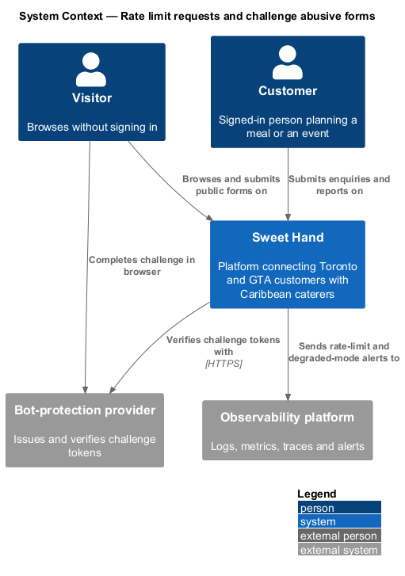
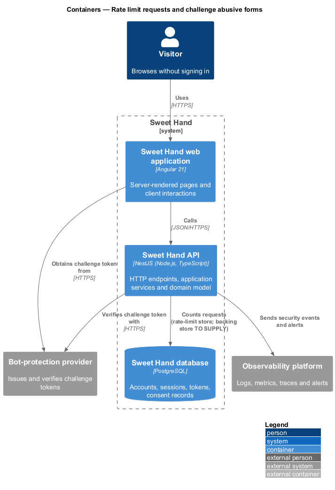
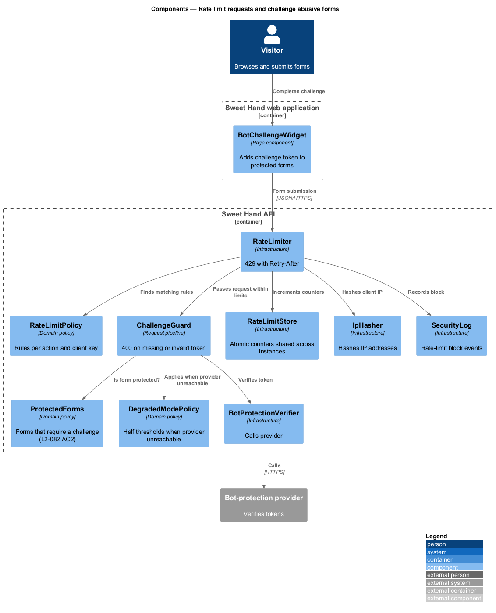
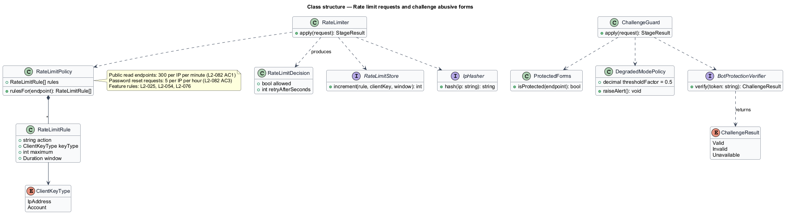
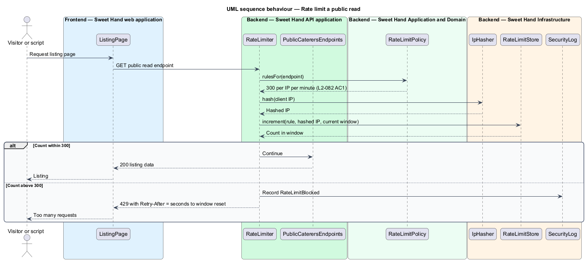
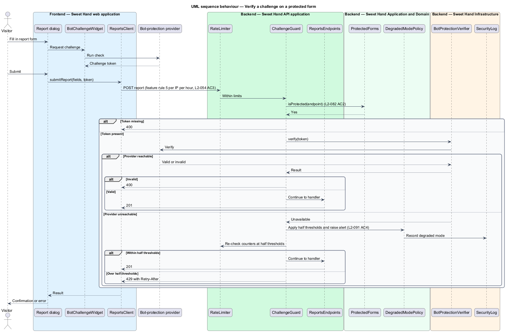

# Rate limit requests and challenge abusive forms

## Overview

Sweet Hand exposes public pages and a small set of forms to anyone on the
internet. Scrapers can overload the listing, and scripts can fill the enquiry,
registration and report forms with spam. This feature protects the platform in
two ways.

The first is the **rate limit**: a cap on how many requests one client sends in
a time window. A client over the cap receives HTTP 429 with a `Retry-After`
header until the window resets. The platform-wide limit applies per IP address
to public read endpoints. Individual features set tighter limits on their own
actions, such as 10 enquiries per customer per day (`L2-025`) or 5 reports per
IP address per hour (`L2-054`).

The second is the **bot-protection challenge**: a privacy-respecting check,
issued by an external bot-protection provider, that a person rather than a
script submitted a form. The form obtains a challenge token in the browser, and
the server verifies the token with the provider before processing the form.

Terms used in this document:

- **client key** — value a rate limit counts against: a hashed IP address, an account identifier, or both
- **rate-limit rule** — combination of a client key, an action, a maximum count and a window length
- **fixed window** — counting interval that starts at a fixed time and resets when it ends
- **challenge token** — short-lived token the bot-protection provider issues to a browser that passes its check
- **protected form** — form whose submission requires a valid challenge token

## Description

Technology choices follow ADR 0001 (Angular 21) and ADR 0006 (NestJS on
Node.js, PostgreSQL through Drizzle ORM, S3-compatible object storage);
providers not named there remain `<TO SUPPLY>`. The bot-protection provider is
`<TO SUPPLY>`; it shall respect privacy and set only the cookie listed in the
privacy notice (`L2-074 AC1`).

**Frontend — Sweet Hand web application**

- **`BotChallengeWidget`** — component placed in each protected form. It runs
  the provider's check, adds the challenge token to the submission, and shows a
  message after an HTTP 429 response using the `Retry-After` value.

**Backend — Sweet Hand API application**

- **`RateLimiter`** — stage of `RequestPipeline` that runs before
  authentication work. It finds the rules that match the endpoint, increments
  the counter for each client key and rejects the request with HTTP 429 and
  `Retry-After` once a rule's maximum is passed.
- **`ChallengeGuard`** — runs on protected forms. It rejects a missing or
  invalid challenge token with HTTP 400 before the handler runs.

**Backend — Sweet Hand Application and Domain**

- **`RateLimitRule`** — client key type, action, maximum and window.
- **`RateLimitPolicy`** — the table of rules. The platform-wide rules are:

  | Action | Client key | Maximum | Window | Source |
  |--------|------------|---------|--------|--------|
  | Public read endpoints | IP address | 300 requests | 1 minute | `L2-082 AC1` |
  | Password reset requests | IP address | 5 requests | 1 hour | `L2-082 AC3` |

  Feature rules from `L2-025`, `L2-054` and `L2-076` register in the same
  policy and are documented in their features.
- **`ProtectedForms`** — the forms that require a challenge (`L2-082 AC2`):
  registration (customer and caterer), sign-in after the `L2-076` threshold,
  password reset request, enquiry, and anonymous report.
- **`DegradedModePolicy`** — when the provider cannot be reached, protected
  forms are accepted without a token under rate limits at half their normal
  thresholds, and an alert is raised. This behaviour realizes `L2-091 AC4` and
  is documented in `platform/degrade-gracefully`.

**Backend — Sweet Hand Infrastructure**

- **`RateLimitStore`** — atomic counters keyed by rule and client key, shared by
  every API instance so the limits hold when the API scales out (`L2-086 AC5`).
  The backing store is `<TO SUPPLY>`.
- **`IpHasher`** — hashes IP addresses before they are used as counter keys, so
  raw IP addresses are not stored (`L2-084 AC1`).
- **`BotProtectionVerifier`** — sends the token to the provider and returns
  valid, invalid or unavailable.
- **`SecurityLog`** — records each rate-limit block (`L2-084 AC1`).

**Rules the slice enforces**

- Counting uses a fixed window per rule. Sliding windows are not required by
  the specification; the window algorithm beyond that is `<TO SUPPLY>`.
- Which endpoints count as "public read endpoints" follows the endpoint policy
  catalogue in `authorise-requests`: every `GET` endpoint marked anonymous.
- Requests served from the CDN cache never reach the rate limiter.

## Requirements

The feature realizes the following level-2 (L2) requirements from
`docs/specs/L2.md`. Each refines the level-1 (L1) requirement cited beside it.
Requirement text is quoted from the specification, with *must* rendered as
*shall*.

| L2 ID | Refines (L1) | Requirement |
|-------|--------------|-------------|
| `L2-082` | `L1-021` | The platform shall limit request rates for each client and require bot-protection challenges on forms that are open to abuse. |

## Diagrams

### System context

Visitors and signed-in users reach Sweet Hand, which verifies challenge tokens
with the bot-protection provider and sends alerts to the observability
platform.

### Containers

The web application obtains challenge tokens in the browser. The Sweet Hand API
counts requests in the rate-limit store and verifies tokens with the provider.

### Components

`RateLimiter` applies `RateLimitPolicy` through `RateLimitStore` before any
handler runs. `ChallengeGuard` checks protected forms through
`BotProtectionVerifier`.

### Class structure

`RateLimitPolicy` holds `RateLimitRule` entries keyed by `ClientKeyType`.
`ChallengeGuard` consults `ProtectedForms` and `DegradedModePolicy`.

### Behaviour — rate limit a public read

The rate limiter increments the counter for the hashed IP address. Under the
limit the request continues; over it the response is HTTP 429 with
`Retry-After`, and the block is logged.

### Behaviour — verify a challenge on a protected form

The challenge guard verifies the token before the handler runs. A missing or
invalid token returns HTTP 400. An unreachable provider switches the form to
the degraded mode and raises an alert. The diagram uses the anonymous report
form as the example protected form.

