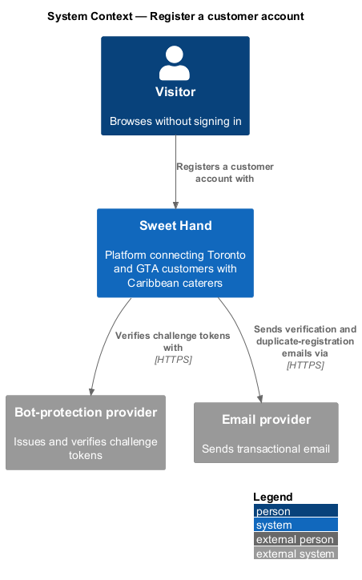
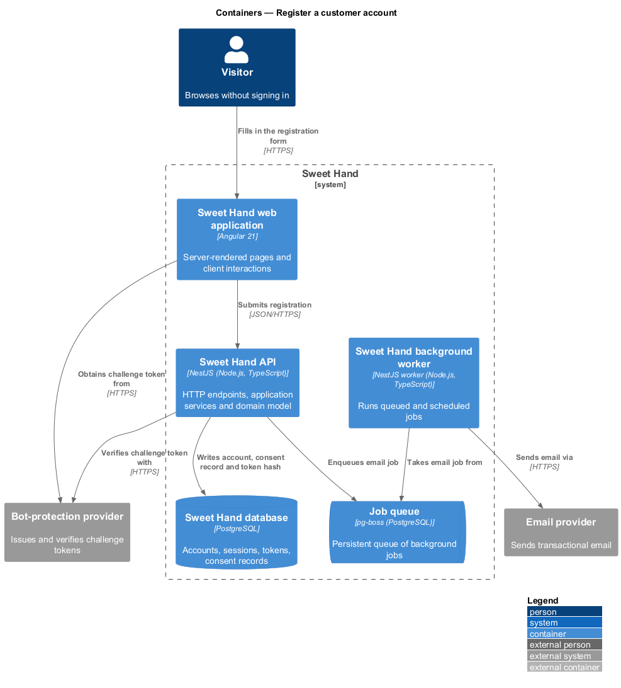
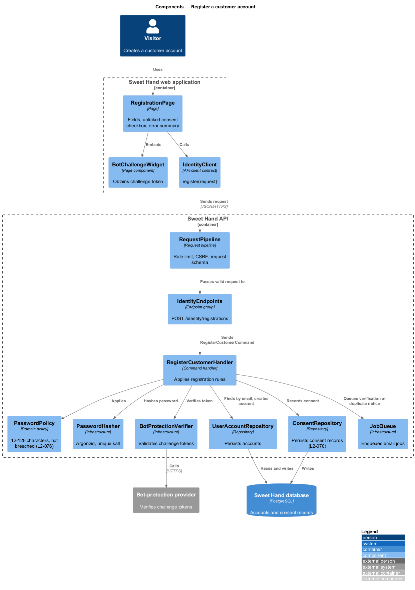
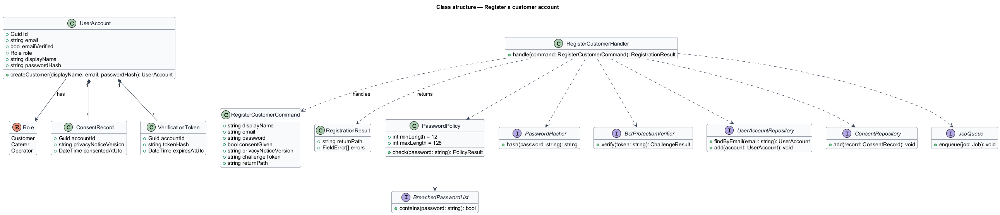
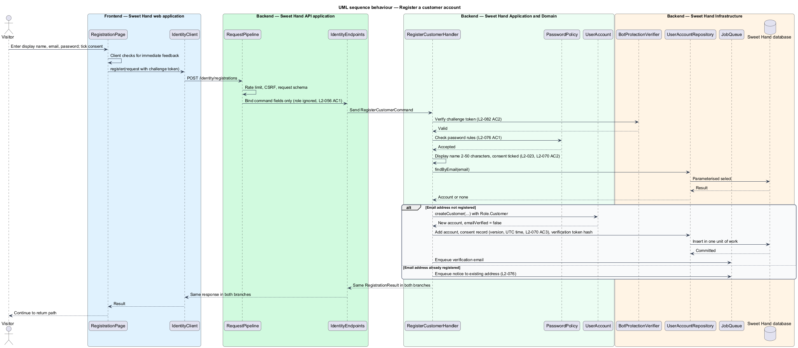

# Register a customer account

## Overview

Sweet Hand is a web platform that connects people in Toronto and the Greater
Toronto Area (GTA) with caterers who sell Caribbean food. A visitor can browse
the listing and every caterer page without an account. Sending an enquiry,
writing a review and opening account pages require a customer account.

This feature covers customer registration. A visitor creates a customer account
with a display name, an email address and a password, and consents to the
privacy notice. Registration is usually reached from an action that needs an
account, such as "Send an enquiry", so the feature returns the new customer to
the page that started it.

Registration is open to anonymous callers by deliberate choice, so it is also a
target for automated sign-ups and for probing which email addresses hold
accounts. The feature therefore requires a bot-protection challenge and gives
the same response whether or not the email address is already registered.

Terms used in this document:

- **customer account** — user account with the role `Customer` that can send enquiries and write reviews once its email address is verified
- **privacy notice version** — identified revision of the published privacy notice that a consent record points to
- **consent record** — stored evidence that an account holder agreed to one privacy notice version at a UTC time
- **return path** — relative Sweet Hand URL the visitor goes to after registration completes
- **bot-protection challenge** — privacy-respecting check, issued by the bot-protection provider, that a person submitted the form
- **account enumeration** — discovery of which email addresses hold accounts by comparing responses

Caterer registration is a separate feature (`caterer-profiles/register-caterer`).
Operator accounts are never self-registered; an Admin operator creates them
(`moderation/manage-operator-accounts`).

## Description

Technology choices follow ADR 0001 (Angular 21) and ADR 0006 (NestJS on
Node.js, PostgreSQL through Drizzle ORM, S3-compatible object storage);
providers not named there remain `<TO SUPPLY>`. The slice runs from the
registration screen to the database and the notification queue.

**Frontend — Sweet Hand web application**

- **`RegistrationPage`** — screen with labelled fields for display name, email
  address and password, a consent checkbox that is not ticked by default, a
  short summary of purposes beside the checkbox and a link to the privacy
  notice (`L2-070 AC2`). It checks field rules on the client for immediate
  feedback and shows an error summary linked to each field. It carries the
  return path from the query string.
- **`BotChallengeWidget`** — obtains a challenge token from the bot-protection
  provider and adds it to the submission (`L2-082 AC2`).
- **`IdentityClient`** — API client contract the page depends on. Its
  `register(request)` operation returns a typed result or field errors.

**Backend — Sweet Hand API application**

- **`IdentityEndpoints`** — exposes `POST /identity/registrations`. The endpoint
  is anonymous by explicit choice. It binds only the fields of
  `RegisterCustomerCommand`, so a `role` or other unexpected field in the
  request body is ignored (`L2-056 AC1`, `L2-079 AC2`).
- **`RequestPipeline`** — applies the rate limit, CSRF check and request schema
  before the endpoint runs (see `authorise-requests`,
  `validate-input-and-secure-transport` and `rate-limit-and-challenge`).

**Backend — Sweet Hand Application and Domain**

- **`RegisterCustomerCommand`** — `displayName`, `email`, `password`,
  `consentGiven`, `privacyNoticeVersion`, `challengeToken`, `returnPath`.
- **`RegisterCustomerHandler`** — verifies the challenge token, applies the
  field rules, checks for an existing account, then either creates the account
  or notifies the existing address. It records consent, issues a verification
  token and queues the verification email.
- **`UserAccount`** — created with `Role.Customer` and `emailVerified = false`.
  The role is set by the handler, never from the request.
- **`PasswordPolicy`** — rejects passwords shorter than 12 or longer than 128
  characters and passwords on the breached-password list, with a message that
  explains the rule (`L2-076 AC1`).
- **`ConsentRecord`** — account identifier, privacy notice version and UTC
  timestamp (`L2-070 AC3`).
- **`VerificationToken`** — single-use, expiring token described in
  `verify-email-and-reset-password`.

**Backend — Sweet Hand Infrastructure and background worker**

- **`BotProtectionVerifier`** — validates the challenge token with the
  bot-protection provider.
- **`BreachedPasswordList`** — the 100,000 most common breached passwords. The
  list source and refresh schedule are `<TO SUPPLY>`.
- **`PasswordHasher`** — Argon2id with a unique salt per password, at least
  19 MiB of memory and 2 iterations (`L2-076 AC2`).
- **`UserAccountRepository`** and **`ConsentRepository`** — persist accounts
  and consent records in the Sweet Hand database.
- **`JobQueue`** and **`SendNotificationJob`** — queue and send the
  verification email or the duplicate-registration notice through the
  `EmailGateway`.

**Rules the slice enforces**

- Display name: 2 to 50 characters after trimming (`L2-023`).
- Email comparison ignores letter case. Further normalisation rules are
  `<TO SUPPLY>`.
- An email address that already holds an account produces the same response as
  a successful registration. An email goes to the existing address saying that
  someone tried to register with it. This applies the `L2-076` rule that
  sign-in flows shall not reveal which emails have accounts, in the same form
  that `L2-037 AC4` states for caterers.
- A successful registration signs the new customer in, using the session
  creation in `sign-in`, and sends them to the return path. `L2-023 AC1`
  requires the enquiry form to reappear after registration. How the
  duplicate-email response stays indistinguishable from a signed-in success is
  `<TO SUPPLY>`.
- The return path accepts only relative Sweet Hand paths, so registration
  cannot redirect to another site.
- The enquiry draft that the visitor typed before registering is kept by
  `enquiries/send-enquiry`. Registration only preserves the return path.
- Email verification before an enquiry is sent (`L2-023 AC2`) is enforced by
  `enquiries/send-enquiry`.

## Requirements

The feature realizes the following level-2 (L2) requirements from
`docs/specs/L2.md`. Each refines the level-1 (L1) requirement cited beside it.
Requirement text is quoted from the specification, with *must* rendered as
*shall*.

| L2 ID | Refines (L1) | Requirement |
|-------|--------------|-------------|
| `L2-023` | `L1-008` | Only a signed-in customer with a verified email address can send an enquiry. Customer registration asks for a display name (2–50 characters), an email address, a password (L2-076) and consent to the privacy notice (L2-070). Anything the visitor typed into the enquiry form before signing in shall be kept. |
| `L2-056` | `L1-016` | Operator accounts cannot be self-registered. Only an operator with the `Admin` permission can create one. Operators shall use multi-factor authentication. Every operator page and endpoint shall check for the operator role on the server. |
| `L2-070` | `L1-020` | The platform shall publish a privacy notice that explains what personal information is collected, why, who it is shared with, how long it is kept and how to contact the privacy officer. Users shall give consent that is meaningful under PIPEDA when they register. |
| `L2-076` | `L1-021` | Users shall sign in with an email address and a password. Passwords are stored with a slow, salted hash designed for passwords. Sign-in shall resist guessing attempts and shall not reveal which emails have accounts. |
| `L2-082` | `L1-021` | The platform shall limit request rates for each client and require bot-protection challenges on forms that are open to abuse. |

This feature realizes `L2-056` only in part: public registration never creates
an operator account (`L2-056 AC1`). It realizes `L2-070` only at registration
(`L2-070 AC2`, `AC3`); the notice itself and re-consent belong to
`privacy/consent-to-privacy-notice`.

## Diagrams

### System context

A visitor registers through Sweet Hand. Sweet Hand checks the bot-protection
challenge with the bot-protection provider and sends the verification email
through the email provider.

### Containers

The registration screen in the web application calls the Sweet Hand API. The API
stores the account and consent record in the Sweet Hand database and queues the
email, which the background worker sends.

### Components

`RegistrationPage` depends on the `IdentityClient` contract. Inside the API,
`IdentityEndpoints` dispatches `RegisterCustomerCommand` to
`RegisterCustomerHandler`, which applies `PasswordPolicy`, hashes the password
and persists the account and consent.

### Class structure

`RegisterCustomerHandler` creates a `UserAccount` with a fixed `Role`, a
`ConsentRecord` and a `VerificationToken`. It depends on `PasswordPolicy`,
`PasswordHasher` and `BotProtectionVerifier`.

### Behaviour — register a customer

The handler verifies the challenge token, applies the field and password rules,
and then branches. A new email address produces an account, a consent record and
a verification email. An existing email address produces only a notice to that
address. Both branches return the same response to the visitor.

