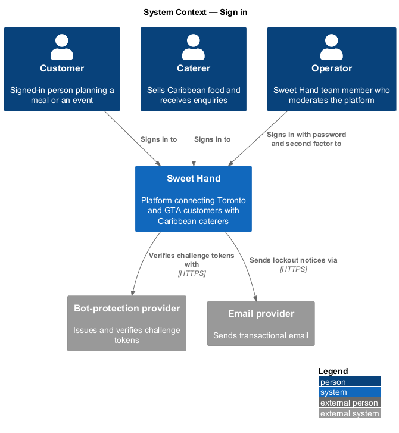
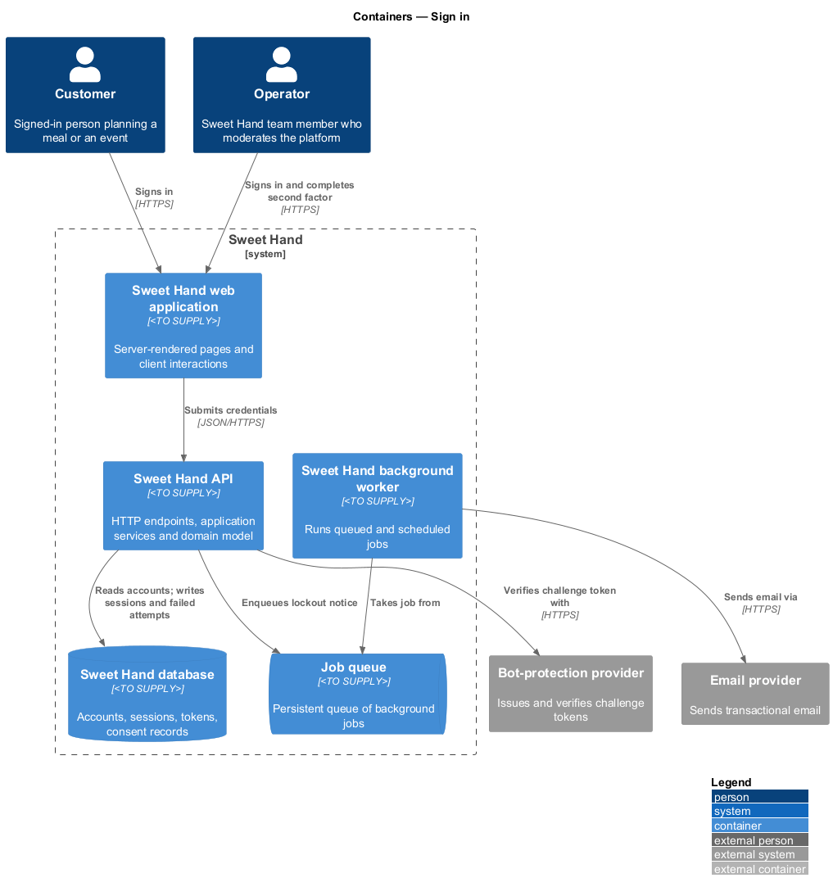
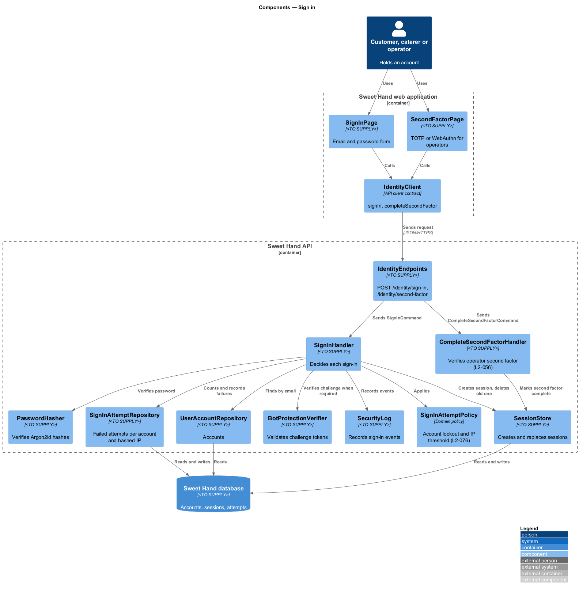
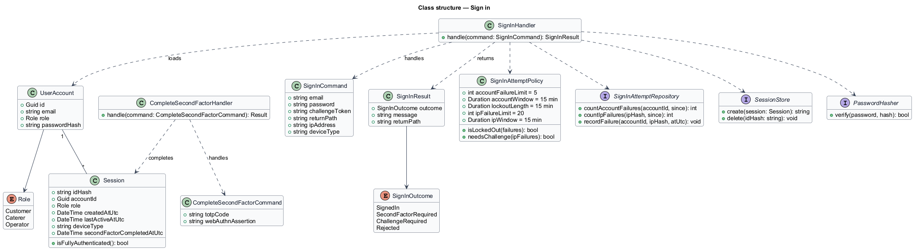
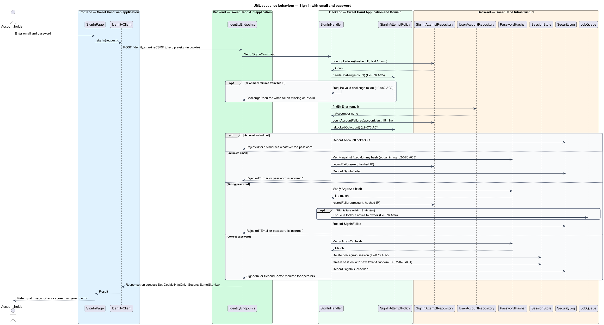
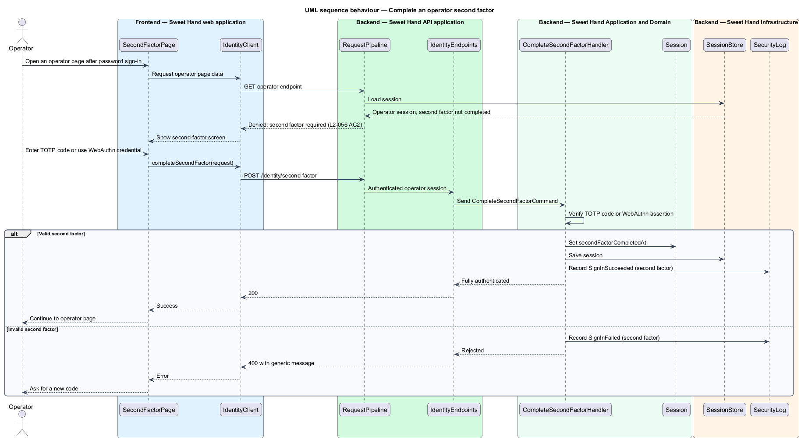

# Sign in

## Overview

Sweet Hand has three kinds of account: customer, caterer and operator. Every
account holder signs in with an email address and a password. Operators also
complete a second factor before they can reach any operator page.

Sign-in is the most attacked entry point of the platform. It faces password
guessing against one account, password spraying across many accounts from one
network address, and probing for which email addresses hold accounts. The
feature answers each threat with a stated rule: a per-account lockout, a
bot-protection challenge after repeated failures from one address, and
responses that are identical in message, status and timing whether or not the
email address is registered.

A successful sign-in creates a new server-side session and replaces any session
identifier the browser held before. Session timeouts, sign-out and the list of
active sessions belong to `manage-sessions`.

Terms used in this document:

- **failed sign-in** — sign-in attempt whose email address is unknown or whose password does not match
- **account lockout** — 15-minute period during which every sign-in to one account is rejected whatever the password
- **IP failure threshold** — 20 failed sign-ins from one IP address across any accounts within 15 minutes, after which a bot-protection challenge is required
- **second factor** — time-based one-time password (TOTP) or WebAuthn credential an operator presents after the password
- **session fixation** — attack in which a session identifier set before sign-in stays valid after it

## Description

Technology choices for every component below are `<TO SUPPLY>` pending
architecture decision records in `docs/adr/`.

**Frontend — Sweet Hand web application**

- **`SignInPage`** — screen with labelled email and password fields
  (`type="email"`, `autocomplete="username"` and `autocomplete="current-password"`).
  It shows the `BotChallengeWidget` when the API reports that a challenge is
  required, and returns the account holder to the return path afterwards.
- **`SecondFactorPage`** — screen where an operator enters a TOTP code or uses a
  WebAuthn credential.
- **`IdentityClient`** — API client contract with `signIn(request)` and
  `completeSecondFactor(request)`.

**Backend — Sweet Hand API application**

- **`IdentityEndpoints`** — exposes `POST /identity/sign-in` and
  `POST /identity/second-factor`. Sign-in is anonymous by explicit choice. On
  success the endpoint sets the session cookie with `HttpOnly`, `Secure` and
  `SameSite=Lax` (`L2-078 AC1`).
- **`RequestPipeline`** — applies the CSRF check, the general rate limit and the
  correlation ID before the endpoint runs.

**Backend — Sweet Hand Application and Domain**

- **`SignInCommand`** — `email`, `password`, `challengeToken` (optional),
  `returnPath`, plus the caller's IP address and coarse device type taken from
  the request.
- **`SignInHandler`** — the single place that decides a sign-in. It checks the
  IP failure threshold, the account lockout and the password, then creates the
  session. For an unknown email address it still runs a password hash against a
  fixed dummy hash, so the response time matches a wrong-password attempt
  (`L2-076 AC3`).
- **`SignInAttemptPolicy`** — domain policy holding the thresholds: 5 failures
  per account within 15 minutes lock the account for 15 minutes
  (`L2-076 AC4`); 20 failures per IP address within 15 minutes require a
  challenge (`L2-076 AC5`, `L2-082 AC2`).
- **`SignInResult`** — one of `SignedIn`, `SecondFactorRequired`,
  `ChallengeRequired` or `Rejected`. Every `Rejected` result carries the same
  message, "Email or password is incorrect", and the same HTTP status.
- **`CompleteSecondFactorCommand`** and **`CompleteSecondFactorHandler`** —
  verify the operator's TOTP code or WebAuthn assertion and mark the session as
  fully authenticated (`L2-056 AC2`). Second-factor enrolment and recovery are
  `<TO SUPPLY>`.
- **`Session`** — opaque random identifier of at least 128 bits, account,
  role, created time, last active time, device type, and
  `secondFactorCompletedAt` for operators. The session is not a
  self-contained token (`L2-078 AC1`).

**Backend — Sweet Hand Infrastructure and background worker**

- **`UserAccountRepository`** — loads the account by email address.
- **`PasswordHasher`** — verifies Argon2id hashes (`L2-076 AC2`).
- **`SignInAttemptRepository`** — records failed sign-ins per account and per
  hashed IP address with timestamps. The backing store is shared across API
  instances; its technology is `<TO SUPPLY>`.
- **`SessionStore`** — creates sessions and deletes the pre-sign-in session
  (`L2-078 AC2`). It stores a hash of the session identifier, not the
  identifier itself.
- **`BotProtectionVerifier`** — validates the challenge token.
- **`SecurityLog`** — records sign-in success, failure and lockout events
  (`log-security-events`).
- **`JobQueue`** and **`SendNotificationJob`** — send the lockout notice to the
  account owner (`L2-076 AC4`).

**Rules the slice enforces**

- An operator session without a completed second factor reaches only the
  second-factor screen and sign-out. `RequestPipeline` denies every operator
  page and endpoint until `secondFactorCompletedAt` is set (`L2-056 AC2`).
- During a lockout the response keeps the generic rejection. Whether a locked
  account also sees a lockout-specific message, which would reveal that the
  account exists, is `<TO SUPPLY>`.
- A changed privacy notice that needs fresh consent is checked after sign-in
  by `privacy/consent-to-privacy-notice`.
- An undeliverable email address raises a banner after sign-in, owned by
  `enquiries/notify-enquiry-activity` (`L2-030 AC3`).

## Requirements

The feature realizes the following level-2 (L2) requirements from
`docs/specs/L2.md`. Each refines the level-1 (L1) requirement cited beside it.
Requirement text is quoted from the specification, with *must* rendered as
*shall*.

| L2 ID | Refines (L1) | Requirement |
|-------|--------------|-------------|
| `L2-056` | `L1-016` | Operator accounts cannot be self-registered. Only an operator with the `Admin` permission can create one. Operators shall use multi-factor authentication. Every operator page and endpoint shall check for the operator role on the server. |
| `L2-076` | `L1-021` | Users shall sign in with an email address and a password. Passwords are stored with a slow, salted hash designed for passwords. Sign-in shall resist guessing attempts and shall not reveal which emails have accounts. |
| `L2-078` | `L1-021` | Sessions shall be held in cookies that client scripts cannot read and that are protected from cross-site attacks. Timeouts depend on the role. |
| `L2-082` | `L1-021` | The platform shall limit request rates for each client and require bot-protection challenges on forms that are open to abuse. |

This feature realizes `L2-056 AC2` (second factor), `L2-078 AC1` and `AC2`
(session cookie and fixation), and `L2-082 AC2` for the sign-in form. The
remaining criteria of those requirements belong to
`moderation/manage-operator-accounts`, `manage-sessions` and
`rate-limit-and-challenge`.

## Diagrams

### System context

A customer, caterer or operator signs in to Sweet Hand. Sweet Hand checks
challenge tokens with the bot-protection provider and sends lockout notices
through the email provider.

### Containers

The sign-in screen calls the Sweet Hand API, which reads accounts and writes
sessions and failed attempts in the Sweet Hand database. The background worker
sends the lockout notice.

### Components

`SignInPage` and `SecondFactorPage` depend on `IdentityClient`. Inside the API,
`SignInHandler` consults `SignInAttemptPolicy`, `PasswordHasher` and the
repositories, then creates the session through `SessionStore`.

### Class structure

`SignInHandler` returns a `SignInResult`, applies `SignInAttemptPolicy` and
creates a `Session` for a `UserAccount`. `CompleteSecondFactorHandler` marks an
operator `Session` as fully authenticated.

### Behaviour — sign in with email and password

The handler checks the IP failure threshold first, then the account lockout,
then the password. Unknown email and wrong password follow the same path to the
same rejection. A success replaces the old session identifier with a new one.

### Behaviour — operator second factor

An operator whose password is correct holds a session marked as awaiting the
second factor. Only after a valid TOTP code or WebAuthn assertion does the
session reach operator pages.

