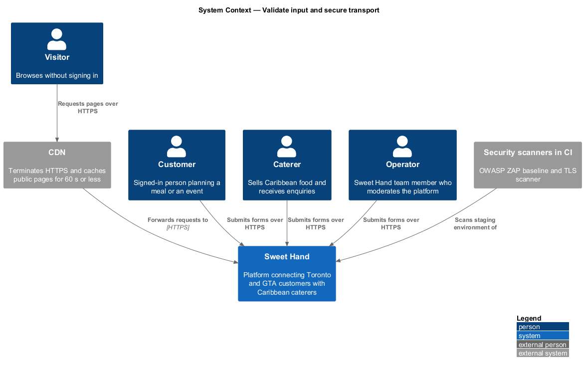
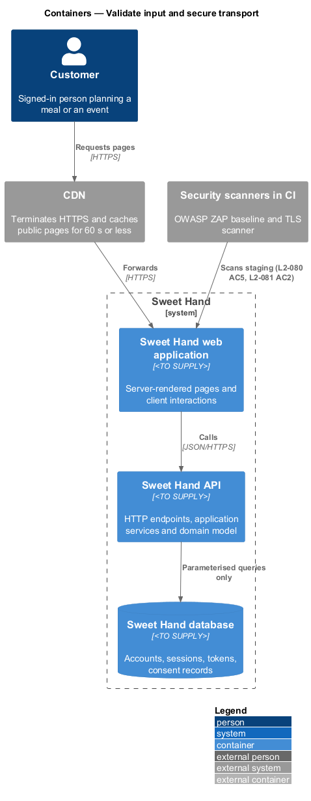
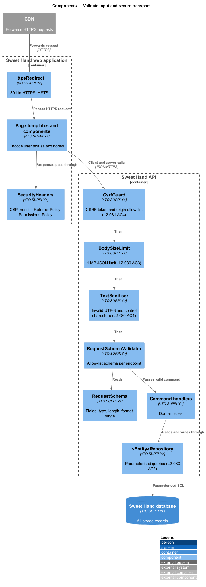
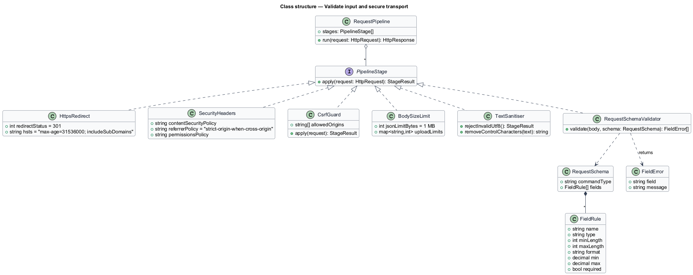
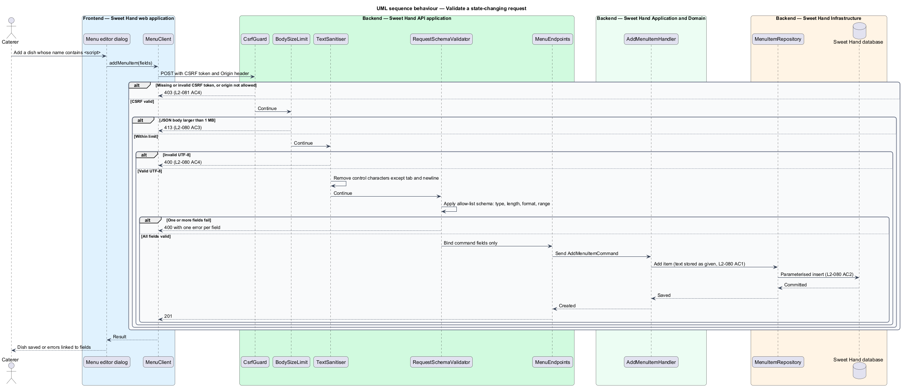
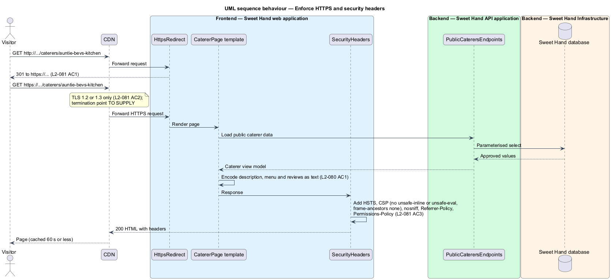

# Validate input and secure transport

## Overview

Every Sweet Hand page shows text that other people typed: caterer descriptions,
menu items, enquiry messages, reviews and replies. Every form and query string
is also a way for an attacker to send crafted input. This feature defines how
the platform treats input on the way in and output on the way out, and how it
protects the connection that carries both.

On the way in, the server checks each request against an allow-list schema that
states the type, length, format and range of every field. Text is stored as the
author typed it, apart from control characters. On the way out, every value is
encoded for the place it appears, so markup in a review shows as literal text
and never runs. All database access uses parameterised queries.

The connection uses HTTPS only. Every response carries security headers that
limit what a browser will run, frame or send, and every state-changing request
carries a cross-site request forgery (CSRF) token from an allowed origin.

Terms used in this document:

- **allow-list schema** — declaration of the fields a request may contain and the type, length, format and range of each
- **output encoding** — conversion of a value into a form that is inert in its context, such as HTML text or an attribute
- **parameterised query** — database query whose values travel separately from the query text
- **content security policy (CSP)** — response header that tells the browser which sources of script and content to trust
- **CSRF token** — per-session secret that a state-changing request carries to prove it came from a Sweet Hand page
- **TLS termination point** — component where the HTTPS connection is decrypted before reaching the containers

## Description

Technology choices for every component below are `<TO SUPPLY>` pending
architecture decision records in `docs/adr/`. The TLS termination point (CDN,
load balancer or container) is `<TO SUPPLY>`.

**Transport and headers**

- **`HttpsRedirect`** — redirects any plain HTTP request to HTTPS with HTTP 301.
  HTTPS responses carry
  `Strict-Transport-Security: max-age=31536000; includeSubDomains`
  (`L2-081 AC1`).
- **TLS configuration** — enables only TLS 1.2 and 1.3 and targets grade A or
  better on an industry-standard TLS scanner (`L2-081 AC2`). The scanner and
  its schedule are `<TO SUPPLY>`.
- **`SecurityHeaders`** — adds headers to every HTML response from the web
  application (`L2-081 AC3`): a `Content-Security-Policy` whose `script-src`
  has no `unsafe-inline` or `unsafe-eval` and that sets
  `frame-ancestors 'none'`; `X-Content-Type-Options: nosniff`;
  `Referrer-Policy: strict-origin-when-cross-origin`; and a
  `Permissions-Policy` that turns off camera, microphone and geolocation. The
  API adds the same headers that apply to JSON responses.
- **No inline scripts** — pages load scripts only from Sweet Hand files with
  content-hashed names. Per-response nonces are not used, because the CDN
  caches public HTML for up to 60 seconds (`L2-087 AC4`) and a cached nonce
  would be shared between visitors.
- **`CsrfGuard`** — rejects a POST, PUT, PATCH or DELETE without a valid CSRF
  token, or from an origin not on the allow-list, with HTTP 403
  (`L2-081 AC4`). The CSRF token cookie is one of the three cookies the
  platform sets before consent (`L2-074 AC1`).

**Input validation**

- **`BodySizeLimit`** — rejects a JSON request body larger than 1 MB with HTTP
  413. Upload endpoints declare their own limits, for example 15 MB for photos
  (`L2-041`) and 10 MB for certificate files (`L2-040`) (`L2-080 AC3`).
- **`TextSanitiser`** — rejects a request containing invalid UTF-8 with HTTP 400
  and removes control characters other than tab and newline from text fields
  (`L2-080 AC4`). The specification permits either removal or rejection for
  control characters; this design removes them.
- **`RequestSchema`** — allow-list schema per endpoint. Each command type
  declares its fields and their rules.
- **`RequestSchemaValidator`** — stage of `RequestPipeline` that applies the
  schema. A failing request returns HTTP 400 with one error per failing field
  and reaches no handler. Domain rules that need stored state, such as
  "Minimum guests can't be more than maximum guests", stay in the domain layer.
- **Query and filter parameters** — validated against the same schemas; an
  unknown filter value is ignored where `L2-003 AC3` requires it.

**Data access and output**

- **`<Entity>Repository`** — the only code that reaches the database. It uses
  parameterised queries for every statement, so injection payloads such as
  `' OR '1'='1` return a validation error or an empty result and leave the
  database unchanged (`L2-080 AC2`).
- **Page templates and components** — insert user text only as encoded text
  nodes or encoded attribute values. No component inserts user text as raw
  HTML. URLs in messages and reviews stay plain text (`L2-032 AC4`). The
  payloads in `L2-080 AC1` are stored as given and shown literally.

**Verification in continuous integration (CI)**

- An OWASP ZAP baseline scan runs against the staging environment and reports
  no High or Medium findings (`L2-080 AC5`). The CI system and staging
  environment are `<TO SUPPLY>`.

## Requirements

The feature realizes the following level-2 (L2) requirements from
`docs/specs/L2.md`. Each refines the level-1 (L1) requirement cited beside it.
Requirement text is quoted from the specification, with *must* rendered as
*shall*.

| L2 ID | Refines (L1) | Requirement |
|-------|--------------|-------------|
| `L2-080` | `L1-021` | All input shall be checked on the server against an allow-list schema of type, length, format and range. All output shall be encoded for the context it appears in. Database access shall use parameterised queries only. |
| `L2-081` | `L1-021` | All traffic shall use HTTPS, and every response shall include security headers. |

## Diagrams

### System context

Every role reaches Sweet Hand over HTTPS, through the CDN for public pages. A
security scanner in CI probes the staging environment.

### Containers

The CDN forwards HTTPS traffic to the web application, which adds security
headers to HTML. The Sweet Hand API validates every request and reaches the
Sweet Hand database through parameterised queries.

### Components

`HttpsRedirect` and `SecurityHeaders` act at the edge of both containers. In
the API, `CsrfGuard`, `BodySizeLimit`, `TextSanitiser` and
`RequestSchemaValidator` run in order before any handler, and repositories run
parameterised queries.

### Class structure

`RequestPipeline` composes the transport and input stages. Each command type
has one `RequestSchema` made of `FieldRule` entries that
`RequestSchemaValidator` applies.

### Behaviour — validate a state-changing request

A state-changing request passes the CSRF check, the body size limit, the text
sanitiser and the schema in order. The first failing stage ends the request
with its status code; a valid request reaches the handler, and the repository
stores the values through a parameterised query. The diagram uses adding a
menu item as the example request.

### Behaviour — enforce HTTPS and security headers

A plain HTTP request receives a 301 redirect to HTTPS. An HTTPS request for a
page receives the rendered HTML with HSTS, CSP and the other security headers.
Stored user text is encoded as it is rendered.

