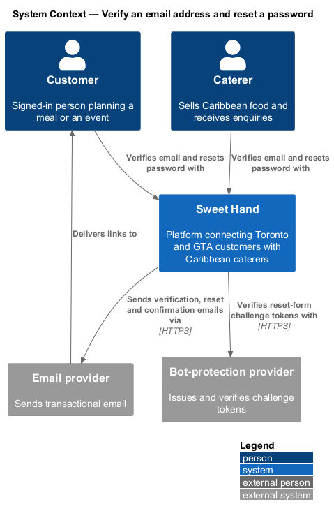
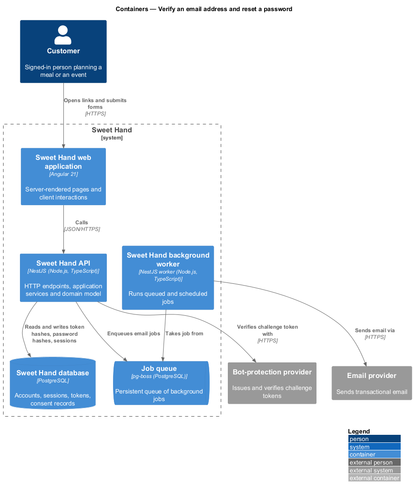
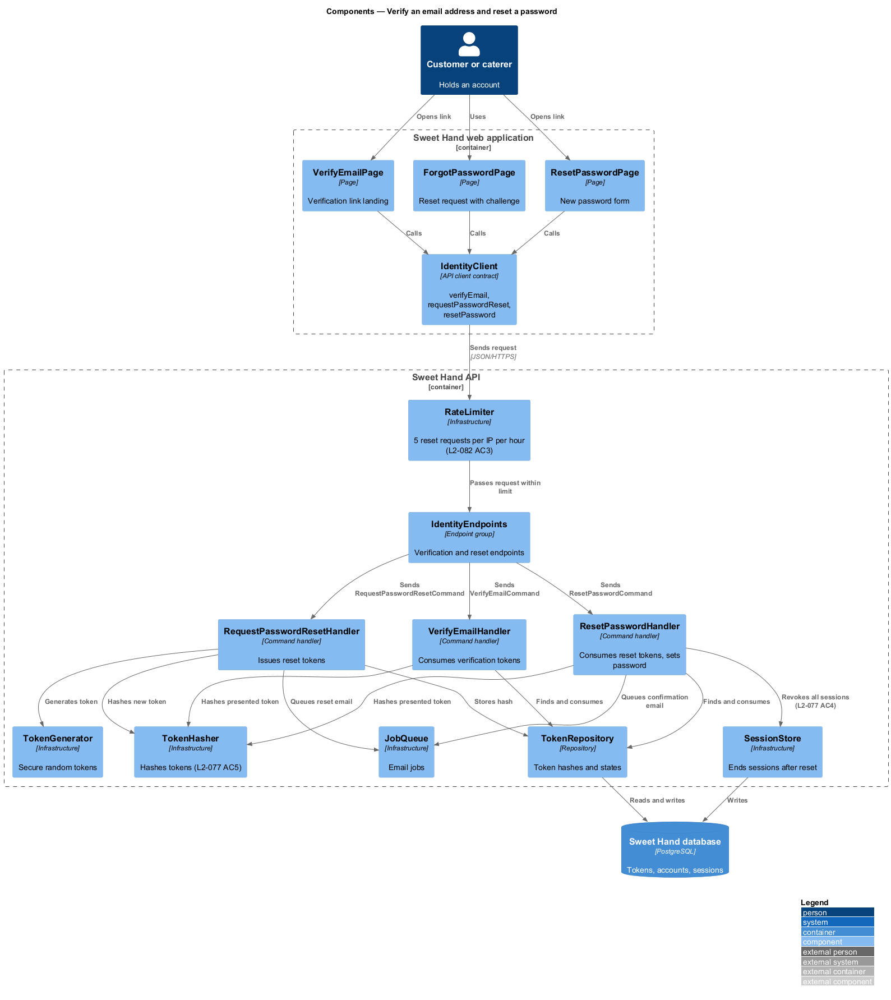
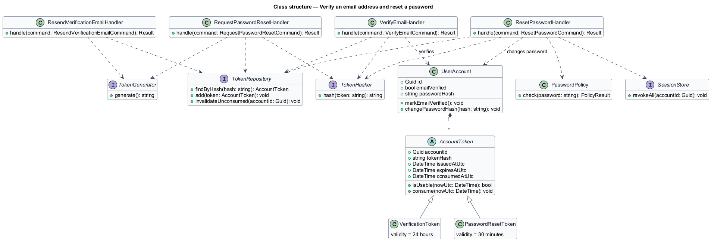
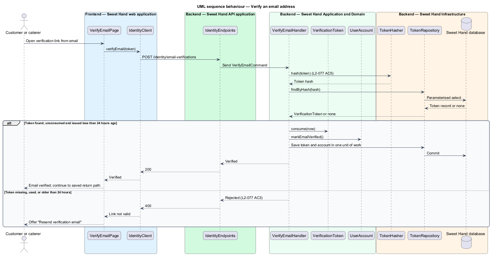
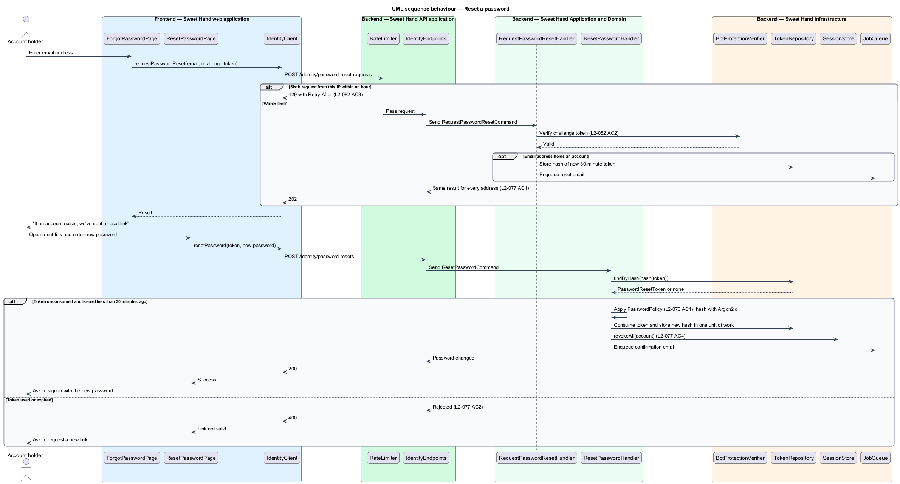

# Verify an email address and reset a password

## Overview

Two Sweet Hand account flows work by sending a link to the account's email
address. Email verification proves that a newly registered customer or caterer
controls the address they gave. A customer needs a verified address to send an
enquiry, and a caterer needs one to submit a profile for approval. Password
reset lets an account holder who forgot their password choose a new one.

Both flows rest on the same mechanism: a token that is random, can be used once,
and expires. The link carries the token; the database holds only a hash of it,
so a copy of the database cannot be turned into working links.

Password reset is also a route for account enumeration and for flooding an
inbox. The request form therefore gives the same answer for every email address,
requires a bot-protection challenge, and is rate limited per IP address.

Terms used in this document:

- **verification token** — single-use token, valid for 24 hours, that marks an account's email address as verified
- **password reset token** — single-use token, valid for 30 minutes, that authorises one password change
- **token hash** — one-way hash of a token, stored in place of the token
- **consumed token** — token that has been used once and is no longer accepted

## Description

Technology choices follow ADR 0001 (Angular 21) and ADR 0006 (NestJS on
Node.js, PostgreSQL through Drizzle ORM, S3-compatible object storage);
providers not named there remain `<TO SUPPLY>`.

**Frontend — Sweet Hand web application**

- **`VerifyEmailPage`** — landing screen for the verification link. It reports
  success, or an expired or used link with a "Resend verification email"
  control (`L2-077 AC3`).
- **`ForgotPasswordPage`** — screen that takes an email address and a
  bot-protection challenge, then shows "If an account exists, we've sent a
  reset link" (quoted product copy) for every address (`L2-077 AC1`).
- **`ResetPasswordPage`** — landing screen for the reset link with a new
  password field (`autocomplete="new-password"`). An expired or used link asks
  the account holder to request a new one (`L2-077 AC2`).
- **`IdentityClient`** — API client contract with `verifyEmail`,
  `resendVerification`, `requestPasswordReset` and `resetPassword`.

**Backend — Sweet Hand API application**

- **`IdentityEndpoints`** — exposes `POST /identity/email-verifications`,
  `POST /identity/email-verifications/resend`,
  `POST /identity/password-reset-requests` and `POST /identity/password-resets`.
  The verification, reset-request and reset endpoints are anonymous by explicit
  choice; the token or the challenge is the credential. Resend requires a
  signed-in session.

**Backend — Sweet Hand Application and Domain**

- **`VerifyEmailCommand`** / **`VerifyEmailHandler`** — hash the presented
  token, load the matching unconsumed token, check its 24-hour expiry, mark it
  consumed and set `UserAccount.emailVerified`.
- **`ResendVerificationEmailCommand`** / **`ResendVerificationEmailHandler`** —
  issue a fresh verification token for the signed-in account and queue the
  email. Earlier unconsumed tokens for the account are invalidated.
- **`RequestPasswordResetCommand`** / **`RequestPasswordResetHandler`** —
  verify the challenge token. When the email address holds an account, issue a
  reset token and queue the email. Return the same result whether or not the
  account exists.
- **`ResetPasswordCommand`** / **`ResetPasswordHandler`** — hash the presented
  token, check its 30-minute expiry and unconsumed state, apply
  `PasswordPolicy`, store the new Argon2id hash, consume the token, end every
  session of the account and queue a confirmation email (`L2-077 AC4`).
- **`VerificationToken`** and **`PasswordResetToken`** — account identifier,
  token hash, issued time, expiry time and consumed time.
- **`PasswordPolicy`** — rules from `L2-076 AC1`, shared with
  `register-customer`.

**Backend — Sweet Hand Infrastructure and background worker**

- **`TokenGenerator`** — produces tokens from a cryptographically secure random
  source. Token length is `<TO SUPPLY>`; it shall be at least 128 bits to match
  the session identifier rule in `L2-078 AC1`.
- **`TokenHasher`** — hashes tokens before storage and lookup (`L2-077 AC5`).
- **`TokenRepository`** — persists token hashes and their states.
- **`SessionStore`** — deletes every session of an account after a reset.
- **`RateLimiter`** — rejects a sixth password-reset request from one IP address
  within an hour with HTTP 429 (`L2-082 AC3`).
- **`JobQueue`** and **`SendNotificationJob`** — send verification, reset and
  confirmation emails through the `EmailGateway`.

**Rules the slice enforces**

- Tokens never appear in logs (`L2-084 AC2`).
- The reset-request response is identical for registered and unregistered
  addresses in message and status. Timing equalisation for this endpoint is
  `<TO SUPPLY>`; queuing the email asynchronously keeps the two paths close.
- The 24-hour validity of a verification link matches the 24-hour enquiry
  draft retention in `L2-023 AC3`. A customer who verifies within the link's
  lifetime returns to a filled enquiry form.

## Requirements

The feature realizes the following level-2 (L2) requirements from
`docs/specs/L2.md`. Each refines the level-1 (L1) requirement cited beside it.
Requirement text is quoted from the specification, with *must* rendered as
*shall*.

| L2 ID | Refines (L1) | Requirement |
|-------|--------------|-------------|
| `L2-077` | `L1-021` | Email verification and password reset shall use tokens that are random, can be used only once, and expire. |
| `L2-082` | `L1-021` | The platform shall limit request rates for each client and require bot-protection challenges on forms that are open to abuse. |

This feature realizes `L2-082` for the password reset form only (`L2-082 AC2`
for the challenge and `L2-082 AC3` for the hourly limit).

## Diagrams

### System context

An account holder verifies an email address or resets a password through
Sweet Hand. Sweet Hand sends the links through the email provider and checks
the reset form's challenge with the bot-protection provider.

### Containers

The web application's screens call the Sweet Hand API, which stores token hashes
in the Sweet Hand database and queues emails for the background worker.

### Components

The four screens depend on `IdentityClient`. Inside the API, one handler per
command uses `TokenGenerator`, `TokenHasher` and `TokenRepository`, and the
reset handler also uses `PasswordPolicy`, `PasswordHasher` and `SessionStore`.

### Class structure

`VerificationToken` and `PasswordResetToken` share the single-use, expiring
token shape through `AccountToken`. Each handler depends on the generator,
hasher and repository.

### Behaviour — verify an email address

The handler looks the token up by its hash and accepts it only once and only
within 24 hours. An expired or used token returns the resend option.

### Behaviour — reset a password

The request step answers every email address the same way. The reset step
accepts a token only once within 30 minutes, stores the new hash, ends every
session and sends a confirmation email.

