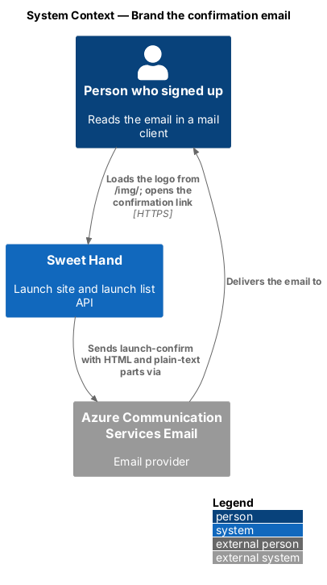
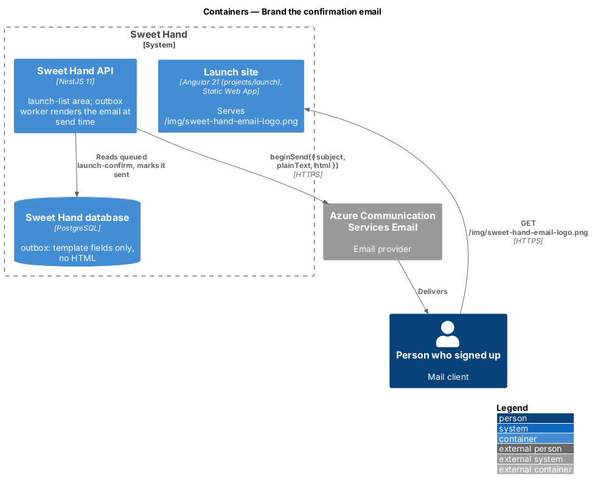
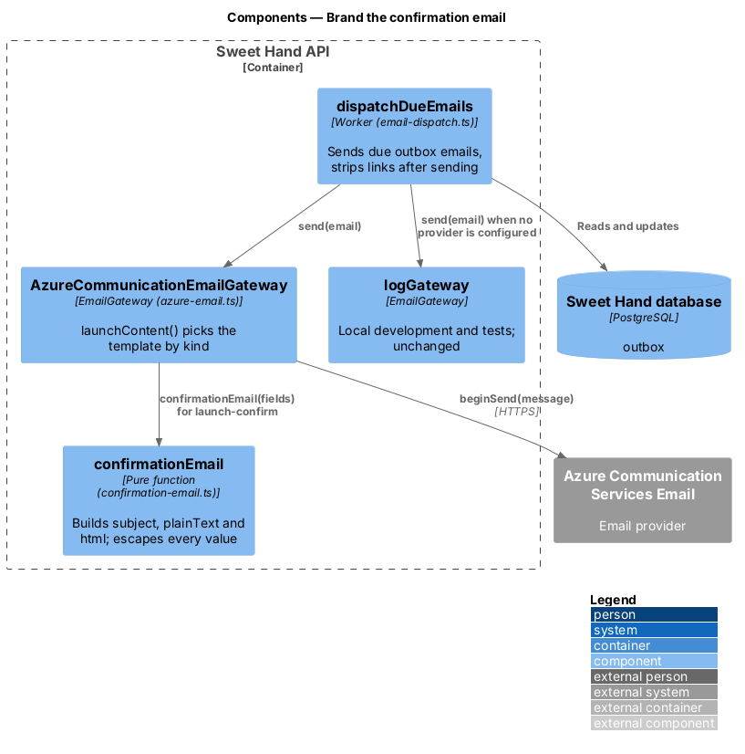
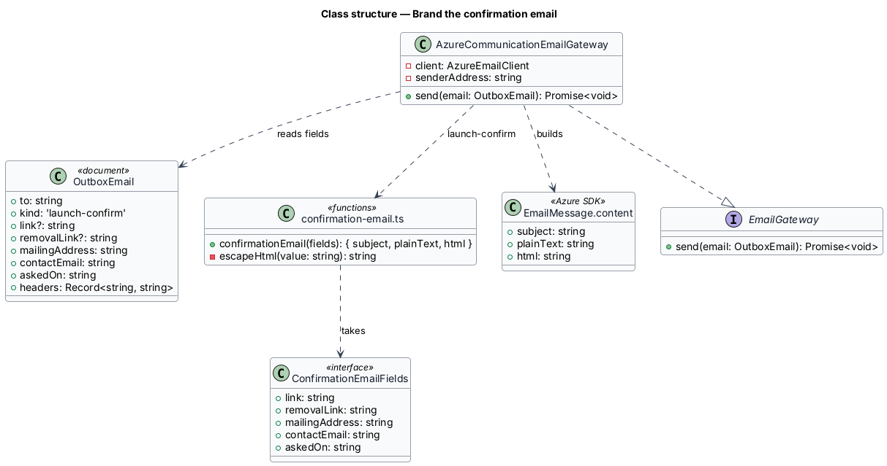
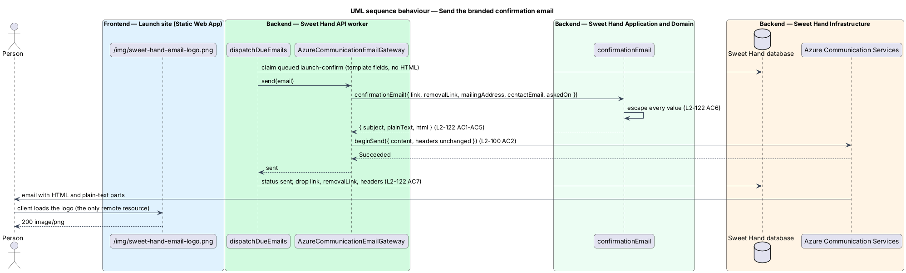

# Brand the confirmation email

## Overview

After a sign-up on the launch site, the platform queues a `launch-confirm` email (feature `launch/confirm-launch-list-email`). The Azure gateway sent it as plain text only. This feature sends it as an HTML email in the Sweet Hand design, with the plain-text part kept beside it (`L2-122`). The facts in the email do not change: who sent it, why, one confirmation link that expires in 48 hours, that nothing happens if it is ignored, and the CASL footer with the removal link (`L2-099 AC1`, `L2-101 AC4`). The mock is `docs/mocks/notifications/launch-confirm-email/` (states `default`, `caterer`, `plain-text`). The decision is recorded in ADR 0015 (`docs/adr/0015-branded-html-emails.md`).

> **HTML part** — the `html` content of the email: one 600px column of presentation tables with inline styles

> **plain-text part** — the `plainText` content of the same email, for clients and readers that show text only

> **fixed value** — a colour, size or spacing written as a literal in the email, read from a design token by role; mail clients do not support CSS custom properties, so the email cannot use the tokens themselves

> **email logo** — the PNG `/img/sweet-hand-email-logo.png`, served by the launch site, and the only remote resource the email loads

Anyone who signs up receives the same email; a caterer's email carries no business name. The other three launch list emails (`launch-already-listed`, `launch-day-customer`, `launch-day-caterer`) and the product emails keep their current content and are outside this feature.

## Description

**Template — `backend/src/launch-list/confirmation-email.ts`**

- **`confirmationEmail(fields)`** — a pure function from the template fields `link`, `removalLink`, `mailingAddress`, `contactEmail` and `askedOn` to `{ subject, plainText, html }`. It reads no clock, configuration or database.
  - `subject` is "Confirm your Sweet Hand launch email".
  - `plainText` says why it was sent, gives the link and its 48-hour expiry, says nothing happens if it is ignored, and ends with the CASL footer (`L2-122 AC1`).
  - `html` reproduces the mock's markup and styles: `<html lang="en-CA">`, `<meta name="color-scheme" content="light dark">`, one `<style>` block with a `max-width: 600px` rule and a `prefers-color-scheme: dark` rule, and the body as nested tables with `role="presentation"` (`L2-122 AC4`, `AC5`). In order: the email logo with `alt="Sweet Hand"`, the `<h1>` "Confirm your email", the reason, the "Confirm my email" button, the link written out under "Or copy this link into your browser:", the expiry and "nothing happens" line, then the footer: "You asked for this email on {askedOn}.", "Sweet Hand", the mailing address, the contact address as a `mailto:` link and "Remove your email" (`L2-122 AC2`, `AC3`).
  - The logo URL is `new URL('/img/sweet-hand-email-logo.png', link)`. The confirmation link is always `${SITE_URL}/?confirmed=<token>` (`queueConfirmation`), so the logo comes from the site URL with no new outbox field.
- **`escapeHtml(value)`** — replaces `&`, `<`, `>`, `"` and `'` with entities. Every dynamic value passes through it, in text and in attributes, so a value containing markup appears as text (`L2-122 AC6`, `L2-104 AC7`).
- The template holds no tracking pixel, no other image, no `<link>`, no `<script>` and no web font, and no marketing content (`L2-122 AC2`, `AC8`, `L2-030 AC5`).

**Gateway — `backend/src/platform/azure-email.ts`**

- **`launchContent(email)`** — for `launch-confirm` it checks the five fields with `required()` (a missing one is a `PermanentFailure`, as before) and returns `confirmationEmail(...)`. The other launch kinds keep `{ subject, plainText }`.
- **`AzureCommunicationEmailGateway.send`** — passes the content unchanged into `EmailMessage.content`, which gains `html` for `launch-confirm`. The `headers` (`List-Unsubscribe`, `List-Unsubscribe-Post`) are copied from the outbox email as before (`L2-122 AC7`, `L2-100 AC2`).

**Outbox and dispatcher — unchanged**

- Rendering happens at send time from the outbox fields, so no HTML and no rendered token is ever stored. `dispatchDueEmails` still drops `link`, `removalLink` and `headers` from the record once the email is sent (`L2-122 AC7`).
- `logGateway` in `backend/src/platform/email-dispatch.ts`, used in local development and tests when no provider is configured, is unchanged: it logs the kind and a hashed address only.
- There is no migration and no wire-model change.

**Email logo — `frontend/projects/launch/public/img/sweet-hand-email-logo.png`**

- A 480 by 128 pixel PNG shown at 240 by 64 (2x for high-density screens): the light lockup (`assets/logo/sweet-hand-logo-light.svg`) rendered with Figtree on a white tile with rounded corners and transparent outside. The tile keeps the dark wordmark readable in dark mode and when a client inverts colours.
- The prerendered launch site copies `public/` to its output, so the Static Web App serves it at `${SITE_URL}/img/sweet-hand-email-logo.png` with the existing `/img/*` cache rule. No page loads it, so the launch site's first-load budget is unchanged (`L2-105`).
- Most mail clients block inline SVG and `data:` URIs, and an SVG cannot be relied on to use the brand font; a hosted raster avoids both. The product site, when it replaces the launch site at `/`, shall serve the same path until the launch list is deleted (`L2-102`); `<TO SUPPLY>` with the retire-launch-site work.

**Fixed values**

Each value comes from a token by role and is listed in `docs/design-system/patterns/notifications.html#email`:

| Use | Token | Light | Dark |
|-----|-------|-------|------|
| Page and footer | `--color-bg-surface-sunken` | `#f7f5f2` | `#1a1917` |
| Card | `--color-bg-surface` | `#ffffff` | `#141312` |
| Card edge | `--color-border-default` | `#e2ded7` | `#2e2b28` |
| Heading | `--color-fg-default` | `#141312` | `#efece7` |
| Body | `--color-fg-muted` | `#4d4b48` | `#b8b2a8` |
| Footer | `--color-fg-subtle` | `#6b6863` | `#9a948a` |
| Links | `--color-fg-link` | `#141312` | `#efece7` |
| Button | `--color-action`, `--color-fg-on-action` | `#141312`, `#ffffff` | `#efece7`, `#141312` |

Type: `--font-family-sans` stack inline, heading 24px bold (`--font-size-2xl`), body 16px (`--font-size-md`), footer and link line 14px (`--font-size-sm`). Spacing: 8, 16, 24 and 32px (`--space-2` to `--space-8`). Card radius 20px (`--radius-lg`), button `--radius-full` and 52px tall (`--control-height-lg`).

**Dark mode** — light is the inline baseline, so a client that drops `<style>` shows the light email. The `@media (prefers-color-scheme: dark)` block overrides the classes `sh-bg`, `sh-card`, `sh-text`, `sh-muted`, `sh-subtle`, `sh-link` and `sh-btn` with `!important`. Every text pair meets WCAG 2.2 AA in both modes (`L2-122 AC5`).

**Component requirements** — the email is not an Angular component and no `sh-*` component changes, so the component requirements phase produced no CRD.

**Tests**

- `backend/test/platform/azure-email.test.ts`: the Azure message for `launch-confirm` has `html` and `plainText`, each with the link, the "nothing happens" line and the CASL footer; headers unchanged.
- `backend/test/launch-list/confirmation-email.test.ts`: `lang`, heading, logo `src` and `alt`, button and written-out link, presentation tables, the dark-mode block, no other remote resource, and escaping of `<`, `&` and `"`.
- `backend/test/platform/email-dispatch.test.ts`: after the Azure gateway sends, the outbox record has no `html`, `link` or `removalLink`.
- `frontend/e2e/specs/launch/email-logo.spec.ts`: the launch site serves the logo as `image/png`.

**Open questions**

- The template's markup is kept in step with the mock by hand. A build step that generates one from the other is deferred.
- The other launch list emails and the product emails stay plain text until they have mocks.

## Requirements

The feature realizes the following level-2 (L2) requirement from `docs/specs/L2.md`. It refines the level-1 (L1) requirement cited beside it. Requirement text is quoted from the specification, with *must* rendered as *shall*.

| L2 ID | Refines (L1) | Requirement |
|-------|--------------|-------------|
| `L2-122` | `L1-025` | The confirmation email (L2-099) shall be an HTML email in the Sweet Hand design, with a plain-text part beside it that carries the same facts. |

## Diagrams

### System context

Sweet Hand sends the email through Azure Communication Services. The person's mail client loads the logo from the launch site.

### Containers

The API's outbox worker renders and sends the email; the database holds template fields only. The launch site serves the logo.

### Components

`dispatchDueEmails` hands the email to `AzureCommunicationEmailGateway`, whose `launchContent` calls `confirmationEmail` for `launch-confirm`.

### Class structure

`confirmationEmail` takes five outbox fields and returns the three content parts the Azure SDK's `EmailMessage.content` accepts.

### Behaviour — send

The worker claims the email, the gateway renders both parts at send time, Azure delivers them, and the record drops its links once sent.

