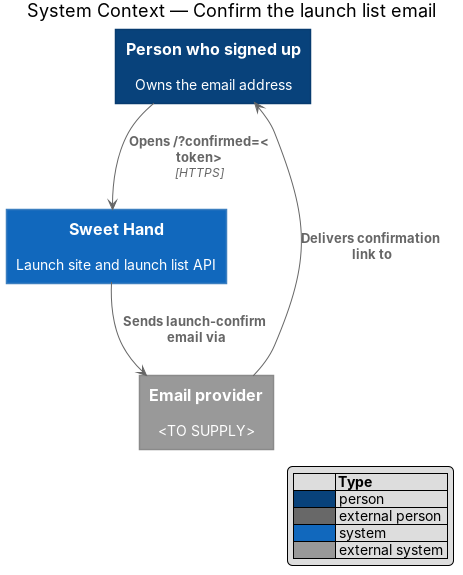
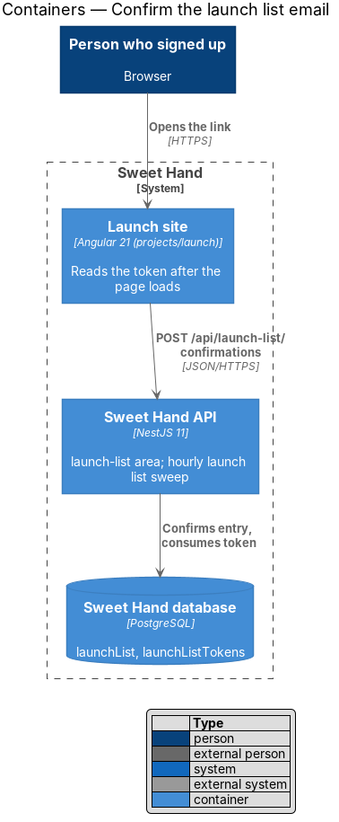
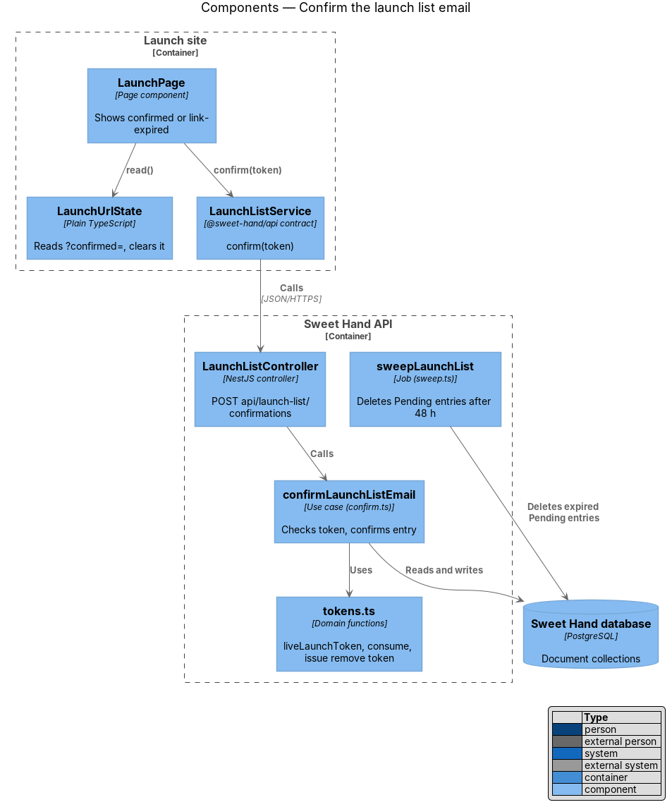
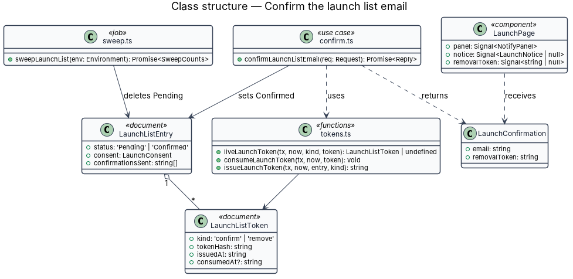
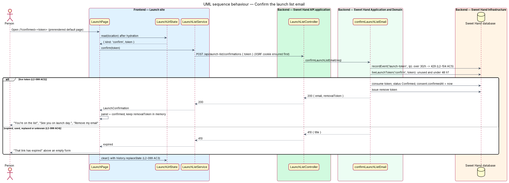
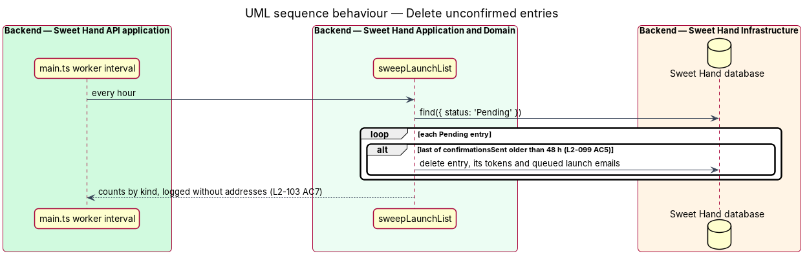

# Confirm the launch list email

## Overview

A sign-up counts only once the person confirms it from the address they gave (double opt-in, `L2-099`). Confirmation is the evidence that the owner of the address gave express consent, which the single launch-day email depends on under assumption A-8. The mock states are `confirmed` and `link-expired` in `docs/mocks/pages/launch/`.

> **confirmation email** — the `launch-confirm` email sent after a sign-up, carrying one confirmation link and one removal link

> **confirmation link** — URL `/?confirmed=<token>` on the launch site whose token is single-use and valid for 48 hours from sending

> **live token** — token that is unused, not replaced by a newer one and inside its lifetime

The person opens the link from their inbox. The launch site loads its usual prerendered page, then sends the token to the API in a `POST`. A mail scanner that only fetches the URL runs no script and confirms nothing (`L2-099 AC2`). A live token confirms the entry and the page shows "You’re on the list". Any other token shows "That link has expired" above the form, so the person can sign up again. An entry that is never confirmed is deleted 48 hours after its last confirmation email.

## Description

**Email — `launch-confirm`**

- Queued by `joinLaunchList` (feature `launch/join-launch-list`) through `queueEmail` with `kind: 'launch-confirm'`, `link` (the confirmation URL) and `removalLink`. The outbox removes both links once the email is sent, as for other token emails.
- Content: sender "Sweet Hand"; why it was sent; the confirmation link and its 48-hour expiry; a line saying nothing happens if it is ignored; the removal link; the operator's mailing address and contact address (`L2-099 AC1`, `L2-101 AC4`). Headers `List-Unsubscribe` and `List-Unsubscribe-Post` follow feature `launch/leave-launch-list`. The wording and layout are the mock `docs/mocks/notifications/launch-confirm-email/`; the HTML and plain-text parts are built by feature `launch/brand-confirmation-email` (`L2-122`).

**Frontend — Launch site**

- **`LaunchPage`** — after hydration, when `LaunchUrlState.read` returns a `confirm` link, it calls `LaunchListService.confirm(token)`. `HttpLaunchListService` first fetches `GET /api/public/launch-list` when no `XSRF-TOKEN` cookie exists, as for sign-up.
  - On `LaunchConfirmation`, it sets `panel` to `confirmed` and keeps `removalToken` in a signal, in memory only. The panel shows the `sh-empty-state` (success variant) "You’re on the list", "See you on launch day." and the "Remove my email" button (`L2-099 AC2`). Focus moves to the panel title, so a screen reader announces "You’re on the list" and the next Tab reaches "Remove my email" (`L2-107 AC6`).
  - On HTTP 410, it sets `notice` to `link-expired` and leaves `panel` as `form`. An `sh-alert` (warning, `role="status"`) reads "That link has expired" and "Enter your email again for a new one." above an empty form (`L2-099 AC4`, `L2-107 AC5`).
  - On a 429, a 5xx or a network failure, it shows the `link-expired` notice as well, because the page cannot tell whether the token was valid. A distinct message is `<TO SUPPLY>` and needs a mock.
  - In every case it then calls `LaunchUrlState.clear()`, so reloading or sharing shows the default page (`L2-099 AC3`).

**Backend — `backend/src/launch-list/`**

- **`LaunchListController`** — `POST api/launch-list/confirmations` with `@UsePolicy(anonymous)` and `@MaxBody(4096)`, under the usual CSRF guard (`L2-104 AC3`).
- **`confirm.ts`** — `confirmLaunchListEmail(req)`:
  1. Counts `launch-token` events for the hashed IP. Above 30 in an hour it returns HTTP 429 with `Retry-After` (`L2-104 AC5`), then records the event.
  2. Calls `liveLaunchToken(tx, now, 'confirm', body.token)`. A token is live when its hash matches, `consumedAt` is empty and `issuedAt` is less than 48 hours before `now`. Tokens replaced by a later sign-up were consumed when the new one was issued (`L2-098 AC4`).
  3. With no live token it returns `gone('That link has expired')` (HTTP 410) and changes nothing (`L2-099 AC4`).
  4. With a live token it consumes it, sets the entry's `status` to `Confirmed` and `consent.confirmedAt` to `now`, issues a fresh `remove` token, and returns `ok({ email, removalToken })` (`L2-099 AC2`, `L2-103 AC2`). Confirming an already `Confirmed` entry through a second live token only consumes that token.
  5. After the launch-day run, step 2 to 4 are skipped and the reply is HTTP 410, so nothing is confirmed (`L2-102 AC4`).
- **`sweep.ts`** — `sweepLaunchList(env)` runs every hour from the worker interval in `backend/src/main.ts`, beside `dispatchDueEmails`. It deletes each `Pending` entry whose latest `confirmationsSent` time is more than 48 hours old, with its tokens and any queued `launch-*` outbox email to that address (`L2-099 AC5`). It logs the count only. The launch-day part of the sweep belongs to `launch/send-launch-day-email`.
- **Launch day** — `Pending` entries receive no launch-day email (`L2-099 AC6`), because the send selects `status: 'Confirmed'` only.

**Tests**

- `backend/test/launch-list/confirm.test.ts`: live, expired at 48 hours plus one second (with the fixed clock), used, replaced and unknown tokens; the hourly sweep.
- `frontend/e2e/specs/launch/confirm-launch-list-email.spec.ts`: the `confirmed` and `link-expired` states, the cleaned URL and the focus move.

## Requirements

The feature realizes the following level-2 (L2) requirement from `docs/specs/L2.md`. It refines the level-1 (L1) requirement cited beside it. Requirement text is quoted from the specification, with *must* rendered as *shall*.

| L2 ID | Refines (L1) | Requirement |
|-------|--------------|-------------|
| `L2-099` | `L1-025` | A sign-up shall only count once the person confirms it from the email they gave (double opt-in). The confirmation email carries a single-use link that works for 48 hours. |

## Diagrams

### System context

Sweet Hand sends the confirmation email through the email provider. The person opens its link on the launch site.

### Containers

The launch site posts the token to the Sweet Hand API, which confirms the entry in the database.

### Components

`LaunchPage` reads the token through `LaunchUrlState` and calls `LaunchListService.confirm`. `confirmLaunchListEmail` checks and consumes the token. `sweepLaunchList` removes entries never confirmed.

### Class structure

A successful confirmation returns a `LaunchConfirmation`, whose `removalToken` lets the confirmed page remove the address without signing in.

### Behaviour — confirm

A live token confirms the entry and returns a removal token; any other token returns 410 and the page shows the `link-expired` notice. The page cleans the URL in both cases.

### Behaviour — delete unconfirmed entries

Every hour the sweep deletes `Pending` entries whose last confirmation email is more than 48 hours old.

