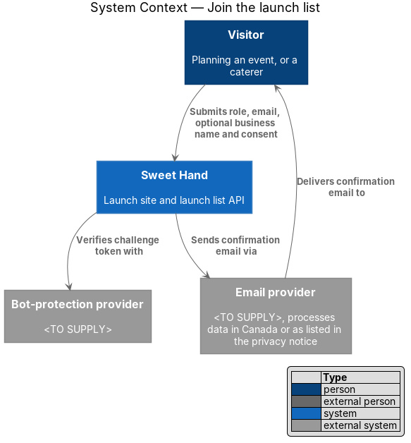
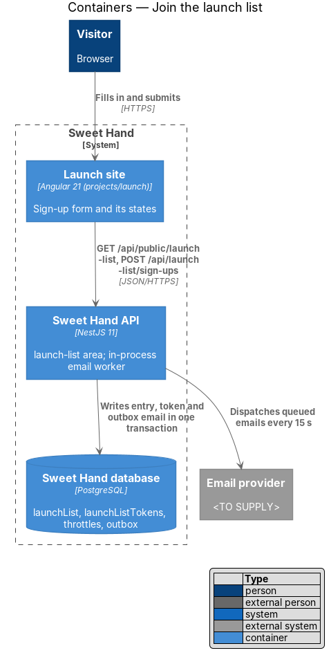
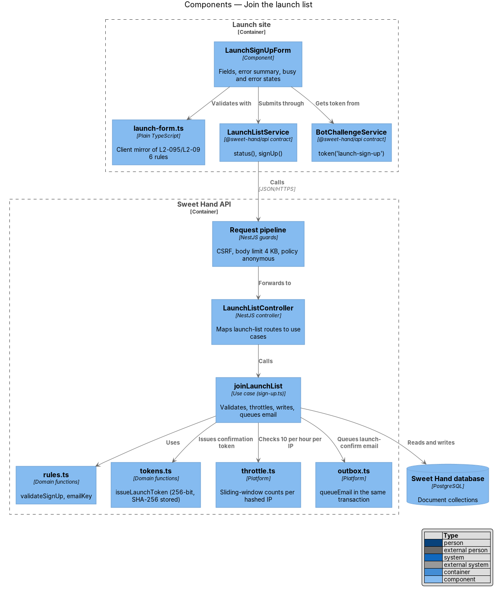
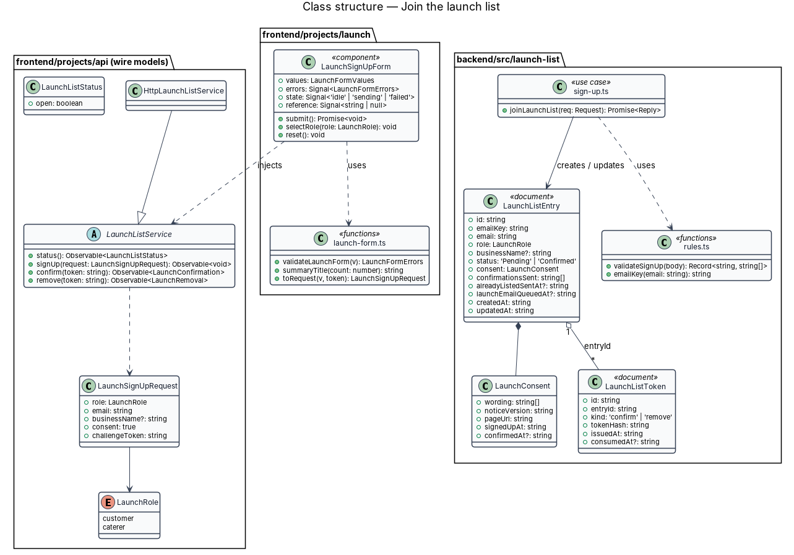
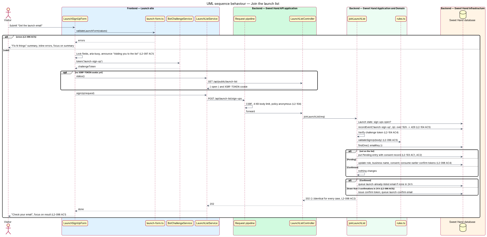
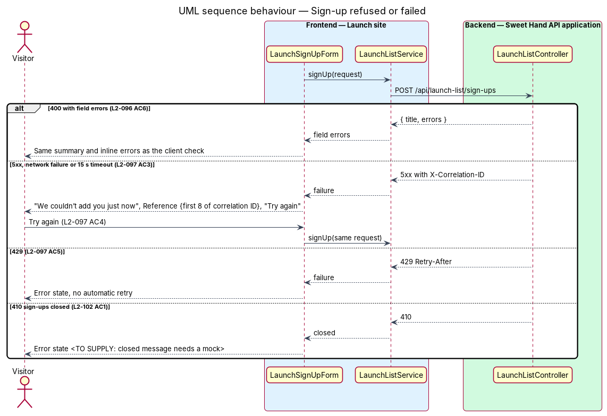

# Join the launch list

## Overview

Before Sweet Hand opens, a visitor can ask for one email on launch day (`L1-025`, assumption A-8). This feature is the sign-up form on the launch page and the API call behind it, shown in the mock states `default`, `caterer`, `invalid`, `submitting`, `error` and `success` of `docs/mocks/pages/launch/`.

> **launch list entry** — stored record of one email address on the launch list, with its role, optional business name, consent record and status

> **`Pending` entry** — launch list entry whose owner has not yet confirmed the address from the confirmation email

> **`Confirmed` entry** — launch list entry whose owner opened a valid confirmation link; only these receive the launch-day email

> **consent record** — evidence of express consent: the wording shown, the privacy notice version, the page URL and the UTC times of sign-up and confirmation

> **email key** — trimmed, lower-cased form of an email address, used to find an entry so that addresses differing only in letter case match

The visitor chooses "Planning an event" or "A caterer", enters an email, optionally a business name (caterers only), and ticks "Email me when Sweet Hand opens". A valid submission always ends in "Check your email", whatever the address's history, so the page never reveals who is on the list (`L2-098`). The confirmation link itself belongs to `launch/confirm-launch-list-email`; the removal link in every email belongs to `launch/leave-launch-list`.

## Description

**Frontend — Launch site (`frontend/projects/launch/src/app/sign-up/`)**

- **`LaunchSignUpForm`** (`launch-sign-up-form.ts`, `.html`, `.css`) — the form inside the sign-up panel of `LaunchPage`. It uses `sh-radio-group` with `variant="card"` and the legend "I’m…" for the role (`L2-107 AC3`), and inputs for "Business name (optional)", "Email" and the consent checkbox with the summary "One email, nothing else." and a "Privacy" link (`L2-095`). Neither role is selected and the box is unticked on every render of the form (`L2-103 AC3`).
  - The business name field renders only while `role === 'caterer'`, directly after the role group, and focus stays on the role card (`L2-095 AC2`). Choosing "Planning an event" hides it and `toRequest` drops its value (`L2-095 AC3`). `maxlength="60"` caps it (`L2-095 AC4`).
  - Attributes follow `L2-065`: `type="email"`, `autocomplete="email"`, `spellcheck="false"` on the email; `autocomplete="organization"` on the business name.
  - `submit()` runs `validateLaunchForm`. On errors it renders the error summary ("Fix 1 thing", "Fix 2 things", "Fix 3 things") with one link per error in field order, sets `aria-invalid` and `aria-describedby` on each field and moves focus to the summary (`L2-096 AC1` to `L2-096 AC3`, `L2-068`). Fixing a field clears its inline message at once (`L2-096 AC4`).
  - While sending, `state` is `sending`: radio and checkbox are disabled, text fields are `readonly`, the button has `aria-busy="true"` and `aria-disabled="true"`, and a polite live region says "Adding you to the list". A second activation is ignored (`L2-097 AC1`, `L2-097 AC2`).
  - On a 5xx, a network failure or no answer within 15 s, `state` is `failed`: an `sh-alert` (`role="alert"`) reads "We couldn’t add you just now" and "Your details are still here. Reference {reference}.", values stay, and the button reads "Try again" (`L2-097 AC3`, `L2-097 AC4`). `{reference}` is the first 8 characters of the `X-Correlation-ID` response header, or of a `crypto.randomUUID()` value when there is no response. A 429 shows the same state with no automatic retry (`L2-097 AC5`); its own message waits for a mock.
  - On a 400, the server's `errors` map to the same messages and summary (`L2-096 AC6`).
  - On success, `LaunchPage.panel` becomes `success`. The panel shows the `sh-empty-state` "Check your email" with "Confirm the link we sent to {email}." and a "Use a different address" link, focus moves to the result (`tabindex="-1"`), and a status region says "Check your email. We sent a confirmation link." (`L2-098 AC1`). "Use a different address" returns an empty form with no role and an unticked box and focuses the section heading (`L2-098 AC3`).
  - Values survive rotation because the form state lives in signals on the component, which does not re-create on resize (`L2-106 AC4`).
- **`launch-form.ts`** — plain TypeScript rules beside the form. `validateLaunchForm(values)` returns the messages "Choose one", "Enter an email like name@example.com" and "Tick the box to get the email". The email check accepts one `@`, a non-empty local part, a domain with at least one dot and a top-level part of 2 or more letters, and at most 254 characters after trimming. `summaryTitle(count)` uses an ICU plural (`@@launch.signUp.summaryTitle`). `toRequest(values, challengeToken)` builds `LaunchSignUpRequest`.

**Frontend — `@sweet-hand/api`**

- **`LaunchListService`** (`services/launch-list.service.ts`) — abstract contract: `status()`, `signUp(request)`, `confirm(token)`, `remove(token)`. **`HttpLaunchListService`** (`services/http-launch-list.service.ts`) implements it with `HttpClient` (ADR 0003).
- **Wire models** (`models/`, one type per file): `LaunchRole` (`'customer' | 'caterer'`), `LaunchSignUpRequest` (`role`, `email`, `businessName?`, `consent: true`, `challengeToken`), `LaunchListStatus` (`open`), `LaunchConfirmation`, `LaunchRemoval`. The backend imports them with `import type`.
- **`ProtectedAction`** gains `'launch-sign-up'`, in both `projects/api` and `backend/src/platform/bot-challenge.ts`.
- **CSRF cookie** — the page makes no request on load (`L2-105 AC5`), so the first submit may find no `XSRF-TOKEN` cookie. `HttpLaunchListService.signUp` first calls `status()` (`GET /api/public/launch-list`) when the cookie is missing; the request-context middleware sets the cookie on that response. Only the CSRF and bot-protection cookies are ever set (`L2-103 AC5`).

**Backend — `backend/src/launch-list/`**

- **`launch-list.controller.ts`** — `LaunchListController`:
  - `GET api/public/launch-list` with `@UsePolicy(anonymous)` returns `{ open }`, where `open` is false once the launch-day email has run.
  - `POST api/launch-list/sign-ups` with `@UsePolicy(anonymous)` and `@MaxBody(4096)` calls `joinLaunchList` (`L2-104 AC1`, `L2-104 AC6`). `CsrfGuard` applies as on every state change (`L2-104 AC3`).
- **`model.ts`** — the documents, through the persistence port (ADR 0008):
  - `LaunchListEntry` in collection `launchList`: `id` (`lle-<uuid>`), `emailKey`, `email` (trimmed, as typed), `role`, `businessName?`, `status`, `consent: LaunchConsent`, `confirmationsSent` (ISO times), `alreadyListedSentAt?`, `launchEmailQueuedAt?`, `createdAt`, `updatedAt`. Nothing else is stored (`L2-103 AC1`).
  - `LaunchConsent`: `wording` (`["Email me when Sweet Hand opens", "One email, nothing else."]`), `noticeVersion`, `pageUrl`, `signedUpAt`, `confirmedAt?` (`L2-103 AC2`).
  - `LaunchListToken` in collection `launchListTokens`: `id`, `entryId`, `kind` (`confirm` or `remove`), `tokenHash`, `issuedAt`, `consumedAt?`.
  - `LaunchState` in collection `launchState`, single document `launch`: `launchEmailRunAt?`, `launchDay?`.
- **`rules.ts`** — `validateSignUp(body)` checks on the server: `role` is `customer` or `caterer`; `email` is a string, at most 254 characters, in the format above; `businessName` is absent, or at most 60 characters after trimming and only with role `caterer`; `consent === true`; no field holds control characters, CR or LF (`L2-096 AC5`, `L2-104 AC7`). Failures return `invalid(errors)` (HTTP 400) with the form's messages. `emailKey(email)` trims and lower-cases (`L2-096 AC7`).
- **`tokens.ts`** — `issueLaunchToken(tx, now, entry, kind)` creates a token with `randomToken()` (32 random bytes) and stores only `sha256(token)` (`L2-104 AC2`). Issuing a `confirm` token consumes earlier unused `confirm` tokens of that entry. `findLaunchToken` hashes the presented token and looks the hash up with `findOne`, as `identity/tokens.ts` does. The comparison is between SHA-256 digests of 256-bit tokens, so its timing reveals nothing usable about a stored token (`L2-104 AC2`).
- **`sign-up.ts`** — `joinLaunchList(req)`, in the request's single transaction:
  1. Reads `LaunchState`. After the launch-day run it returns `gone(...)` (HTTP 410) and stores nothing (`L2-102 AC1`).
  2. Counts recent `launch-sign-up` events for the hashed IP with `recentEvents`. Above 10 in an hour it returns HTTP 429 with `Retry-After` (`L2-104 AC5`), then records the event.
  3. Awaits `req.env.challenges.verify(body.challengeToken, 'launch-sign-up')`. Production uses `TurnstileChallengeVerifier`, which requires provider success, the `launch-sign-up` action and an allowed Sweet Hand hostname. Tests use `LocalChallengeVerifier`, as does production while the operator keeps `BOT_CHALLENGE=off` before the Turnstile widget exists (`L2-104 AC9`, deploy-to-azure design). A missing or invalid token returns HTTP 400 and stores nothing (`L2-104 AC4`).
  4. Runs `validateSignUp`.
  5. Finds the entry by `emailKey` and applies the table in `L2-098`: a new address gets a `Pending` entry; a `Pending` entry takes the new role, business name and consent record; a `Confirmed` entry is left unchanged.
  6. For a new or `Pending` entry with fewer than 3 `confirmationsSent` in the last 24 hours, it issues a `confirm` token and a `remove` token and queues a `launch-confirm` email with `queueEmail` (`L2-098 AC5`, `L2-099 AC1`). For a `Confirmed` entry with no `alreadyListedSentAt` in the last 24 hours, it issues a `remove` token and queues `launch-already-listed`.
  7. Returns `accepted({})` (HTTP 202) in every case. Emails go out from the outbox, so the reply never waits for the email provider and its timing does not depend on the case (`L2-098 AC2`, `L2-098 AC6`).
- **Logging** — the use case logs counts and the hashed IP only; no email, business name or token (`L2-103 AC7`, `L2-084`).
- **Privacy notice** — the "Privacy" links open the privacy notice, which gains a launch list section stating purpose, data, processor and country, retention and how to leave (`L2-103 AC4`). Where the notice is served from before launch is `<TO SUPPLY>` and needs a mock. The notice version recorded in `LaunchConsent.noticeVersion` comes from that page's version.
- **Data location** — the collections live in the Sweet Hand database in a Canadian region, under `privacy/locate-data-and-record-breaches` (`L2-103 AC6`).

**Tests**

- `backend/test/launch-list/` drives `POST /api/launch-list/sign-ups` over HTTP against the in-memory database: validation, the three address cases with identical replies, the per-address and per-IP limits, the challenge and the 410 after launch.
- `frontend/e2e/specs/launch/join-launch-list.spec.ts` covers the six mock states through the `LaunchPage` page object, reading the queued email through the `/__test/` control API (ADR 0009).

## Requirements

The feature realizes the following level-2 (L2) requirements from `docs/specs/L2.md`. Each refines the level-1 (L1) requirement cited beside it. Requirement text is quoted from the specification, with *must* rendered as *shall*.

| L2 ID | Refines (L1) | Requirement |
|-------|--------------|-------------|
| `L2-095` | `L1-025` | The sign-up form shall ask for a role, an email address, an optional business name for caterers and express consent, and shall not ask for anything else. |
| `L2-096` | `L1-025` | The form shall check its fields before sending and show every problem at once, and the server shall check them again and reject anything invalid. |
| `L2-097` | `L1-025` | While a sign-up is being sent the form shall be locked against changes and second submissions. If sending fails, the visitor's details shall be kept so they can try again. |
| `L2-098` | `L1-025` | A successful submission shall always end in the same "Check your email" message, whether the address is new, pending or already confirmed, so the page never reveals who signed up. What happens next depends on the address, by email only. |
| `L2-103` | `L1-020` | The launch list shall collect only what it needs, record express consent, be covered by the privacy notice from the first day it collects anything, and keep its data in Canada. |
| `L2-104` | `L1-021` | The launch list API is open to anyone, so it shall resist abuse: guessing tokens, flooding inboxes, enumerating addresses and automated sign-ups. |

The field table in `L2-095`, the message table in `L2-096` and the address table in `L2-098` are summarised under `LaunchSignUpForm`, `launch-form.ts` and `joinLaunchList` in the Description.

## Diagrams

### System context

The visitor submits the form to Sweet Hand. Sweet Hand checks the bot-protection token and sends a confirmation email through the email provider.

### Containers

The launch site calls the Sweet Hand API. The API writes the entry, its tokens and the queued email in one transaction; the in-process worker sends the email.

### Components

`LaunchSignUpForm` validates with `launch-form.ts` and submits through `LaunchListService`. `LaunchListController` calls `joinLaunchList`, which uses the rules, the throttle, the token functions and the outbox.

### Class structure

A `LaunchListEntry` composes a `LaunchConsent` and owns any number of `LaunchListToken` documents. The wire model `LaunchSignUpRequest` crosses from the form to the use case.

### Behaviour — join the list

The form checks fields first. The server checks the launch state, the IP limit, the challenge and the fields, then applies the address table of `L2-098` and returns the same 202 in every case.

### Behaviour — refused or failed sign-up

A 400 shows field errors. A 5xx, network failure or timeout keeps the values and offers "Try again". A 429 or 410 shows the error state until their own messages are mocked.

